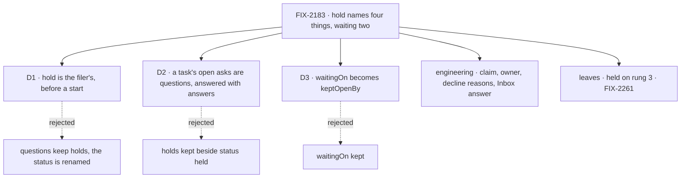

# FIX-2183 · Decisions

[Spec](SPEC.md) · **Decisions**

## D1 · *Hold* keeps one meaning: the filer's hold on a task that hasn't started

| | |
|---|---|
| **Decision** | Status `held`, `createTask({ held: true })`, `hold()`, `release()`, the `held` and `released` change kinds keep their names. Nothing else on the task surface says hold |
| **Instead of** | Keeping *holds* for a task's questions and giving the status a new word · qualifying every use ("filer hold", "question hold") |
| **Because** | A bare `held` in a row or a log names no releaser, so it has to be the meaning a reader assumes. "On hold" in English is a hold someone places and lifts, which is the filer's. It is the older, more taught surface (FIX-2080; every page and the concept's `updateTask` table), and FIX-2092 specs its phase steps on it (its D2, ER-4). Qualifying keeps four meanings and asks every reader to carry the qualifier (tenet 1) |
| **Locks in** | Status `held`, `held: true`, `hold()`, `release()`; the word hold for the filer's state alone |

It comes down to a bare `held`: renaming the status leaves "held on questions" still meaning two things.

## D2 · A task's open asks are `questions`, from filing to answering

| | |
|---|---|
| **Decision** | `Task.holds` → `Task.questions`; `TaskHold` → `TaskQuestion` (and the schema, row and suspension forms); `openHolds` → `openQuestions`, `hasOpenHold` → `hasOpenQuestion`; the Inbox's `InboxHold` → `InboxQuestion`, an item's `holds` → `questions`. `updateTask({ question })` → `updateTask({ answers })`. A task with an open question is *waiting on a user*, the word FIX-2214's reason already uses |
| **Instead of** | `holds` kept, now that D1 frees nothing else to collide · a new word (`asks`, `stops`, `waits`) |
| **Because** | A filer files `questions` and reads them back under `holds`: two words for one list. `updateTask`'s `question` carries an id beside `createTask`'s `questions` carrying prompts, and the steer it writes already stores that id as `answers` (`TaskSteer.answers`), so the tool and the record take one name. `ask` is the sweep's kept meaning and a field inside each entry; `ask` as a word is retired as a wait. *Stop* is a request ended from a screen; *wait* is a request's |
| **Locks in** | `Task.questions`, `TaskQuestion`, `openQuestions`, `hasOpenQuestion`, `InboxQuestion`, `updateTask`'s `answers`. A run's stop for approval, review or input, mirrored on its row, is listed as a question, its `ask.kind` saying which |

It comes down to the list a filer writes as `questions` coming back as `holds`.

## D3 · `waitingOn` becomes `keptOpenBy`, and filed work keeps its filer open

| | |
|---|---|
| **Decision** | `Task.waitingOn` → `keptOpenBy` (values `wait`, `filed`, `steer` unchanged), `TaskWaitingOn` → `TaskKeptOpenBy`, `setWaitingOn` → `setKeptOpenBy`; `endRules.filedWorkHolds` and the helper → `filedWorkKeepsOpen`, `holdsItsFiler` → `keepsFilerOpen` |
| **Instead of** | `waitingOn` kept, and `filedWorkHolds` → `waitsOnFiledWork` |
| **Because** | Once *waiting on a user* means an open question (D2), `waitingOn` answers the wrong question: it is `null` on a task asked midway and `wait` on one stopped for an approval, and never says user. Its own doc already defines it as "what keeps this running task open while no worker holds it". *Waits on filed work* would read as a request's wait on a task, which the concept keeps for `getTask({ wait: true })` |
| **Locks in** | `keptOpenBy`, `setKeptOpenBy`, `filedWorkKeepsOpen`. *Waiting* is a request's word (its wait, its session waiting) and the user's (*waiting on a user*), and no task field |

It comes down to `waitingOn` being silent on the one wait a reader most wants to see.

## Decided, not asked

- **The claim is the claim.** "A request holds a task" becomes "has the task's claim":
  `heldTask` → `claimedTask`, `heldTaskId` → `claimedTaskId`, `heldRowOf` → `claimedRowOf`,
  `ticketHoldsRow` → `ticketClaimsRow`. The concept already calls it the claim (rule 2, vocabulary).
- **A board has an owner.** "The session that holds the board" becomes "owns the board": Shift
  Manager's `holderSessionId` → `ownerSessionId`, `holderOf` → `boardOwnerOf`.
- **Decline reasons follow D2.** The write outcome `"held"` (refused while a question is open) →
  `"open-question"`; `"no-such-hold"` → `"no-such-question"`, which the tool already reports as
  `no_such_question`; the option `whileHoldOpen` → `whileQuestionOpen`; the internal `refuseWhenHeld`
  → `refuseWithOpenQuestion`. The status decline `held → errored` keeps its meaning.
- **A question closes; a held task is released.** A row question's `source.releasedBy` →
  `closedBy`, `HoldReleaser` → `QuestionCloser`. Release stays the filer's verb.
- **`HoldAsk` → `QuestionInit`,** the shape a filer or worker asks with, like `TaskInit`. Not
  `QuestionAsk`: the sweep's `ask-symbol` row refuses a new `…Ask…` identifier.
- **The Inbox client's `answerHold` → `answer`,** and task-tools' live `answerQuestion` helper →
  `answerTaskQuestion`, so FIX-2243's keep entry for it goes. No new name lands on
  `answerQuestion`, which FIX-2243 retires.
- **Prose:** "a question holds its task", "held on questions" and "a task held midway" become "a
  task waits on its questions" / "waiting on a user". The docs prose row in `RETIRED` refuses
  "held on (a|its) question", "question holds", "row hold", "suspension hold" and "open holds" in
  published pages; *held* beside a status stays.
- **Goal names.** `goals/task-board/holds-a-task-on-questions` → `waits-on-its-questions`, its
  verdict log kept. The KEEP entries in `one-word-per-thing/rules.mjs` that cite `TaskHold` are
  reworded to `TaskQuestion`.
- **Order with work in flight.** Builds after FIX-2070 (the epic). FIX-2241 part 2 (#4022) and
  FIX-2239 (#4020) use `holds` and `question`; whichever lands second carries the other's usage
  in its codemod. FIX-2092's builds take the new names if this lands first; its held steps need
  nothing (D1).
- **No second spelling.** Stores are reset ([epic D1](../../epics/FIX-2071/DECISIONS.md#d1)): no
  reader of `holds` or `waitingOn`. The one stored legacy read, `waitingOn: "queued"` read as
  `"filed"`, moves to `keptOpenBy` as it is.

## Considered and dropped

- **Rename only `Task.holds`.** The smallest change; it leaves `question` beside `questions` and
  `waitingOn` silent on a user wait, so the word is renamed twice, which Jake's comment rules out.
- **`stops` for the list.** PR-3 calls the event "a stop for a person", but *stop* is also a request
  ended from a screen (the concept's vocabulary), and a confirm asked at filing stops nothing.
- **Give `keptOpenBy` a `user` value.** It would let one field answer "why isn't this running?"
  for every case, but it changes what the claim gate writes. Not this issue's.

## Open

None.

## Settled

- **Counts and totality** re-derived by [`poc/inventory/check.mjs`](poc/inventory/check.mjs) on
  `main` at 78b0b07: every hold-shaped export in the covered modules is renamed or kept, and every
  retired head name is live. `--control` plants an unclassified export and fails (exit 1).
- **Actor `"system"` is never written** in package source (`git grep 'actor: "system"'` finds
  none), so every open question is the user's and *waiting on a user* is `hasOpenQuestion`.

## Analysis

Not run as a separate sub-agent for this rename-only spec: the epic's analysis (#3985) covered the
set's objectives, and this spec adds no mechanism. Reuse: two rows in the existing sweep and one
codemod in `scripts/codemod/`, nothing new.

## How it got here

- **Draft** — 2026-10-28: four meanings of hold and two of waiting mapped on `main`; hold kept for
  the filer's status, a task's asks named `questions` end to end, `waitingOn` named for what it
  says, building on the epic's sweep and codemods.
