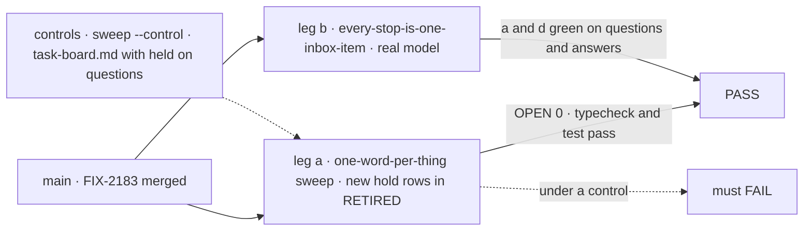
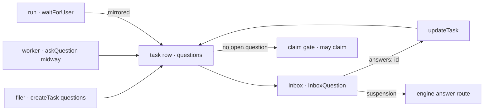

# FIX-2183 · "Hold" names four different things on the task surface

**Spec** · [Decisions](DECISIONS.md)

## Five readers, before and after

| Someone who… | Today | After |
|---|---|---|
| **reads `held` on a task row or in a log** | Can't tell if the task has started, waits on a user, or waits on its filer: status `held`, a row with open `holds`, and "held on questions" all say it | `held` is a status, and only the filer's: the task hasn't started, and the filer releases it |
| **files a task with questions, then reads it back** | Files `questions`, reads them back under `holds`, and answers one with `updateTask({ question: <id> })` | Files `questions`, reads `questions`, answers with `updateTask({ answers: <id>, message })`, the field the stored steer already calls `answers` |
| **reads why a running task has no lease** | Reads `waitingOn`, which is `null` on a task that waits on a user's midway question | Reads `keptOpenBy` (`wait`, `filed`, `steer`); a task waits on a user exactly when it has an open question |
| **writes a task entry's `endRules`** | Passes `filedWorkHolds`, the third meaning of hold | Passes `filedWorkKeepsOpen` |
| **reads the task-board page or the coordination concept** | Meets "a question holds its task", "the request holds the task", "the session that holds the board", and status `held` in one page | Meets one word per state: held, questions, kept open, claim, owner |

FIX-2056's wrap analysis filed this, and the [FIX-2071 epic](../../epics/FIX-2071/SPEC.md) took it
as its one spec-route child, since its names are a decision ([D2](../../epics/FIX-2071/DECISIONS.md#d2)).
It goes before FIX-2243, so the task collection's names change once.

## The goal, and how we'll know it's met

**A reader who meets *hold* or *waiting* on the task surface (a task row, a model's tool, a log,
the orchestration README, the task-board page, the coordination concept) finds one thing for
each word: *held* is a task its filer hasn't released, and a task's questions, what keeps a
running task open, a request's claim and a board's owner each have a name of their own.**

| Is it the right goal? | |
|---|---|
| **The real need** | The issue: "Together a developer can't tell from `held` in a row, a log or a doc whether the task has started, whether it's waiting on a person, or whether anything will release it on its own." Jake on the issue: this spec owns *waiting* as well as *hold*, "so the word isn't renamed two ways" |
| **Smaller, and rejected** | "Rename `Task.holds` and stop." It leaves `updateTask({ question })` taking an id beside `createTask({ questions })` taking prompts, `waitingOn` silent on a task that waits on a user, and `filedWorkHolds` |
| **Bigger, and not this issue's** | Behaviour: whether status `held` belongs on rung 3 of the board's termination ladder (it reports `blocked-by-failures` today), and whether `keptOpenBy` should name a midway question. Each is a behaviour change, out of scope for the issue and the epic |
| **Not done if** | A retired identifier in [`renames.md`](../../epics/FIX-2071/renames.md#decided-by-fix-2183) is in package source off a `retired-name-refusal` line · a page teaches "a question holds its task" or "held on questions" · `getTask` returns `holds` · the `updateTask` tool takes `question` · status `held`, `held: true`, `hold()`, `release()` or FIX-2092's held steps changed name · a name is kept as an alias |



The sweep proves no retired spelling is left; the real-model goal proves a model still files,
reads and answers questions under the new names.

| How we verify | |
|---|---|
| **Goal check** | Leg a: `node goals/vocabulary/one-word-per-thing/sweep.mjs`, with this spec's rows added to `RETIRED` (an identifier row and a docs prose row). Leg b: `goals/shift-manager/every-stop-is-one-inbox-item`, real model `openai/gpt-6-luna`, run by the implementer at completion, verdict in the implementation PR |
| **Signal** | Leg a: OPEN 0, no unruled file; `pnpm typecheck` and `pnpm test` pass. Leg b: `a:six-items`, `a:rows-read` and `d:answer-by-id` green, reading `questions` and sending `answers` |
| **Input** | The repository on the implementation PR's head; leg b's words picked at run time (`pickWords`), as today |
| **Anti-game** | `RETIRED` only grows; a KEEP entry strips a line for a stated reason, never a file. Leg b reads the page and `getTask`, never the codemod |
| **Control that must fail** | `sweep.mjs --control` plants `openHolds` in a file it reads; adding "a task held on questions" to `task-board.md` fails the prose row; leg b on the commit before the build fails `a:rows-read` (no `questions` on the row). The PR shows each FAIL before the PASS |

## What changes


Before, *hold* named four things and *waiting* two. After, each state has one word.

```diff
 // a filer
 await createTask({ goal: "Write the adoption script", questions: ["Which CSV export?"] });
-const { holds } = await getTask({ id });
-await updateTask({ id, question: holds[0].id, message: "orders-v2.csv" });
+const { questions } = await getTask({ id });
+await updateTask({ id, answers: questions[0].id, message: "orders-v2.csv" });

 // a task entry
-taskRequestAdmission({ find, endRules: { filedWorkHolds } });
+taskRequestAdmission({ find, endRules: { filedWorkKeepsOpen } });

 // a reader of a row
-if (task.waitingOn === "filed") …      if (hasOpenHold(task)) …
+if (task.keptOpenBy === "filed") …     if (hasOpenQuestion(task)) …

 // a screen's Inbox
-inbox.answerHold(item.holds[0], { text: "orders-v2.csv" });
+inbox.answer(item.questions[0], { text: "orders-v2.csv" });

 // unchanged: the filer's hold
 await createTask({ goal, held: true });
 await updateTask({ id, status: "pending" });
```

The full table, one row per retired head name with what it becomes and its file counts, is in the
epic's [`renames.md` → Decided by FIX-2183](../../epics/FIX-2071/renames.md#decided-by-fix-2183).
Derived spellings (locals, files, test ids) follow their head name and are the implementer's
call, under the epic's rule: one that would land on a retired name stops and comments up.



**Docs:** update `apps/docs/docs/orchestration/task-board.md` (the sections *A task held on
questions*, retitled *A task's questions*, *A task waiting on a user*, the `updateTask` field table,
*Building an Inbox*, `endRules`), `task-substrate.md`, `glossary.md` (Task, Inbox),
`apps/docs/guides/human-in-the-loop.md`, `apps/docs/docs/workforce/coordinators.md` where it names
holds, and the `orchestration`, `workforce`, `harness-manager` and `shift-manager` READMEs. Internal:
the coordination concept's vocabulary, *Inbox items* and the `updateTask` table
(`docs/internal/design/workforce-coordination-concept.md`) and the gaps file's
words-that-collide table, which gains a *Hold* row. A changeset for `@flow-state-dev/orchestration`
and `@flow-state-dev/workforce` names every renamed public name.

## What stays as it is

- **Behaviour.** No write, read, claim or release changes. A rename that needs one stops and comments up.
- **The filer's hold.** Status `held`, `createTask({ held: true })`, `TaskCollectionRef.hold()` and
  `release()`, `patchSettings({ held })`, the `held` and `released` change kinds, `counts.held`,
  `heldFromBlocked`, and FIX-2092's held phase steps ([D1](DECISIONS.md#d1)).
- **The board's reason `"waiting-on-a-user"`** (FIX-2214) and `goalSeekLoop`'s: already the name for
  a task with an open question.
- **A question's `ask` (`kind`, `prompt`)**, its `kind` values, `actor`, `due`, `midway`, and the
  `asked` and `answered` change kinds. `ask` is the sweep's kept meaning, a question to a user.
- **`Task.wait`, the wait slot (FIX-2082), `wait_changed`, `waitOnTask`:** a request waiting on a
  task. **A session's *waiting*** (holding a suspended request). **`queuedBehind`** (FIX-2239) and
  **`call`** (FIX-2070).
- **Hold outside the task surface:** a checkout's held work (`workspace`, `harness-manager`), a lock
  or lease a process holds, `canHoldWait`, and *hold* as an ordinary English verb ("the rows it holds").

## What's already here, and the debt

| Already here | What this does with it |
|---|---|
| FIX-2080's held start: status `held`, `hold`, `release`, `held: true` | **Kept**: it becomes the one meaning of hold |
| FIX-2133's holds (`specs/issues/FIX-2133/`, its D2: "one list of holds, `Task.holds`, whatever the row's status") and FIX-2058's ER-8 ("the word stays hold; FIX-2071 renames it") | **Amends** the names only: the one list is `Task.questions`; D2's single list and its one write stay |
| FIX-2077's `waitingOn` (D1) and `filedWorkHolds` (rule 6) | **Amends** the names: `keptOpenBy`, `filedWorkKeepsOpen` |
| FIX-2214's `"waiting-on-a-user"` reason | **Kept**, and now it is the one meaning of "waiting on a user" |
| The coordination concept's vocabulary rows "held on questions … never waiting on a person" and "waiting on a person: its request suspended by `waitForUser`" | **Superseded**: PR-3 made both one Inbox item over one list; one state, *waiting on a user*, an open question, of any `ask.kind` |
| FIX-2092's D2 and ER-4 (#3970): phase steps filed held, released with `updateTask({ status: "pending" })` | **Unchanged** by D1. Its prose about a suspension hold reads "a question on the feature row" once this lands |
| `goals/vocabulary/one-word-per-thing` (FIX-1876), extended by the epic | **Extended**: two rows; its KEEP reasons that cite `TaskHold` are reworded |
| FIX-2243's row: harness-manager's `answerQuestion()` retired, with task-tools' live `answerQuestion` helper kept by file | **Ends the keep:** the helper is renamed `answerTaskQuestion`, so the identifier is nowhere live |

| Builds on / Adds | Existing piece considered | Why that doesn't fit, or how this is composed |
|---|---|---|
| A sweep row for retired hold identifiers, and a prose row for the docs | `scripts/check-retired-terms.mjs` (prose words, Workforce paths) | The identifier sweep is the epic's one list ([D2](../../epics/FIX-2071/DECISIONS.md#d2)); the prose row goes there too, scoped to the published docs, since the task board is orchestration's, outside the prose guard's paths |
| A codemod in `scripts/codemod/` | FIX-595's type-aware codemods | **Builds on**, as every child does |

| The debt | |
|---|---|
| **Removes** | Four meanings of hold down to one; two meanings of "waiting on a user" down to one; `question` beside `questions`; the `answerQuestion` keep entry |
| **Adds** | Two sweep rows |
| **Leaves** | Status `held` on rung 3 of the termination ladder reports `blocked-by-failures`, though a held task waits on its filer, not a failure: a behaviour question, filed as [FIX-2261](https://linear.app/fixpoint-labs/issue/FIX-2261) |

**Net: down.** No mechanism; fewer meanings per word, one fewer keep entry.

## Sign off

**[The goal](#the-goal-and-how-well-know-its-met):** every hold and waiting meaning on the task
surface, the model's tools and the docs included, not only `Task.holds`. If wrong: about 170 files
change where 60 would have done.

**[The debt](#whats-already-here-and-the-debt): down.** If wrong: a fifth meaning appears and the
sweep doesn't catch it.

1. **[D1](DECISIONS.md#d1) · *Hold* keeps one meaning: the filer's hold on a task that hasn't
   started.** It comes down to a bare `held` in a row: it names no releaser, so it must mean the
   one thing a reader assumes. If wrong: the status gets a new word later, and FIX-2092 re-specs.
2. **[D2](DECISIONS.md#d2) · A task's open asks are `questions`, from filing to answering, answered
   with `updateTask({ answers })`.** It comes down to one list read back under a second name. If
   wrong: a run's approvals listed as questions confuse a reader, and they get a list of their own.
3. **[D3](DECISIONS.md#d3) · `waitingOn` becomes `keptOpenBy`, and filed work keeps its filer
   open.** It comes down to `waitingOn` being `null` on a task waiting on a user. If wrong: about
   50 files renamed for a word a reader would have learned.

**Decided, engineering:** the claim and board-owner words, the decline reasons, the Inbox client's
`answer` ([Decided, not asked](DECISIONS.md#decided-not-asked)). **Open:** none.

Improvement · `orchestration`, `workforce`, `harness-manager`, `shift-manager`, `devtool` + docs ·
medium (one codemod, about 170 files, no behaviour) · 1 PR · build after FIX-2070, before FIX-2243 ·
epic FIX-2071
