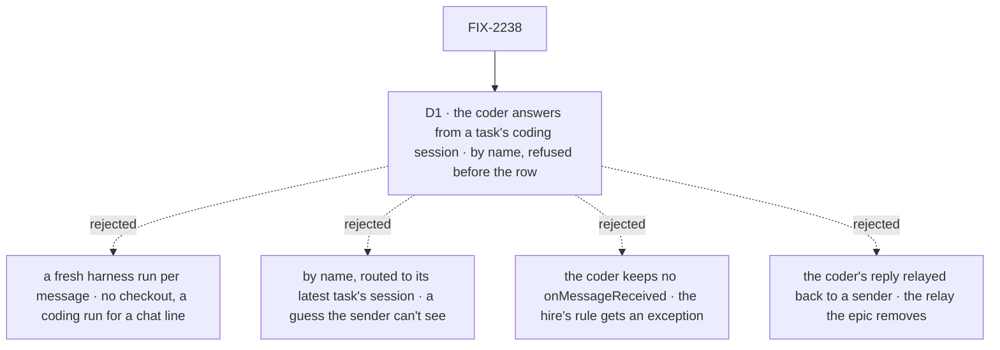

# FIX-2238 · Decisions

[Spec](SPEC.md) · **Decisions**

The epic decided the model ([FIX-2070](../../epics/FIX-2070/DECISIONS.md)): one entry, `onMessageReceived`;
one tool, `sendMessage`; no relay; every worker receives and the hire checks it; where a message
lands; one budget per typed message; the old names removed (ER-1, ER-2, ER-6, ER-7). One call is
left for this issue: what the coder, which has no conversation of its own, does with a message.

This spec reads epic ER-6's "no session starts a chain of its own except a user's turn and a
released held task" with the concept's own words, "a request with nothing behind it, such as a held
task once it's released, gets a fresh 6": a request whose turn and session carry no chain (a door
that marks no user's turn, a scheduled filing) starts one. Recorded here so no child reopens it.

## The tree

Solid edges are what you're signing. Dashed edges lost, and the label says why.

## D1 · The coder hears messages only in its tasks' sessions; by name, refused before the row

*A product call: the epic says every worker receives, and the coder can only answer from a coding
session it has already run.*

| | |
|---|---|
| **Instead of** | Starting a fresh harness run for every message to the coder by name; or routing a message by name to the coder's latest task's session |
| **Because** | The coder's only model is its coding harness, and its only memory of the work is a task's coding session: today's door resumes that session for a line in a finished task's session and refuses a line anywhere else (`harness-manager/session-door.ts`, `not-started`). A fresh run would answer "does the CSV have a month column?" with no checkout and spend a coding run on a chat line. Routing by name to the latest task guesses which work the sender meant, and the sender can't see the guess. The coder has no send tool, so it answers with its reply in the task's session: the person sees it there, and a call (FIX-2239) returns it as the result. Relaying that reply to a plain send's sender would bring back the relay the epic removes. A refusal at the send, before the row, costs nothing and names the coder's tasks, which FIX-2160's `{ task }` target reaches ([tenet 2](../../../docs/philosophy.md): no second way to start a coding run) |
| **Locks in** | `messageReceivedEntry`'s `hears: "task-sessions"`, read by the send from the recipient flow's entry; refusal `task_sessions_only`, before anything is written, paying nothing. Here the coder mounts `onMessageReceived` with no turn (the hire's rule holds); FIX-2160 adds `harnessTalkTurn`, the door's resume path, when `{ task }` first reaches a coder's task session. A plain send to it gets no message back; a call gets its reply. The epic's closure leg a ("writer calls coder") calls one of coder's tasks, not the coder by name |

**What would change my mind:** a lab where workers need the coder's view with no task between
them, such as "which of our repos uses pnpm?". Then a message by name starts a read-only harness
run in the conversation's project.

It comes down to where the coder's knowledge lives: in a task's coding session, and nowhere else.

## Decided, not asked

- **One entry factory, `messageReceivedEntry`, outside the board kit.** Today's `workerMessageEntry`
  renamed and freed, so the coder, the error reporter and test-mode flows mount it without the
  delegation board. The session kit's `entries(turn)` still spreads it. A flow with no turn (a
  test-mode control) passes none: the message lands as an item and nothing runs.
- **The hire checks `onMessageReceived` as it checks `respond`:** a `messageReceivedProblem` beside `doorProblem`
  (`worker-door.ts`), role-independent, called from `workerFlowProblems`: the entry is there, its
  input schema takes the probe `{ messageId }`, and it carries `messageReceivedEntry`'s one mark. That mark
  holds `hears` and is not a role (no `markRolePiece`); it exists because the send reads `hears`
  off the mounted entry. One reader of it serves the hire, the send's refusal and the tool's list
  of who a send by name reaches. The convergence point is
  `workerFlowProblems`: the hire, the inventory and `workerFlowProblems`' callers all pass through
  it. Every worker flow in `packages/`, `apps/`, `goals/` and the test fixtures that has none gets
  the entry; the error reporter, which already offers the tool, starts hearing.
- **Two shapes, one source.** The entry's dispatch payload stays `{ messageId }`, strict, so a
  sender can shape nothing (BP-031); the entry reads the row and hands its turn `onMessageReceived`'s input,
  `{ id, from, text, call, inReplyTo?, budget }`, every field from the row and the chain. `call` is
  always `false` until FIX-2239. `budget` is the limit less the chain's count after this message.
  The hire probes the entry with `{ messageId }`.
- **A received message is two items, both existing types:** a `message` line visible to history
  only (the model reads it as today), and a client-only `component` keyed `workforce:received`
  carrying `{ id, from, text, inReplyTo? }` for the screen. No new item type and no change to
  `contracts` (Layer 1 holds no Workforce concept). Shift Manager draws the component and drops its
  text-prefix detection.
- **No relay.** `workforceRelayTo` and the relay handler go. The woken turn's prompt says how to
  answer with `sendMessage` and `inReplyTo`, and that silence is an answer.
- **An answer lands in the session that sent the original,** a task's session included after its
  task ended; FIX-1989's redirect to the sender's conversation goes (epic ER-2). A message from a
  task's session to the worker that filed it lands in the session that filed it.
- **Where a chain starts:** a user's turn (`markUserTurn`), the first turn of a task released from
  a hold it was filed with (a midway question's hold carries its budget on, as the concept says), and
  a request with nothing behind it: the send mints one only when neither the turn nor its session
  carries a chain, as today for a door that marks no user's turn (DevTeam's EM, test fixtures). The
  leak closes at the source: a delegate's ongoing session is born with its filer's hop and chain
  (`carriedHopState`, as a task session is, `board.ts`), so its notice, steer and `routeOn` turns,
  and a task turn whose filing mark a user's line cleared, count on in that chain.
- **A send is paid with its row.** The place in the chain is taken only after every check passes,
  with the row write; a send refused at the budget or the per-request limit leaves no id in the
  chain row. "Per turn" becomes "per request" in the text; `hireWorkforce`'s `perTurn` keeps its
  name (FIX-2071).
- **Only messages spend.** Filing a task never does, as today. FIX-2241's server-sent question is
  exempt; FIX-2241 builds that path.
- **Removed outright, with no alias** (epic ER-7, FIX-2056 (e)): the entry and tool names, the
  exports `takesWorkerMessages`, `sendWorkerMessage` (renamed `sendMessage`'s server function),
  `messageWorkerInputSchema`, `SendWorkerMessage`, `workerMessageInputSchema`, and `replyTo` on
  rows. FIX-2249 adds them to the retired-terms check.

## Considered and dropped

- **A new conversational item type for a received message.** It would put a Workforce concept in
  `contracts`, and a `message` line plus a `component` already carry everything the screen and the
  model need.
- **Refusing a send in a turn with no chain (`no_budget`).** It refuses doors that mark no user's
  turn today, such as DevTeam's EM, and the leak it aimed at is closed by the ongoing session's birth.
- **Keeping `takes_tasks_only` for any flow without the board kit.** That is today's rule, and it
  is why the error reporter can send but not hear. `hears` is declared by the recipient, for the
  one worker that needs it.

## Open / Settled

**Open: none.**

No counted facts rest on hand derivation; the reference counts in [SPEC.md](SPEC.md) came from a
search the implementer re-runs, and the sweep is FIX-2249's check.

## Analysis

2026-10-27, a fresh reviewer at spec altitude, with `reuse-review` on Builds on / Adds. Verdict: the right work, the base child of the epic. Reuse: `messageReceivedEntry` extends `workerMessageEntry`; `hears` extends `recipientRefusal`; the received item reuses `message` and `component`. Folded: the coder can't answer a plain send (no send
  tool), so D1 says it answers with its reply and a call returns it, and its talk turn moves to
  FIX-2160; `no_budget` dropped for the ongoing session's birth; the two input shapes named; the
  ring leg sets up a cleared filing mark and its control reverts the birth; the debt counts the
  renamed refusal and the renderer entry. Blind goal review, folded: the goal names every landing,
  the item, the server-set fields, the sweep and the per-request cap, and every signal has a
  control.

Recorded for the implementer, not folded:

- Paying only on success means a conditional append inside the chain row's guarded update, with
  the per-request reservation moved after the budget check (`send-message.ts`).
- The coder flow (`coder.mts`) uses `installation.session()` with no extra shape: add the hop and
  seen-message state the entry keeps.
- The round-robin coordinator's `onMessageReceived` runs its agent turn: the goal's hire must name a model.
- "Held from its filing" is a hold without `midway` (`orchestration/.../holds.ts`); a task set
  `held` by `updateTask` before it starts counts as held from its filing.
- The send tool's description lists only workers a send by name would reach, so not the coder.
- The two items of a received message come from one helper, and the dedupe on the message id runs
  before either is appended or the turn runs: until FIX-2240 a dispatch can be tried twice.
- A person's line in a finished task's session runs `respond` there without `markUserTurn` today
  (`user-turn.ts` skips task sessions); whether it starts a fresh 6 is the concept's "one budget per
  message a user types", so mark it.

## How it got here

- **Draft** — framed as the base child of FIX-2070: one entry and one tool over FIX-1989's log,
  dedupe and hop chain, the relay and two refusals removed, the chain made the budget; D1 settles
  the coder as the one worker that hears only in its tasks' sessions.
- **Analysis fold** — the coder answers with its reply (no send tool) and its talk turn moves to
  FIX-2160; the budget's leak closes at the ongoing session's birth instead of a `no_budget` refusal.
- **Review fold** — the hire check is `messageReceivedProblem` beside `doorProblem`; the entry is
  renamed `onMessageReceived` (the owner's call, 2026-10-27), here, in the epic's spec and in the
  design docs.

## Notes from review

- **Cursor simplify review (#3986), folded:** the hire check is a `messageReceivedProblem` beside
  `doorProblem` and the entry's one mark carries `hears`, with one reader (not a role mark); the
  feature line drops `harness-manager`, whose door FIX-2160 owns. Noted for the implementer: one
  helper writes the received message's two items, after the dedupe.
