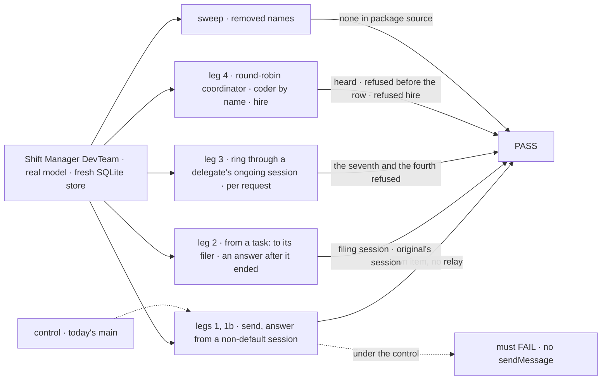
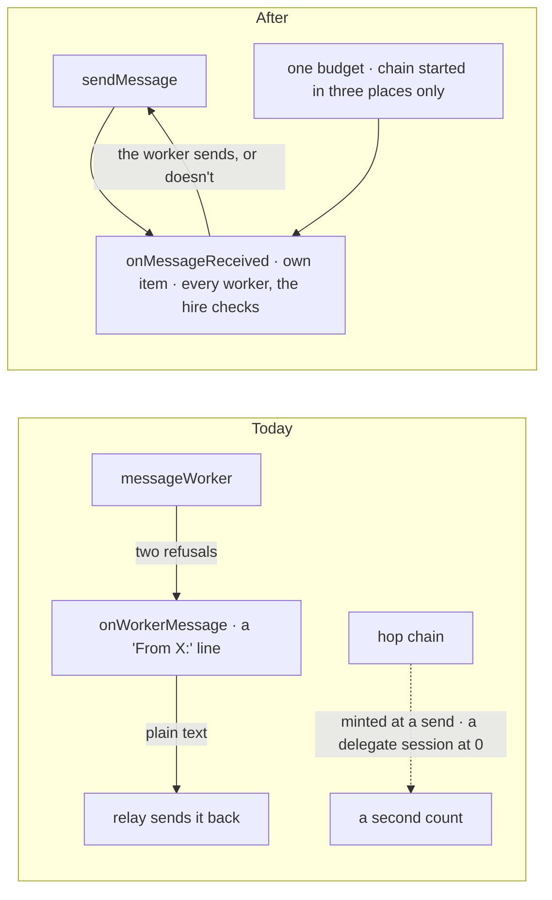
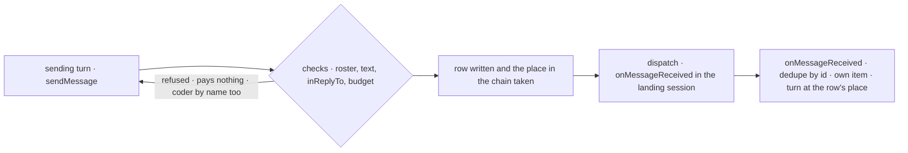

# FIX-2238 · A worker hears a message on `onMessageReceived`, sent with `sendMessage`

**Spec** · [Decisions](DECISIONS.md)

## Six people, before and after

| Someone who… | Today | After |
|---|---|---|
| **builds a worker that talks to another** | Gives its model `messageWorker({ to, text, replyTo? })`. A woken worker that ends with plain text has that text sent back as an answer for it | Gives it `sendMessage({ to, text, inReplyTo? })`. Nothing is relayed: a worker that wants to answer sends one |
| **watches a worker's conversation in Shift Manager** | Sees a plain assistant line, `From researcher: …`, which the app finds by its text prefix | Sees a received message as its own item: sender, message id, and the message it answers. The model still reads it as a line in its history |
| **messages a coordinator that routes round robin or to everyone** | Is refused `no_turn`: "nobody would read a message" | The coordinator's own turn reads it, as a judgment coordinator's does |
| **messages the coder by name** | Is refused `takes_tasks_only`: "file a task instead" | Is refused before anything is written, `task_sessions_only`: the coder has no conversation to answer from, only its tasks' coding sessions. It carries an `onMessageReceived` that hears in those sessions; FIX-2160's `{ task }` target reaches them, and a call (FIX-2239) gets its reply ([D1](DECISIONS.md#d1)) |
| **messages from a task, and gets an answer after the task ended** | The answer goes to the sender's own conversation, because "nothing runs there again" | The answer lands in the task's session that sent the original, and `onMessageReceived` runs there with that session's history (epic [ER-2](../../epics/FIX-2070/DECISIONS.md#who-owns-what)) |
| **runs a ring of workers passing messages on** | 6 messages per user's line and 3 per turn, but a delegate's ongoing session or a send with no chain starts a fresh count, and a refused send has already spent its place | One budget per message the user types: 6 in all, 3 per request, a fresh 6 only for a user's line, a task held from its filing and then released, or a request with nothing behind it. A delegate's ongoing session counts on in its filer's budget. A refused send pays nothing. `onMessageReceived` is told what is left |

The hire refuses a worker flow without `onMessageReceived`, as it refuses one without `respond`. The old
names go with no alias (epic [ER-7](../../epics/FIX-2070/DECISIONS.md#who-owns-what)).

## The goal, and how we'll know it's met

**Every worker on a person's roster, any coordinator included, hears another worker's message on
one entry, as its own item with a sender the server set, and sends with one tool; a message lands
where the epic says (the default or project conversation, the filer's session, the original's
session for an answer); the old names are gone; and every message one typed line causes, through
any path, counts against one budget of 6, at most 3 per request. The coder is the one worker that
hears only in its tasks' sessions ([D1](DECISIONS.md#d1)).**

| Is it the right goal? | |
|---|---|
| **The real need** | The epic's goal: "a worker can message any worker, task or conversation of its user … Every message lands once, in the session it is about, inside one budget per typed message" ([epic SPEC](../../epics/FIX-2070/SPEC.md)). This issue is the part every other child builds on: the entry, the tool, the landing rules and the budget ([ER-1, ER-2, ER-6, ER-7](../../epics/FIX-2070/DECISIONS.md#who-owns-what)) |
| **Smaller, and rejected** | Rename `onWorkerMessage` and `messageWorker` and stop. Two guessed refusals stay, a round-robin coordinator stays unreachable, the coder has no entry at all, the relay keeps answering for workers, and a ring through a delegate's session escapes the budget |
| **Bigger, and not this issue's** | `{ task }` and `{ session }` targets (FIX-2160) · a call that waits (FIX-2239) · delivery that survives a crash (FIX-2240) · a task's midway question to its filer (FIX-2241) |
| **Not done if** | A worker flow without `onMessageReceived` is hired · a coordinator is unreachable because of its routing · a woken worker's plain text reaches the sender · `onMessageReceived`'s `from`, `call` or `budget` can be set by tool input · a received message is plain text, not its own item · a message to the filer lands outside the filing session, or the project coordinator's outside the project conversation · an answer lands anywhere but the original's session · a ring through a delegate's ongoing session or a scheduled task sends a seventh message · a request sends a fourth · a send refused at the budget leaves its place spent · filing a task spends budget · a task held from its filing gets no fresh 6 when released · the coder's refusal comes after the row is written · a removed name is still in package source |



The check reads the conversations' stored items, the turns' tool outputs and the message log, through the person's own clients.

| How we verify | |
|---|---|
| **Goal check** | `goals/shift-manager/workers-message-each-other/`, amended in place (its legs keep their names; FIX-1989's `2:lands-in-own-conversation` and `4:coder-refused` are replaced). Real model, run by the implementer at completion with `pnpm tsx goals/shift-manager/workers-message-each-other/run.mts`; PASS is every leg in 3 of 3 runs, as that goal's verdict log does; verdict in the implementation PR. The model-free parts (the hire, the budget's places, the sweep) are also `packages/workforce` CI tests |
| **Signal** | `1:own-item` the recipient's conversation holds one received-message item with `from`, the id and no `inReplyTo`, and its turn ran. `1:no-relay` a woken worker told to answer in plain text runs a turn, and the sender's stored items gain no received item from it. `1b:in-reply-to` an answer sent with `inReplyTo` to a message sent from a non-default session lands in that session as an item naming the original. `2:to-filer` a task's message to its filer lands in the filing session. `2:lands-in-task-session` an answer to a message sent from a task's session lands there after the task ended, and a turn runs there. `3:ring-stops-at-6` a ring that passes through a delegate's ongoing session, after a user's line in the filer's conversation has cleared the filing's mark, shows exactly 6 sent and a seventh send refused `budget`; `3:per-request` a fourth send from one request is refused; `3:refused-pays-nothing` the refused send's id is in no row the Messages view lists, and the ring's next line after a new user line starts at hop 1; `3:budget-left` each `onMessageReceived` item's budget counts down. `4:round-robin-heard` a round-robin coordinator's own `onMessageReceived` turn runs and writes in its conversation. `4:coder-refused` a message to `eng.coder` by name is refused `task_sessions_only` and writes no row. `4:sender-not-settable` a call naming `from`, `call` or `budget` is refused at the tool, and no row names another sender. `4:hire-refuses` a hire with a flow without `onMessageReceived` is refused naming it, and the same hire with the entry passes. `sweep` the ER-7 names have no references in `packages/*/src`. Today's legs 2b, 3b and 5 are kept as they are |
| **Input** | DevTeam's workers as today's goal hires them, plus `rr-lead`, a coordinator hired with `routing: "round-robin"` and Helper A as its delegate. The ring and the delegate's ongoing session are induced as today's leg 3 and 3b do (instructions to pass every message on; Helper A files Helper B a task routed to its ongoing session). A different valid input: any roster worker as sender and recipient; the legs pick ids at run time |
| **Anti-game** | Sends counted from each turn's own tool outputs; receipts and relays from stored session items; nothing from a helper's return. Nothing seeded; `budget` checked against a tool call that names it, which is refused |
| **Control that must fail** | Today's `main`: every leg fails, `1:own-item` first (there is no `sendMessage` tool). `GOAL_CONTROL=relay-back` fails `1:no-relay`. `ongoing-at-0` (a delegate's ongoing session born with no hop or chain, as today) fails `3:ring-stops-at-6`. `refuse-at-receive` (the coder's refusal decided by its entry, after the row) fails `4:coder-refused`. `answer-to-conversation` (FIX-1989's redirect) fails `2:lands-in-task-session`. `no-turn-back` (the `no_turn` refusal restored) fails `4:round-robin-heard`. `no-hire-check` fails `4:hire-refuses`. `pay-first` (the place taken before the checks) fails `3:refused-pays-nothing`. The PR shows each FAIL before the PASS |

## What changes



One entry and one tool replace two names, a relay and two refusals, and the hop chain becomes the
one budget.

An app's own worker flow that carries the session kit changes in one line:

```diff
 const answer = generator({
   name: "em-answer",
-  uses: [board.tools, board.messages],   // messageWorker
+  uses: [board.tools, board.messages],   // sendMessage
   ...
 });
 return defineFlow({
   ...
-  internal: { actions: board.entries(answer) },   // onWorkerMessage
+  internal: { actions: board.entries(answer) },   // onMessageReceived
 });
```

A worker flow without the kit, such as a coding worker, mounts the same entry with its own turn:

```diff
 internal: {
   actions: {
     [STEER_TURN_ENTRY]: ...,
+    [MESSAGE_RECEIVED_ENTRY]: messageReceivedEntry({ installation, flowKind: "coder", hears: "task-sessions" }),
+    // FIX-2160 adds `turn: harnessTalkTurn(...)`, the door's resume path, when { task } reaches it
   }
 }
```

**Docs:** update `apps/docs/docs/workforce/messaging-workers.md` (the tool, `onMessageReceived`, answering
with `inReplyTo` and no relay, the budget, the refusals table without `takes_tasks_only` and
`no_turn`, the coder's refusal), `delegating-work.md` and `ui.md` (names),
`shift-manager/overview.md` (the received item); `packages/workforce/README.md` → Worker messages
and the exports table; `packages/shift-manager/README.md`; the concept's entries table
(`waiting` → `call`). A changeset for `@flow-state-dev/workforce` (removed exports).

## How a message travels



## What stays as it is

- The message log (`workforce/messages/*`) and the Messages view: rows keep every field, with
  `replyTo` renamed `inReplyTo` and a target kind added (stores are reset between the refactor
  epics, epic seam table).
- Two dispatch tries, then `unconfirmed`: FIX-2240 replaces them. `call` is always false here:
  FIX-2239 sets it.
- `hireWorkforce`'s `messages: { hopLimit, perTurn }`: same names and defaults, now described as
  the budget. FIX-2071 owns any rename.
- A message never steers, holds no claim and isn't part of a task; into a session whose task's turn
  is running, it runs after that turn (FIX-1989, kept).

## What's already here, and the debt

| Already here | What this does with it |
|---|---|
| Ways a worker reaches another worker, from searches of `packages/*/src` for `dispatchThroughSeam`, `sendWorkerMessage`, `createTask` and `respond`: task tools (tracked work), a person's line on `respond`, and `messageWorker` (talk). This keeps the count at three | **Replaces** `messageWorker` and `onWorkerMessage` with `sendMessage` and `onMessageReceived`; the other two are untouched |
| FIX-1989's design ([`specs/issues/FIX-1989/DECISIONS.md`](../FIX-1989/DECISIONS.md)): D2's relay and its "nothing runs in an ended task session" answer redirect | **Supersedes in part**: the relay and the redirect go (epic ER-1, ER-2). The log, the dedupe and the hop chain are **kept** and extended |
| The hop chain (`messages/hop.ts`, `message-limits.ts`, the chain rows): 6 per exchange, 3 per turn | **Extends** into the budget: the place is paid with the row, a chain is started in three places only, a delegate's ongoing session is born with its filer's chain |
| FIX-2106's filing mark (`filedAtHop`, `task-entry.ts`): a task's turn counts on from its filer | **Kept**, with one exception: a task held from its filing starts a fresh chain when released (concept: "no attempt used and a fresh budget"). A midway hold carries its budget on |
| The hire's door check (`worker-door.ts`) and role table (`worker-roles.ts`) | **Extended**: `onMessageReceived` is checked as `respond` is, for every worker flow |
| `harnessSessionDoor` (`harness-manager/session-door.ts`): a finished task's line resumes its coding session | **Left** for FIX-2160, whose `{ task }` target is the first thing that reaches a coder's task session: it mounts the door's resume path as the coder's `onMessageReceived` turn |
| FIX-2154's D4 ("coder takes tasks only, so it can't be messaged") | **Amended**: by name it is refused `task_sessions_only`, before the row; its tasks are reachable through FIX-2160 |

| Builds on / Adds | Existing piece considered | Why that doesn't fit, or how this is composed |
|---|---|---|
| `messageReceivedEntry` | `workerMessageEntry` (`messages/worker-message-entry.ts`), already outside the kit | **Extends** it: renamed, an optional turn, the `hears` declaration and the hire's mark |
| `hears: "task-sessions"` on `messageReceivedEntry` | `takes_tasks_only` in `recipientRefusal` | **Extends** the send's existing read of the recipient flow's entries: a declaration on the recipient's own entry instead of a guess from missing pieces; decided before the row ([D1](DECISIONS.md#d1)) |
| A received-message item | `message` items, `component` items | **Reuses** both: a history-only line the model reads, and a client-only `component` keyed `workforce:received`, with its entry in `chatAssistantRenderers` and the `substrate-components-never-raw` test (`items.md`). No new item type |

| The debt | |
|---|---|
| **Removes** | `onWorkerMessage`, `messageWorker`, `replyTo` on rows and input, `workforceRelayTo`, `takes_tasks_only`, `no_turn`, `takesWorkerMessages`, the "From X:" prefix detection in Shift Manager, the send-time chain mint, the answer redirect |
| **Adds** | `task_sessions_only`, a refusal by name declared by a worker that answers only from a task's session, in place of `takes_tasks_only` and `no_turn`. Permanent by design: the coder has no conversation to answer from. A renderer entry for the received component |
| **Leaves** | The gaps file's phase-4 line refs are stale (fixed by FIX-2071's sweep, #3985). `hopLimit`/`perTurn` keep pre-budget names (FIX-2071) |

**Net: down.** One entry and one tool replace two names and a relay; one declared refusal replaces
two guessed ones; one budget replaces a count with a leak; the answer redirect and the text-prefix
sniffing go.

## Sign off

**[The goal](#the-goal-and-how-well-know-its-met), at that size:** every worker hears on one entry,
sends with one tool, answers land where the original came from, one budget of 6 per typed line.
If wrong: the four children after this one build on a second message path.

**[The debt](#whats-already-here-and-the-debt): down.** Removes two names, a relay, a refusal, a
redirect and a leak; one refusal is now declared by the coder. If wrong: a leak in the budget survives under a new name.

1. **[D1](DECISIONS.md#d1) · The coder hears messages only in its tasks' sessions and answers
   with its reply there, which a call returns; a message to it by name is refused before anything
   is written.** If wrong: workers expect to ask the coder anything by name and are always sent to
   its tasks.

**Open: none.** D1 is the one to weigh. The engineering calls: [DECISIONS.md → Decided, not asked](DECISIONS.md#decided-not-asked).

Feature · `workforce`, `shift-manager` + docs (no `harness-manager` change: its door is FIX-2160's) · large (the messages module, the session kit, the hire check, the budget, the coder entry, the received item; one goal amended) · 1 PR · epic FIX-2070
