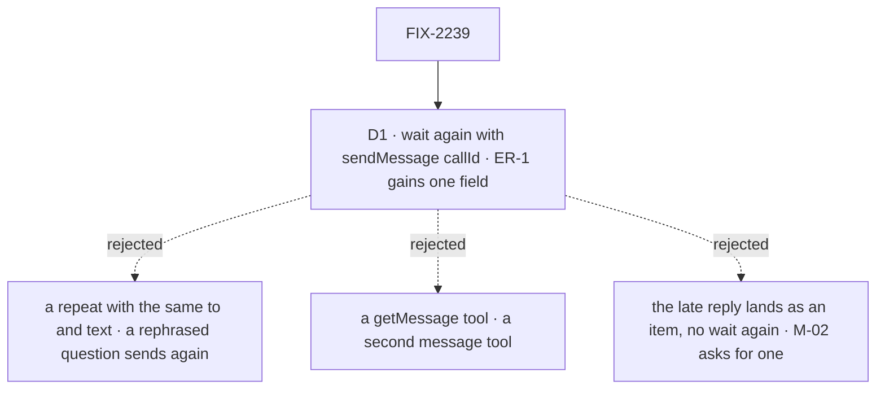

# FIX-2239 · Decisions

[Spec](SPEC.md) · **Decisions**

The epic decided the model ([FIX-2070](../../epics/FIX-2070/DECISIONS.md)): a call is a message
waited on the engine's wait gate, not a task (D1); a message to a session waiting on a person
queues (D3); one tool, `sendMessage`, and a server-set `call` on `onMessageReceived` (ER-1); a late
result is the request's own record, "found by the call id" (D1, ER-4). One call is left for this
issue: how a worker names that call id when it waits again, since ER-1's five fields have no place
for it.

## The tree

Solid edges are what you're signing. Dashed edges lost, and the label says why.

## D1 · To wait again, a worker passes the call id

*A product call: it amends the epic's locked tool signature (ER-1) by one optional field.*

| | |
|---|---|
| **Instead of** | Matching a repeat by its `to` and `text` to an unread call from the same session; a separate `getMessage({ id, wait })` tool; writing a late reply into the caller's session as a received item that wakes nothing |
| **Because** | The epic already says the late result is "found by the call id", and every system with a kept late result finds it by a handle: Temporal's `getHandle(id).result()`, A2A's `tasks/get`, an idempotency key. A match on words fails exactly where it matters: a model that rephrases its question sends a second message and pays again, and the same question asked hours later gets a stale answer. It also needs an "unread" mark stored somewhere, where the epic says nothing else is stored. A second tool is the second message path the epic removes ([tenet 2](../../../docs/philosophy.md)). A late reply written as an item reaches the caller only on its next turn, and M-02 asks that waiting again return it |
| **How** | Every call's output carries its `callId` (the message id). `sendMessage({ callId, deadline? })` waits again: no row, no budget, nothing sent; `to`, `text`, `inReplyTo` and `wait` are refused beside it. It finds the row, refuses a call this session didn't send (`no_such_call`), and parks on the request the row names, or returns its reply at once if that request has ended. It passes the same host, step, deadline and depth checks as a call |
| **Locks in** | `callId` on `sendMessage`, amended into the epic's ER-1 and the concept's `sendMessage` line in this PR. The call's output: `{ status: "answered" \| "running" \| "failed", callId, reply?, error?, recipient? }`, where `recipient: "waiting_on_person"` says why a call is still running (epic D3) |

**What would change my mind:** the goal's runs showing models never carry the id and call afresh
instead. Then the deadline output's wording is the fix, not the field.

It comes down to the handle: a call id finds the reply whatever words the model uses next.

## Decided, not asked

- **A call's result is the recipient's reply: the final text of its `onMessageReceived` turn.**
  The entry's request outputs `{ reply }` (cut to `MAX_MESSAGE_CHARS`, BP-042). When `call` is true,
  the woken turn's prompt says its reply goes back to the caller as the call's result and not to send
  a message. A turn with no text answers `""`. A send's request outputs the same, and nothing reads
  it: no relay. The coder's task session (FIX-2160's `harnessTalkTurn`) answers with its run's reply.
- **Every check before anything is written**, after FIX-2238's and FIX-2160's: the host can hold a
  wait (`canHoldWait`, else `wait_unavailable`; a call is never turned into a send); the deadline is
  in ms from now, the host's default unset, within its bounds (`wait_deadline_out_of_range`, never
  clamped); one wait per model step, shared with `getTask`'s claim (`wait_already_pending`); the
  chain within `MAX_WAIT_DEPTH` (`wait_too_deep`). `deadline` without `wait` or `callId` is refused.
- **One park on a request.** `dispatcher({ wait: true })`'s private `sendAndWait` is split: the park
  half (plan the gate and deadline under `runOnce`, park bound to `{ requestId }`, map the outcome)
  becomes core's exported `waitOnRequest`, with the gate id chosen by its caller. The dispatcher,
  a call and waiting again use it; each dispatches, or not, itself. A held message parks with
  `parkOnWait` directly, since it binds to a task row as well as a request and must see a stop.
  A call's gates and memo keys are its own (`call:<id>#…`, `fsd.call.*`), and a held message's
  too (`queue:<id>#…`, `fsd.queue.*`): never `ask:` or `fsd.ask.*`, which a question owns. A call
  dispatches with `waits: true`, so the engine stamps the child and counts its depth. A tool adds
  the per-step claim, as `getTask` does (`toolCallOf`).
- **Which request a call waits on:** the one acting on the message, as FIX-2240's row names it:
  its taker (`takenBy`) until the message is delivered, then the request it was delivered in
  (`deliveredAs`). A call parks on the request its own dispatch became; when that request ended
  without acting on it (a duplicate, or a taker that died), the call reads the row and returns, or
  parks on, the request named there. Waiting again by `callId` always reads the row. This is the durable once evidence FIX-2240
  keeps (epic D2), written by the recipient's admission, not by the sender's dispatch.
- **The person's stop holds the message** (epic ER-4, D3), at the entry's admission, the one point
  every send, call and FIX-2240 resend passes. In a task's session it reads the row's open holds
  (FIX-2160's `rowsInSession` with `hasOpenHold`, FIX-2058 ER-2): a stop for a person and a question both hold. In a plain
  conversation it reads the session's open person suspension: one read added to `RequestHost.waits`,
  backed by the engine's listing and `isUserSuspension`. While held, the message request parks on
  the wait gate: bound to the stopped request for a suspension (the engine resumes a `{ requestId }`
  gate in the ended request's own session too), and bound to the task row for a question, with a
  short deadline, since a question has no request to wait on. It checks again at every resume, and
  runs its turn, on the same `defer` line, once nothing holds it. It waits for the stopped request
  to *end*, not merely resume: until then the session is busy, which ER-4's first sentence already
  covers. While held, the row says so (`queuedBehind: "user"`), which a call's `running` output reads.
  A parked message is a wait, never a person's stop: the Inbox and `waiting-on-a-user` never count
  it. If its own park would be a sixth wait deep, it isn't admitted and FIX-2240's resend tries
  again.
- **A call is never a person's stop and never steers.** A person stopping the calling request ends
  it; the message's request runs on.
- **Shift Manager:** the received item carries `call`; the Messages view shows a call's state:
  waiting, answered, answered late. The tool's description carries the rule: call for an answer
  now, file a task for work to track.

## Considered and dropped

- **The engine's `defer` policy holding the key through a person's stop.** It would change a
  Layer 1 rule every entry relies on (a suspension gives its place back), and a deferred run waits
  in a process for hours with no durable record. The entry's own park is durable and touches only
  messages.
- **Leaving a held message to FIX-2240's resend.** The resend runs on a timer, so the message would
  run a pass after the stop ends, and a call would have no request to wait on meanwhile.
- **A shared dispatch-and-wait helper.** Waiting again and a held message wait on a request that
  already exists and dispatch nothing, so the shared piece is the park alone.

## Open / Settled

**Open: none.** D1 amends ER-1; merging this spec approves the amendment.

Settled from the code, not argued: a deferred request already has its id and record when the
dispatch returns (`engine/src/context/dispatch-operation.ts`, `createInboundTransportHost.ts`), so a
call can bind to it before it starts; a generator's tool can park on the gate (`getTask` does, via
`toolCallOf`); no existing piece holds an internal entry while a plain conversation waits on a
person (a task's steer waits on the row, which a message is never part of).

No counted facts rest on hand derivation.

## Analysis

2026-10-27, a fresh reviewer at spec altitude, with `reuse-review` on Builds on / Adds. Verdict:
the right work, with changes; all folded.

- **Reuse.** `wait`/`deadline` extend `sendMessage`; the engine resume extends
  `resumeRequestWaiters`; the person read extends `waits`. Folded: the shared helper is the park
  (`waitOnRequest`), not dispatch-and-wait, since waiting again and a held message dispatch nothing;
  a task's session reuses `hasOpenHold`.
- **D1.** Folded: the draft matched a repeat by its words, an outlier against handle-based prior art
  that stores an "unread" mark and misses a rephrased question. D1 now takes the call id, amending
  ER-1, and is put to the owner as the one decision.
- **ER rules.** Folded: the draft let a task's question hold admit a message, against epic ER-4 and
  FIX-2058 ER-2. A question now holds it too. Folded: D3's "the tool says when the recipient waits
  on a person" is the `recipient` field.
- **Recorded:** a stop with no deadline re-parks at the host maximum (Leaves); a session parked on a
  call admits another message (Leaves; the epic holds only for a person); the own-session resume
  cost (Leaves).

Blind goal review, folded: the host default, waiting again, a `{ task }` call, a send into the
stopped session, timing windows on the deadline, the caller going on, the stopped request ending
first, forced preconditions, and the `ignore-deadline`, `no-default-deadline` and `no-step-guard`
controls. The busy recipient, the depth and the no-wait host are CI tests named in the PR.

## How it got here

- **Draft** — framed as the epic's call child: a send that parks on the one wait gate for the
  recipient's reply, sharing `dispatcher`'s park and `getTask`'s rules; the person's stop held by
  the entry parking on the stopped request.
- **Analysis fold** — waiting again by call id, not by repeating the words (D1, amending ER-1); a
  task's question holds a message; the shared helper is the park alone.

## Notes from review

- **Cross-spec review, amended at build (Jake approved the four points):** a call parks on the
  row's `takenBy` until the message is delivered, then on `deliveredAs`, as FIX-2240 writes them;
  the row's mark is `queuedBehind`, not `heldBy`, with the value `"user"`: the cross-spec point said `"person"`, which the CI vocabulary check retires (say user), so the value follows the check; `recipient: "waiting_on_person"` stays as epic D3 locked it, since the check reads it as one word; a task's session reads its row with
  FIX-2160's `rowsInSession` and `hasOpenHold`; a call's gate ids and keys are `call:` and
  `fsd.call.*`, not a question's `ask:` and `fsd.ask.*`. Found at build: a held message parks with
  `parkOnWait`, not `waitOnRequest`, since it binds to a task row too and must see a stop.
- **Second look on the PR, folded:** a call's checks are orchestration's `checkWaitable`, the one
  `getTask`'s wait makes, not a copy (the step is claimed last, so a wait refused for its depth
  holds no step); the host read is `RequestHost.waits.userStop`, matching the vocabulary check; the
  reply step reads whether a message landed from request state, not from its input's shape.

- **Codex (P2, on e94985c), folded:** a resend after a crash makes a duplicate request whose turn is
  skipped, so pointing the call at the newest request would lose the reply. The row now names the
  request that acted on the message, written once by the entry's dedupe; a call parked on a
  duplicate reads the row.
- **FSD Architect (#4000), folded:** goal legs renumbered to 10, 10b and 10c, after FIX-2160's 6 to
  8 and FIX-2240's 9; FIX-2160's `task_running` refuses a call to the coder's open task at send
  time, before this issue's queue; the row's acting request is FIX-2240's `deliveredAs`.
- **FSD Architect coherence check, recorded:** FIX-2071's renames table and FIX-2249's sweep treat
  `callId` as a sixth field; FIX-2240's spec must keep the acting request's id on the row; FIX-2241's
  spec (#3994) should match ER-4 on a question hold holding admission. Routed to the epic's thread.
- **Cursor (on 0fa9269's parent), recorded for the implementer, verbatim in substance:** the goal's
  signal lines read like a test script (exact ms, sweep-tick windows, forced `deadline: 5000`);
  keep the timing preconditions in `run.mts` and the PR checklist where they can, outcomes in the
  goal. The own-session resume's cost is merge-gate evidence: show the ungated request end is
  unchanged (test or benchmark), not a nice-to-have.
- **Cursor, dropped:** splitting the person-stop hold out, or holding by admission only with
  FIX-2240's resend (already weighed in *Considered and dropped*: the resend runs on a timer and a
  call would have nothing to wait on; epic ER-4 gives the hold to this issue). ER-4's own wording is
  untouched by this PR. Folded inline: the concept's "or repeats the call" is gone, so it matches D1.
