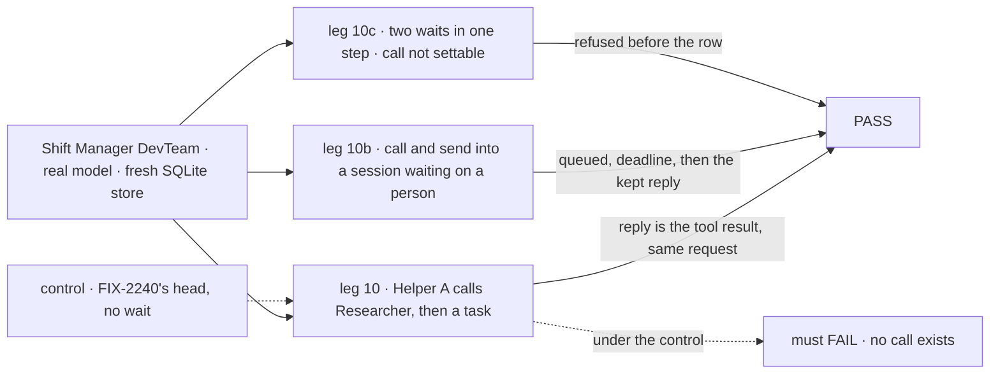
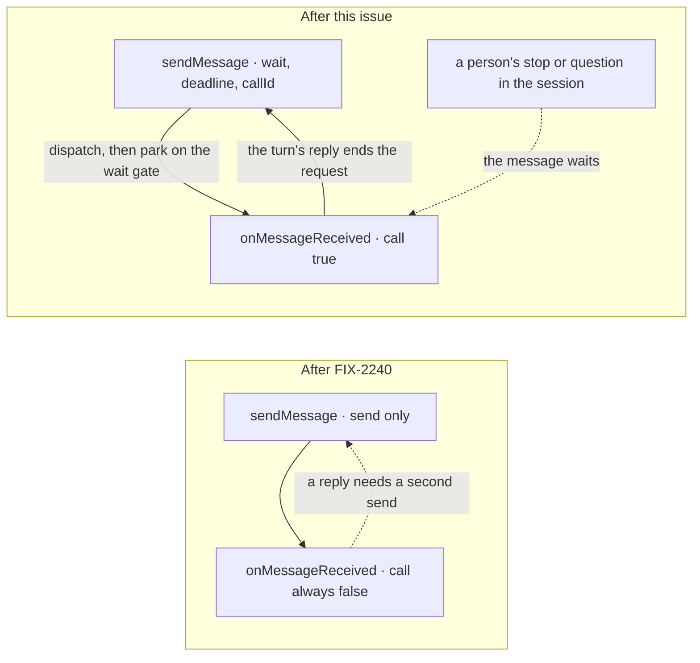
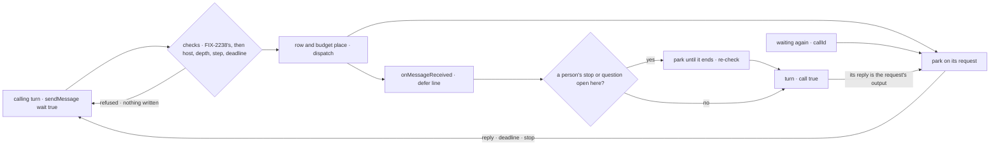

# FIX-2239 · A call waits for the recipient's result until its deadline

**Spec** · [Decisions](DECISIONS.md)

## Five people, before and after

| Someone who… | Today | After |
|---|---|---|
| **builds a worker that needs an answer before it goes on** | Can't get one in the same request. `sendMessage` only sends, and the answer arrives later as a new turn. The other way is to file a task and wait on it with `getTask({ id, wait })`, which gives a one-line question a row, attempts and a retry | `sendMessage({ to, text, wait: true, deadline? })` is a call. The request waits, and the recipient's reply comes back as the tool's result in the same request |
| **writes the worker that is called** | Can't tell a call from a send. Its plain-text reply goes nowhere | `onMessageReceived` says `call: true`. Its turn's reply is the call's result, so it answers in words and sends nothing |
| **calls a worker that is busy or waiting on a person** | — | The call queues behind the recipient's current request; a request stopped for a person, or a task held on a person's question, counts as busy. Past the deadline the caller goes on with `running`, told when the recipient waits on a person, and nothing is stopped. Waiting again by the call id returns the kept reply without sending again ([D1](DECISIONS.md#d1)) |
| **runs Workforce on a host that can't hold a wait** | — | A call is refused `wait_unavailable` before anything is written. A send still works |
| **watches the two workers in Shift Manager** | A received message is one item, the same for every message | The item marks a call. The Messages view shows whether the call's answer came back |

A call is still a message: it pays one place in the budget, lands where a send would land, and
holds no row, attempt or claim (epic [D1](../../epics/FIX-2070/DECISIONS.md#d1)). Tracked work is
still a task.

## The goal, and how we'll know it's met

**A worker can call any worker or task it can message and use the recipient's reply as the tool's
result in the same request. The call waits until the reply or its deadline (the host's default
when none is passed), whichever is first, and queues behind a busy recipient or one waiting on a
person, as a send does. A late reply is kept under the call id and returned when the caller waits
again. All of this runs on the engine's one wait gate, with no new wait mechanism.**

| Is it the right goal? | |
|---|---|
| **The real need** | Story M-02: "call a worker and wait for its result until a deadline, so that I can use the answer in the same request … waiting again or repeating the call returns the late result kept under its call id". M-07: a busy or waiting recipient queues, and "a call never waits past its deadline". M-11: the caller sets the deadline, the host's default otherwise. The epic's leg a ([epic SPEC](../../epics/FIX-2070/SPEC.md)) |
| **Smaller, and rejected** | `wait: true` that waits only while the recipient is free. A call into a busy session, or one waiting on a person, would fail or run beside the stopped request, and nothing would keep a late reply |
| **Bigger, and not this issue's** | `{ task }` and `{ session }` targets (FIX-2160, stacked below this one: a call reaches whatever a send reaches) · delivery that survives a crash (FIX-2240, stacked below) · a lookup tool for sessions (epic Not doing) |
| **Not done if** | A call's reply arrives as a later turn instead of the tool's result · a call with no `deadline` waits past the host's default, or with one, past it · the caller errors at the deadline instead of going on · the deadline stops the recipient, running or queued · a send or a call runs while its session's request waits on a person, or while its task is held on a person's question · a late reply is lost, or waiting again sends a second message or pays budget again · a call on a host that can't hold a wait is sent anyway, or turned silently into a send · a call joins a sixth wait in a chain · two waits park in one model step · `call` can be set by tool input |



The check reads the caller's tool calls and outputs, both sessions' stored items and requests, and
the message log, through the person's own clients.

| How we verify | |
|---|---|
| **Goal check** | `goals/shift-manager/workers-message-each-other/`, amended: leg 2b ("no waiting") is replaced by legs 10, 10b and 10c. Real model, run by the implementer at completion, `pnpm tsx goals/shift-manager/workers-message-each-other/run.mts`; PASS is every leg in 3 of 3 runs; verdict in the implementation PR. The run sets the host's wait default to 8 s. The parts a model can't be made to hit reliably are `packages/workforce`, `packages/core` and `packages/engine` CI tests, each named in the PR with its red state: `wait_unavailable` with no row written and a send still landing; `wait_too_deep` at the sixth wait; a call into a recipient whose turn is running queues behind it; the deadline stops nothing; a question hold holds a message |
| **Signal** | `10:answer-in-turn` Alice tells Helper A "ask Researcher the codename, then tell me", after telling Researcher the codename. Researcher's session stores an `onMessageReceived` request whose output is Helper A's `sendMessage` tool output (`status: "answered"`, the codename), and Helper A's answer to Alice, in the same request, holds it. `10:no-second-line` Researcher's turn sent no message, and Helper A's conversation gains no received item from it. `10:task-call` Helper A, told to ask leg 2's finished task the colour it found, calls `{ task }` and gets it as the result. `10:default-deadline` a call with no `deadline` into the stopped session of 10b resumes `running` between 8 s and 8 s plus one sweep tick. `10b:queued` Researcher's conversation has a request stopped by `waitForUser` (the run fails the leg if no stop opened); Helper A calls with `deadline: 5000` (the run reads the tool input and fails the leg without it) and sends one plain message too; while the stop is open no `onMessageReceived` turn runs in Researcher's session, Helper A's request reads as parked on a wait, its tool output is `running` between 5 s and 5 s plus one sweep tick and says the recipient waits on a person, and Helper A's turn goes on to answer Alice. `10b:kept` Alice answers the stop; the message turns run only after the stopped request ends; Helper A, told only to get the answer, waits again with the call id and gets `answered` with the reply; the log shows one row and one budget place for the call. `10c:one-wait-per-step` Helper A, told to make two calls in one step, does (the leg fails if no second call was made), and the second is refused `wait_already_pending`. `10c:not-settable` a tool call naming `call` is never taken, and no row carries a call flag the server didn't set. Legs 1 to 9 as FIX-2238, FIX-2160 and FIX-2240 leave them |
| **Input** | DevTeam as FIX-2238's goal hires it. Researcher's stop is opened by a line telling it to ask Alice for approval first with its `waitForUser` tool. The codename and the stop's prompt are picked at run time |
| **Anti-game** | The answer is read from the caller's own tool output in the turn's stored items and matched to the recipient's stored request, never from the log or a helper. The queue is graded on what ran in Researcher's session while the stop was open, read from its stored requests. Nothing seeded |
| **Control that must fail** | The stack below this one (FIX-2240's head): every leg 10 fails, `10:answer-in-turn` first (there is no `wait`). `GOAL_CONTROL=no-person-hold` (the admission doesn't read the person's stop) fails `10b:queued`. `ignore-deadline` (the call waits for the reply whatever its deadline) fails `10b:queued`. `no-default-deadline` fails `10:default-deadline`. `send-again` (waiting again sends a new message) fails `10b:kept`. `relay-the-call` (the reply also sent back as a message) fails `10:no-second-line`. `no-step-guard` fails `10c:one-wait-per-step`. The PR shows each FAIL before the PASS, and names the module each control patches |

## What changes



A call is a send that parks on the wait gate, bound to the request its delivery became, and the
recipient's reply is that request's output.

A worker's model writes:

```diff
- sendMessage({ to: "researcher", text: "What's the codename?" })
- // …the answer arrives later, as a new turn
+ sendMessage({ to: "researcher", text: "What's the codename?", wait: true, deadline: 60_000 })
+ // → { status: "answered", callId: "msg_…", reply: "Bluebird" }
+ // → { status: "running", callId: "msg_…", recipient: "waiting_on_person" }
+ sendMessage({ callId: "msg_…", deadline: 60_000 })   // wait again: sends nothing
```

**Docs:** update `apps/docs/docs/workforce/messaging-workers.md` with a *Calls* section (wait,
deadline, the reply as the result, queueing behind a busy or waiting session, waiting again by
`callId`, the refusals) and the "send to talk, call to use the answer now, file a task for tracked
work" rule the epic gives this page; `apps/docs/docs/shift-manager/overview.md` (a call
on the received item and in the Messages view); `packages/workforce/README.md` → Worker messages;
the concept's `sendMessage` line and the epic's ER-1 gain `callId` (in this PR). The engine's
own-session wait gets a line where `docs/architecture/` describes FIX-2082's wait gate. Changesets
for `@flow-state-dev/workforce`, `core` and `engine`.

## How a call travels



## What stays as it is

- Every send without `wait`, and the rest of `sendMessage`'s input (epic ER-1, amended only by
  `callId`).
- The landing rules, the refusals and the budget (FIX-2238). A call is paid like a send: one place,
  when its row is written. Waiting again pays nothing.
- FIX-2240's delivery debt and resend. A call reads the row's `deliveredAs`, the request that acted on
  the message, written once at the recipient's take, to find the reply.
- FIX-2160's `task_running`: a message, a call included, to the coder's open task is refused at
  send time, so it never queues here as a busy session.
- `getTask({ id, wait })` for tracked work, and `dispatcher({ wait: true })`'s behaviour.
- A person's stop, a task's question, their Inbox item and their answer routes (PR-3). A parked
  caller or a parked message is never one.

## What's already here, and the debt

| Already here | What this does with it |
|---|---|
| Ways to wait on work that runs elsewhere, from searches of `packages/*/src` for `parkOnWait`, `wait: true` and `waits`: `getTask({ id, wait })` (`orchestration/src/tasks/helpers/wait-on-task.ts`), a plan board's drain on a row it handed over (the same function), and `dispatcher({ wait: true })` (`core/src/blocks/dispatcher.ts`). All three park on the one wait gate (`core/src/types/wait-gate.ts`). A call is the fourth caller of that gate, and adds no wait mechanism | **Builds on** the gate. Its park-on-a-request moves out of `dispatcher` into one exported core helper that both use |
| `dispatcher({ wait: true })`'s private `sendAndWait`: send under `runOnce`, plan a gate and deadline, park bound to `{ requestId }`, map the outcome | **Split and shared.** The park half becomes `waitOnRequest`; the dispatch stays with each caller, since waiting again and a held message dispatch nothing |
| `getTask`'s rules for a tool that waits: the host check, the deadline in ms from now (host default, host bounds), one wait per model step (`wait_already_pending`), the depth check (`MAX_WAIT_DEPTH`, 5) | **Reused** as written, by name. A call and a `getTask` wait share the step's one wait |
| The engine resumes a gate bound to `{ requestId }` when that request ends, looked up in the session of the request that dispatched it, and only for a dispatched request (`engine/src/durability/wait-chain.ts`, `resumeRequestWaiters`) | **Extended**: a request's end also resumes gates in its own session bound to it, so a message can wait on a stopped request of its session ([Decided, not asked](DECISIONS.md#decided-not-asked)) |
| The engine's `defer` policy, which `onMessageReceived` runs under (`AFTER_REPLY_CONCURRENCY`): a busy session queues, and a request that suspends gives its place back (`engine/src/transports/concurrency/arbiter.ts`) | **Kept** for a busy session. A person's stop or question is held by the entry's own admission (epic ER-4, D3) |
| A task row's open holds (`hasOpenHold`, `orchestration/src/tasks/collection/holds.ts`), which mirror a task run's stop for a person and mark its questions (FIX-2058 ER-2) | **Reused** for a task's session, as ER-4 says. A plain conversation has no row, so it reads the session's suspensions |
| Epic [D1](../../epics/FIX-2070/DECISIONS.md#d1), [D3](../../epics/FIX-2070/DECISIONS.md#d3), ER-1 and ER-4; FIX-2238's `call` field and received item; FIX-2238 D1 ("a call gets its reply" from the coder's task session) | **Built as decided.** ER-1 gains `callId` ([D1](DECISIONS.md#d1)) |

| Builds on / Adds | Existing piece considered | Why that doesn't fit, or how this is composed |
|---|---|---|
| `wait`, `deadline` and `callId` on `sendMessage` | `getTask({ id, wait })`; a second tool | **Extends** the one message tool; `wait` and `deadline` mean what they mean on `getTask` |
| `waitOnRequest`, exported from core | `dispatcher({ wait: true })`'s private `sendAndWait` | **Extracted**: the dispatcher calls it, and so do the call, waiting again and a held message. One copy |
| A read of a session's open person stop, on `RequestHost.waits` | `provider.listSuspended` with `isUserSuspension`, engine-only; `waits.running` and `waits.ended`, which don't say why a request is parked | **Extends** the existing `waits` read surface with one read. It is not a new host verb |
| A wait on a request of the same session | The gate's `{ requestId }` binding, resumed today only for a dispatched child | **Extends** where the engine looks when a request ends. No new binding kind |

| The debt | |
|---|---|
| **Removes** | `dispatcher`'s private copy of the park (moved into core) · goal leg 2b, which asserted that a message can't wait |
| **Adds** | `wait`, `deadline` and `callId` on the one message tool · one read on `waits` and a wider resume lookup in the engine, both generic. None is a second way to do an existing job: a call is the gate's fourth caller |
| **Leaves** | The engine's own-session resume lists pending gates in the ended request's session on every request end; the implementer keeps it off the common path (for example only when the session has a parked message) and measures it in the PR. A message held behind a stop with no deadline re-parks at the host's longest wait, one wake per cycle, until the stop ends. A session parked on a call or a `getTask` wait still admits another message (the epic holds only for a person, D3). A lookup tool for sessions stays out (epic Not doing) |

**Net: flat.** Three fields on an existing tool and two small, generic engine extensions; the
dispatcher's park is shared, not copied.

## Sign off

**[The goal](#the-goal-and-how-well-know-its-met), at that size:** a call returns the reply in the
same request, queues behind a busy or waiting recipient, stops at its deadline, and keeps a late
reply for a caller that waits again. If wrong: workers fall back to filing a task for a one-line
question.

**[The debt](#whats-already-here-and-the-debt): flat.** Adds three fields to the one tool and two
generic engine reads; removes the dispatcher's private copy. If wrong: a second wait path grows
beside the gate.

1. **[D1](DECISIONS.md#d1) · To wait again, a worker passes the call id: `sendMessage({ callId })`.**
   This adds one optional field to the epic's locked `sendMessage` (ER-1), which this PR amends.
   If wrong: a sixth field on the one tool, where repeating the same words would have done.

**Open: none.** D1 amends an epic rule, so merging this spec is the owner's approval of it. The
engineering calls: [DECISIONS.md → Decided, not asked](DECISIONS.md#decided-not-asked).

Feature · `workforce`, `core`, `engine`, `shift-manager` + docs · medium (the call on the send path, the shared park, the person-stop hold, the received item's flag; one goal amended) · 1 PR, stacked on FIX-2240 · epic FIX-2070
