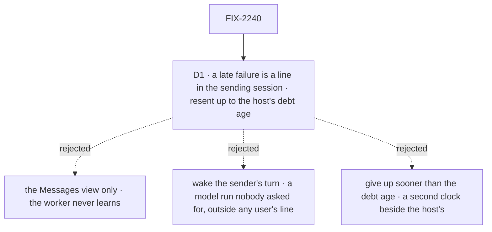

# FIX-2240 · Decisions

[Spec](SPEC.md) · **Decisions**

The epic decided the model ([FIX-2070 D2](../../epics/FIX-2070/DECISIONS.md#d2), ER-5): delivery
is a debt on the sending session's existing wake, paid in its board's `dispatch` pass; only a row
still `unconfirmed` is sent again; a refusal is final; the evidence for "once" outlasts the debt.
It left this spec two things: which evidence, and what the sender hears when a message can't land
after its send returned. The first is an engineering call, below. The second is D1.

## The tree

Solid edges are what you're signing. Dashed edges lost, and the label says why.

## D1 · A late failure is a line in the sending session; resent until the host's debt age

*A product call: rule 10 says a refusal is "returned to the sender", and after the send has
returned the sender's request is gone.*

| | |
|---|---|
| **Instead of** | Showing a late failure only in the Messages view; or waking the sender's turn to decide what to do about it |
| **Because** | The worker is who sent it, so the worker must be able to learn it failed, which the Messages view can't give it: a person reads that view, a model doesn't. A line in the sending session (as a task's undeliverable notice is today, `conversation-board/delivery.ts`) is in that session's history, so its next turn reads it, at no cost. Waking a turn for it runs a model nobody asked for, in a request that descends from no user's line, so it either spends a budget that may be gone or starts one outside every user's line, which the budget exists to stop (epic ER-6). The resend runs as long as the host keeps any debt (`maxDebtAgeMs`, a day by default), the clock a task's notice already runs on: a second, shorter clock for messages is a second setting to explain |
| **Not free** | The line waits for that session's next turn. In a task's session whose task has ended, that is the next line or answer that reaches it, which may never come; there the Messages view is what shows it. Moving the line to the worker's own conversation would bring back the redirect FIX-2238 removed |
| **Locks in** | The line: *"Your message msg_… to `<worker>` wasn't delivered: `<reason>`."*, in the session that sent it, with no turn. `refused` for a final refusal on a resend; `undeliverable` past the debt age; each resend re-runs the recipient check the send ran, so a worker fired since is refused `worker_unavailable` |

**What would change my mind:** the closure run showing workers that never act on the line, or that
re-send the same message every time they read one. Then a late failure wakes the sender's turn,
paid from the budget of the line the message came from.

It comes down to who has to learn it: the worker sent the message, and only its session's history reaches its model.

## Decided, not asked

- **"Once" is FIX-2123's take, on the message row.** `onMessageReceived`'s first step (today's
  dedupe step, in `messageReceivedEntry`) makes one guarded write on the row (`updateState`, the
  ref's read-check-write; the winner is read from the updater's last run, as `withOutcome` does):
  while the row is `unconfirmed`, it records `takenBy` = the running request. A request finding
  its own id there (a continued request) goes on. One finding another taker that has not ended
  (`hasEnded`, which reads the recipient's own session, so it works across flows) runs nothing.
  One finding a taker that ended without delivering takes over, naming it replaced, exactly as a
  notice copy does (`takeFor`). The taker appends the items, then writes `status: "delivered"`,
  `deliveredAs`, `deliveredAt` and `toSession`, then runs the turn. The evidence lives as long as
  the row, so it outlasts every debt (epic ER-5). The session's 500-id window and its state go.
  **Convergence point:** that step. Every delivery reaches it: the fast path, the pass's resend,
  FIX-2239's call, FIX-2160's `{ task }` and `{ session }` targets, and FIX-2241's question.
- **`delivered` is written once the item has landed, before the turn.** A taker killed before
  its item is taken over by the next copy, so the message lands once. A turn interrupted after
  `delivered` is the engine's interrupted request, as a person's line is; it is not resent.
  The window left is a taker killed between its item and its `delivered` write, taken over and
  shown twice, the same window a task's notice has.
- **The debt clears only on `delivered`, a final refusal, or the age limit.** Never when the host
  accepts the dispatch: an accepted request can still never run (one queued behind a concurrency
  gate is written `aborted` at a drain, and one killed inside the persistence window leaves no
  record, `dispatched-work.md`). This is the task ending's rule too: only the filer's delivery
  clears its debt.
- **The row keeps its delivery address whole** (`toSession`, `toFlow`, and `toState`, the
  state a derived conversation is opened with), so a resend to a conversation that the first
  dispatch never opened opens it, instead of being refused `session-not-found`.
- **The send's order:** owe the sending session's wake for the board's pass (`DISPATCH_ENTRY`,
  due `NOTICE_DUE_MS`), put the id on the session's owed list with the sending request's id
  beside it, write the row, then dispatch once. The pass runs on its own concurrency key, so it
  can read the list while a send is between the list and the row: an id with no row is dropped
  only once its sending request has ended (`hasEnded`, the same session), so a crash before the
  row leaves an id the pass drops later, and a send still running keeps its pointer. A crash
  after the row leaves a debt with a wake. **Convergence point:** `sendMessage`'s server function, which the tool and
  FIX-2241's server-sent question both call. A flow offering the tool carries the session kit and
  so the pass (`board.entries`); the send refuses to start on a flow without it, as a
  configuration error, not a model refusal.
- **The pass's message step** (`payMessageDebts`, in the pass's first half beside the plan
  ledger's, outside its "this session files" branch): for each owed id, read its row. No row and a sending request that has ended, a
  row delivered, or one refused or `undeliverable` whose line is recorded (`toldAt`):
  drop the id. Past the host's `maxDebtAgeMs`, counted from the row's `at`: write
  `undeliverable`, leave D1's line, drop the id. Past its next send: re-run the send's recipient
  check (the roster, and FIX-2160's target checks; not the budget, paid once with the row), then
  the same dispatch as the first, and record `resent`. The step returns the earliest next send,
  kept in the pass's request state (as `passPlanDue` is) and folded into the settle.
- **Two pure pieces lifted into `orchestration`, one each, and named deliverables.** The take
  rule (`own | busy | takeover(replacing)` from the taker, the running request and `hasEnded`),
  today inside `takeFor` (`task-settled-entry.ts`), and the backoff (`(resent, due) → at`:
  `NOTICE_DUE_MS · 2^n` after the last send, capped at 5 minutes), today inside `nextSendAt`
  (`task-notice.ts`). The notice take and the message take both call the first; the notice
  pass and the message step both call the second. Neither is restated in `workforce`, and
  FIX-2239 and FIX-2241 reuse them.
- **Final refusals and retryable ones.** Final: `no-entry`, `session-not-found`,
  `session-not-addressable`, `create-refused`, `external-dispatcher` (the recipient can never
  take it), and a failed recipient check. Retryable: a throw, `dispatch-rejected` (busy under a
  `reject` policy), `no-dispatch-operation`, and `flow-not-found` (a rolling deploy can leave a
  flow missing for a moment): the debt stays, until the age limit.
- **Writes that end a row are guarded too.** `refused` and `undeliverable` are written only while
  the row is `unconfirmed` and no live request has taken it, so a late refusal never overwrites a
  delivery. The terminal write also marks the row owed its line (`toldAt` absent), and the id
  stays on the owed list until the line is written and `toldAt` recorded: a pass that finds a
  `refused` or `undeliverable` row with no `toldAt` leaves the line, then records it, then drops
  the id. A crash between the two leaves the line twice at most, never not at all.
- **A resend is the same dispatch.** It queues behind a busy or waiting session (epic ER-4) and
  never carries `waits`: a call parked on its first dispatch is FIX-2239's, which finds a late
  result through `deliveredAs`.
- **The tool's answer** is `{ sent }` once the row is written. `not_delivered` is only a final
  refusal of the fast path. A throw is no longer the model's concern.
- **A host with no wakes** sends again only when the sending session's pass runs for something
  else; the epic's Not doing covers it.
- **Stores are reset between the refactor epics** (epic seam table), so no row from before
  `deliveredAs` is read; BP-030 needs no legacy branch.

## Considered and dropped

- **Clearing the debt when the host accepts the dispatch** (today's `delivered`). Simpler, and one
  pass fewer per message. Lost because an accepted request can die before it runs, which is the
  loss the goal names.
- **Finding owed messages by listing the log.** No new state. Lost to BP-033: the log holds every
  message the user ever sent, and a pass would load all of them to find a few.
- **An outbox collection.** Lost to the epic's D2: a second record beside the log.
- **Asking `livenessOf` whether the accepted copy is still queued**, to skip the copies a busy
  recipient gets. Lost because it answers only for the caller's own flow instance, and a message
  crosses flows. The copies are cheap: each is taken as a no-op.
- **A take that is final** (the first request to take a message owns it, live or dead). Simpler,
  and lost: a taker killed before its item lands loses the message, since an interrupted request
  with no resolved gate is not driven again (`execution-and-errors.md`, the sweep).
- **A bigger session window.** Still a window: a resend a day later can outrun any size.
- **A wake in the recipient's session.** The recipient's conversation may not exist until the
  dispatch opens it, and the debt is the sender's: it is the sender who is told.

## Open / Settled

**Open: none.**

No counted facts rest on hand derivation: the one count (delivery mechanisms) comes from the
searches named in [SPEC.md](SPEC.md#whats-already-here-and-the-debt), which the implementer re-runs.

## Analysis

2026-10-27, a fresh reviewer at spec altitude, with `reuse-review` on Builds on / Adds, and a blind
goal review. Verdict: the right work, the task notice's shape on a second debt. Reuse: the take
**extends FIX-2123's notice take**, which the draft treated as new; the other rows hold. Folded:
the take is a reservation with take-over, `delivered` once the item landed (a final take lost a
message whose taker died, since an interrupted request is not driven again); the row keeps the
delivery address's starting state (a resend to an unopened conversation was refused
`session-not-found`); D1 states that the line in an ended task's session may go unread;
`flow-not-found` is retryable. Blind goal review, folded: *not done if* names the resend's source,
a taken row resent, the age limit and refusal kinds; every leg asserts the resend's sender stamp
and that its fault fired; `9:seen-once` clears the session's dedupe state so a window can't pass
it; `9:late-refusal` holds the resend until the fire; `9:crash-after-take` added.

Recorded for the implementer, not folded:

- `updateState` returns nothing: read the winner from the updater's last run (`withOutcome`),
  and give D1's line and `refused` only when the guarded refusal won.
- Sharing the backoff means lifting a pure `(resent, due) → at` out of `nextSendAt(row: Task, …)`.
- The message step's handler declares `workerMessagesResources` and the roster's resources, and
  is marked as a dispatcher.
- The faults and controls share `goals/lib/module-patch.mjs`; the restarted process loads
  without the fault, and the runner restarts it.

## How it got here

- **Draft** — framed as the second delivery on the task ending's shape (FIX-2078): owe the
  sender's wake, write, one dispatch, the board's pass resends; "once" is the recipient's take,
  written on the row, which outlives every debt; D1 tells the sender of a late failure with a line.
- **Analysis fold** — the take became FIX-2123's take with take-over, `delivered` after the item;
  the row keeps the delivery address whole.

## Review rounds

Round 1 (2026-10-27), folded: Codex, a crash after a row's terminal write and before D1's line
left the sender untold, so the row is owed its line (`toldAt`) and the id stays owed until it is
written. FSD Architect, the take rule and the backoff are lifted into one pure piece each in
`orchestration` and named as deliverables, so `workforce` holds no second copy. Codex, on 032e6e9: a pass could drop an owed id while its send was still between the list and
the row, so an id with no row is dropped only once its sending request has ended. The FSD
Architect: the goal's leg is renumbered `9`, since FIX-2160 (#4000) owns legs 6 to 8. Cursor, folded: the epic's message-row seam now names where the delivery's state lives. Not folded:
the merge order (FIX-2238's spec #3986 and the epic #3983 have already merged).

## Notes from review

Recorded for the implementer, verbatim in substance:

- Cursor: "the explicit final vs retryable refusal code list will drift when send/dispatch errors move. A rule-shaped summary … plus a pointer at today's taxonomy might be easier to maintain."
- Cursor: split leg 6's (now leg 9's) *Signal* cell into one row per sub-leg (fault · timeout · pass criteria) in the goal file.
- Cursor: `payMessageDebts` should run once per pass and batch row reads where possible.

## Amendments while building

Three seams with the sibling specs, folded during the build (2026-10-27):

- **A flow with no pass sends on the fast path only.** A send owes a wake only when its session's board carries the message step (`carriesPass`); without it, the one dispatch is the whole delivery, and a failure it can't confirm stays `unconfirmed` on the row. Jake accepted the one loss window this leaves (2026-10-27, cross-spec review): a server-sent message from a session with no board pass, such as the coder's midway question, goes out on the fast path only, and `askMidway`'s replay is its resend.
- **The take comes before FIX-2239's hold.** The order on the recipient is take, then hold, then the items, then `delivered`, then the turn, so a held message is already the recipient's and no resend lands a second copy.
- **A send is repeat-safe by id.** `sendMessage(..., from, { id })` with an id already on the log returns that row's answer and sends nothing, so a caller that retries its own send can't land a message twice.
