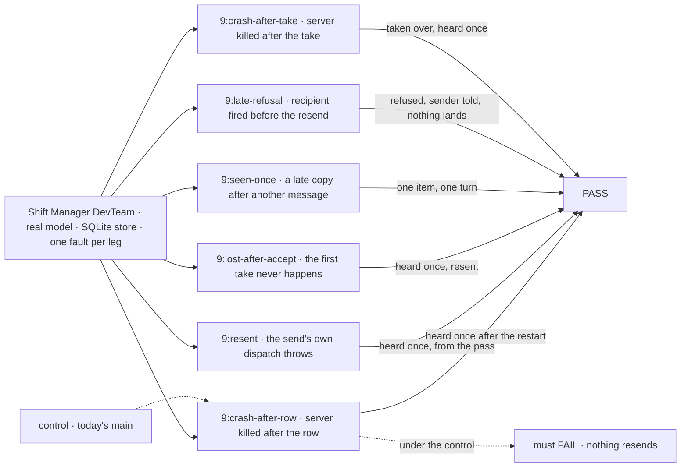
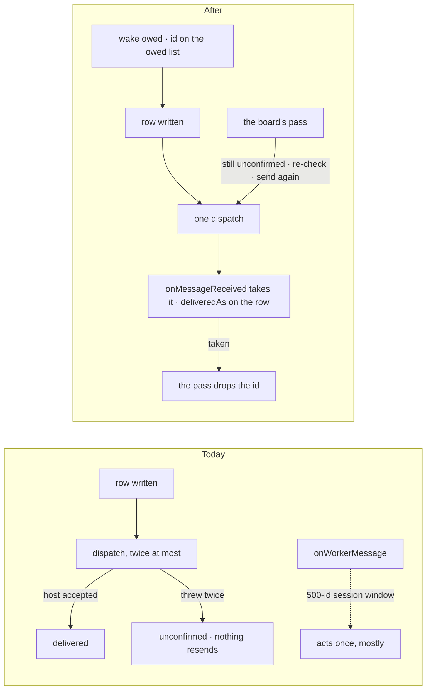
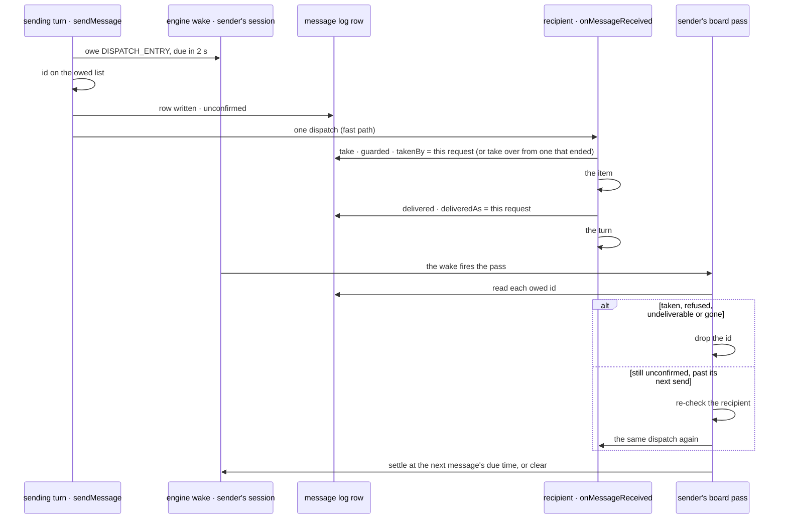

# FIX-2240 · A message lands once

**Spec** · [Decisions](DECISIONS.md)

## Six people, before and after

| Someone who… | Today | After |
|---|---|---|
| **builds a worker whose send hits a host error** | The tool answers "the delivery couldn't be confirmed; it may still arrive". The send tries twice, and nothing tries again | The tool answers `{ sent }`. The sending session's pass sends it again, backing off, until it lands, for up to a day |
| **runs Workforce, and the server dies after the row is written and before the dispatch** | The row stays `unconfirmed` and the recipient never hears the message | After the restart, the sending session's wake sends it; the recipient hears it once |
| **messages a busy worker, and the host stops before the queued delivery runs** | The row reads `delivered`, because the host accepted the dispatch. The message is gone | The row stays `unconfirmed` until the recipient's `onMessageReceived` takes it, and is sent again until then |
| **gets a copy of a message long after the first** (a resend after a lost answer) | Hears it twice once 500 other message ids have reached that session | Hears it once: the row names the request that took it, for as long as the row lives; a copy taken by a request that died before the message landed is taken over |
| **sent a message to a worker fired before it landed, or to a session that is gone** | Two tries, then the row sits `unconfirmed` | Refused and final. The sending session gets a line naming the message and why, and its next turn reads it ([D1](DECISIONS.md#d1)) |
| **reads the Messages view** | `delivered` as soon as the host accepted the dispatch | *on its way* until the recipient takes it, then *delivered*; *refused* with its reason; *couldn't be delivered* after a day |

Nothing an author writes changes. The send, the tool and `onMessageReceived` keep the shape
FIX-2238 gives them; what changes is when a message counts as delivered and who sends it again.

## The goal, and how we'll know it's met

**Every message a send writes is taken by the recipient's `onMessageReceived` exactly once, through
a crash before or after its dispatch, a lost answer, and a delivery the host accepted but never
ran, and is resent only by the sending session's board pass; a message that can't land is final,
and its sender is told.**

| Is it the right goal? | |
|---|---|
| **The real need** | The epic's "a message lands once, a crash included" ([epic SPEC](../../epics/FIX-2070/SPEC.md), leg c) and its rule ER-5: "the send owes a debt on its session's wake until the message is delivered or refused, the board's `dispatch` pass resends a row still `unconfirmed`, and `onMessageReceived` acts on its id once. The evidence for 'once' lasts as long as the debt" ([epic DECISIONS](../../epics/FIX-2070/DECISIONS.md#who-owns-what)). The concept: "Delivery is retried until it lands; the receiver dedupes by id, so it sees each message once … A refusal is final, returned to the sender" |
| **Smaller, and rejected** | "Resend on the wake after a crash between the row and the dispatch." It meets leg c and leaves two losses: a delivery the host accepted and never ran counts as delivered, and a late copy is heard twice once the session's 500-id window has moved on. The concept's "sees each message once" fails both times |
| **Bigger, and not this issue's** | A call's late result (FIX-2239 reads the id this issue keeps) · `{ task }` and `{ session }` targets (FIX-2160; a resend re-checks them) · the midway question (FIX-2241; it sends through this path) · delivery on a host with no wakes (epic Not doing) |
| **Not done if** | A row written before a crash is never delivered after the restart · a delivery the host accepted, that never ran, clears the debt · a copy reaches the recipient's history or turn twice, at any distance · a resend comes from anything but the sending session's board pass (a boot sweep, a timer, a retry inside the send) · a taken row is dispatched again · a final refusal is resent, or a retryable one is final · a resend refused leaves the sender untold (a crash after the row ends included), or its next turn can't read why · a message resent to a worker fired since the send lands · a debt past the host's age limit stays `unconfirmed`, or its sender is never told · a crash after the take shows the message twice · the tool still answers `unconfirmed` · the session's bounded window is still what "once" reads |



Each leg injects one fault into the server under test and then reads only what a person can see:
the conversations' stored items, the turns that ran, and the message log.

| How we verify | |
|---|---|
| **Goal check** | `goals/shift-manager/workers-message-each-other/`, a new leg `9`, beside the legs FIX-2238 leaves. Real model; the implementer runs it at completion with `GOAL_LEGS=9 pnpm tsx goals/shift-manager/workers-message-each-other/run.mts`. PASS is every assertion in 3 of 3 runs; verdict in the goal's log and the implementation PR. The model-free parts (the pass's resend and backoff, the take, the guarded refusal, the age limit at a short `maxDebtAgeMs`, the final and retryable refusals) are also `packages/workforce` CI tests |
| **Signal** | Each sub-leg has the herald message Helper B with a held-out word, under one fault (`GOAL_FAULT`) applied as the server loads, through the same `goals/lib/module-patch.mjs` the controls use (a control and a fault may both be set). Every fault writes a line to the run's fault log when it fires, and a sub-leg whose fault never fired is a setup failure, not a grade. "Took it" below means: Helper B's conversation holds exactly one received item for the id, one `onMessageReceived` request ran past the take for it, and the row is `delivered` with `deliveredAs` naming that request. `9:crash-after-row` (`exit-after-row`: the process kills itself after the row is written, before the dispatch; the runner starts a new process on the same store, without the fault): within 60 s Helper B took it, and `deliveredAs`'s request record names the herald's session and the pass's resend block as its sender (the dispatch stamp), so no boot sweep or other path sent it. `9:resent` (`fast-path-throws`: only the send's own dispatch throws, before sending; the pass's go out): the tool answered `{ sent }`, Helper B took it, the sender stamp is the pass's resend, and `resent.n` is at least 1. `9:lost-after-accept` (`lose-first-take`: the first request each message's dispatch starts ends before its take, as a queued request the host stopped would): Helper B took it, from a later request than the first, and `resent.n` is at least 1. `9:seen-once` (`late-copy`: every message is dispatched once more after the next message to the same session lands, and the recipient session's dedupe state is cleared before the copy, standing in for a window that has moved on; the herald sends two): each id has one received item and one request past the take, and the copy's request record exists and ended at the take with no item. `9:late-refusal` (`fast-path-throws` and `hold-resend`: the pass holds every resend until the runner, after Alice fires Helper B through the roster, releases it): the row is `refused` naming `worker_unavailable`; no dispatch for the id is recorded in the 30 s after; the herald's conversation holds one line naming the id and Helper B; Helper B's conversation holds no received item for it; and the herald's next answer to Alice's "Did Helper B get your message?" says it didn't. `9:crash-after-take` (`exit-after-take`: the process kills itself after the take, before the items; the runner restarts it without the fault): within 60 s Helper B took it, from a later request than the one the crash interrupted, and holds one received item for the id |
| **Input** | DevTeam as FIX-2238's goal hires it; `GOAL_LEGS=9` hires the herald and Helper B itself when the earlier legs didn't. The resend's first delay is `NOTICE_DUE_MS` (2 s), doubling. Held out, picked at run time: each sub-leg's word. A different valid input: any roster pair, picked at run time |
| **Anti-game** | Read through the person's own clients: stored items, request records the session client lists, the log through the roster session. No row is written, no wake is owed and no entry is dispatched by the runner. A fault only removes or delays something the server does; none delivers |
| **Control that must fail** | Today's `main`: `9:crash-after-row`, `9:resent`, `9:lost-after-accept` and `9:late-refusal` fail (nothing resends). `GOAL_CONTROL=no-debt` (the send owes no wake and keeps no owed id) fails `9:crash-after-row` and `9:resent`. `accept-clears` (an accepted dispatch marks the row delivered and drops the debt) fails `9:lost-after-accept`. `window-dedupe` (today's session window, at its size, instead of the take on the row) fails `9:seen-once`. `take-is-final` (a copy never takes over from a taker that ended) fails `9:crash-after-take`. `no-recheck` (a resend skips the recipient check) fails `9:late-refusal`. The PR shows each FAIL before the PASS |

## What changes



The debt is owed before the row and cleared only when the message has landed in the recipient's
session, by a final refusal or by the age limit; the board's existing pass is the only resend.

What a reader of the log sees, the one surface that changes shape (`messages/log-row.ts`):

```diff
-/** `delivered` once the host accepted it; `refused` when it refused it; `unconfirmed` when a dispatch threw twice. */
-export const MESSAGE_STATUSES = ["delivered", "refused", "unconfirmed"] as const;
+/** `unconfirmed` until the recipient takes it; `delivered` once it did; `refused`, final; `undeliverable` past the host's debt age. */
+export const MESSAGE_STATUSES = ["unconfirmed", "delivered", "refused", "undeliverable"] as const;
 ...
+  /** Where it is delivered, with the state a derived conversation is opened with, so a resend can open it too. */
+  toState: z.record(z.string()).optional(),
+  /** The request that took it, and the one it was taken over from (FIX-2123's take, on a message). */
+  takenBy: z.string().min(1).optional(),
+  /** The request it landed in: the recipient's `onMessageReceived`. Set once. A call's late result is that request's (FIX-2239). */
+  deliveredAs: z.string().min(1).optional(),
+  deliveredAt: z.number().optional(),
+  /** How often the sending session's pass has sent it again, and when last. */
+  resent: z.object({ n: z.number().int().min(1), at: z.number() }).optional(),
+  /** When the sender was told of a refusal or `undeliverable` (D1's line). */
+  toldAt: z.number().optional(),
```

And what the model reads back from the tool:

```diff
-{ "sent": "msg_3f1c0a9e2b7d4c6a8e10", "unconfirmed": "the delivery couldn't be confirmed (…); it may still arrive." }
+{ "sent": "msg_3f1c0a9e2b7d4c6a8e10" }
```

**Also delivered, in `orchestration`:** the take rule (`own | busy | takeover`) and the resend
backoff (`(resent, due) → at`), each lifted out of the notice code into one exported pure
function that the notice and the message both call.

**Docs:** update `apps/docs/docs/workforce/messaging-workers.md` (a *Delivery* section: a message
lands once, resent until it does; the four statuses; the line a late refusal leaves; the host
posture; the tool's answer without `unconfirmed`), `apps/docs/docs/shift-manager/overview.md`
(the Messages row's statuses), `packages/workforce/README.md` → Worker messages (the tool's
answer, the row's statuses and fields). A changeset for `@flow-state-dev/workforce`: a row reader
meets a new status and new fields, and the tool's answer loses `unconfirmed`.

## How a message is delivered



## What stays as it is

- `sendMessage`, the tool, `onMessageReceived`'s input and where a message lands: FIX-2238's.
  The budget is paid once, with the row; a resend pays nothing.
- The board's one pass per session (`dispatch`, `defer`), its wake and its settle
  (`settlePassWake`). A message adds a debt the pass pays, as the plan ledger's does; no new wake
  kind and no new entry.
- A resend queues behind a busy or waiting session exactly as the first dispatch does (epic ER-4).
- The log is the record: one row per message, user scope, read by the Messages view.

## What's already here, and the debt

| Already here | What this does with it |
|---|---|
| Ways a delivery is made once across a crash, from searches of `packages/*/src` for `wakes?.owe`, `settlePassWake`, `payBoardDebts`, `dispatchThroughSeam` and `seen`: a task's ending (FIX-2078, `orchestration/src/tasks/notice/delivery.ts`: owe the wake, write, fast path, the filer's pass resends, the filer's entry clears it) is the closest; FIX-1989's message send (two tries, `messages/send-message.ts`) and its 500-id window (`worker-message-entry.ts`, `MAX_SEEN`) are the other | **The second delivery on that shape, not a new one.** The message send takes the task ending's order and its backoff; the two tries and the window go. This keeps the count of delivery mechanisms at one |
| The board's pass (`conversation-board/board.ts`: `beforeDrain`, `settleWake`, `passPlanDue`) | **Extends**: a message step beside the plan ledger's, its next due time settled with the rest |
| Epic [D2](../../epics/FIX-2070/DECISIONS.md#d2) and [ER-5](../../epics/FIX-2070/DECISIONS.md#who-owns-what): delivery as a debt the wake pays; the once evidence outlives the debt | **Implements**, and picks the evidence D2 left to this spec: the id of the request that took the message, on the row |
| FIX-1989 ([`specs/issues/FIX-1989/DECISIONS.md`](../FIX-1989/DECISIONS.md)): two tries, then `unconfirmed`; `delivered` when the host accepts | **Superseded in part**: the tries and that meaning of `delivered` go. The log and its pinned pattern stay |
| FIX-2238 ([`specs/issues/FIX-2238/`](../FIX-2238/SPEC.md)): `sendMessage`'s checks and the place paid with the row; `messageReceivedEntry`'s dedupe step | **Builds on**: the send's order gains the wake and the owed id before the row; the dedupe step becomes the take |
| FIX-2123's notice take (`orchestration/src/tasks/notice/task-settled-entry.ts`, `takeFor`; `task-notice.ts` → "A notice is taken before it runs"): one conditional write records the taking request; a copy runs nothing while it runs, and takes over once it has ended (`hasEnded`) without clearing the debt | **Extends** it to a message: the same take, take-over and `hasEnded` read, on the message row instead of a task row |
| `RequestHost.livenessOf` (`core/src/types/request-host.ts`) | **Not used**: it answers only for the caller's own flow instance, and a message crosses flows. A busy recipient gets a few copies it ignores instead ([Considered and dropped](DECISIONS.md#considered-and-dropped)) |

| Builds on / Adds | Existing piece considered | Why that doesn't fit, or how this is composed |
|---|---|---|
| The send owes the sending session's wake first | The board's `owePass` and the task ending's `beforeEnding` | **Reuses** the same wake (`DISPATCH_ENTRY`, `NOTICE_DUE_MS`), owed the same way |
| An owed list in the sending session's state | Listing the log and filtering by `fromSession`; an outbox collection | Listing loads every message the user ever sent (BP-033); an outbox is a second record (epic D2). A list of ids, server-written, points at the rows |
| The pass's message step (`payMessageDebts`) | `payBoardDebts` (rows on a task ledger) | **Composes beside it**, as the plan ledger's step does: a message is not a task row. Its timing is the notice's backoff (`NOTICE_DUE_MS · 2^n`, capped at 5 min), lifted into one pure piece in `orchestration` that both call |
| The take: `takenBy`, then `deliveredAs` once the item has landed, guarded, on the row | FIX-2123's notice take; FIX-1989's session window | **Extends** the notice take: its rule is lifted into one pure piece in `orchestration` that both takes call, and **replaces** the window. The row lives as long as the log, so the evidence outlives every debt; the guarded write is `ResourceRef.updateState`'s |
| `undeliverable` | `refused`; the task notice's "settled undeliverable" | **Reuses the vocabulary** of a task's notice. `refused` stays what a recipient's host said; past the age nobody said anything |

| The debt | |
|---|---|
| **Removes** | The two dispatch tries, the tool's `unconfirmed` answer, the session's seen window (`WORKER_MESSAGES_SEEN_STATE`, `MAX_SEEN`) and its state shape, and `delivered` meaning "the host accepted it" |
| **Adds** | An owed list in a sending session's state; one status; six row fields; a message step in the board's pass. Permanent by design: a debt needs a pointer the pass can read without a scan |
| **Leaves** | A recipient busy or waiting on a person gets a copy at each backoff step (about 7 in the first 5 minutes, then 12 an hour), each queued under `defer` and run as a no-op; every message costs one pass of the sending session's board 2 s later. A taker that dies after its item lands and before it marks the row is taken over, so that message shows twice: the one window left, as a task's notice has it. A turn interrupted after the message landed is the engine's interrupted request, never resent ([Decided, not asked](DECISIONS.md#decided-not-asked)). No issue: each is how a task's notice behaves today |

**Net: down.** One delivery shape where there were two (the task ending's and a loop of its own),
one take, FIX-2123's, where there was a window that doesn't last; it adds a pointer list and a status.

## Sign off

**[The goal](#the-goal-and-how-well-know-its-met), at that size:** once, through a crash before or
after the dispatch, a lost answer and an accepted delivery that never ran; a refusal is final and
told. If wrong: the epic's closure leg c passes while a message the host accepted is still lost.

**[The debt](#whats-already-here-and-the-debt): down.** The loop and the window go; an owed list
and a status come. If wrong: a second delivery mechanism survives beside the wake.

1. **[D1](DECISIONS.md#d1) · A message that can't land after its send returned is told to the
   sender as a line in the sending session, and is sent again until the host's debt age (a day)
   before it is `undeliverable`.** No turn is woken for it. If wrong: a worker either never learns
   its message failed, or a failure wakes a turn nobody asked for.

**Open: none.** D1 is the one to weigh. The engineering calls: [DECISIONS.md → Decided, not asked](DECISIONS.md#decided-not-asked).

Feature · `workforce`, `shift-manager` + docs · medium (the send's order, the take, the pass's
message step, the row and its view; one goal leg) · 1 PR, stacked FIX-2238 → FIX-2160 → FIX-2240
→ FIX-2239 · epic FIX-2070
