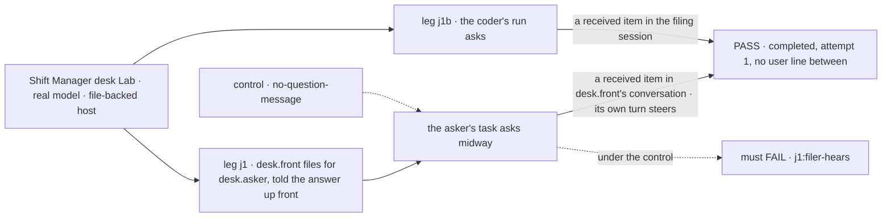
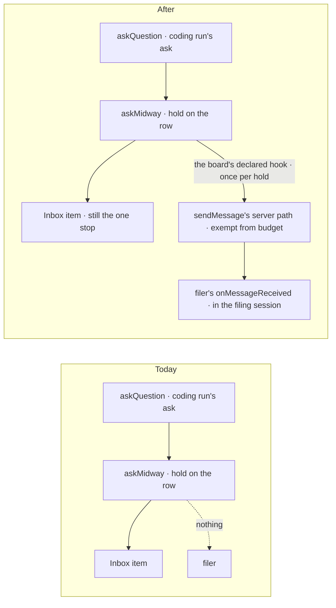

# FIX-2241 · A task's midway question reaches its filer as a message

**Spec** · [Decisions](DECISIONS.md)

## Five people, before and after

| Someone who… | Today | After |
|---|---|---|
| **files work for a worker**, a worker's model | Hears nothing when its task asks a question midway. It finds out only if it happens to read the row with `getTask` | Hears it on `onMessageReceived`, in the session that filed the task, as a message from the task's worker naming the task and the question. It may answer it with `updateTask({ id, question, message })` or leave it to the user |
| **filed a task that was routed to a workstream** | Hears nothing | Hears it the same way, told that the user answers it from the Inbox. Its own answer is still refused `question_is_the_users` |
| **filed a coding task** | Hears nothing when the coding run's question ends the run | Hears it the same way: the coding run's question is a midway question too |
| **is the user** | Sees one Inbox item for the question | Sees the same one item. The filer's answer, if it comes first, closes it; the message is never a second item (PR-3) |
| **runs a ring of workers that is out of budget** | n/a | The question still reaches the filer: the server's question costs no budget (epic ER-6) |

The answer half is already on `main` (FIX-2133 ER-4, FIX-2131): a filer may answer its task's
midway question by a steer, unless the task is routed. Until yesterday a park's question reached
the filer as a task notice; FIX-2131 retired the park and left the telling to this issue.

## The goal, and how we'll know it's met

**When a task a worker filed asks a question midway, by its model or by its coding run, the filer
hears it on `onMessageReceived` in the session that filed the task, once, at no cost to the budget,
and can answer it there with a steer that lets the task go on, while the user's one Inbox item
stays the only stop.**

| Is it the right goal? | |
|---|---|
| **The real need** | The issue: "a question a task asks midway reaches its filer as a message from the task's session … The filer may answer it with a steer unless the task is routed, or leave it to the user." Concept rule 11 and the epic's leg e: "the midway question arrives at the filer's `onMessageReceived` in the session that filed the task; its steer releases the hold" ([epic SPEC](../../epics/FIX-2070/SPEC.md)) |
| **Smaller, and rejected** | "The `askQuestion` tool sends a message." A coding run's question (`harness-manager`'s ask step) would stay silent, and a filer would hear only the questions one tool asks |
| **Bigger, and not this issue's** | Delivery that survives a crash after the message row (FIX-2240) |
| **Not done if** | A coding run's question doesn't reach the filer · the filer's model has to call `getTask` to learn the question or its id · a question is told twice, a durable replay included · the question spends budget, or is refused at a spent one · a routed task's filer is told it may answer · the message opens a second Inbox item · a crash and a replay of the asking turn loses or doubles the message · the filer's answer doesn't let the task go on, on the same attempt |



The check reads desk.front's stored conversation items and the task row, as Alice, through her clients.

| How we verify | |
|---|---|
| **Goal check** | `goals/shift-manager/every-stop-is-one-inbox-item/`, leg j1 amended in place (FIX-2058's ground, as the epic says). Real model, run by the implementer at completion; PASS is j1 green in 3 of 3 runs; verdict in the implementation PR. Model-free: `packages/workforce` and `packages/harness-manager` CI tests for both ask paths, the once, the budget and the routed text |
| **Signal** | `j1:filer-hears` desk.front's conversation gains exactly one received-message item from `desk.asker` whose text names the task's id and the question's id, and an `onMessageReceived` request runs there. `j1:filer-answers-own` (kept, stronger) that request's `updateTask` steer carries the question's id, `from: "filer"`, and the task ends `completed` on attempt 1 with no line from Alice after the filing. `j1:routed-told` a routed task's filer receives the question with the Inbox wording, and its `updateTask` is refused `question_is_the_users`. `j1b:coder-heard` eng.coder's coding question reaches its filer's session as one received item. `j1:one-item` the Inbox lists one item per question throughout |
| **Input** | Alice files with desk.front: "File one task for desk.asker… If it asks you anything about tone, the answer is: formal." The words are picked at run time (`pickWords`); any question and answer pass the same way. The Lab gains what j1 needs: a workstream desk.front routes to (for `j1:routed-told`), and desk.front's model filing eng.coder's task (today's coder legs file from a screen, with no filer session) |
| **Anti-game** | Today's j1 has Alice tell desk.front the question exists; that line goes. Receipt is read from stored items, the answer from the row's steers; nothing seeded |
| **Control that must fail** | Today's `main`: `j1:filer-hears` (nothing is sent). `GOAL_CONTROL=no-question-message` (the hook not called) fails `j1:filer-hears`. `ask-tool-only` (only `askQuestion` sends) fails `j1b:coder-heard`. `question-pays` (the send charged to the budget) fails the CI test of a spent chain. The PR shows each FAIL before the PASS |

## What changes



`askMidway` is the one write every midway ask passes through; after it, the board's declared
delivery tells the filer, and a Workforce board declares it as a message. The hook is called with the
open midway holds read from the committed row, also when a durable replay's ask comes back
declined, so a crash after the hold write still tells the filer.

Nothing a person types changes. The surface is the board's delivery declaration, which Workforce
already fills for its endings:

```diff
 // workforce/src/conversation-board/delivery.ts
 export function conversationDelivery(ledgerId: string): DeclaredDelivery {
   return {
     passEntry: DISPATCH_ENTRY,
     noticeEntry: () => TASK_SETTLED_ENTRY,
     ...
+    // a midway question, told to the filer through sendMessage's server path
+    onMidwayQuestion: (ctx, row, holds) => sendQuestionToFiler(ctx, row, holds),
   };
 }
```

What the filer's model reads (the received item's text, server-written):

```text
Your task "Write the gala greeting" (t7) asks: "Formal or casual?"
Answer it with updateTask({ id: "t7", question: "h1", message }), or leave it to the user, who sees it in their Inbox.
```

**Docs:** update `apps/docs/docs/workforce/messaging-workers.md` (a task's question arrives as a
message; answer with `updateTask`, not a reply) and `apps/docs/docs/orchestration/task-board.md` →
the midway ask (a board's `onMidwayQuestion` delivery; without one the filer reads it with `getTask`);
`packages/workforce/README.md` and `packages/orchestration/README.md`. A changeset for
`@flow-state-dev/orchestration` (`DeclaredDelivery.onMidwayQuestion`) and `@flow-state-dev/workforce`.

## What stays as it is

- **The hold is the record** (FIX-2133). `getTask` and `listTasks` show the open question; the
  Inbox item is read from it, and the first answer, from the user or the filer, closes it.
- **Who may answer** (FIX-2133 ER-4): the filer, only a midway question, only on a task not routed.
- **A message never steers.** Replying with `sendMessage` and `inReplyTo` talks in the task's
  session; it answers nothing.
- **A board without the hook** (an orchestration-only board) tells no one, as today.

## What's already here, and the debt

| Already here | What this does with it |
|---|---|
| Ways to tell a filer about its task, from searches of `packages/*/src` for `recordEnding`, `noticeText`, `sendWorkerMessage`, `onTaskSettled` and `askMidway`: the task notice (endings, durable on the row), the message (FIX-2238), and `getTask`. Before FIX-2131 a fourth: a park's notice (`043be81`, `"parked"` ending) | **Builds on** the message, as the epic decided (seam table). Does not bring the park's notice back: a question is not an ending, and the notice path would deliver it on `onTaskSettled` |
| `askMidway` (`orchestration/task-board/task-request.ts`), called by `askQuestion` and `harness-manager`'s ask step | **Extends**: the convergence point; after a successful ask it calls the board's hook once per opened hold |
| `DeclaredDelivery` (`orchestration/tasks/notice/delivery.ts`), the board-declared delivery Workforce fills (`conversationDelivery`) | **Extends** with one optional hook; Layer 1 knows no message (architecture rule) |
| FIX-2238's send server path and landing rule "a message to the worker that filed your task lands in the session that filed it" | **Builds on**, with `from` and the sending session read from the row, and the budget exemption FIX-2238 left to this issue |
| FIX-2133 ER-4's answer (`answerQuestion`, `question_is_the_users`) and FIX-2058's j1 leg | **Kept**; the leg is amended so the filer hears instead of being told |

| Builds on / Adds | Existing piece considered | Why that doesn't fit, or how this is composed |
|---|---|---|
| `DeclaredDelivery.onMidwayQuestion` | `onUndeliverable`, the same declaration's hook | **Extends** the declaration a Workforce board already fills; no second registry |
| `sendQuestionToFiler` | `sendMessage`'s server function | **Composes**: one call with a server-set sender and an exemption flag; no second delivery path |
| A message id per hold | The message row's take by id (FIX-2240) | **Reuses** it: the id is derived from the task and the hold, so any repeat lands once |

| The debt | |
|---|---|
| **Removes** | The concept's and docs' "until then the filer reads it with `getTask`" |
| **Adds** | One optional hook on `DeclaredDelivery`; one budget-exempt send, permanent by design (epic ER-6) |
| **Leaves** | On a host without durable execution, a crash between the hold write and the message row loses the message (the Inbox item stands), as the epic's D2 leaves for every send. On a durable host the replay sends it, once. From a sending flow with no session board pass (the coder's), a failed fast path on such a host means the filer never hears it; the hold and its Inbox item remain ([DECISIONS](DECISIONS.md#decided-not-asked)) |

**Net: flat.** One hook and one send, against a rule the code doesn't keep today.

## Sign off

**[The goal](#the-goal-and-how-well-know-its-met), at that size:** every midway question, the
coding run's included, reaches its filer once, free, and the filer's steer lets the task go on.
If wrong: a filer that could answer leaves the user to.

**[The debt](#whats-already-here-and-the-debt): flat.** Adds one hook and one exempt send. If
wrong: a second way to tell a filer grows beside the notice.

**No decision cards:** the epic decided the model, and FIX-2133 the answer. **Open: none.** The engineering calls: [DECISIONS.md → Decided, not asked](DECISIONS.md#decided-not-asked).

Feature · `orchestration`, `workforce`, `harness-manager` (tests only) + docs · small (one hook, one send, one goal leg) · 1 PR, after FIX-2238's (stacked on it while it is open) · epic FIX-2070
