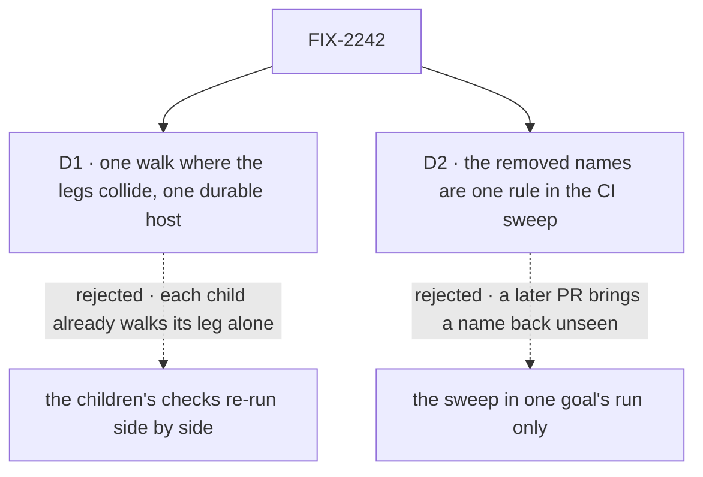

# FIX-2242 · Decisions

[Spec](SPEC.md) · **Decisions**

The plan's four rows are the [closure rule's](../../../docs/contributing/orchestration.md#the-closure-issue-every-epic-ends-in-qa)
and its legs are the [epic's](../../epics/FIX-2070/SPEC.md#the-goal-and-how-well-know-its-met).
Two calls are this spec's: how the walk puts the legs together, and where the sweep keeps running.

## The tree

Solid edges are what you're signing. Dashed edges lost, and the label says why.

## D1 · One walk where the legs collide, on one durable host, not the children's checks side by side

| | |
|---|---|
| **Instead of** | Re-running each child's legs (1 to 10c, j1) and calling the set proved when each is green |
| **Because** | Each child's check walks one leg on a host where nothing else happens. What none of them sees is the legs meeting: a call outstanding when the host dies between its row and its dispatch (a with c), a midway question reaching a filer whose request is parked on a call (e with a), a ring spending a typed message's budget while a call waits (d beside a). Those need the legs in one Lab, on one host, at once. The ring keeps its own typed message, so its budget can't be confused with the call's |
| **Locks in** | A real-model run with a kill and a restart, some minutes per attempt, repeated in full per finding. Each assertion is tagged `<leg>:<assertion>`, so a red leg doesn't hide the others, and every attempt is printed |

It comes down to collisions: a check that walks one leg on a calm host can never produce one.

**What would change my mind:** a host that can't be killed and restarted mid-call in a goal run.
Then a and c walk on their own, and e meets a parked call that never crosses a restart.

## D2 · The removed names are one rule in the CI sweep, beside FIX-2134's, not a check one goal runs

| | |
|---|---|
| **Instead of** | `workers-message-each-other`'s own sweep (`run.mts`, `REMOVED`), which runs only when that goal runs, over `packages/*/src` |
| **Because** | The epic promises one entry and one tool. The likeliest way to break that after the wrap is a later PR bringing back `messageWorker`, the relay or a refusal under its old name, and only CI sees every PR. FIX-2087's engine already runs in CI with plants, and FIX-2134 added `PERSON_STOPS_REMOVED` beside its rows, so this is one more list in the same pass, not a second sweep. The goal's sweep then reads this list, so there is one copy |
| **Locks in** | A PR naming one of the twelve where the sweep reads (package source and tests, the pages a user reads; comments skipped) fails CI until it edits the list. `replyTo` is a word `core`'s dispatcher and tests still use for their own fields, so it is matched only in `packages/workforce`, `packages/shift-manager` and the pages, as FIX-2134 scoped `answerQuestion` |

It comes down to a later PR: swept only by one goal, a returned `messageWorker` is seen at the next closure, if ever.

**On `main` today the list is not yet green:** `packages/shift-manager/test/messages-view.test.tsx`
still renders a `takes_tasks_only` refusal, which FIX-2238 removed. The CI sweep reads tests, so
the PR adding the rule updates that fixture to a refusal that exists.

## The plan in full

| # | What runs | PASS means |
|---|---|---|
| 1 | Legs a to e and the sweep ([the signal](SPEC.md#the-signal)) | Each green; each control red where named |
| 2 | **j1** *uses Shift Manager*, in a browser as Alice after the walk: Researcher's conversation shows Helper A's call once, as its own item, with its sender and its call mark, and Helper A's conversation shows the call's tool line answered with the reply, never a second received item (`j1:own-item`); the Messages view lists the crashed call once, `delivered`, the parked call `answered`, and the ring's seventh `refused` (`j1:states`); each side's link opens its session (`j1:opens-side`). j1 grades only the screen: what it reads, row 1 has already graded in the store, so a j1 failure with row 1 green is a drawing bug. The other four teams' *after* is walked by leg a (builds talkers), e (files work), c and d (production) and the sweep (maintains); each mapping is printed | Each green |
| 3 | Every child's goal check with its controls, read from Linear at run time and printed: `workers-message-each-other` legs 1 to 10c with every control, FIX-2240's leg 9 included; `every-stop-is-one-inbox-item` j1 and j1b with FIX-2241's controls, and its other legs, since FIX-2241 changed its Lab. **None is skipped:** row 1 walks the legs together in its own scenes, never a child's legs as that child wrote them. #4021's two budget cases are CI tests | Each PASS beside its documented FAIL |
| 4 | The gap sweep: each [coordination seam](../../epics/FIX-2070/DECISIONS.md#coordination-seams) from both sides, as its row names them; [`messaging-workers.md`](../../../apps/docs/docs/workforce/messaging-workers.md) and the Workforce README followed as written; each epic *not done if* state absent | Every seam two-sided |

**Must be green first:** every other child merged with its goal's PASS and its controls' FAIL;
#4021 merged; the D2 rule in CI. **FIX-2240's leg 9 is not on `main`:** #4008 merged with its
model-free tests and without the goal leg its spec names (`9:crash-after-row` and the rest, with
`no-debt` and the other four controls). It lands before the run, as its own child of FIX-2070
blocking this issue, since leg c reuses its faults and `no-debt`.

## Decided, not asked

- **Leg a's callee is an agent worker, not the coder.** The epic's figure says "writer calls
  coder", but FIX-2238 D1 lets the coder hear only in its tasks' sessions. The coder is reached by
  `{ task }`, which FIX-2160's leg 8 and FIX-2239's `10:task-call` cover in row 3.
- **Leg e asks through `askQuestion`, from an agent worker's task.** Both ask paths share one
  point (`askMidway`); the coder's path is j1b, re-run in row 3. The walk then needs no Claude Code.
- **Leg c's crash uses FIX-2240's `exit-after-row` fault,** through `goals/lib/module-patch.mjs`,
  one-shot on the call's row.
- **[FIX-2087 D1](../FIX-2087/DECISIONS.md#d1), inherited:** a structural miss on any attempt is a
  finding; only a judgment miss (what the model chose to write) earns another attempt.
- **One new control, `call-holds-session`:** a parked call keeps its session's place, so a
  question to the filer waits for the call to end. It is the one collision no child's control
  breaks. A patch that never fired fails the build.
- **Today's `main` is `e2c190e`,** the commit before FIX-2238. Leg d can pass there, since
  FIX-1989's hop limit already stopped a ring at 6; the epic names a, b, c and e.
- **No legacy leg:** stores are reset between the refactor epics, as the epic's seam table says.
- **Kitchen-sink's missing `workforce:received` renderer** is outside FIX-2070 and not graded.

## Considered and dropped

| Alternative | Why not |
|---|---|
| Re-run the children's checks and stop there | Each leg alone is proved by its own child; row 3 re-runs them. What none can show is the legs colliding (D1) |
| The ring in the same typed message as the call | Its budget and the call's would mix, and a red `d:seventh-refused` couldn't say whose message was seventh |
| A Claude Code coding run in the walk | The coder's ask path is j1b's; the collision is the filer's, whatever asks |
| The walk model-free | The epic's goal says real model; the CI tests are the model-free half |

## How it got here

- **Draft** — the epic's legs on one durable host, a call across the crash, a question to a
  filer parked on a call; FIX-2134's shape and FIX-2087's D1 kept; the sweep added to the CI
  engine beside `PERSON_STOPS_REMOVED`. Found on `main`: FIX-2240's leg 9 never landed, and a
  shift-manager test still names `takes_tasks_only`.
- **Review** — leg e waits again by call id (`e:kept-once`), j1 reads a call as a tool result, rows 3 and 4 trimmed (Codex, Cursor).

## Notes from review

- **Codex, folded:** `j1:own-item` looked for the call's answer as a received item, which `a:no-relay` forbids; it now reads the call in Researcher's conversation and the answered tool line in Helper A's. `send-again` graded `a:one-place`, which never waits again; leg e now waits again by call id and `e:kept-once` carries the control.
- **Cursor, folded:** row 3 says nothing is skipped and why; row 4 points at the seam table instead of restating it; j1 grades the screen only; the docs line says the pages are followed, not written.
- **Cursor, kept:** the sequence diagram is the required *What changes* figure, and the flowchart is the goal's; the figures' CSS is the trade-off template's, copied as every spec does.

**Open: none of its own.**
