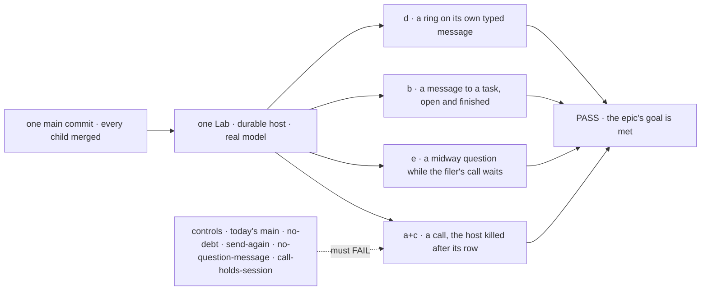
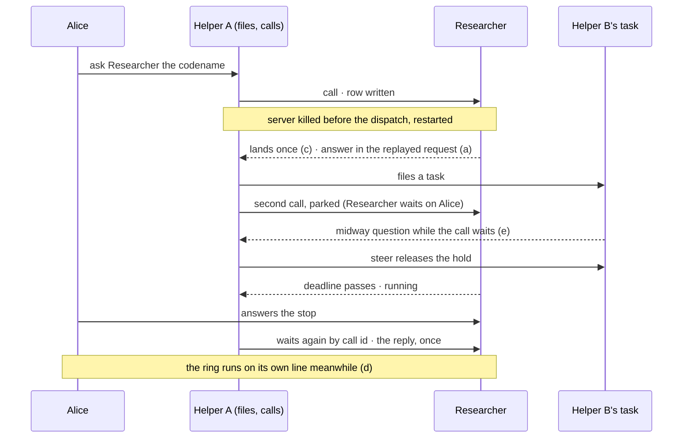

# FIX-2242 · Closure: workers talk by send and call, to any worker, task or conversation

**Spec** · [Decisions](DECISIONS.md)

## Five teams, before and after

| A team that… | Today | After this closes |
|---|---|---|
| **decides whether the epic is done** | Each child green on its own commit; no check has a call, a crash, a midway question and a ring on one host at once | One report on one `main` commit, every check beside its control's FAIL |
| **uses Shift Manager, like Alice** | Each kind of message is shown in its own child's run | In a browser after the walk, each message shows once, in the session it is about, with its sender, what it answers and its state, a restart included |
| **builds a worker that talks to others** | A call is proved on a calm host | A call outstanding across a crash still returns its answer, once, to the request that asked |
| **builds a worker that files work** | Hears its task's midway question in a check with nothing else running | Hears it while its own call waits, steers, and the task goes on the same attempt |
| **runs Workforce in production, or maintains it** | The removed names are swept only when one goal runs | CI fails a later PR that brings `messageWorker` or the relay back ([D2](DECISIONS.md#d2)) |

## The goal, and how we'll know it's met

**On one `main` commit with every other child merged, in Shift Manager on a real model and a
durable host, a worker calls another and uses the answer in the request that asked, across a
crash between the log write and the dispatch; a message to a task lands in that task's session;
a task's midway question reaches its filer while the filer waits on a call; every message lands
once; a ring stops inside one typed message's budget; and none of the removed names is in source.**

| Is it the right goal? | |
|---|---|
| **The real need** | [The epic's goal](../../epics/FIX-2070/SPEC.md#the-goal-and-how-well-know-its-met) on the assembled set: the gaps *between* children ([closure rule](../../../docs/contributing/orchestration.md#the-closure-issue-every-epic-ends-in-qa)) |
| **Smaller, and rejected** | "Re-run every child's legs." Each walks one leg on a calm host, so a call lost across a crash, or a question that can't reach a filer parked on a call, still passes ([D1](DECISIONS.md#d1)) |
| **Not done if** | The [epic's list](../../epics/FIX-2070/SPEC.md#the-goal-and-how-well-know-its-met), plus: a check ran on another commit · a structural miss was retried away ([FIX-2087 D1](../FIX-2087/DECISIONS.md#d1)) · a control was skipped or passed · a check graded through a child's helper · a finding is open |



The walk reads sessions and the log through public actions; each control breaks one leg.

| How we verify | |
|---|---|
| **Goal check** | `goals/shift-manager/workers-talk-together/`, new, reusing `workers-message-each-other`'s cast and world · the model each worker's file names (`openai/gpt-5.4-mini`; the Shift Coordinator `anthropic/claude-haiku-5-5`) · run by the closure worker on one `main` commit · the report is the closure PR's body |
| **Signal** | Every `<leg>:<assertion>` in [the signal table](#the-signal) passes |
| **Input** | DevTeam served by Shift Manager's command over a SQLite store file (`DEVTEAM_STORE`), killed and restarted on the same file; codenames and the brief's fact picked at run time |
| **Anti-game** | Assert on sessions' stored items, the message log and `getTask`, read as Alice; nothing seeded; sent messages counted from each turn's own tool outputs; a fault that never fired is a setup failure, not a grade |
| **Control that must fail** | Today's `main` before FIX-2238 (`e2c190e`): legs a, b, c and e, and the sweep · `no-debt` (FIX-2240's) **`c:lands-once`** · `send-again` (FIX-2239's) **`e:kept-once`** · `task-to-conversation` (FIX-2160's) **`b:in-task-session`** · `no-question-message` (FIX-2241's) **`e:filer-hears`** · `no-hop-cap` (FIX-2238's) **`d:seventh-refused`** · `call-holds-session`, new: a parked call keeps its session's place **`e:heard-while-calling`** · the sweep's `--control` its plants |

### The signal

| Assertion | Passes when |
|---|---|
| `c:lands-once` | Helper A calls Researcher; the server kills itself after the call's row is written, before its dispatch; restarted without the fault, Researcher's session holds exactly one received item for the id, and the row is `delivered`, `deliveredAs` naming the resend |
| `a:answer-in-request` | Helper A's request that made the call, replayed by the durable host, reads Researcher's answer as the call's result, and its answer to Alice holds the codename, with no line from Alice in between. A killed request the host never replays is a finding, not a pass by waiting again |
| `a:one-place` | The log holds one row and one budget place for the call, crash and replay included |
| `a:no-relay` | Researcher's turn sends no message back, and Helper A's conversation gains no received item from it |
| `e:filer-hears` | Helper A files Helper B a task whose brief needs a fact only Helper A holds; Helper B asks it midway; the question arrives at Helper A's `onMessageReceived` in the session that filed the task |
| `e:heard-while-calling` | It arrives while Helper A's second call, into Researcher's conversation holding a stop for Alice, is parked: the received item is stored before the call resolves |
| `e:steer-releases` | Helper A's steer releases the hold, and the task finishes on attempt 1 |
| `e:kept-once` | The second call's deadline passes before Alice answers Researcher's stop, so it returns `running`; after her answer, Helper A waits again by call id and gets Researcher's reply. The log holds one row and one budget place for that call |
| `b:in-task-session` | A message to Helper B's task while its turn runs lands in that task's session after the turn ends; one sent after the task finished is answered there from the task's history |
| `b:task-unchanged` | The row's status, output, attempts and session are the same before and after both |
| `d:per-request` | Started on its own line from Alice, the ring's fourth send from one request is refused |
| `d:seventh-refused` | The ring's exchange holds exactly 6 messages and the seventh is refused at the limit, while leg e's call is parked |
| `sweep:no-old-path` | None of [D2](DECISIONS.md#d2)'s `MESSAGE_NAMES_REMOVED` has a reference in what the CI sweep reads, each at its scope |

**The rest of the plan** is [in DECISIONS](DECISIONS.md#the-plan-in-full): one browser journey,
the children's checks under a skip map, and the gap sweep. A failure becomes a child of FIX-2070
blocking this issue, and the plan runs again as the closure rule says.

## What changes



Before, each arrow lived in its own child's check on a calm host; the closure runs them on one.

**The sweep, one rule in the engine CI already runs** ([D2](DECISIONS.md#d2)):

```diff
  // goals/workforce-coordination/runs-on-one-task/rules.mjs
+ // FIX-2070's old message surface: no reference where the sweep reads, matched as
+ // PERSON_STOPS_REMOVED is, with the same `--control` plant
+ export const MESSAGE_NAMES_REMOVED = [
+   "onWorkerMessage", "messageWorker", "MESSAGE_WORKER_TOOL", "WORKER_MESSAGE_ENTRY",
+   "workerMessageEntry", "sendWorkerMessage", "takesWorkerMessages", "workforceRelayTo",
+   "takes_tasks_only", "no_turn", "answerTo",
+   { name: "replyTo", files: /^packages\/(workforce|shift-manager)\/|^apps\/docs\/(docs|guides)\// }, // core keeps the word
+ ];
```

**Docs:** no documentation impact: no page is written or changed. Row 4 follows the pages FIX-2238 and FIX-2239 published, and the sweep reads them; a page that doesn't hold when followed
is a finding against its child.

**Stays as it is:** all product code; every child's check as it is on `main`, except that
`workers-message-each-other`'s own sweep reads D2's list instead of its copy. No legacy leg:
stores are reset between the refactor epics.

## What's already here, and the debt

| Already here | What this does with it |
|---|---|
| The epic's legs a to e and its sweep | **Builds on.** Walked together, not apart |
| `workers-message-each-other` (legs 1 to 8 on `main`, 9 and 10 to come) and `every-stop-is-one-inbox-item` j1 | **Composed.** Cast and world reused; five controls reused |
| `workers-message-each-other`'s `sweep` in `run.mts`, run only with that goal | **Replaced** by D2's rule, which it then reads |
| [FIX-2134](../FIX-2134/SPEC.md), the last closure, and `PERSON_STOPS_REMOVED` | **Kept** its shape; **extended** by one list beside it |
| Anything else grading the set | **None.** Searched `goals/` for `sendMessage`, `onMessageReceived`, `callId`, `closure` |

| The debt | |
|---|---|
| **Removes** | One copy of the removed-names list |
| **Adds** | One goal and one CI rule. Permanent by design |
| **Leaves** | Kitchen-sink draws no `workforce:received` item; outside this epic, not graded |

**Net: up, a little.** One goal and one list, for a promise that stays true.

## Sign off

**[The goal](#the-goal-and-how-well-know-its-met), at that size:** the five legs on one durable
host, colliding, on a real model and one commit. If wrong: the epic wraps on pieces that pass apart
and break together.

**[The debt](#whats-already-here-and-the-debt), net up a little:** one goal and one CI rule. If
wrong: a CI rule that fails a later PR reusing one of twelve names.

1. **[D1](DECISIONS.md#d1) · One walk where the legs collide, not the children's checks side by
   side.** If wrong: a longer run whose failures are harder to split.
2. **[D2](DECISIONS.md#d2) · The removed names are one rule in the CI sweep, beside FIX-2134's.**
   If wrong: one more list to edit when a name is reused.

**Open: none of its own.** D1 is the one to weigh. Before the run: FIX-2240's leg 9 is not on
`main` yet ([Must be green first](DECISIONS.md#the-plan-in-full)).

Improvement · closure (QA) · `goals/` and one CI rule · large, repeats per finding · epic
[FIX-2070](../../epics/FIX-2070/SPEC.md), closure · required · runs after every other child merges
(FIX-2238, FIX-2160, FIX-2240 done; FIX-2239, FIX-2241 in review) · Linear [FIX-2242](https://linear.app/fixpoint-labs/issue/FIX-2242)
