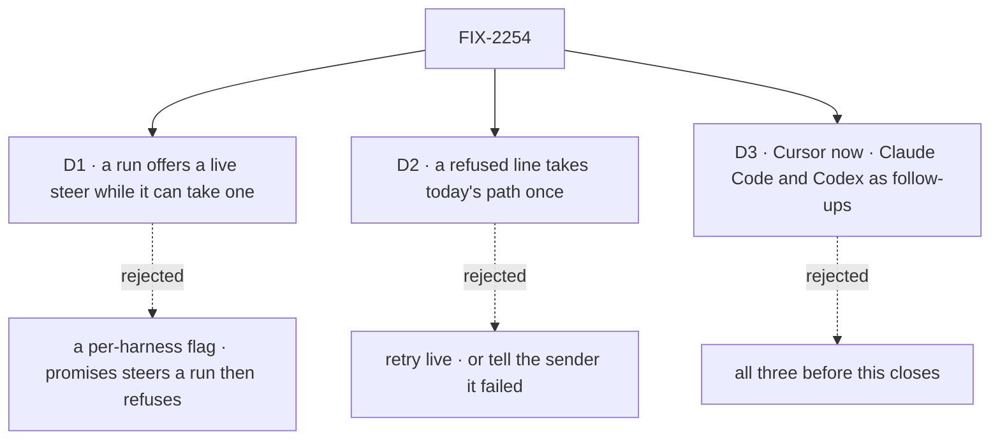

# FIX-2254 · Decisions

[Spec](SPEC.md) · **Decisions**

FIX-2086 settled what a steer is and that it is taken once. These three settle how a run that can
take one in flight says so, what happens when it says no, and which harnesses do it now.

## The tree

Solid edges are what you're signing. Dashed edges lost, and the label says why.

## D1 · A run offers a live steer while it can take one, not a harness once for all its runs

| | |
|---|---|
| **Instead of** | A flag a harness declares once (`steers: true`), which the manager and Kitchen Sink read before the run starts |
| **Because** | Whether a line can go in flight is a fact about one run, learned during it. Cursor's `steer` is optional on its `Run`, exists only for local runs, and a cloud run always answers *send it as a follow-up*. A run that hasn't started its turn yet, or has finished it, can't take one either. A flag would promise a steer the run then refuses, and every caller would need the refusal path anyway. The hook says it when it is true. It is the same kind as `onSession`: the harness calls the host during the run, so core gains no vendor notion and the host asks the run, not the name (tenet 2) |
| **Locks in** | Core's `HarnessSteer` (`(text) => Promise<"delivered" \| "refused">`) and `HarnessSteerHook` (`(steer \| null, ctx) => void`), offered as `onSteerable` on the harness block's options, the manager's feeds and Kitchen Sink's feeds. A harness calls it with a function once its run can take a line, and with `null` before the block returns, on every exit. `delivered` means the turn in flight has the words; anything less is `refused`. A cloud run (FIX-2256) offers nothing |

It comes down to a run that refuses what its harness can do: a flag promised a steer the run won't take.

**What would change my mind:** every harness that steers taking a line on every run it starts,
from the first message to the last. Then a flag is simpler and the refusal path is rare.

## D2 · A refused line takes today's path once, with the same words

| | |
|---|---|
| **Instead of** | Retrying the live steer until the run takes it, or telling the sender the line was not delivered |
| **Because** | The sender was told the steer was accepted (FIX-2086 D2's reason), so it must reach the work. Cursor's `revert_to_followup` means *the turn does not have it; send it as a follow-up yourself*. Retrying live into a turn that is ending can't succeed. Today's path already delivers it: the manager stops the step (with `stopsOnAbort`) or adds one at the step's end, and Kitchen Sink sends it as the next turn |
| **Locks in** | One take per line. The manager takes the line before handing it to the run, so a line is taken once whichever way it reaches the work; taking first also stops a later poll handing over a line still pending. The row has no untake, so a refused line is kept as owed: the step's own end, a stop (with `stopsOnAbort`) and the check before the settle all count it with the untaken lines and render it into the next step. **Binding:** after a take, every exit hands the line to the run or counts it refused, never drops it; a poll that finds its step ended before it handed the line over counts it refused, and a line already handed over waits for its answer. Where the owed record lives (the request's own state, or a mark on the row's steer) is the implementer's call against the code; the invariant is not. Kitchen Sink's `steer` answers `{ taken: false }` and the page sends the line as a `turn`; the line shows once in the conversation |

It comes down to a line the sender was told was accepted: a retry into an ending turn loses it.

**A pending steer is never guessed at.** Cursor's `steer` stays pending through the server's
intermediate ack and settles on the terminal outcome that follows, so the Cursor block waits for
that answer before it returns, with no timer. Only `refused` sends the line on. The one cut is a
run stopped from outside (its deadline, or a cancel): its turn is cut anyway, so the line goes to
the next step with a note that the conversation may already hold it.

**What would change my mind:** Cursor refusing lines it would take a moment later, a pending
steer the SDK resolves late. Then a short retry before the fallback pays for itself.

## D3 · Cursor only now; Claude Code and Codex get their own follow-ups

| | |
|---|---|
| **Instead of** | Live steering for all three harnesses before this closes |
| **Because** | The issue asks for Cursor first and Codex if its contract fits. It doesn't: our Codex harness runs `@openai/codex-sdk`, which spawns `codex exec` per turn and has no steer; only Codex's app-server has `turn/steer`, and moving runs onto it is a transport change for the whole harness. Claude Code's SDK takes messages into a running query (`streamInput`, `priority: 'next'`), but our harness sends a single-message prompt, so it needs a move to streaming input and a real-CLI check that a `next` message joins the running turn. The hook lets each join without touching the manager or Kitchen Sink |
| **Locks in** | Cursor offers the hook; Claude Code and Codex don't. The parity row says so per mode, and flips when each follow-up lands |

It comes down to what each harness needs: Cursor steers today; the other two need their run changed.

**What would change my mind:** you want every mode steering live before this closes. Then
Claude Code joins here (a smaller change than Codex's), and Codex stays a follow-up.

## Decided, not asked

- **The convergence point stays the take.** Every line reaches a coding run through the task
  row's steer take (`board.takeSteers`, fenced to the claim). The manager's poll takes the
  untaken steers, renders them as one line, and hands it to the run. Writers: `updateTask`'s
  `message`, the session door's line. Nothing writes around the take.
- **A live steer is no step and no ending.** It adds no `steerSteps`, uses no attempt, never
  aborts, never settles. The 20-steer cap still holds at write.
- **When the poll runs.** As today with `stopsOnAbort`; without it, only while the run has
  offered a steer. Same `STEER_POLL_MS`. A failed read stops nothing.
- **Cursor block.** Offers `run.steer` once `send` returns, on a local run that has it
  (`CursorRunLike` gains an optional `steer`); maps `complete_delivered` to `delivered` and
  everything else, a throw included, to `refused`; withdraws (`null`) before the block returns.
  The `env` child runtime reports in its `send` reply whether the run has `steer`, and gains a
  `steer` op. `onSession` fires before `send`, so a refused line always finds a confirmed
  session to resume.
- **A steer during a background wait** goes to the SDK like any other; 1.0.40 runs it at once.
  Leg w checks it rather than assuming it.
- **Kitchen Sink.** The session flow keeps one in-process offer per session, keyed by the
  framework's session id, never by the body (BP-031). `steer` answers `{ taken }` and writes the
  turn record's notice; the composer sends `steer` while a turn runs, then `turn` on
  `{ taken: false }`. The page says *taken into the running turn* or *runs after this turn*.
  The fallback runs on the page, so a page closed between the two sends loses the line, as a
  failed `turn` send does today. Kitchen Sink is the showcase, not the production path; the
  manager's fallback is server-side. Lines are sent in typed order: the composer holds a second
  line until the first has its answer.
- **Parity row.** Per mode: whether it takes a line live, and that a line sent mid-turn reaches
  the run exactly once. Scripted SDKs gain a pause and a scripted `steer` answer.
- **One style of run callback in core.** FIX-2145 (#3886) also adds per-run harness callbacks to
  `types/harness.ts`; whichever lands second takes the other's shape (harness → host, `(value, ctx)`).
- **No POC and no checker.** The SDK facts are read from the packages' typings (Cursor 1.0.31 and 1.0.40
  `run.d.ts`, Codex SDK 0.164.0, Agent SDK 0.3.312 `sdk.d.ts`); nothing rests on a count.

## Considered and dropped

| Option | Why it lost |
|---|---|
| Call `run.steer` inside the Cursor package only | Nothing hands it a line ([SPEC](SPEC.md#the-goal-and-how-well-know-its-met)) |
| A generic engine hook: deliver input to a running request, across processes | The manager already polls the row in the step's own process. No engine change is needed |
| Make `turn` steer when a turn is running | `queue` holds the second turn before its block runs; `allow` runs two harnesses in one worktree |
| A mode check in the session flow (`if mode === "cursor"`) | The issue forbids it; the hook makes it unnecessary |
| Fix the owed record's home in the spec: the request's state, or `delivery: live-refused` on the row's steer | Both meet D2. A mark on the row survives a crash between the answer and the next step and keeps one place to read, but adds a persisted field every steer reader must tolerate (BP-030) and a second fenced write after the answer. The request's state adds neither, but is a second place to read. The difference is in the code, not the direction, so D2 binds the invariant and leaves the home open |

## Settled

- **Cursor has `steer` for local runs since 1.0.31; main pins 1.0.40** (#3993). `run.d.ts`: `steer?(text): Promise<"complete_delivered" | "revert_to_followup">`; the latter means *send it as an ordinary follow-up*. 1.0.32 makes a steer during a background-subagent wait run at once.
- **A Cursor turn waits for its background work** (Jake's call in the Cursor SDK thread, 2026-10-27). A steer during the wait goes to the SDK.
- **Codex's SDK can't steer.** 0.164.0 spawns `codex exec --experimental-json`; no steer in its typings. App-server's `turn/steer` exists ([docs](https://developers.openai.com/codex/app-server)).
- **Claude Code's SDK takes messages into a running query** (`Query.streamInput`, `SDKUserMessage.priority`); whether `next` joins the turn in flight is for its follow-up.
- **Kitchen Sink queues a line typed mid-turn.** Enter submits the form while streaming ([`prompt-input.tsx:852-869`](https://github.com/fixpoint-labs/flow-state-dev/blob/50a96de/packages/ui/registry/components/prompt-input.tsx#L852-L869)) and `turn` is `concurrency: "queue"`.

## Analysis

2026-10-27, on the draft. **Right approach**, with one fold. The draft said a refused line is
rendered into the next step "the same as a line that arrived too late". In the code it isn't:
a late line is untaken on the row, and a taken-then-refused one is not, so the step's own end,
a stop and the settle would all have dropped it. **Folded** into D2: a refused line is kept on
the request as owed. Reuse: the core hook and the manager's poll extend what is there; the
Kitchen Sink action is new and needed. Blind goal check: **folded** a leg for a turn waiting on
background work, one run id on leg k, the page's notice, a parity row read from the run, and a
second control. Recorded for the implementer below.

## Notes from review

- "The poll's `live()` early returns would silently drop a line taken just before the step ends. After a take, every exit must hand the line on or count it refused." — analysis
- "Consider the SDK's own `supports?(\"steer\")` probe, used today for `wait`." — analysis
- "The `HarnessFeeds` docs say four feeds (manager.ts:487, 533). The Kitchen Sink `HarnessFeeds` is a separate interface and needs the field too." — analysis

- "Extending poll to runs without `stopsOnAbort` adds ~1 Hz committed reads for the whole steerable window. Implementers should treat event-driven wake after row take (and idle backoff when no untaken steers) as part of the design, not an optional optimization." — Cursor bot, round 2
- "In-process offer map keyed by session id duplicates state the session flow already owns (`serverOwned` binding/turns). Simpler v1? Register `HarnessSteer` in session-scoped state (or WeakMap on session identity) unless you truly need a global registry. Also: fifth feed is a good moment to export one host feed type from core and drop copy-paste." — Cursor bot, round 2
- "For a smaller first implementation PR, consider an optional phase order (core + manager + cursor + h/w goal legs, then KS steer action + composer + k/r). Cursor first can still close the issue in two slices under one approved spec." — Cursor bot, round 2

These are inputs, not instructions.

## How it got here

- **Draft** — framed as FIX-1690's deferred live delivery, delivered for Cursor: a run offers a
  steer through a core hook like `onSession`; the manager's existing poll and a Kitchen Sink
  `steer` action hand it the line, and a refusal takes FIX-2086's stop-and-resume.
- **Analysis** — a refused line is kept on the request as owed, because the row has no untake;
  the goal check gains a waiting-turn leg (Jake chose that a turn waits for its background
  work), and the spec moves to the 1.0.40 pin and FIX-2256's cloud runs.
- **Codex, round 1** — a steer still pending when the run ends waits for Cursor's own answer
  instead of a grace timer, because a timeout can't tell a refusal from a delivery and would send
  the line twice.
- **Cursor bot, round 2** — D2's "hand on or count refused, never drop" became binding, and where
  the owed record lives (request state or a mark on the row's steer) was left to the implementer;
  the goal check's signal was split per leg.
