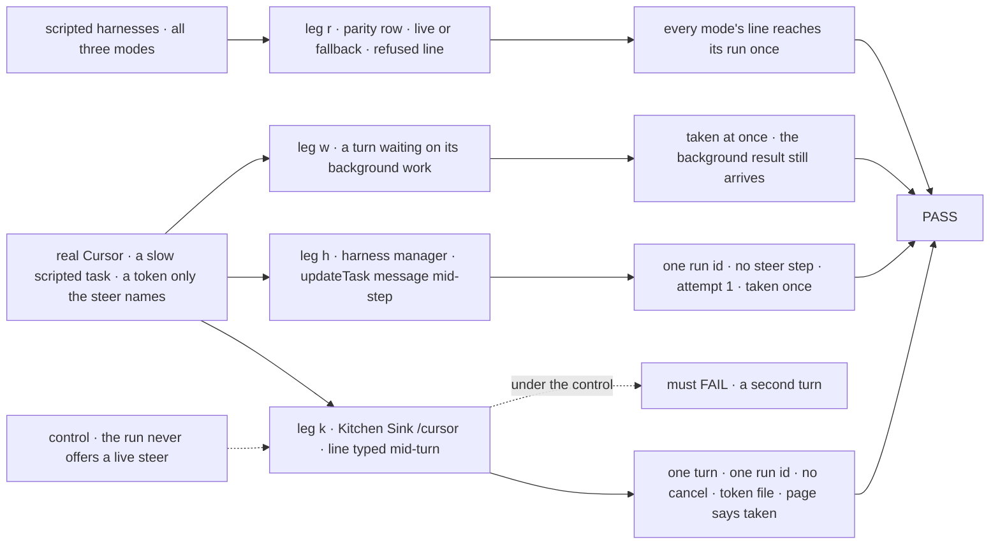
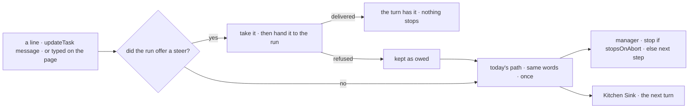

# FIX-2254 · Steer a running coding turn live where the harness supports it (Cursor first)

**Spec** · [Decisions](DECISIONS.md)

## Six people, before and after

| Someone who… | Today | After |
|---|---|---|
| **steers a task a Cursor worker is coding** | The run's step is stopped (or the line waits for the step to end), then the same coding session resumes with the line. The step in flight is lost | Cursor takes the line into the turn it is running. Nothing stops, no step is added, the task stays on attempt 1 |
| **steers a task a Claude Code or Codex worker is coding** | Stop-and-resume, as above | The same. Their own live steer is a follow-up each |
| **steers a Cursor turn that waits on its background work** (Jake's call: a turn waits for it) | Stop-and-resume, which ends the wait | The turn takes the line at once (SDK 1.0.32+, pinned 1.0.40). The wait is not cut |
| **steers a Cursor run that refuses the line** (Cursor answers *send it as a follow-up*), or a cloud run (FIX-2256) | — | The line takes today's path, once, with the same words. It is never lost |
| **types while a turn runs on Kitchen Sink's `/cursor`** | Enter queues the line as the next turn, which starts only when this one ends | The running turn takes the line, and the page says *taken into the running turn*. A refused line becomes the next turn, as today |
| **types while a turn runs on `/claude-code` or `/codex`** | Queued as the next turn | The same, and the page says *runs after this turn* |

## The goal, and how we'll know it's met

**A person's line reaches a coding turn that is already running without stopping it, on every
harness run that can take it live (Cursor, in this issue), and reaches it by today's
stop-and-resume on every run that can't or refuses; Kitchen Sink and the harness manager ask the
run, never the harness's name.**

| Is it the right goal? | |
|---|---|
| **The real need** | *"Steering is a per-harness capability behind FIX-2086's existing steer contract … No mode branches in Kitchen Sink's `harness-session-flow` … Kitchen Sink shows steering per mode: Cursor first, Codex if its contract fits"* ([FIX-2254](https://linear.app/fixpoint/issue/FIX-2254)) |
| **Smaller, and rejected** | "Call `run.steer` inside the Cursor package." Cursor would take a line, but nothing hands it one: the manager would still stop the step, and Kitchen Sink would still queue |
| **Bigger, and not this issue's** | Live steering for Claude Code (FIX-XXX · steer a running Claude Code turn live) and Codex (FIX-XXX · steer a running Codex turn live) · steering a cloud run live (FIX-2256 keeps cloud on stop-and-resume) · the SDK pin (FIX-2253, merged: main pins 1.0.40) |
| **Not done if** | A line delivered live also reaches a later step or turn, or a pending one is sent on before Cursor answers (except a run stopped from outside, whose next step is told the line may be there already) · a refused line is dropped, by a step that ended on its own, a stop, or the settle · a line sent while the turn waits on its background work is dropped, sent twice, or ends the wait · a live steer uses an attempt, adds a step, stops a step, or settles the task · the page says *taken* for a line that went to the next turn · `harness-session-flow.ts` or the manager names a harness · the parity row hardcodes which modes are live, or passes for a mode whose line never reaches its run |



The check runs a real Cursor turn and steers it mid-flight; the dashed control takes the live
offer away, and the line must then land in a second turn, failing leg k.

| How we verify | |
|---|---|
| **Goal check** | `goals/cursor-harness/takes-a-steer-mid-turn/` · `CURSOR_API_KEY=… pnpm tsx goals/cursor-harness/takes-a-steer-mid-turn/run.mts` (legs k, h, w; real Cursor, `@cursor/sdk` 1.0.40) · leg r is `pnpm --filter kitchen-sink test harness-parity` (`apps/kitchen-sink/test/harness-parity.test.ts`), in CI · run by the implementer at completion · verdict in the implementation PR |
| **Signal** | One entry per leg, each read from the run, never the model's prose:<br>• **k** (Kitchen Sink's `/cursor` session flow, driven as the page drives it: `turn`, then `steer` mid-turn): one `turn` request · one Cursor run id and no cancel · `steer` answers `{ taken: true }` and the turn record says taken · the token file exists · the last step file exists<br>• **h** (a harness manager over Cursor, `updateTask({ message })` mid-step): one Cursor run id · `steerSteps` unset · the steer taken once · attempt 1<br>• **w** (a turn that starts a background subagent and waits on it, steered during the wait): the steer is taken live · the token file exists · the background result still reaches the turn<br>• **r** (per mode): *live* is read from whether the run offered a steer, true for Cursor and false for the other two · a line sent mid-turn reaches the run exactly once, a Cursor line the scripted SDK refuses included · the session flow and the manager import no harness package |
| **Input** | A task that writes six step files with a pause between them; the steer asks for a file holding a fresh random token. Held out: any step count, any arrival point after the run starts |
| **Anti-game** | Files read from the worktree, rows through `getTask`, run ids from the run's own items, never the model's prose. Leg r drives the real adapters behind scripted SDKs, never a fake block |
| **Control that must fail** | `GOAL_CONTROL=no-live-steer` (the Cursor block never offers a steer) must FAIL leg k on *one `turn` request*, leg h on *`steerSteps` unset* and leg w on *taken live*. In leg r, `drop-refused` (a refused line is not carried on) must FAIL Cursor on *exactly once*, and `drop-fallback` (a non-live mode's line is not queued) must FAIL Claude Code and Codex on it |

## What changes


A run that can take a line offers it through one hook; everything else keeps today's path.

**A host wiring a harness, and core's hook:**

```diff
  // core types/harness.ts
+ export type HarnessSteer = (text: string) => Promise<"delivered" | "refused">;
+ export type HarnessSteerHook = (steer: HarnessSteer | null, ctx: HarnessCallbackContext) => void;

  harnessManager({
    harness: (feeds) => cursorAgent({
      cwd: feeds.cwd, resume: feeds.resume, onSession: feeds.onSession,
+     onSteerable: feeds.onSteerable,
    }),
  });
```

```diff
  // Kitchen Sink session flow
  actions: {
    turn:  { block: turn, concurrency: "queue" },
+   steer: { block: steerRunningTurn, concurrency: "allow" },  // { prompt } → { taken: boolean }
  }
```

**Docs:** update *Orchestration → Harness manager* (*Steering a run*: a run that can steer takes
the message in flight), *Tools → Coding agents* (a section on the live-steer hook and which
harnesses offer it), *Tools → Cursor SDK agent* (steering, local runs only), and the
harness-manager, cursor and kitchen-sink READMEs. No new page.

Kitchen Sink's composer changes: while a turn runs, Enter sends `steer`, then `turn` if the line
was not taken. FIX-1690 hoped live delivery would need no composer change; a page that says
*taken* or *runs after this turn* needs one.

## How a line reaches a running turn



The offer is per run: a harness calls the hook when its run can take a line and again with
`null` when it no longer can. A taken line the run refused is no longer untaken on the row, so
the manager keeps it as owed, and every path that today carries an untaken line
(the step's own end, a stop, the check before the settle) carries it too.

## What stays as it is

- **The steer write** (FIX-2086): one write, `updateTask`'s `message`, kept on the task, capped
  at 20, taken once, refused once finished.
- **Stop-and-resume** for a run that offers nothing, and as the fallback for a refused line.
- **Claude Code and Codex** runs, unchanged.
- **Kitchen Sink's `turn`** action and its queue.
- **Cloud Cursor runs** (FIX-2256, building after this): a cloud run offers no steer, so it
  keeps stop-and-resume.

## What's already here, and the debt

| Already here | What this does with it |
|---|---|
| The job, *put words into a running coding turn*: none takes them live. Closest: FIX-2086's stop-and-resume ([`manager.ts:2628-2772`](https://github.com/fixpoint-labs/flow-state-dev/blob/50a96de/packages/harness-manager/src/manager.ts#L2628-L2772)); also Kitchen Sink's queued `turn` ([`harness-session-flow.ts:254-258`](https://github.com/fixpoint-labs/flow-state-dev/blob/50a96de/apps/kitchen-sink/lib/harness-session-flow.ts#L254-L258)), the live session door's line, `harnessSessionDoor` ([`session-door.ts:188`](https://github.com/fixpoint-labs/flow-state-dev/blob/50a96de/packages/harness-manager/src/session-door.ts#L188); not the retired `messageDoor` / `harnessMessageDoor`), and `sendMessage` (FIX-2070, conversation, never a steer). Searched `steer`, `streamInput`, `inject`, `followup` across `packages/` and `apps/kitchen-sink` | **Builds on.** This is the second way a steer reaches a coding run: live first, stop-and-resume behind it |
| Core's run hooks, `onSession` and `onUsage` ([`harness.ts:285`](https://github.com/fixpoint-labs/flow-state-dev/blob/50a96de/packages/core/src/types/harness.ts#L285)): a harness calls the host during the run | **Extends.** `onSteerable` is a third hook of the same kind |
| Cursor's `run.steer`, optional on the SDK's `Run`, answering `complete_delivered` or `revert_to_followup` (`@cursor/sdk` `run.d.ts`, since 1.0.31; main pins 1.0.40, which also runs a steer at once while a turn waits on background subagents) | **Builds on.** The Cursor block offers it when the run has it |
| The `env` child runtime's `open/send/wait/cancel` ops ([`child-runtime.ts`](https://github.com/fixpoint-labs/flow-state-dev/blob/50a96de/packages/cursor/src/child-runtime.ts)) | **Extends** with a `steer` op |
| [FIX-1690's fork](../FIX-1690/DECISIONS.md#open--live-delivery-mid-step-or-stop-and-continue-for-every-harness-first): stop-and-continue for every harness first, live delivery filed later | **Kept, and its follow-up delivered** for Cursor. Its fear of a cross-process hook in Core and Engine doesn't apply: the line reaches the step's own process through the row it already polls |
| FIX-2240's owed message ids, kept in the sending session's state ([#3999](https://github.com/fixpoint-labs/flow-state-dev/pull/3999), in review) | **Considered, not reused.** A message row and a steer on the task row each have their own take; a shared "owed" helper would bend one around the other |
| [FIX-2086](../FIX-2086/SPEC.md#what-stays-as-it-is) *"no harness takes a line mid-step"*, and its [coding-run call](../FIX-2086/DECISIONS.md#decided-not-asked) | **Amended in part.** A run that offers a steer takes it mid-step; the rest stands |

| Builds on / Adds | Existing piece considered | Why it doesn't fit, or how this is composed from it |
|---|---|---|
| `HarnessSteerHook` and `HarnessSteer` in core | `HarnessResolver` (host → harness, at run start) · a capability flag on the block | A resolver is read once, before the run can steer. A flag can't say a given run refused ([D1](DECISIONS.md#d1)). Composed like `onSession`: harness → host, during the run |
| `onSteerable` on the manager's feeds, and a refused line kept as owed | The steer watch (`watchForSteers`) and `stepForSteer`'s untaken-steer read | Composed from them: the same poll, delivering instead of stopping when the run offered a steer, and running without `stopsOnAbort` only while one is offered. `stepForSteer` and the settle check count a refused line as owed and render it, the same as an untaken one ([D2](DECISIONS.md#d2)) |
| A `steer` action on Kitchen Sink's session flow | `turn` with another concurrency | `turn` queues before its block runs, so it can't reach the running turn; `allow` on `turn` would run two harnesses in one worktree |

| The debt | |
|---|---|
| **Removes** | Nothing. Stop-and-resume stays as the fallback |
| **Adds** | A second way a steer reaches a coding run, permanent by design: Cursor answers *send it as a follow-up*, so the fallback is needed even where live works · a refused line kept as owed beside the row's taken mark, since the row has no untake · a per-second row read while a steerable step runs without `stopsOnAbort` · Kitchen Sink's in-process map of running turns that offered a steer, which a second server process doesn't see (that process's line falls back) |
| **Leaves** | Claude Code and Codex live steering (FIX-XXX ×2) · steering a cloud Cursor run live · FIX-1179, a detached run that can't resume |

**Net: up, a little.** One hook and one action arrive, nothing goes; the second path is the
price of a run that may refuse.

## Sign off

**[The goal](#the-goal-and-how-well-know-its-met), at that size:** Cursor takes a line in
flight, in the manager and on Kitchen Sink, and every other run keeps stop-and-resume. If
wrong: Claude Code and Codex runs still lose their step on every steer until their follow-ups.

**[The debt](#whats-already-here-and-the-debt), net up a little:** a hook, a poll without
`stopsOnAbort`, and a Kitchen Sink action arrive; nothing goes. If wrong: the fallback path
rots because Cursor rarely refuses.

1. **[D1](DECISIONS.md#d1) · A run offers a live steer while it can take one, not a harness
   once for all its runs.** If wrong: a hook where a flag would have done.
2. **[D2](DECISIONS.md#d2) · A refused line takes today's path once, with the same words.** If
   wrong: a refused line costs the step a live steer was meant to save.
3. **[D3](DECISIONS.md#d3) · Cursor only now; Claude Code and Codex get their own follow-ups.**
   If wrong: two of three modes still cut their step.

**Open: none.** Number 3 is the one to weigh: it decides whether this closes with one harness.

Feature · `core` + `cursor` + `harness-manager` + `kitchen-sink` · medium · no epic · not blocked (FIX-2253's 1.0.40 pin has merged) · builds before FIX-2256 (cloud runs), and its Kitchen Sink part after #3987
