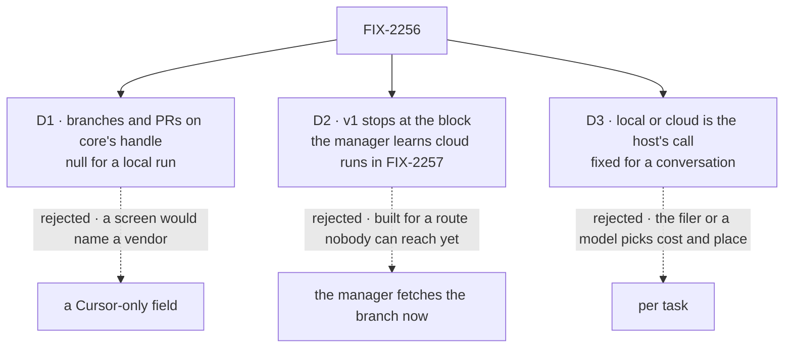

# FIX-2256 · Decisions

[Spec](SPEC.md) · **Decisions**

What was considered, what was chosen, why, and what each choice locks in. Three decisions are the
sign-off surface. Everything else here is context for them.

## The tree

Solid edges are what you're signing. Dashed edges lost, and the label says why.

## D1 · A run names the branches and pull requests it pushed in one neutral field on core's handle, `null` for a local run

| | |
|---|---|
| **Instead of** | A Cursor-only field on Cursor's handle extension, as `cursorUsage` is |
| **Because** | A screen, and later the harness manager, must find the work without naming a vendor (tenet 4; core: "nothing here names a vendor notion"). A branch and a pull request are what any remote coding agent hands back, and Codex and Claude Code both have cloud products, so a second writer is plausible. `null` keeps every local run and every stored handle valid (BP-030) |
| **Locks in** | `branches: { repository, branch, pullRequestUrl }[] \| null` on `HarnessRunHandle` and its schema, defaulting to `null`. Every harness writes `null` until it pushes from a remote; core's harness test gains that row. `url` stays as it is: the SDK gives no run URL |

It comes down to who reads it: a Cursor-only field makes every reader name a vendor.

**What would change my mind:** a year with no second remote harness. The field then costs nothing
but a `null`, so it stays; we'd just stop expecting a second writer.

## D2 · v1 follows a cloud run to its end and returns its branch or PR; the harness manager learns cloud runs with the worker route (FIX-2257)

| | |
|---|---|
| **Instead of** | Teaching the harness manager now to fetch a cloud run's branch into the run's checkout, so its commits, judge and review read it as a local run |
| **Because** | The worker route that would use it (WORKER.md `harness: cursor-cloud`, FIX-2154's routing) isn't built, so no caller would reach the manager change. And the change has open meanings this issue can't settle without that route: a retry makes a new Cursor agent, so a new branch and a second PR; the manager's output `branch` names a branch it never pushes; the commit base can drift; cancel then resume can hit Cursor's busy error; the talk path has no repository; Cursor's own follow-ups push after the settle. The Head of Engineering asked for this smaller v1, and prior art (Copilot coding agent, Codex cloud, Devin) treats the PR as the artifact |
| **Locks in** | This issue ships the block, the core field and Kitchen Sink. A worker set to run in the cloud waits for FIX-2257, which carries those inputs. FIX-2257 may still choose the fetch, or settle from the remote with no checkout, and it must leave one source of truth for which branch holds the work: the manager reads `handle.branches`, or its own `branch` is renamed for what it means |

It comes down to the route: built now, the manager change has no caller and six open questions.

**What would change my mind:** FIX-2154's harness routing landing before this is built. Then
FIX-2257 is small enough to fold in, with its inputs answered here.

## D3 · Local or cloud is the host's call, picked once per conversation, never the filer's or a model's

| | |
|---|---|
| **Instead of** | A runtime the filer or the model picks per run |
| **Because** | Where code runs, whose credentials push it and who pays are the host's call (BP-031), so `runtime` is configuration, like `cwd`: a fixed value, or a resolver that reads server state, never block input. A worker's owner sets it in the worker file once FIX-2257 routes by `harness`; Kitchen Sink sets it when a session starts. And it is picked once per conversation: a local agent can't be resumed in the cloud, or a cloud one locally, so a conversation that switched would fail as an unknown conversation. That rule lives in the block, not in each host's habits |
| **Locks in** | `runtime: "local" \| "cloud" \| resolver` on `cursorAgent`, default `"local"`, and `cursor-cloud` as the `harness` value FIX-2257 reads. **The runtime is fixed when a conversation starts.** The block records it explicitly with the id it hands back for resume, and a resumed run takes it from there. A `runtime` resolver chooses when a conversation starts; on a resume it is only checked, and an answer that disagrees with the recorded runtime is refused before anything is created. The block never switches. How the runtime rides with the id (a tag Cursor never sees, with an untagged id read as local per BP-030, or a field beside it) is the implementer's, so long as it is stored, not guessed from the id's shape, and core's session hook stays a string. A person who wants one cloud run uses a host or worker set for it. Workforce's per-worker runtime stays with FIX-2257, through the worker file or a manager feed, never through `WorkerSessionCriteria` or a run's input |

It comes down to who decides cost and place: per run hands it to the filer, or to a model.

**What would change my mind:** people asking to send one task of a local worker to the cloud. Then
a task setting the host checks against the runtimes it allows, never a free choice.

## Decided, not asked

- **The repository comes from a resolver, never the prompt** (BP-031): `repository: HarnessResolver<{ url, startingRef } | null>`, beside `cwd`. Only a credential-free `https` URL is sent; anything else is refused before anything is created. The refusal is one check where the next remote harness can reuse it (beside the workspace package's `withoutCredential`, or in core), not a second helper in `packages/cursor`. The resolver may return a commit SHA as `startingRef`. `cloud.repos` in the forwarded options stays refused: one owner. A resumed agent needs no repository: Cursor keeps its own.
- **A cloud run doesn't call `cwd`, and ignores `env` and the `local` bag.** A host can pass the same feeds and options to both runtimes, and with a `runtime` resolver both may be set; each runtime uses its own. `env` fences a local Cursor process; a cloud run spawns none and talks to Cursor through the SDK client in this process, so nothing in `env` is sent anywhere (Kitchen Sink sets `env` on every run). What Cursor rejects on cloud and a person would silently lose, `tools`, `disallowedTools`, `systemPrompt` and custom tools, is refused: at build time for a fixed `runtime: "cloud"`, which also refuses a `local` bag and `env` as contradictions, and before anything is created when a resolver answers `"cloud"`.
- **Cursor names the branch.** `workOnCurrentBranch` stays the host's, default `false`, so Cursor cuts `cursor/…` from the starting ref. The block reads `run.wait()`'s `git.branches` and keeps the entries for the requested repository.
- **Credentials.** The run's credential is the Cursor API key (`agent.apiKey`, or `CURSOR_API_KEY` read by the SDK in this process). GitHub access is Cursor's GitHub App on the repository; pull requests open as the key's owner unless the host sets `openAsCursorGithubApp`. The package never copies the server's environment into `cloud.envVars`; only what the host writes there is sent, and Cursor refuses `CURSOR_*` names.
- **The source is `cursor/cloud`** for a cloud run, by the `<package>/<door>` rule.
- **Cost.** Tokens come from `run.wait()` as today. After the run the block asks `agent.getUsage({ runId })` once, inside the deadline: `rawCostCents` becomes `{ usd, basis: "reported" }`. Cursor's cost can lag the run's end; when it is absent the block falls back to today's estimate. `chargedCents` is not used: it is 0 for plan-included use. The implementer confirms the run's id is the `run-<uuid>` this call takes. `basis` keeps the two apart, and FIX-2145 (#3886) is the reader that records and shows a run's spend: its ledger counts a `cursor/cloud` cost only when `basis` is `"reported"`, and its D2 (`billing`) decides whether a screen shows the dollars, as it does for Claude Code's `total_cost_usd`, which is also the run's cost and not the bill. This spec defines no cost basis or display rule of its own.
- **Abort.** A deadline cancels the cloud run (`run.cancel()`, as today) and throws, keeping the agent id. A next send that meets Cursor's busy error because the cancel hasn't landed fails with that named error (BP-035's concurrent path), never a silent retry.
- **Steering.** A cloud run never offers FIX-2254's steer. In Kitchen Sink a second message is the next turn on the same agent. A cloud agent resumes from any process and needs no local store, so FIX-2252 doesn't apply.
- **Kitchen Sink.** Cursor mode offers *Cloud* when the server has `KITCHEN_SINK_CURSOR_REPOSITORY` set (a GitHub URL). The runtime is chosen when the session starts and stored beside its model as a read-only field. The block's own rule (D3) is what keeps a resume on the right runtime; the read-only field keeps Kitchen Sink from asking for a switch. The repository is the server's, never the browser's. A cloud turn shows the branch and pull request links. The mode check skips the worktree and child-process steps on cloud.
- **Order.** FIX-2254 builds first (agreed with its spec thread); this rebases on its changes to `agent.ts` and `harness.ts`. `@cursor/sdk` 1.0.40, pinned by #3993 (merged), is the minimum: its typings carry the cloud options, `RunResult.git.branches` and `getUsage({ runId })` this design reads.

## Considered and dropped

| Alternative | Why not |
|---|---|
| A separate `cursorCloudAgent` block | Same stream, translation, resume and handle. Two blocks are two harnesses to keep in step |
| Use the core envelope's one-way door: dispatch and return `status: "dispatched"` | Nothing would report the branch, the outcome or the cost. The SDK lets the block follow the run to its end |
| Fill `url` with a Cursor agent page | The SDK gives no URL, and building one from an id would be a URL format we don't own |

## Unconfirmed, and not load-bearing

- **A second turn on the same cloud agent pushes to the same branch.** Cursor's docs imply it
  (follow-ups use "the agent's current conversation and workspace state") and don't say it. The
  design doesn't rest on it: each result names the branches that run's `wait()` reports. Goal leg
  a2 records the answer for FIX-2257.

## Analysis

2026-10-27 · watermark 2026-10-27 (issue filed) · **Scope issue, folded.** A fresh analyst read
the first draft, which also taught the harness manager to fetch a cloud run's branch.

1. **Reuse** — the block extension and the resolver compose existing pieces. Extend the workspace package's remote checks for the repository URL: folded.
2. **Prior art** — Copilot coding agent, Codex cloud and Devin treat the PR as the artifact and don't pull it back to settle. Folded into D2.
3. **Other shapes** — "stop at the block" was dismissed on a route this issue doesn't build. Folded: it is now D2.
4. **New factors** — no production manager runs Cursor, and FIX-2154's routing is unbuilt. FIX-2254 touches the same files; order agreed.
5. **Necessity** — the block, the field and Kitchen Sink earn their place. The manager change, now, did not.
6. **Ergonomics** — the first draft refused `cwd` while its own example spread the feeds that carry it. Folded: a cloud run ignores `cwd`.
7. **Concerns** — retries, the output branch, base drift, cancel then busy, the talk path, post-settle pushes, the ask marker: moved to FIX-2257 as its inputs. The Kitchen Sink row claiming Vercel: dropped, recorded in the debt's *Leaves*. The goal's control `ignore-runtime` failed before reading the remote: `fake-branch` added.

## How it got here

- **Draft** — a second runtime of the Cursor door with a neutral branch field on core's handle, and the harness manager fetching the pushed branch so its settle reads one way.
- **Analysis** — the manager half moved to FIX-2257, because the worker route that would call it isn't built and its retry, branch and talk meanings were open. D2 now records where v1 stops.
