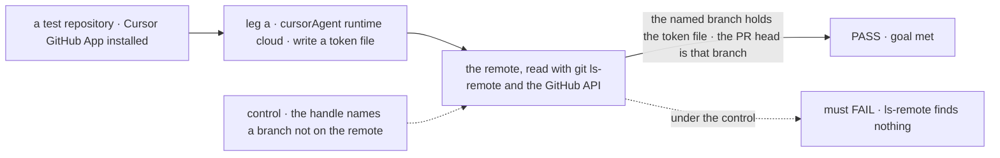
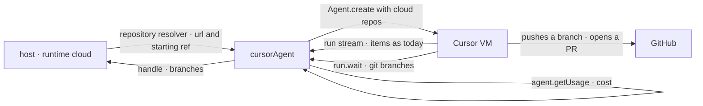

# FIX-2256 · Run Cursor coding work in Cursor's cloud: no local checkout, output a branch or PR

**Spec** · [Decisions](DECISIONS.md)

## Six people, before and after

| Someone who… | Today | After |
|---|---|---|
| **builds a host that runs Cursor in the cloud** | Can't. Cursor runs only on the host, in a checkout the host made, and a `cloud` option is refused | Sets `runtime: "cloud"` and a `repository` resolver. The run goes to Cursor's VM against that repository. The host starts no Cursor runtime and makes no checkout |
| **reads what a cloud run did** | n/a | The run's result names the branch Cursor pushed and, when the host asked for one, the pull request ([D1](DECISIONS.md#d1)) |
| **opens Kitchen Sink's Cursor mode with a repository configured** | Local runs only | Picks *Local* or *Cloud* when the session starts. A cloud turn ends with links to its branch and pull request |
| **sends a second turn to a cloud session** | n/a | It continues the same Cursor agent, as a local session does, in the cloud: a conversation keeps the runtime it started on ([D3](DECISIONS.md#d3)). There is no live steer on a cloud run: Cursor refuses it, so FIX-2254's steer is for local runs only |
| **wants a Workforce coding worker to run in the cloud** | n/a | Not yet. The harness manager learns cloud runs with the worker route, in FIX-2257 ([D2](DECISIONS.md#d2)) |
| **runs Cursor locally, as today** | A checkout, the `env` fence, the local agent store | Unchanged. The result's new field is `null` |

Cursor's SDK can run its agent in Cursor's own VM against a GitHub repository. Jake chose to add
that now (decision card, 2026-10-27). The output is then a branch or a pull request, not files on
our disk, so this issue gives the run a cloud door and a place to name that output.

## The goal, and how we'll know it's met

**A host can run a Cursor coding turn in Cursor's cloud with no Cursor runtime and no checkout of
its own, and the run's result names a real branch, and a pull request when asked for, that holds
the work.**

| Is it the right goal? | |
|---|---|
| **The real need** | Linear FIX-2256: "A Cursor run can be cloud instead of local, picked through the block's runtime setting … A cloud run outputs a branch or PR, and the handle names it … Kitchen Sink shows it in Cursor mode." The Head of Engineering's v1: follow a run to its end and output a branch or PR |
| **Smaller, and rejected** | "The Cursor block accepts a cloud option." Met while the result names nothing, so nobody can find the work, or names a branch that isn't on the remote |
| **Bigger, and not this issue's** | A Workforce worker that runs in the cloud through the harness manager, with its settle, retries, review and talk (FIX-2257, with FIX-2154's routing) · live steering (FIX-2254) · agent lifetime (FIX-2251) · Cursor's usage left (the FIX-2139 epic) |
| **Not done if** | The result names a branch that isn't on the remote · the branch lacks the requested change · Cursor's local runtime was used · a credentialed or non-https remote reached Cursor · a deadline left the cloud run running · a local run's result changed · the check ran on a scripted client only |



The check reads the remote, never only the result's claim about it.

| How we verify | |
|---|---|
| **Goal check** | `goals/cursor-harness/a-cloud-run-pushes-its-work/` · real Cursor (`composer-2.5`) · needs `CURSOR_API_KEY` on a Cursor plan that includes cloud agents, and a test repository with Cursor's GitHub App installed (`goal.md` names both) · run by the implementer at completion if those are at hand, otherwise handed to Jake with the command in `goal.md` · verdict in the implementation PR |
| **Signal** | a: the result's `source` is `cursor/cloud` and `branches` has one entry for the test repository; `git ls-remote` finds that branch, and its head holds `notes/<token>.md` with the token. The real client, wrapped, records that `create` got a `cloud` bag and no `local` bag, and the run's temporary `HOME` holds no Cursor local agent store. a2: a second turn on the same agent ends with its change on a branch the result names (and records whether it is the same branch); the same resume with a resolver now answering `"local"` is refused before anything is created. b: with `autoCreatePR`, `pullRequestUrl` is an open pull request whose head is that branch. d: a deadline mid-run ends the turn with the abort error, and Cursor reports the run cancelled. l: a local run's result has `branches: null`, and `keeps-the-servers-environment-from-its-commands` still passes |
| **Input** | A fresh random token per run, so no answer is known ahead. Any file path or prompt that makes a change passes the same way |
| **Anti-game** | Read the remote with `git ls-remote` and the GitHub API, never the result's fields alone. Legs a, a2, b and d use the real SDK, never a scripted client |
| **Control that must fail** | `GOAL_CONTROL=fake-branch` (the result's branch name is replaced with one the remote doesn't have) fails leg a on *`git ls-remote` finds that branch*. `GOAL_CONTROL=ignore-runtime` (the block runs local) fails leg a on *`create` got a `cloud` bag*. Today's `main` refuses to build the block with a cloud bag |

## What changes


Read across the two rows: only where the run works changes; what comes back is the same handle, with the branch named.

**A host runs Cursor in the cloud:**

```diff
  cursorAgent({
-   cwd: (ctx) => checkoutFor(ctx),
+   runtime: "cloud",                                   // or a resolver; fixed once a conversation starts
+   repository: (ctx) => ({ url: projectRemote(ctx), startingRef: "main" }),  // never the prompt
+   cloud: { autoCreatePR: true },                      // Cursor's cloud options, minus `repos`
    resume, onSession, model,
  })
```

**What a run hands back:**

```diff
  { source: "cursor/cloud", status: "completed", sessionId: "bc-4f1…", outcome: "finished",
+   branches: [{ repository: "https://github.com/acme/app", branch: "cursor/add-notes-9a1c",
+                pullRequestUrl: "https://github.com/acme/app/pull/88" }],
    usage: { inputTokens: 51200, outputTokens: 3900 }, cost: { usd: 0.42, basis: "reported" } }
```

**Docs:** update `packages/cursor/README.md` and `apps/docs/docs/tools/cursor.md` with a
*Running in Cursor's cloud* section (the runtime option, the repository resolver, credentials,
what a cloud run refuses, steering, cost) and rewrite their local-only rows and *Limitations*;
add `branches` to `packages/core/README.md`'s handle and to `apps/docs/docs/tools/coding-agents.md`.
Changesets for `cursor` and `core` (minor). No new page.

## How a cloud run reaches the work



The repository comes from a resolver the host writes, beside `cwd` and `resume`. The block streams
the run as it does a local one, reads the pushed branches from `run.wait()`, and asks Cursor once
for the run's cost.

## What stays as it is

- **Local runs**: the checkout, the `env` fence, the local agent store, live steering (FIX-2254).
  `runtime` defaults to `"local"`.
- **The item stream and Cursor's message translation.** A cloud run sends the same messages.
- **Core's existing handle fields**, and the harness manager. No manager runs a cloud harness yet.
- **Usage left** (FIX-2139). Cursor has no reader, local or cloud.

## What's already here, and the debt

| Already here | What this does with it |
|---|---|
| Ways to run a coding agent somewhere other than this process: none. Searched `cloud`, `remote`, `prUrl`, `pullRequest`, `branch` across `packages/`, `labs/`, `apps/`, `goals/`. Codex and Claude Code have local doors only. Core's `HarnessRunEnvelope` describes a dispatch-only cloud door; no harness ships one | **Extends** the Cursor block, the closest: a second runtime of the same door, not a new block |
| Cursor's refusal of `agent.cloud` and `send.cloud` (`agent.ts`, `assertNoOwnedKeys`) | **Removes** it. `cloud.repos` stays refused: the repository resolver owns it |
| The `cwd` / `resume` / `onSession` resolvers (LAB-152, BP-031) | **Builds on.** `repository` is one more resolver on the same rule |
| The workspace package's remote checks (`withoutCredential`, `remotes.ts`) | **Reused** to refuse a remote with a credential before it reaches Cursor |
| harness-manager's output `branch` and run record `branch`: the branch the manager names | **Leaves alone** in v1. FIX-2257 must leave one source of truth for which branch holds the work: the manager reads `handle.branches`, or the two fields are named for what each means (the branch asked for, the branch pushed) |
| [FIX-1917](../FIX-1917/SPEC.md#the-goal-and-how-well-know-its-met): "Cursor's cloud agents" named bigger and not that issue's | **Delivered** here, at block level |
| [FIX-2086](../FIX-2086/DECISIONS.md#decided-not-asked): a steer stops the harness step and resumes by session id | **Kept** for FIX-2257: a cloud steer will take it, since Cursor refuses a live one |
| FIX-2254's `onSteerable` hook (spec in review) | **Kept.** A cloud run never offers a steer. FIX-2254 builds first; this rebases on it |

| Adds | Existing piece considered | Why it doesn't fit, or how this is composed from it |
|---|---|---|
| `runtime`, `repository` and forwarded `cloud` options on `cursorAgent` | A separate cloud block | Composed: same stream, translation, resume and handle. A second block is a second harness to keep in step |
| `branches` on core's `HarnessRunHandle` | A Cursor-only handle field | A screen or a manager must read it without naming a vendor (tenet 4) ([D1](DECISIONS.md#d1)) |

| The debt | |
|---|---|
| **Removes** | The cloud refusal in the Cursor block and its two docs rows |
| **Adds** | A second runtime path in `cursorAgent` · `branches` on core's handle · a `cursor/cloud` source. All permanent by design |
| **Leaves** | Workforce workers can't run in the cloud yet, and a run's branch is answered by the handle and by the manager's own `branch` until FIX-2257 leaves one source of truth (FIX-2257) · Cursor's own follow-ups (CI fixes, wake-ups) may push to the PR after the turn ends, and that spend isn't on the result (FIX-2257) · Kitchen Sink on Vercel cuts a cloud turn at the function's 300 s limit, and the run goes on in Cursor (Kitchen Sink is a reference app; no issue) · no Cursor usage-left reader (FIX-2139 epic) |

**Net: up**, by one runtime path and one core field. Nothing is a second way to do a job we have.

## Sign off

**[The goal](#the-goal-and-how-well-know-its-met), at that size:** a cloud turn with no Cursor
runtime or checkout on the host, and a real branch or PR named on its result. If wrong: we hold
the issue open for the Workforce route, which FIX-2257 owns.

**[The debt](#whats-already-here-and-the-debt), net up:** one runtime path, one core field; the
cloud refusal goes. If wrong: every harness carries a field only Cursor fills.

1. **[D1](DECISIONS.md#d1) · A run names the branches and pull requests it pushed in one neutral
   field on core's handle, `null` for a local run.** If wrong: a core field only one harness
   fills, for longer than we'd like.
2. **[D2](DECISIONS.md#d2) · v1 follows a cloud run to its end and returns its branch or PR; the
   harness manager learns cloud runs with the worker route (FIX-2257).** If wrong: Workforce
   workers wait one more issue for the cloud.
3. **[D3](DECISIONS.md#d3) · Local or cloud is the host's call, picked once per conversation, never the filer's or a model's.**
   If wrong: someone who wants one cloud run needs a host or worker set for it.

**Open: none.** D2 is the one to weigh: it is where this issue stops.

Feature · `core`, `cursor`, Kitchen Sink, a goal check · medium · no epic · after FIX-2254;
#3993 (the 1.0.40 pin) merged
