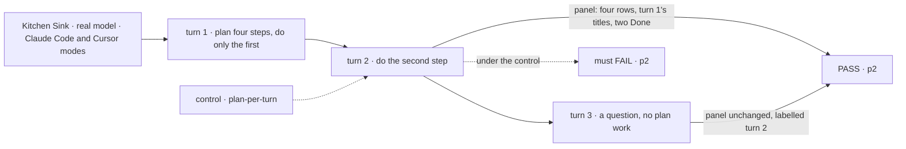
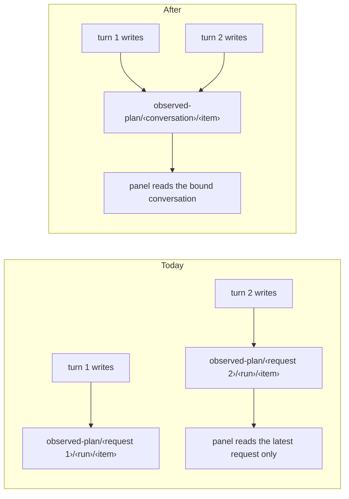

# FIX-2259 · A harness's plan lasts as long as its conversation

**Spec** · [Decisions](DECISIONS.md)

## Five people, before and after

| Someone who… | Today | After |
|---|---|---|
| **asks Claude Code for a five-step job in Kitchen Sink, then says "carry on"** | Turn 2's panel shows only the rows turn 2 touched (one "Done" row, untitled, since its title came from turn 1's `TaskCreate`), as if that were the plan. Or "no plan recorded for this turn" if turn 2 touched none | Sees all five steps, with turn 1's titles and turn 2's progress, labelled with the turn that last changed the plan |
| **does the same in Cursor mode** | Turn 2 reads "no plan recorded for this turn" unless Cursor called `updateTodos` again | Sees Cursor's last confirmed list until Cursor changes it |
| **opens a coding task's run in Shift Manager after a follow-up continued it** | Sees the plan rows of that one run only | Sees the plan of the conversation the run worked in |
| **continues in a new conversation** (the harness refused to resume) | Sees "no plan recorded for this turn" | The same: a new conversation starts with no plan, and never shows the lost one's |
| **uses Codex mode** | "Codex reports no plan" | The same. Codex offers its model no plan tool at the version we pin (FIX-1916) |

The agent itself keeps its list: the conversation resumes, and a resumed Claude Code session
still lists its tasks under the same ids ([Settled](DECISIONS.md#settled)). What drops the plan
is our record, which is keyed per turn, and the panel, which reads only the latest turn
(FIX-1915 BR-15, BR-17). This is a contract change, so it takes the spec route.

## The goal, and how we'll know it's met

**A plan a coding harness records in one turn stays the plan, with its titles and progress, on
every later turn of the same harness conversation, until the harness changes it, and a new
conversation starts with none.**

| Is it the right goal? | |
|---|---|
| **The real need** | Jake's report: "The plan belongs to the session, not the turn. A later turn continues or updates the same plan; it is replaced only when the harness deliberately starts a new one" ([FIX-2259](https://linear.app/fixpoint-labs/issue/FIX-2259)) |
| **Smaller, and rejected** | "Show the last turn that recorded a plan." It fixes Cursor and leaves Claude Code showing turn 2's one untitled row, because Claude Code reports its list one item at a time |
| **Bigger, and not this issue's** | Codex's plan (waits on a pinned Codex with a plan tool). Workflow phases (FIX-2092): a flow's own phase list, not the agent's to-do list |
| **Not done if** | A turn that touches no item shows less than the turn before · a Claude Code row updated in a later turn loses its title · two conversations' items merge · Shift Manager shows a run's rows only · a row stored before this change stops reading |



The check reads the panel the person sees and compares it with the harness's own list.

| How we verify | |
|---|---|
| **Goal check** | A new leg **p2** in `goals/kitchen-sink-harness/claude-code-continues-its-conversation/` and `goals/kitchen-sink-harness/cursor-continues-its-agent/`, after their leg **p**. Real model, run by the implementer at completion; PASS is p2 green in 3 of 3 runs per mode; the verdict goes in the implementation PR. Model-free: CI tests in `core`, `claude-code`, `cursor`, `kitchen-sink` and `shift-manager` |
| **Signal** | `p2:kept` after turn 2 the panel holds all of turn 1's rows, in order, each with its turn 1 title, and the two worked steps read Done. `p2:quiet-turn` after turn 3 the rows and their label are unchanged. `p2:matches` the rows equal the harness's own list (Claude Code `TaskList` in a turn 4; Cursor's last `updateTodos` result in the turn's items) |
| **Input** | Step titles picked at run time (`pickWords`), so no fixed list passes |
| **Anti-game** | Read the page and the harness's own list, never the record's keys. Nothing seeded |
| **Control that must fail** | Today's `main`: `p2:kept`. `GOAL_CONTROL=plan-per-turn` (writers key by turn again) fails `p2:kept`. In CI, dropping the legacy read makes a session that holds only per-turn rows show none, and its test fails. The PR shows each FAIL before the PASS |

## What changes



Core gains a conversation namespace beside `harnessRunNamespace`, built from the harness's name
and the conversation id it confirmed (Claude Code's session id, Cursor's agent id). Both writers
key plan rows and the plan's list marker under it. Each row and marker also records the request
that last wrote it, so a reader can say which turn changed the plan. Each run also leaves a pointer to its conversation under its own namespace. Readers find the
plan by the conversation: Kitchen Sink from the session's binding, Shift Manager from the run's
pointer. A session whose rows were stored per turn still reads them, as today.

```diff
 // core/src/types/harness-plan.ts
 export function harnessRunNamespace(ctx: BlockContext): string
+/** One harness conversation's plan: every turn of it writes here. */
+export function harnessConversationNamespace(harness: string, conversationId: string): string
+export function planConversationPrefix(harness: string, conversationId: string, key?): string
 export const observedPlanItemStateSchema = z.object({
   ...
+  /** The request that last wrote this row. */
+  requestId: z.string().nullable().default(null),
 });
```

What the panel says, after turn 3 of a Claude Code session:

```text
Plan · last changed in turn 2
  Done         List the files
  Done         Count the lines
  To do        Sort by size
  To do        Write the summary
```

**Docs:** update `apps/docs` pages that describe the plan record and the plan panel (the harness
pages for Claude Code and Cursor, and Kitchen Sink's harness mode page): the plan is the
conversation's, not the turn's. Update `packages/core/README.md` (the new namespace) and the
`claude-code` and `cursor` READMEs. Changesets for `@flow-state-dev/core`,
`@flow-state-dev/claude-code` and `@flow-state-dev/cursor`.

## What stays as it is

- **The record reports what the harness confirmed**, never what the agent asked for
  (`translate.ts`'s rule), and it never starts work.
- **File operations and gap rows stay per run.** They describe what a run did, not a standing
  list.
- **The panel's other states**: "<label> reports no plan", "the plan is empty", "may be
  incomplete" with its reason. "No plan recorded for this turn" becomes "no plan recorded in this
  conversation".
- **Codex** declares no plan record.

## What's already here, and the debt

| Already here | What this does with it |
|---|---|
| The plan record (FIX-1915): `observed-plan`, `observed-plan-list`, `replacePlanList`, `harnessRunNamespace`, `planRowsPrefix` in `core/src/types/harness-plan.ts` | **Extends**: the same collections, a second namespace for plans; the row and marker gain one nullable field |
| FIX-1915 BR-15 and BR-17 ("an earlier turn's rows are never shown as the current plan") and D-panel "the panel shows the session's latest turn" | **Supersedes** for the plan. The turn label stays, now naming the turn that last changed the plan |
| FIX-1917's Cursor writer (`openPlanWriter`, one `replacePlanList` per confirmed list) | **Amends** its namespace only |
| Claude Code's work recorder (`work-recorder.ts`): plan rows by item id, marker written only on failure | **Amends** the plan rows' and marker's namespace; the file and gap rows keep `runId` |
| Kitchen Sink's binding (`harness-turn.ts`, `binding.confirmed`) and Shift Manager's `readRecordedWork` | **Builds on** the binding; Shift Manager's reader reads the plan by conversation and the files by request, as today |
| FIX-2092's phase list in session state (#3970) | **Leaves alone**: a flow's phases, written by the flow, not a record of the agent's list |

| Builds on / Adds | Existing piece considered | Why that doesn't fit, or how this is composed |
|---|---|---|
| `harnessConversationNamespace`, and a run's pointer to it | `harnessRunNamespace`; harness-manager's run record, which knows the harness session but is server-only | Its identity is one invocation by design (a tool called twice in one request is two runs). A plan's identity is the conversation; the two sit side by side |
| `requestId` on a row and a marker | The turn records in Kitchen Sink session state | They know a turn's conversation, not which turn last changed the plan. One nullable field (BP-023) |

| The debt | |
|---|---|
| **Removes** | The panel's "latest run in the latest turn" selection for plans |
| **Adds** | A second namespace in the plan record; a per-turn read kept only for rows stored before this change (BP-030) |
| **Leaves** | Codex's plan (FIX-1916's follow-up). Shift Manager runs whose rows were written per turn keep showing that run's rows. A conversation that straddles the upgrade is not migrated: its plan starts at the first write after it, marked possibly incomplete |

**Net: flat.** One namespace swapped for another on the plan, and a legacy read.

## Sign off

**[The goal](#the-goal-and-how-well-know-its-met), at that size:** a plan lasts as long as the
conversation, in Kitchen Sink and Shift Manager, for both harnesses that report one. If wrong: a
person keeps seeing half a plan on every turn after the first.

**[The debt](#whats-already-here-and-the-debt): flat.** If wrong: two places to look for a plan
grow apart.

**No decision cards:** the report decided the direction (the plan is the conversation's), and
the choices left are engineering. **Open: none.** The calls: [DECISIONS.md → Decided, not
asked](DECISIONS.md#decided-not-asked).

Improvement · `core`, `claude-code`, `cursor`, `kitchen-sink`, `shift-manager` + docs · small to
medium (one namespace, two writers, two readers, one goal leg in two goals) · 1 PR · blocks
FIX-1918 · epic FIX-1907
