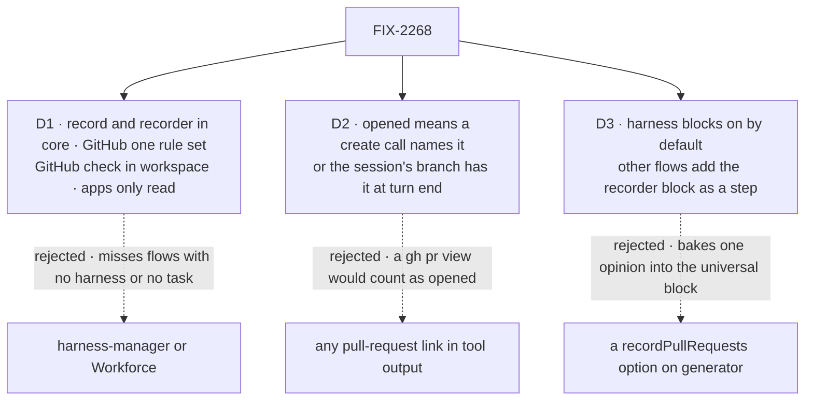

# FIX-2268 · Decisions

[Spec](SPEC.md) · **Decisions**

What was considered, what was chosen, why, and what each choice locks in. Three decisions are the
sign-off surface. Everything else here is context for them.

## The tree

Solid edges are what you're signing. Dashed edges lost, and the label says why.

## D1 · The record and the recorder live in core beside the plan record, with GitHub as one rule set; the GitHub check lives in `workspace` on the host; Workforce and the harness manager only read

| | |
|---|---|
| **Instead of** | The record in `harness-manager` or in Workforce, where the coding task lives |
| **Because** | It must cover flows that have no harness and no task: Kitchen Sink's harness modes run without the harness manager or Workforce, and Flow State mode runs neither. The three harness packages depend only on `core` (Claude Code also on `workspace`), so core is the one place they and the generator all reach. The plan record already lives there for the same reason. Nothing in it is a Workforce concept: Workforce reads it through the task's `run.sessionId`, which keeps the layer boundary. Tenet 4: the record is neutral (host, repository, number, link), and GitHub's command, link shape and tool names sit in one rule the recorder takes from a list, so a merge request on another forge is a new rule, not a new record. GitHub is the default because it is where all three harnesses open pull requests today. Core stays isomorphic: the rules read text, and only the host's `gh` call talks to GitHub, in `workspace`, which already runs `git` in the host's checkouts |
| **Locks in** | `observed-pull-requests` as a public collection key, its row schema (every field nullable, BP-023), `findOpenedPullRequests`, `githubPullRequestRule`, `recordPullRequests` and `writePullRequests` exported from `@flow-state-dev/core`, and `recordBranchPullRequests` from `@flow-state-dev/workspace` |

It comes down to who must write it: Kitchen Sink's harness modes and our own generator run without the manager or Workforce.

**What would change my mind:** the Architect placing coding records in a package of their own.
The record then moves with the plan record, and the harness packages gain that dependency.

**Status:** confirmed by the Architect on the PR (2026-10-28, comment 6476389332), answering
the ask on agent-mailbox #35, with three conditions this card keeps: no GitHub client in core
(core holds the record, the writer and a pure rule; anything that runs `gh` or calls the API
stays in `workspace` or the host); one writer (the branch check and FIX-2256's handle field write
through `writePullRequests` and grow no record or reader of their own; FIX-2256's issue carries a
line saying so); and no Workforce or harness-manager concept in core, with `requestId` stated as
a read key in the row contract.

## D2 · A pull request counts when the session opened it: a create call whose result names it, or a pull request on the session's own branch at turn end

| | |
|---|---|
| **Instead of** | Any pull-request link that appears in a tool call's output |
| **Because** | Agents look at pull requests all the time (`gh pr view`, `gh pr list`, a search tool), and a list that mixes those in no longer answers "what came out of this session". A create call is the signal: `gh pr create` in a shell command, or a tool whose name is a create-pull-request call (GitHub's MCP `create_pull_request`), with the link in its result. The branch check adds what that signal can't read (a raw API call, an unfamiliar tool), and the session's own branch is by construction the session's work. A pull request the session only pushed more commits to, opened by someone else, is not counted (the issue's open question 5) |
| **Locks in** | The row's `source`: `tool` (a create call) or `branch` (the turn-end check). What the docs promise "opened" means. Pushed-to pull requests stay out until an issue asks for them |

It comes down to `gh pr view`: counting every link lists pull requests the session only read.

**What would change my mind:** people asking to see pull requests the session pushed commits to.
That is a third `source`, `pushed`, from the branch check over every branch the run pushed, and
it needs the ref comparison the issue mentions.

## D3 · Harness blocks record by default; a flow with no harness adds core's recorder block as a step; the generator is unchanged

| | |
|---|---|
| **Instead of** | A `recordPullRequests` option on `generator`, or the bash capability recording what its own tool ran |
| **Because** | Jake (2026-10-28, on this PR's thread): building it into the generator "becomes an opinionated thing that we're trying to avoid in the framework … the whole point of the sequence and the block system is to be able to add these steps if you want to add them to your flow." A step can do the whole job: `pullRequestRecorder()` reads the items the request has already emitted (`ctx.response.getItems()`, the snapshot `.waitForCondition` uses) and starts the per-request recorder for the rest, so it sees every tool call in the request whichever block made it. Tapped before the generator, rows appear live; tapped after, when the step ends. The bash capability route would miss a create-PR tool the generator holds. Harness blocks keep the default because Jake asked for it ("harnesses should definitely track this") and a coding harness is the block that opens pull requests; the plan record is opt-in there only because the task board dispatches the bare block |
| **Locks in** | `recordPullRequests` on the Codex, Claude Code and Cursor blocks (default `true`); `pullRequestRecorder()` exported from core, declaring the collection. `generator` gains nothing |

It comes down to the universal block: a step adds the behaviour without giving the generator an opinion.

**What would change my mind:** a flow where a step can't see the generator's tool items (a
generator in a separate request). Then the step goes inside that request, still not into the
generator.

## Decided, not asked

- **Harness blocks call the recorder; they stay handlers.** `codexAgent`, `cursorAgent` and the
  Claude Code agent are handlers, and hosts call them as handlers (`agent.rescue`). Each calls
  core's `recordPullRequests(ctx)` when it starts, the same function `pullRequestRecorder()`
  runs as a step, so there is one recorder with two entries. Making each harness a sequencer to
  install the step would change three public block kinds for no gain (BP-011 forbids a handler
  calling a block, not a core function).
- **One convergence point for writes.** Every writer goes through core's `writePullRequests`:
  the recorder, the host's branch check, and, when FIX-2256 ships, Cursor's cloud handle. It
  upserts by key and never moves `requestId` or `firstSeenAt` once set; a later sighting only
  fills a null `title`, `state`, `branch` or `requestId`, and a `tool` sighting upgrades a
  `branch` row's `source`, so a branch check that wins the race does not hide the turn that
  opened it. That is what makes a repeated link, a second
  recorder and the branch check all land on one row.
- **The key is host, owner, repository and number**, each a key segment escaped with
  `planKeySegment`, lower-cased where GitHub is case-insensitive (host, owner, repository). Not
  the URL string, which varies (`www.`, a trailing `/files`).
- **GitHub hosts only in v1**, github.com and GitHub Enterprise (`https://<host>/<owner>/<repo>/pull/<n>`).
  `/pull/new/<branch>`, the link `git push` prints, is not a pull request and never matches.
  GitLab's merge requests are a later matcher rule, not a new record.
- **One recorder per request, ended by the request.** `recordPullRequests` keys its recorder on
  the request's response (one object in every scope of a request), so two harness blocks in a
  parallel step, or a harness run as a tool inside a recording generator, share one listener.
  The listener is synchronous (the emitter's contract) and starts each write at once, which is
  what keeps the record live. It unsubscribes and awaits its last writes in an `onRequestEnded`
  hook, so no block's return can cut another's recording short. A context with no
  `subscribeToItems` or no request-end seam records nothing and says so in a status note. A
  write that fails emits a status note and never fails the run, as the plan writer does.
- **Live.** The collection is `client.state.read` and `live`, so a row reaches an open page when
  it is written, mid-turn (the people table's first row).
- **Keyed to the session; tasks reach it through their run link** (the issue's open question 2).
  Each row carries the `requestId` that opened it, so Shift Manager can narrow to a run's request
  when a task session holds several runs. Nothing is copied onto the task's output.
- **The branch check is the host's, with the host's `gh` login** (open question 4). The host
  knows the checkout: Kitchen Sink's session worktree and the harness manager's. The helper asks
  for the pull requests on the checkout's current branch as well as the one the host made
  (`kitchen-sink/<kind>/<session>`), since an agent may `git checkout -b`. It runs on every
  ending (the turn's `onFinished`, not a trailing step an abort skips), on its own timeout rather
  than the turn's abort signal, and a missing or signed-out `gh` is a status note, not a failed
  turn. No token is passed to the harness.
- **Kitchen Sink's panel** sits in the harness session panel beside the plan, and in Flow State
  mode's session sidebar; both read the collection through `useResourceCollectionList`, as the
  plan panel does. It shows repository, number, title, state, link, and the turn that opened it.

## Considered and dropped

- **An agent-called "register pull request" tool as the signal.** It works only when the agent
  remembers, which is the failure the record exists to remove (the issue's own advice).
- **Each adapter parses its own tool calls**, in Claude Code's work recorder and Cursor's plan
  writer. Three parsers, and the generator needs a fourth. The items already share one type.
- **The flow's `tools.onToolCompleted` hook.** Simpler for generator flows, but harness tool
  calls never pass through it (`tool-executor.ts`), so harnesses would still need their own.
- **A webhook for state changes.** Out of scope, and a localhost Kitchen Sink can't receive one.
- **Kitchen Sink parses its own items.** The smaller goal; it gives Shift Manager nothing.

## Open

None.

## Settled

- A read of `main` at `ba527aa`: the `tool_output` shapes of the three adapters
  (`codex/src/translate.ts:144-202`, `claude-code/src/sdk/translate.ts:439-447` with results at
  `:788-796`, `cursor/src/translate.ts:145-162`) and the generator
  (`core/src/blocks/internal/emit-tool-output.ts:124-164`); that `onToolCompleted` fires only in
  the generator's tool executor; that `subscribeToItems` sees every item on the request's
  emitter (`engine/src/streaming/response-emitter.ts:286`); that capabilities have no item hook
  (`core/src/capability/types.ts:216-295`); that the plan record is opt-in on the harness blocks
  (Cursor's `recordPlan`, `cursor/src/agent.ts:212`, Claude Code's `recordWork`, `claude-code/src/sdk/agent.ts:261`; Codex records none; Kitchen Sink's mode files set them); and that no code parses
  pull-request links today.

## Notes for the implementer

- **Cursor's shell result is unverified** (the issue's open question 3). Record one real Cursor
  `gh pr create` turn as a fixture before writing the matcher's Cursor case. If its result does
  not carry the command's output, the branch check carries Cursor's in-turn case and the people
  table's first row no longer holds for Cursor: stop and re-gate.
- **Read the command from the arguments, the link from the output.** Codex puts the command in
  `arguments.command` and the output as a string; Claude Code's `Bash` has `input.command` and a
  string or content-block output; the bash tool returns `{ stdout, stderr, exitCode }`. The
  matcher should search strings inside the output, not assume a shape.
- **Flow State mode's goal leg needs the local bash provider** (`STORE_TYPE=filesystem`), so `gh`
  runs on the host. The in-memory provider has no `gh`.
- **A failed create still names a pull request.** `gh pr create` on a branch that has one exits
  non-zero with "a pull request for branch … already exists: <url>", and Codex marks it an
  error. Record it (the session's branch has it), with a fixture.
- **Normalize create-tool names** across sources: Codex `mcp:<server>/<tool>`, Claude Code
  `mcp__github__create_pull_request`, generator tool names; Codex may wrap a command in
  `bash -lc "…"`; generator `toolCall.arguments` is a JSON string.
- **Flow State runs more than one generator.** The background workers in
  `flows/chat-agent/pipelines/background-work.ts` are separate generators, possibly in separate
  requests; add the recorder step to each request that runs one holding bash, and give the goal leg a checkout with a remote in the local
  provider's directory.
- **Default-on reaches dispatched blocks.** The task board refuses only session state, not a
  session resource, so dispatch still works. Under a shared child session several tasks' rows
  mix; Shift Manager narrows by the run's `requestId`. Update the "declares no session state"
  header comments in the Cursor and Claude Code agent files, and declare the collection on the
  harness manager's flow so its branch-check writes show in the manifest.
- **Key spelling.** Add a fixture for owner and repository names with `.`, `-` and upper case,
  so the case-folded key cannot fork by spelling.
- Harness-manager's comment at `manager.ts:974` names a `gh pr list` completion probe that no
  longer exists. Fix the comment if the branch check lands near it.

## Analysis

2026-10-28, on the draft at `origin/main` `ba527aa`, by a fresh analyst with `reuse-review`.
Linear and the web were not swept. **Verdict: right approach, fold needed.**

- Reuse: the recorder's lifetime extends `onRequestEnded` (folded); the collection extends the
  plan record's shape; the rules are new; the branch check extends `workspace`'s `run`.
- Prior art: hosted agents (Cursor's cloud API, Codex cloud, Copilot's coding agent) link one
  pull request to a run from their own product, never from tool output; a local run that opens
  pull requests through a shell has no such link, so reading tool output is justified.
- Other shapes: the bash capability recording its own tool's output (now D3's *Instead of*).
- Necessity: clear; nothing reads pull-request links today.
- Ergonomics and tenet 4: GitHub knowledge in core (folded into D1 as one replaceable rule).
- Findings: three folds (above); four wrong references fixed (Codex declares no plan record;
  `bash.md` has no `gh` note; FIX-2256's field is neutral, not Cursor's; `flow.ts:122`); eight
  notes, recorded under *Notes for the implementer*.

## Notes from review

- **Cursor review on `18ca05c`** (comment): (1) optional phasing, recorder, rules, panel and legs r1/r2 first, then the branch check, leg b and the harness manager; (2) add "a Flow State generator that can open pull requests was not opted in" to the goal's *not done if*, since Flow State runs several generators; (3) merge should wait on the Architect's answer on D1. Folded inline: leg b now runs in the harness modes only, matching the debt row, and the diff names `writePullRequests`.
- **Second look on `18ca05c`** (comment): (1) a per-generator option is the wrong altitude; make it flow-level or add an exhaustiveness test; (2) split into PR A (record, recorder, rule, harness blocks, panel, r1/r2) and PR B (branch check, harness manager and Shift Manager read, leg b); (3) record a real Cursor `gh pr create` fixture before merge, not after; (4) gate on the model-free fixtures and the controls, with one real-model smoke per mode rather than 2/2 × every leg. Smaller: a line on FIX-2256 that it writes through `writePullRequests`; `requestId` as a read key in the row contract; a key-spelling fixture; a branch-first race that leaves `requestId` null; the stale `manager.ts:974` comment. D1 placement agreed. Folded: (1) is answered by Jake's direction (no generator option; a step); the row contract names `requestId` as a read key; the writer fills a null `requestId` and upgrades `source`; the key-spelling fixture is a note; the FIX-2256 line is on its issue. Left to the implementer and Jake: (2) the PR split is the build plan; (3) stays the implementer's first step, with stop-and-re-gate if Cursor's result lacks the output; (4) is recorded for Jake to weigh against the real-model goal convention.
- **Architect on `38df5a6`** (comment): D1 confirmed with three conditions, folded into D1's status.

## How it got here

- **Jake's direction** — 2026-10-28, on the thread: no option on the generator; a block a flow
  adds as a step. D3 re-drafted: `pullRequestRecorder()` replaces the generator option, because
  a step can read the request's items so far and subscribe to the rest.

- **Draft** — 2026-10-28: framed as a session record of opened pull requests that every source
  writes through one recorder; builds on the plan record's shape, the shared `tool_output` item
  and `subscribeToItems`, with a host-side branch check in `workspace` as the backstop.
- **Analysis fold** — same day: the recorder's lifetime moved to the request-end seam, so
  overlapping blocks can't stop each other's recording; GitHub became one rule in a list, so the
  record stays neutral (tenet 4); D3 now weighs the bash capability route, the real alternative;
  the branch check runs on every ending and reads the checkout's current branch too.
