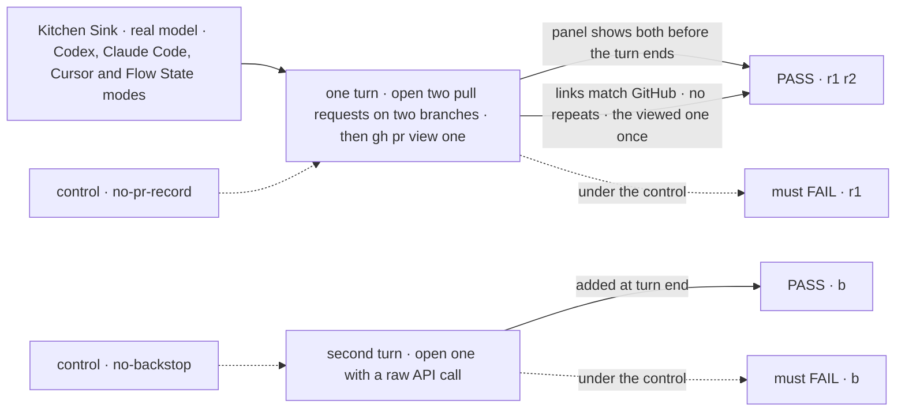
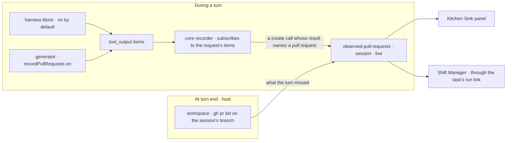

# FIX-2268 · A session keeps a record of the pull requests it opened

**Spec** · [Decisions](DECISIONS.md)

## Five people, before and after

| Someone who… | Today | After |
|---|---|---|
| **asks Codex, Claude Code or Cursor in Kitchen Sink to open two pull requests** | Finds each link only by scrolling the run's tool calls for `gh pr create` output | Sees both in the session's panel, with repository, number, title and link, while the turn is still running. Each appears once, even if the agent prints its link again |
| **does the same in Flow State mode, where our own generator runs `gh` through the bash tool** | The same scroll | The same panel list. The flow turned it on with one option on its generator |
| **has an agent open a pull request in a way the tool-call check can't read** (a raw API call, an unknown tool) | Nothing records it | Kitchen Sink checks GitHub for pull requests on the session's branch at the end of the turn and adds what the turn missed |
| **opens a coding task in Shift Manager** | Sees the run's plan and files, and no pull requests | Sees the pull requests the task's session opened, read from the same record through the task's run link |
| **builds an app on a harness block** | Writes their own parser over the tool calls | Reads one session collection, `observed-pull-requests`, and writes no parser |

The links are already in the stream. All three harnesses and our own generator emit every tool
call as a `tool_output` item with its arguments and output. Nothing reads them out and nothing
keeps them.

## The goal, and how we'll know it's met

**Every pull request a session opens is in one record that the session's page reads live, once
per pull request, whichever harness or generator opened it, and a pull request the session
only looked at is not in it.**

| Is it the right goal? | |
|---|---|
| **The real need** | "A session can open several pull requests. Today nothing records them, so neither Kitchen Sink nor Shift Manager can show what PRs came out of this session." Jake wants it as a framework capability any app gets, not app code; "harnesses should definitely track this" ([FIX-2268](https://linear.app/fixpoint-labs/issue/FIX-2268)) |
| **Smaller, and rejected** | "Kitchen Sink parses its own tool items." It gives one app a panel and Shift Manager nothing, and the next app writes the same parser |
| **Bigger, and not this issue's** | Keeping a pull request's state current after the session (merged, closed) through a webhook. Review UI. Opening a pull request from the page. All out of scope in the issue |
| **Not done if** | A pull request shows only after the run ends · the same pull request shows twice · a `gh pr view` or `gh pr list` of someone else's pull request shows as opened · one harness records and another doesn't · a generator flow needs its own parser · Shift Manager parses tool items · a pull request the in-turn check missed stays missing when the session's branch has it |



The check reads the panel the person sees and compares it with GitHub's own list.

| How we verify | |
|---|---|
| **Goal check** | A new goal `goals/kitchen-sink-harness/session-lists-its-pull-requests/`, legs **r1**, **r2** and **b**, run once per mode (Codex, Claude Code, Cursor, Flow State). Real model, against a scratch repository the implementer names, with `gh` signed in on the host; the run closes its pull requests after. PASS is every leg green in each mode, 2 of 2 runs; the verdict and a screenshot per mode go in the implementation PR. Model-free: CI tests in `core` (the matcher, over each harness's recorded tool-item shapes and the bash tool's), `workspace` (the branch lookup over a stubbed `gh`), each harness package, and Kitchen Sink |
| **Signal** | `r1:live` each pull request is on the panel while the turn's status is still running. `r2:matches` the panel's set equals `gh pr list --author @me --head <each branch>`, by repository and number, with no repeats; the pull request the turn only viewed shows once, as opened by the turn that opened it. `b:caught` a pull request opened by a call the matcher does not read is on the panel after the turn ends, marked as found on the branch |
| **Input** | Branch names and titles picked at run time (`pickWords`), so no fixed list passes |
| **Anti-game** | Read the page and GitHub, never the record's keys. Nothing seeded. The raw API call in leg **b** goes through the shell, so only the branch check can see it |
| **Control that must fail** | `GOAL_CONTROL=no-pr-record` (the blocks record nothing) fails `r1:live`. `GOAL_CONTROL=no-backstop` (no turn-end check) fails `b:caught`. In CI, a matcher that accepts any pull-request URL fails the `gh pr view` fixture, and a writer keyed by URL string fails the repeated-link fixture. The PR shows each FAIL before the PASS |

## What changes



Core gains the record, a recorder and a set of match rules, beside the plan record. The
recorder starts once per request, on the first block that asks for it. It subscribes to the
request's items (`ctx.response.subscribeToItems`, the one seam that sees harness and generator
tool calls alike), writes a row as soon as a create call's result names a pull request, and
stops through the request-end seam (`onRequestEnded`), so overlapping blocks share one
listener. The row is neutral (host, repository, number, link); GitHub is the one rule set core
ships, and another forge is another rule. The three harness blocks start it by default and
declare the collection. A generator starts it when its flow sets `recordPullRequests: true`.
`workspace` gains one helper that asks `gh` for the pull requests on a checkout's branch and
writes what the record lacks; Kitchen Sink and the harness manager run it when a turn or run
ends, however it ended.

```diff
 // core/src/types/pull-requests.ts (new, beside harness-plan.ts)
+export const OBSERVED_PULL_REQUESTS = "observed-pull-requests" as const;
+export const observedPullRequestsCollection  // session scope, client-readable, live
+/** One row per pull request: host, repository, number, url, title, state, branch, requestId, source. */
+export const observedPullRequestStateSchema
+/** The pull requests a create call's result names, by the given rules; [] for any other item. */
+export function findOpenedPullRequests(item: RuntimeItem, rules?: PullRequestRule[]): PullRequestRef[]
+export const githubPullRequestRule: PullRequestRule   // gh pr create, create-PR tools, /pull/<n> links
+/** Starts this request's recorder, once; it stops when the request ends. */
+export function recordPullRequests(ctx: BlockContext): void

 // An app's own flow, Flow State mode
 generator({
   name: "assistant",
   uses: [bashCap],
+  recordPullRequests: true,
 })

 // A harness block: nothing to write. `recordPullRequests: false` turns it off.
 codexAgent({ cwd, resume, onSession, model })

 // workspace: the host's turn-end check
+await recordBranchPullRequests(ctx, { cwd });   // the checkout's current branch, via gh
```

What the Kitchen Sink panel shows, mid-turn:

```text
Pull requests · 2
  acme/app #88   Add notes export        open   opened in turn 1
  acme/app #89   Fix export filename     open   opened in turn 1
```

**Docs:** extend `apps/docs/docs/tools/coding-agents.md` with a *Pull requests a session opened*
section after *The run's plan* (the record, what counts as opened, reading it, turning it on for
your own generator, the branch check, adding a rule for another forge), and extend
`apps/docs/docs/tools/workspace.md` with the branch check. Update the `core`, `workspace`, `codex`, `claude-code`, `cursor` and `harness-manager`
READMEs. Changesets for those six packages (minor). No new page.

## What stays as it is

- **The record says what the session opened, never what it should open.** Nothing in it starts
  work, and a person or agent can't write to it from the client.
- **No GitHub client in core.** The rules read text the tool calls already returned. Only the
  host's branch check talks to GitHub, through the `gh` it is signed in with.
- **A pull request's state is what was seen**, at opening or at the branch check. Nothing keeps
  it current after the session (the issue's out-of-scope list).
- **The tool items themselves** are unchanged, and the harness parity test keeps its contract.

## What's already here, and the debt

| Already here | What this does with it |
|---|---|
| The plan record (`core/src/types/harness-plan.ts`, FIX-1915, FIX-2259): a session-scoped, live collection a harness writes and Kitchen Sink and Shift Manager read | **Copies its shape**: a new collection beside it, declared on the block as Cursor's and Claude Code's plan record is (Codex records no plan, and will record pull requests) |
| `tool_output` items from all three adapters (`codex/src/emit.ts`, `claude-code/src/sdk/emit.ts`, `cursor/src/emit.ts`) and the generator (`core/src/blocks/internal/emit-tool-output.ts`) | **Builds on**: the recorder reads them; nothing about them changes |
| `ctx.response.subscribeToItems` (`core/src/types/block.ts:156`), used by the sequencer's wait | **Builds on**: the recorder's one seam |
| `onRequestEnded` (`core/src/types/request-end.ts:109`), used by the task board | **Builds on**: the recorder stops and awaits its last writes there |
| The flow's `tools.onToolCompleted` hook (`core/src/types/flow.ts:122`) | **Leaves alone**: it fires for generator tools only, so a harness's tool calls never reach it |
| FIX-2256's `branches[].pullRequestUrl` on the neutral run handle (spec merged, not built; Cursor's cloud runs fill it first) | **Composes**: when it ships, the adapter writes a handle's pull requests through the same writer, so the handle and the record never disagree |
| The retired conductor lab's `gh pr list --head` completion check (`207e64c`) | **Revives the call** in `workspace`, returning rows instead of yes or no |

**Which methods already do this job (record a pull request a run opened):** FIX-2256's handle
field, unbuilt, which names a remote run's pull request at the end of the run, on the run's
return value. Searches on `main` (`ba527aa`) for `/pull/`, `pr create`, `pullRequest`
and `pulls` across `packages/`, `apps/` and `labs/` found no other. This is the second way, and
the first that is a session record or live.

| Builds on / Adds | Existing piece considered | Why that doesn't fit, or how this is composed |
|---|---|---|
| `observed-pull-requests` collection | The plan record | Different rows (one per pull request, keyed by repository and number, kept for the session, not a list per conversation). Same declaration and reader path |
| `recordPullRequests` recorder | `onToolCompleted` flow hook; each adapter's own recorder (Claude Code's work recorder, Cursor's plan writer) | The flow hook misses harness tool calls. Three adapter recorders would be three parsers. One subscription sees all four sources; its lifetime is `onRequestEnded`'s |
| `findOpenedPullRequests` and `githubPullRequestRule` | None (searches above) | New, and pure, so each harness's shape is a fixture |
| `recordPullRequests` option on the generator | The bash capability's own tool block recording what it ran ([D3](DECISIONS.md#d3)) | The bash tool misses a create-PR tool the generator holds; the option on the block that emits the items covers both |
| `recordBranchPullRequests` in `workspace` | The conductor's retired check; harness-manager's comment-only "completion probe" (`manager.ts:974`, no code); `workspace/src/exec.ts`'s `run` | Extends `run`, whose header names this use. One helper, so Kitchen Sink and the harness manager don't each glue a lookup to a write |

| The debt | |
|---|---|
| **Removes** | Nothing |
| **Adds** | A second place a run's pull request appears, beside FIX-2256's handle field; accepted because the handle is one run's return value and the record is the session's, and the writer is shared so they agree. One generator option, off by default. GitHub's command and tool names in core, as one replaceable rule ([D1](DECISIONS.md#d1)) |
| **Leaves** | Keeping state current after the session (webhook, out of scope). Flow State mode has no session branch, so it has no turn-end check. Harness-manager's stale "completion probe" comment (`manager.ts:974`) describes code that is gone; noted for the implementer, not filed |

**Net: up.** One record, a recorder, one rule set, a branch check and one generator option, for
a job nothing did before.

## Sign off

**[The goal](#the-goal-and-how-well-know-its-met), at that size:** every pull request a session
opens, in every harness and our own generator, on one live record two apps read. If wrong: each
app keeps scrolling tool calls for links.

**[The debt](#whats-already-here-and-the-debt), net up:** a new record and its recorder, and a
second place a run's pull request appears beside FIX-2256's handle, kept in step by one writer.
If wrong: two places that name a run's pull request grow apart.

1. **[D1](DECISIONS.md#d1) · The record and the recorder live in core beside the plan record,
   with GitHub as one rule set; the GitHub check lives in `workspace` on the host; Workforce and
   the harness manager only read.** (Architect confirming.) If wrong: a coding record in core
   that only coding flows use.
2. **[D2](DECISIONS.md#d2) · A pull request counts when the session opened it: a create call
   whose result names it, or a pull request on the session's own branch at turn end.** If wrong:
   a pull request the agent only pushed commits to is missing from the list.
3. **[D3](DECISIONS.md#d3) · Harness blocks record by default; our own generator records when
   its flow sets one option on it.** If wrong: a generator flow that opens pull requests shows
   none until its author sets it.

**Open: none.** D2 is the one to weigh: it decides what the list means.

Feature · `core`, `workspace`, `codex`, `claude-code`, `cursor`, `harness-manager`, Kitchen
Sink, Shift Manager + docs · medium (one record, one recorder, one matcher, one lookup, three
adapters, two readers, one goal) · 1 PR · no epic · related FIX-2256, FIX-2163, FIX-1907
