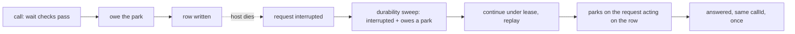

# FIX-2269 · A wait killed before it parks still answers

**Spec** · [Decisions](DECISIONS.md)

## Who feels it, before and after

| Someone who… | Today | After |
|---|---|---|
| **asks a worker something that needs a call to another worker, and the server dies between the call's row and its park** | The message lands once and the other worker answers, but the asking request reads `interrupted` and stays there. The reply is lost to the caller and to the user | After the restart, the engine continues the asking request. Its call reads `answered` with the same call id and the reply, and its line to the user holds it |
| **builds a flow with `dispatcher({ wait: true })`, and the server dies between the dispatch and the park** | Same gap: the child request runs and ends, and the parent stays `interrupted` | The parent is continued, parks on the child it already started, and returns the child's output |
| **operates the host** | Has to find the request and press Continue in the DevTool, or call the continue route | Nothing to do. The log says the engine continued a request that promised to park |
| **builds a request that dies anywhere else** (no wait in flight) | Stays `interrupted` until someone continues it | Unchanged. The engine never guesses that a request is safe to replay |

## The goal, and how we'll know it's met

**A request that starts work it will wait on, and dies before it parks, is continued by the
engine and gets the answer once, the same as a request that died after it parked.**

This is the promise FIX-2070's legs a and c make: "a call outstanding across a crash still returns
its answer, once, to the request that asked".

- **Smaller, and rejected:** fix only Workforce's call. `dispatcher({ wait: true })` in core has
  the same send-then-park window (`sendAndWait`), and a second recovery path in Workforce would
  copy the engine's lease, replay and sweep.
- **Bigger, and not this issue's:** continue every `interrupted` request. Most requests are not
  safe to replay: the engine can't know which side effects ran outside `runOnce`.
- **Not done if:** the caller's request stays `interrupted`; the message is sent or taken twice;
  a request that promised nothing is continued.

The dotted edge is the fault. Everything right of it is what this issue adds; today the chain
stops at `interrupted`.

**How we verify.** One engine test and one Workforce test, each with a fault between the work's
start and the park, a restart on the same store, and a sweep:

- engine: a durable action calls `dispatcher({ wait: true })`; the fault throws after the
  dispatch; the request is marked `interrupted`; the sweep continues it and it completes with the
  child's output, with one child request.
- Workforce: a call with `exit-after-row` (FIX-2240's fault); after the restart the calling
  request completes, its call reads `{ status: "answered", callId: <same>, reply }`, and the row
  was taken once.

**Control that must fail:** drop the "owe the park" call. Both tests must then leave the request
`interrupted`. Two more controls must see the request left alone: one that owes nothing, and one
that owed, parked, was resumed and then died (the park cleared it). The engine test also faults
right after the owe and before the work starts, which must replay and send once.
FIX-2242's scene ac (`a:answer-in-request`) is rerun by the closure once this merges.

## What changes

- **Engine (`RequestWaits`):** one new verb, called by a wait **before** it starts its work: the
  running request owes a park. The engine keeps it, server-written, on the running request only
  (no request id in its input). Its lifecycle is one line: **owe → the park, a wait that returns
  without parking, or the request's end → cleared.** The engine clears it on the park and the end;
  the gate is then the obligation.
- **Engine (durability sweep, step 2b):** an `interrupted` request that owes a park and has no
  newer gate is continued under its lease with no resume context, exactly as the continue route
  does. The stale sweep that marks it `interrupted` arms the durability sweep's tick forward (the
  way `onWakeOwed` arms it for wakes), so recovery takes about one stale threshold, not a stale
  threshold plus a sweep interval. Session history and retention read such a request as one that
  will run again, as they read one parked behind a gate.
- **Core `dispatcher({ wait: true })` and Workforce's call** each owe the park after their checks
  pass and before they send. Nothing else in Workforce changes: the send's `runOnce` keys already
  keep the id and the send across the replay (the issue's hand continue showed it).
- **Docs:** the durability page's crash section and the wait gate's file header say a wait that
  dies before it parks is continued.

## What stays as it is

The continue route, the wait gate, the wake store's shape, FIX-2240's delivery and resend, and
every request that dies without owing a park.

## What's already here, and the debt

| Piece | What this does with it |
|---|---|
| `continueRequest` (FIX-811), the continue route | **Reused.** The sweep calls the same continuation the route does |
| Durability sweep step 2b (re-drive behind a resolved gate) | **Extended** with one more case: owed park, no gate |
| FIX-2166 bring-forward on interrupt | **Reused** to bring the tick forward |
| `runOnce` keys of the call and the dispatcher | **Relied on**, unchanged |
| `RequestWaits` (FIX-2082) | **Extended** with one verb |

**Adds:** one verb, one obligation kept per request, one sweep branch. **Removes:** nothing.
**Debt:** close to none new. A wait already runs only in a durable action (`runOnce` and
`suspend`, or `wait_unavailable`), and the resume after a park already replays the in-flight
block from its start, so that block is already bound to replay safely up to the park. The verb
adds no promise; it acts on that one without waiting for someone to press Continue. The verb's
doc says so. **Net:** small, and it closes the gap for every wait instead of one.

## Sign off

**Approve by merging.** The one call is **where the fix lives: the engine offers "owe a park",
and the wait callers use it** ([D1](DECISIONS.md#d1)). *If wrong:* the fix moves into Workforce
and the dispatcher's gap stays open; the engine verb would then be removed.

Bug · `engine`, `core`, `workforce` · small · 1 PR · blocks
[FIX-2242](https://linear.app/fixpoint-labs/issue/FIX-2242) · child of
[FIX-2070](https://linear.app/fixpoint-labs/issue/FIX-2070)
