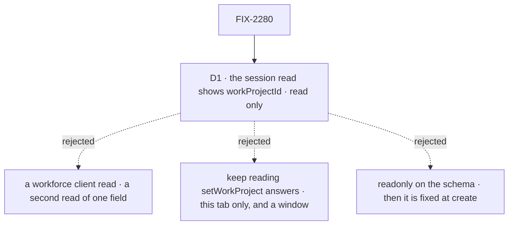

# FIX-2280 · Decisions

[Spec](SPEC.md) · **Decisions**

FIX-2161 decided where a conversation's project lives and who writes it. The issue offered two
ways to read it back: the session read, or a read on the workforce client. One call is left.

## The tree

Solid edges are what you're signing. Dashed edges lost, and the label says why.

## D1 · A screen reads a conversation's project from the session read, not from a workforce client call

| | |
|---|---|
| **Instead of** | A workforce client read, `workProject(worker, { sessionId? })`, run as an action in the conversation, which could check membership again before it answers |
| **Because** | The engine already has one rule for which session state a client sees: the flow names it in `session.client.expose` (BP-015). FIX-2278 (#4073) names `workProjectId` there for every worker session, so the read and the listing carry it with no new call. A second read of the same field would be two answers that can drift ([tenet 2](../../../docs/philosophy.md)), and it would cost a request per poll. The read can't widen access: it is the session owner's, and the owner set the field as a member. A person who later leaves the project still sees an id they chose, and `projectWorkspace()` refuses every run there |
| **Locks in** | `workProjectId` is part of what a person's session read and listing send for every worker session, as `<visibility>/<id>`. Removing it later breaks a screen that reads it. It stays `serverOwned`: the read never becomes a way to write it |

**What would change my mind:** a project id that is itself sensitive to someone who has left the
project, for example ids that carry a customer's name. Then the read checks membership, through a
client call or an engine `client.data` projection.

It comes down to one rule for visible state: a client call would be a second answer for one field.

## Decided, not asked

- **No membership check at read time.** The writer checks; the run checks. The read shows what
  the owner stored.
- **The lab drops its `picked` memo too**, not only the request-answer read. After a
  `setWorkProject` it polls the read like any other change.
- **The proof goes on the built-in agent flow.** #4073's test covers the coordinator flow; the
  Teammates lab's talking workers run on the agent flow, and both reach the field through
  `installation.session()`.
- **No changeset.** #4073 carries the package's patch changeset for the read. This issue adds a
  test, a private lab change and docs.
- **The field stays `<visibility>/<id>`**, parsed with the existing `parseProjectRef` (exported
  from `./browser`), not a new helper. A screen that wants the title joins it to `listProjects`,
  on visibility and id together, so a private and a shared project with one id don't collide.
- **A stored project the person can no longer see** (deleted, or they left it) shows as no
  project in the lab's header, since it has no match in their project list. The next run is
  refused `no-project`/`not-a-member` as today.

## Considered and dropped

| Option | Why it lost |
|---|---|
| Do nothing past #4073 | The lab, the place the gap was found, would still read request answers. Not done |
| Declare `workProjectId` readonly | Readonly fields are visible, but the engine keeps them as created, so `setWorkProject` could never write it (FIX-2161 D1) |
| An engine `client.data` projection that checks membership | Puts a Workforce rule (membership) in a Layer 1 read hook for no reader that needs it. Kept as the route if the "change my mind" case comes |

## Analysis

2026-10-28, watermark #4073 and #4079. **Verdict: right approach, one fold.**

- **Reuse:** the engine's `session.client.expose` and `toClientSession`, used as is. Fold: the
  lab's diff used a new `projectIdOf`; `parseProjectRef` already exists. **Folded.**
- **Prior art:** reading conversation state off the thread, with no extra call, matches common
  agent frameworks. Recorded, not cited.
- **Other shapes:** a client call and a `client.data` projection, weighed in *Considered and
  dropped*. No divergence pass: no new surface.
- **Necessity:** right size; #4073 alone leaves the lab on request answers.
- **Ergonomics:** `projectId` and `workProjectId` now sit side by side on a coordinator's read.
  **Folded** into the docs line.
- **Claims checked on main and #4073:** the agent flow and the error reporter spread
  `installation.session()` and keep `client`; the read, listing, create and metadata answers all
  go through `toClientSession`; no route writes session state; the read is owner-checked;
  `listWorkerSessions` keeps the row. The state read (`get_session_state`) carries it too.
  **Folded** into the docs line.
- **Recorded:** visibility collision and a project no longer visible, both now in *Decided, not
  asked*.

## How it got here

- **Draft** — FIX-2280 asked for a read of a conversation's project. FIX-2278 in #4073 already
  exposes the field on every worker session through `installation.session()`, so the spec
  builds smaller: prove it on the agent flow and move the Teammates lab onto the session read.
