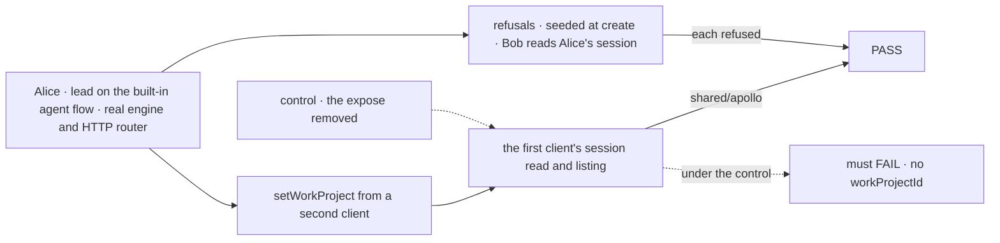
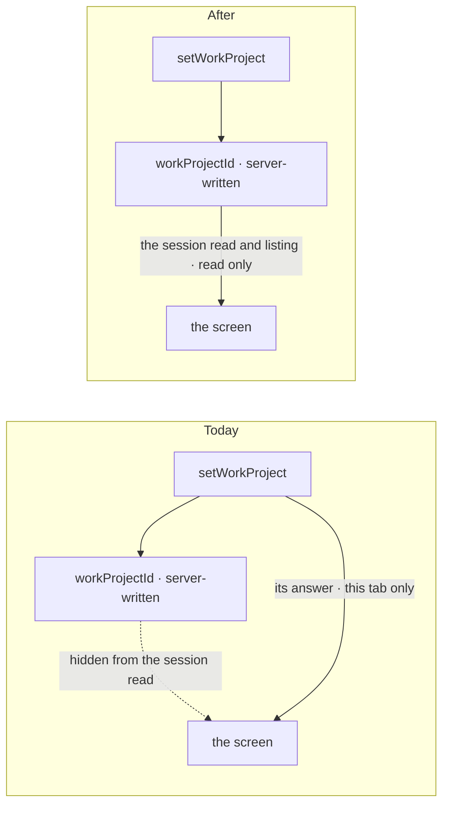

# FIX-2280 · A client can read the project a worker's conversation works in

**Spec** · [Decisions](DECISIONS.md)

## Five people, before and after

| Someone who… | Today | After |
|---|---|---|
| **opens a worker in the Teammates lab after picking its project in another tab** | The header shows no project. The screen only knows a pick from the answers of the conversation's own finished `setWorkProject` requests, and a pick made in this tab | The header names the project. The screen reads it from the conversation itself, through the session read |
| **has talked to the same worker for weeks** | The pick can drop out of view: the screen reads at most 200 finished requests to find the last `setWorkProject` | The project shows however long ago it was set |
| **lists their sessions with a worker in the Claude Code-style lab** | Each row can't name its project | Each row carries its `workProjectId`, since the listing sends the same state as the read |
| **tries to set the project through the session itself** (seed it at create) | Refused: the field is server-owned | The same. Reading it adds no way to write it; only `setWorkProject` does, with its member check |
| **reads another person's conversation** | Refused | The same. The session read stays the owner's |

## The goal, and how we'll know it's met

**A screen names the project any of a person's conversations with a worker works in, read from
the stored, server-written field, whoever set it and however long ago, and the read gives no
way to write it.**

| Is it the right goal? | |
|---|---|
| **The real need** | FIX-2280: "expose the work project to the conversation's members, read only (it stays serverOwned), or give the workforce client a read for it", so that "a project set any other way" is seen. Epic FIX-2152's ER-8 (#3803): a conversation's project is "stored on the server, never read from lab config" |
| **Smaller, and rejected** | "Ship FIX-2278 and stop." #4073 makes the read show the field, but tests it on the coordinator flow only, and the Teammates lab, whose lead, researcher and writer run on the built-in agent flow, still reads request answers. The gap the lab filed would stay open in the lab |
| **Bigger, and not this issue's** | Showing the project's title or checkout beside the id (the screen already lists projects) · pushing a change live to an open screen (the labs poll) · a worker's harness on the roster (FIX-2281) |
| **Not done if** | The screen reads the project from anything but the session's stored field · a pick made by another client doesn't show · a client can write `workProjectId` through any session route · another user can read it |



The check reads the session through the client, as a screen does, never the store.

| How we verify | |
|---|---|
| **Goal check** | Model-free, so no `goals/` script: a `packages/workforce` CI test on the built-in agent flow (`defineAgentWorkerFlow` on an installation), the real engine and HTTP router, nothing mocked. And a Teammates lab test that the adapter's project read follows the session read. Verdicts in the implementation PR |
| **Signal** | `unset`: lead's default conversation reads with no `workProjectId`. `elsewhere`: a second client of Alice sets it to `shared/apollo`; the first client's read, which sent no request, shows `shared/apollo`. `listing`: `listWorkerSessions("lead")` carries it on the default row. `changed`: set to `shared/beta`, the read shows beta. `no-write`: a create that seeds it is refused 400, as today. `other-user`: Bob's read of Alice's conversation is refused. `lab`: the adapter's `watchWorkProject` answers what the session read holds, with no `setWorkProject` request in the conversation |
| **Input** | Shared apollo and beta with Alice a member, and Bob |
| **Anti-game** | Assert on the client's answers, never on state written by hand |
| **Control that must fail** | The expose removed from the worker session fails `elsewhere`, `listing` and `changed`. The lab adapter reading request answers again fails `lab`. The PR shows each FAIL before the PASS |

## What changes



The package half is FIX-2278's one line in #4073 (the worker session exposes the field); this
issue proves it on the agent flow and moves the Teammates lab onto it.

```diff
  // labs/teammates/src/adapter.ts
  watchWorkProject(worker, onChange) {
    return poll(async () => {
      const { sessionId } = await conversationOf(worker);
-     const done = await client.sessions.requests(sessionId, { status: "completed", includeResultOutput: true, limit: 200 });
-     const last = done.filter((r) => r.actionName === SET_WORK_PROJECT_ACTION).sort(/* newest first */)[0];
-     return last?.result?.output?.project?.id ?? picked.get(worker);
+     const { state } = await client.sessions.get(sessionId);
+     return parseProjectRef(state[WORK_PROJECT_STATE_KEY])?.id;   // "shared/apollo" → "apollo"
    }, onChange);
  },
```

**Docs:** update `packages/workforce/README.md` → the `workProjectId` paragraph under session
fields: a person's session read, listing and state read show it, read only, and how it differs
from `projectId`, the project coordinator's link. Extend
`apps/docs/docs/workforce/projects.md` → *Setting the project a conversation works in* with one
paragraph on reading it back. Drop the Teammates lab README's "Not wired yet" line for FIX-2280.
No new page.

## What stays as it is

- **Who writes it.** `workProjectId` stays `serverOwned`; `setWorkProject` is its one writer,
  and its member check is unchanged.
- **The run's gate.** `projectWorkspace()` still checks membership on every run, so a stale id a
  person can read never gives them a checkout.
- **Who reads a session.** The session routes' owner and org checks are unchanged.
- **Core and engine.** The engine's `session.client.expose` already exists for this (BP-015).
  Nothing about the Layer 1 read changes.

## What's already here, and the debt

| Already here | What this does with it |
|---|---|
| `session.client.expose` and `toClientSession` (`engine/src/routes/client-session.ts`), the closest entry: a client sees a session state field only when its flow exposes it or declares it readonly | **Used**, unchanged ([D1](DECISIONS.md#d1)) |
| FIX-2278 in #4073 (open): `installation.session()` returns `client: { expose: [workProjectId] }`, with a test on the coordinator flow. The built-in agent flow and the error reporter spread the same `installation.session()`, so it reaches them too | **Built on.** This issue adds the agent-flow proof and the lab's use. It doesn't re-ship the line |
| FIX-2161 (`specs/issues/FIX-2161`): the field, its writer and its member check | **Kept** as decided |
| The workforce client's `setWorkProject` answer, which the lab reads today | **No longer read** for this |

**Builds on / Adds**

| Adds | Existing piece considered | Why it fits or doesn't |
|---|---|---|
| Nothing in a package's source | A workforce client read, `workProject(worker, { sessionId? })` | Not added: the session read already carries the field once #4073 lands, so a client call would be a second read of one field ([D1](DECISIONS.md#d1)) |
| A test on the agent flow | `work-project.test.ts`'s read test on the coordinator flow | **Extended**: same file, the other flow every lab worker runs on |
| The lab's project read through `sessions.get` | The lab's request-answer read and its `picked` memo | **Replaced**: both go |

| The debt | |
|---|---|
| **Adds** | One test and one lab call |
| **Removes** | The lab's request-answer read and its in-tab `picked` memo, the workaround FIX-2280 was filed against |
| **Leaves** | The session read shows the id, not the project's title, so a screen joins it to its project list. Permanent by design: the listing of projects is the read for titles |

**Net: down, by one workaround in the lab.** No package surface is added.

## Sign off

**[The goal](#the-goal-and-how-well-know-its-met), at that size:** a screen names the project
of any of a person's conversations from the stored field, whoever set it, and can't write it.
If wrong: a lab keeps its own copy of the project, which ER-8 forbids.

**[The debt](#whats-already-here-and-the-debt): down, by one lab workaround.** Adds a test and
one lab call. If wrong: the lab's request-answer read stays as a second source of the project.

1. **[D1](DECISIONS.md#d1) · A screen reads a conversation's project from the session read, not
   from a workforce client call.** If wrong: a reader that should be refused at read time (a
   person who has left the project) still sees the id.

**Open: none.** Depends on #4073 (FIX-2278) and #4079 (the Teammates lab's wiring, FIX-2154)
merging first. Reasoning and what lost: [DECISIONS.md](DECISIONS.md).

Feature · `workforce` (one test) + `labs/teammates` (one read) + docs · small (2 source files,
2 test files, 3 doc surfaces) · 1 PR · epic FIX-2152
