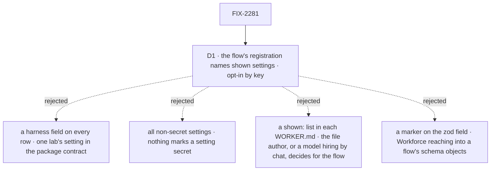

# FIX-2281 · Decisions

[Spec](SPEC.md) · **Decisions**

The epic's [ER-9](../../epics/FIX-2152/DECISIONS.md#who-owns-what) (#3803) settled that a coding
worker names its harness in its `WORKER.md` and that a harness run is tagged from that setting. One
call is left: who decides that a setting may reach a browser.

## The tree

Solid edges are what you're signing. Dashed edges lost, and the label says why.

## D1 · The flow's registration names the settings a person may see; nothing shows by default

| | |
|---|---|
| **Instead of** | A `harness` field on every roster row; every setting not judged secret; or a `shown:` list in each `WORKER.md` |
| **Because** | A setting belongs to its flow: the flow's `configSchema` declares and checks it, and only the flow knows whether it is a harness name or a token. The registration entry already carries per-flow facts (`roles`, `standardOnly`), so this is one more option on the closest piece, not a new one ([tenet 2](../../../docs/philosophy.md)). Opt-in by name means a new setting stays on the server until someone names it, so a secret can't leak by default. A `harness` field would make Workforce know one lab flow's setting. A per-file list would let any worker file (or a model hiring through chat) show a setting the flow's author never meant to, and repeat the same line in every worker on the flow |
| **Locks in** | `WorkerFlowEntry`'s object form gains `showSettings?: readonly string[]`. `RosterEntry` gains `settings: Readonly<Record<string, unknown>>`, holding exactly the shown keys the worker declares (`{}` for none). `hireWorkforce` refuses a name that is a contract key (`CONTRACT_KEYS`), a reserved key, or not declared by the flow's `configSchema` |

**What would change my mind:** a setting that should show for some workers on a flow and not for
others. Then a per-worker narrowing (a file can hide, never add) joins the flow's list.

## Decided, not asked

- **The convergence point is one function**, `shownSettingsOf(flow, settings)`, which both roster
  collections call: the standard projection (from the worker's frontmatter, after `settingsOf`'s
  reserved-key strip) and the user collection's `data` projection (from the stored `settings`). No
  other browser read of settings exists (the searches are in SPEC.md); the inventory keeps its own list.
- **What the worker declares, not the flow's default.** A key the worker doesn't set is absent, not
  filled from the schema's default. The screen shows what the file or the user wrote.
- **Values pass as declared.** A shown key's value goes through whole. Naming a key is the flow
  author's promise that its value is safe to show.
- **A flow gone from the registration** shows nothing for its rows, the same as a flow with no
  `showSettings`. The row's other fields read as today.
- **A user's own worker shows the same keys as a standard one on the same flow.** Its row is read
  only by its user (user scope), and the flow decides either way.
- **The labs adopt it at their wiring**: FIX-2153's `harness-thread` flow registers
  `showSettings: ["harness"]`, and FIX-2154 reads `settings.harness` instead of its fixture.
- **Names beyond `showSettings` and `RosterEntry.settings`** are the implementer's.

## Considered and dropped

| Alternative | Why not |
|---|---|
| `harness: string \| null` on every roster row (the issue's "at least `harness`") | D1: Workforce would name one lab flow's setting, and the next setting worth showing is another field |
| All settings except a deny-list | D1: a new setting shows until someone remembers to deny it. That fails open |
| A `shown:` (or `public:`) key in `WORKER.md` | D1: the file author decides for the flow, and a hire through chat could expose a setting. Also one line per worker instead of one per flow |
| A Workforce marker wrapped round the zod field (`shown(z.enum(...))`) | Same owner as D1, but Workforce would have to tag and later find schema objects; the registration is already where per-flow facts live |
| The screen infers the harness from a run's items (today) | Nothing to show until a run starts, which is the bug |

## Open / Settled

**Open: none.**

**Settled, from reading `main`:** the user worker collection's browser read is an `expose` list
(`worker-row.ts`), so settings don't reach a browser today; the standard projection sends its whole
row; `CONTRACT_KEYS` is `workerConfigSchema().shape`'s keys (`worker-flow-contract.ts`), and every
worker flow composes that schema, so a flow's declared keys are readable from its `configSchema`; a
fork copies the standard worker's frontmatter into `settings` (`hire-blocks.ts`). No POC: the goal
check runs the real path.

## How it got here

- **Draft** — the coordinator's brief ruled out a blanket "non-secret settings" rule and offered
  `harness` alone or an allow-list in `WORKER.md`. Reading `settingsOf` and `WorkerFlowEntry` moved
  the allow-list to the flow's registration, where the setting's owner and the other per-flow facts
  already are.
