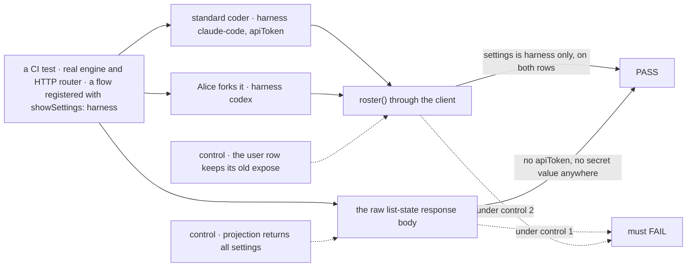
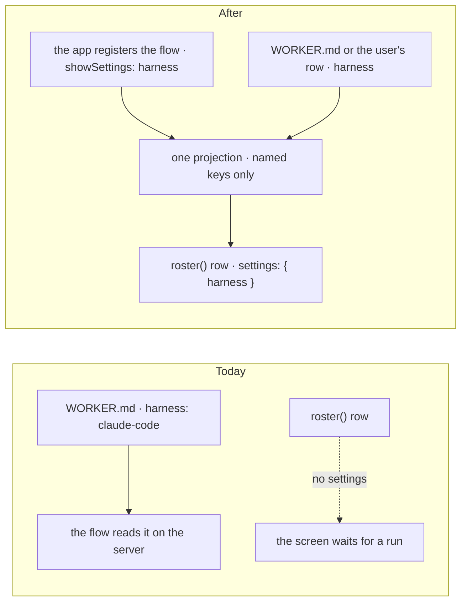
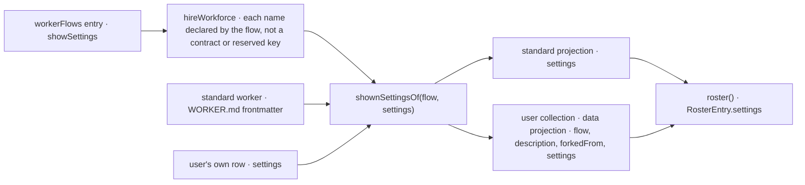

# FIX-2281 · A roster row says which harness a coding worker runs on

**Spec** · [Decisions](DECISIONS.md)

## Four people, before and after

| Someone who… | Today | After |
|---|---|---|
| **opens the Teammates lab's worker list** | Sees `coder` with no harness until one of its runs starts, because `roster()` rows carry no settings; the lab's fixture fakes the line | Sees `coder · Claude Code` from the first read: the row carries the worker's `harness`, because the coding flow registered that setting as shown |
| **forks `coder` and sets its harness to Codex** | n/a | Their fork's row says `codex`, read from their own stored settings |
| **gives a worker a setting nobody marked as shown** (a token, a tool list, a document grant) | It stays on the server | It still stays on the server. Nothing reaches a browser unless the flow that owns the setting named it |
| **writes a worker flow with no shown settings** | n/a | Its rows carry an empty `settings`, and nothing else about them changes |

## The goal, and how we'll know it's met

**An app reads, from `roster()` alone, the settings a worker flow chose to show (for a coding worker,
its `harness`), for standard workers and a user's own alike; and no setting the flow didn't name ever
reaches a browser.**

| Is it the right goal? | |
|---|---|
| **The real need** | "`roster()` rows carry no settings. The screen can only name the harness once a run starts … Ask: put a worker's declared, non-secret settings (or at least `harness`) on its roster row" (the issue, from wiring FIX-2154). The epic's [ER-9](../../epics/FIX-2152/DECISIONS.md#who-owns-what) already says a harness run is tagged from the worker's `harness` setting, and the task row gains no field, so the roster is where the screen must find it |
| **Smaller, and rejected** | A `harness` field on every row. It puts one lab flow's setting into Workforce's contract, and the next flow with a setting worth showing needs another field ([D1](DECISIONS.md#d1)) |
| **Bigger, and rejected** | "Every non-secret setting." Nothing marks a setting secret, so "non-secret" would be a guess at run time, and a new setting would show by default. Shown is opt-in, by name ([D1](DECISIONS.md#d1)) |
| **Not done if** | A setting no flow named reaches any browser read (the typed client *or* the raw HTTP body) · a user's own worker shows nothing while a standard one does · a flow can name a contract key (`instructions`, `teamInstructions`, `workerSkills`) or a reserved one · the row shape breaks a reader that ignores `settings` |



| How we verify | |
|---|---|
| **Goal check** | Model-free, so no `goals/` script: a `packages/workforce` CI test on the real engine and HTTP router, nothing mocked. Verdict in the implementation PR |
| **Signal** | `standard`: a standard worker on a flow registered with `showSettings: ["harness"]`, declaring `harness: claude-code` and `apiToken: s3cr3t-…`, reads back through `roster()` with `settings` equal to `{ harness: "claude-code" }`. `own`: Alice forks it and edits `harness` to `codex`; her row reads `{ harness: "codex" }`. `unshown`: a worker on a flow with no `showSettings` reads `{}`. `raw`: the list-state HTTP response body for both collections, read as text, contains neither `apiToken` nor the secret value. `refused`: `hireWorkforce` refuses a flow whose `showSettings` names `instructions`, a reserved key, or a key its `configSchema` doesn't declare |
| **Input** | One installation with two flows, one standard worker, Alice |
| **Anti-game** | The `raw` leg reads the response text, never the typed client's output, which drops unknown fields |
| **Control that must fail** | The projection returning the whole settings bag fails `raw`. The user collection keeping today's `expose` list fails `own`. Each FAIL is shown in the PR before the PASS |

## What changes



A worker flow's registration, which already says `roles` and `standardOnly`, can name the settings a
person may see. Both roster collections project exactly those keys.

```diff
  const installation = createWorkerInstallation({
    standardWorkers: roster.workers,
    workerFlows: () => ({
-     "harness-thread": harnessThreadFlow,
+     "harness-thread": { flow: harnessThreadFlow, showSettings: ["harness"] },
    }),
  });

  // in the app
  const rows = await workforce.roster();
- // rows[i] has no settings; the harness is a guess until a run starts
+ rows.find((row) => row.id === "teammates.coder")?.settings.harness; // "claude-code"
```

**Docs:** update `packages/workforce/README.md` (the `workerFlows` entry form and `RosterEntry`);
extend `apps/docs/docs/workforce/workers-on-disk.md` → *Which flows can run workers* with a short
*Settings a person can see* beside *A worker flow's roles*. No new page.

## Where a shown setting comes from



One function picks the shown keys from a worker's settings by its flow's registration, and both
collections call it. The standard projection adds `settings` to its row. The user collection swaps
its `expose` list for a `data` projection that returns the same three fields plus `settings`, since
the value is computed (BP-015's case for `data`). `RosterEntry` gains `settings`, `{}` when the row
has none. Nothing stored changes, so there is nothing to migrate (BP-030).

## What stays as it is

- **What a flow reads.** `resolveWorker(ctx).config` still carries every setting, on the server.
- **What is stored.** The user's worker row and its `settings` are unchanged.
- **The org's worker inventory** keeps its own field list (`WORKER_INVENTORY_CLIENT_FIELDS`).
- **The task row**, per ER-9: it gains no field. The screen joins a task's assignee to its roster row.
- **Core and engine.** The `data` projection and the projected collection exist; this uses them.

## What's already here, and the debt

| Already here | What this does with it |
|---|---|
| The `workerFlows` object entry, `{ flow, standardOnly?, roles? }` (`hire.ts`, `WorkerFlowEntry`): per-flow registration facts the installation reads. The closest entry | **Extended** with `showSettings` |
| `settingsOf(manifest)` (`hire.ts`): a worker's settings minus reserved keys, handed to the flow | **Kept**. The shown keys are picked from what it hands the flow, so a reserved key can never show |
| `client.expose` on the user worker collection (`worker-row.ts`): `flow`, `description`, `forkedFrom`; "its settings and instructions stay on the server" | **Replaced** by a `data` projection of the same three fields plus the shown settings. The comment's promise holds for every unnamed setting |
| The standard projection (`standard-workers.ts`): full row to the browser | **One field added** |
| Ways a worker's settings reach a reader, from searches of `packages/*/src` for `settings`, `expose`, `clientData` and `config` in the worker, roster and inventory code: `resolveWorker().config` on the server, and nothing in a browser. This is the **first** browser read of a setting | **New**, and opt-in per key |
| Epic [ER-9](../../epics/FIX-2152/DECISIONS.md#who-owns-what) (#3803): one coding flow routes by the worker's `harness` setting; a harness run is tagged from it and the task row gains no field | **Kept**; this gives the screen the tag |
| The labs' fixture `harness` (`labs/teammates/src/adapter.ts`, `labs/claude-code-style/src/adapter.ts`) | **Left** for each lab's wiring to read from `roster()` (FIX-2154; FIX-2153's flow registers `showSettings`) |

| The debt | |
|---|---|
| **Adds** | One registration option, one row field, one projection function, one hire check. Permanent by design: the package's answer to which settings a person may see |
| **Removes** | The fixture `harness` in each lab, at its wiring |
| **Leaves** | The worker inventory (org-wide rows) doesn't carry shown settings. No script needs it; a screen that lists the org's workers without a roster would |

**Net: up, by one option and one field.** Without it, each lab infers the harness from a run's items
or keeps a copy in its own config, which ER-4 forbids.

## Sign off

**[The goal](#the-goal-and-how-well-know-its-met), at that size:** a flow's named settings on every
roster row, standard and own, and nothing unnamed in any browser read. If wrong: the labs keep a
fixture harness, or a secret reaches a browser.

**[The debt](#whats-already-here-and-the-debt): up, by one option and one field.** If wrong: a
setting-visibility knob nobody but the labs uses.

1. **[D1](DECISIONS.md#d1) · The flow's registration names the settings a person may see; nothing
   shows by default.** If wrong: a worker file can't hide a setting its flow shows, or show one its
   flow doesn't.

**Open: none.** Reasoning and what lost: [DECISIONS.md](DECISIONS.md).

Feature · `workforce` (one registration option, one row field, one projection, one hire check) + docs · small (4 source files, 1 test file, 2 doc surfaces) · 1 PR · epic FIX-2152
