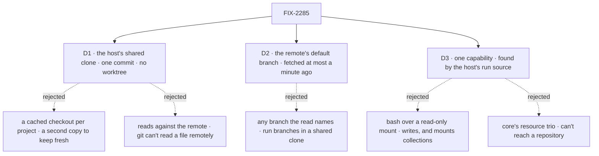

# FIX-2285 · Decisions

[Spec](SPEC.md) · **Decisions**

The issue left two questions open: where the bytes come from, and which version a read sees.
D1 and D2 answer them. D3 is the shape a worker and an app see.

## The tree

Solid edges are what you're signing. Dashed edges lost, and the label says why.

## D1 · Reads come from the host's shared clone, at one commit, with no worktree

| | |
|---|---|
| **Instead of** | A cached read-only checkout per project, kept fresh beside the runs. Or reads against the remote with nothing local |
| **Because** | The host already keeps one bare clone per remote under `<root>/.clones/`, fetches it before every new run branch, and guards it with a lock. Git reads files, lists trees and greps at a commit straight from a bare repository, with no worktree (checked, [Settled](#settled)). So a read adds no copy of the repository and no directory to clean up, and every coding run's fetch freshens it. A checkout per project is a second copy per project to fetch, reset and garbage-collect. Git can't read a file's body from a remote without fetching it, and a forge's file API would put one vendor's API in a package that today speaks only git ([tenet 2](../../../docs/philosophy.md)) |
| **Locks in** | The read shares the coding runs' clone, disk and lock. The first read of a project no run has touched makes the clone, once, inside that read's call. The read view is an optional method on the `WorkspaceHost` contract: a host without one is refused when the capability is built, never at call time, and gets reads by adding the method. A project row can name any remote the server's own credentials can fetch; coding runs already allow that, and reads make it a tool call instead of a harness run |

It comes down to the copy: the clone is already there, and a checkout per project is one more to
keep fresh.

**What would change my mind:** a host whose clone lives somewhere reads can't reach, such as a
remote sandbox. Then that host answers reads from its own place, behind the same view.

## D2 · A read sees the remote's default branch, fetched at most a minute ago, never a run's branch

| | |
|---|---|
| **Instead of** | Letting a read name any branch, a coding run's own included |
| **Because** | The clone is shared by remote, not by project. Run branches live in the clone's `refs/heads/*`; the host's fetch writes only `refs/remotes/origin/*`. A read that resolves `refs/remotes/origin/<default>` therefore can't reach a run branch, by construction, and a package test plants a run branch and a second project's pushed branch and proves no read reaches either. Two projects on one remote, one private to another user, keep their runs' branches in the same clone, so "any branch" would let a member of one read a run of the other. The default branch is what the project's members all see on the remote. A minute bounds staleness without a fetch per call: a model reads in bursts. A run's own work is the run's to report (`getTask`, and FIX-2290's progress note). A project mapped to an operator's checkout reads the base a new run there would be cut from, resolved by the host's own base resolution (the newer of the base and its fetched upstream), and only for a path listed in `localRepositories` |
| **Locks in** | Every read in one tool call sees one commit, and the result names it. A main session can't see a coder's work until it reaches the remote's default branch. Widening to a named remote branch later is additive; narrowing after release would break callers |

It comes down to the shared clone: a branch name can't say whose project it belongs to.

**What would change my mind:** clones kept per project instead of per remote. Then a project's own
run branches are safe to name, and the read can take a branch. FIX-2297's mode, where a run works
in a person's own checkout, would also move this: a read of the base can't see that run's
uncommitted edits, and a read of the working tree might then be wanted.

## D3 · One capability a worker picks in its file; the project is found by the host's own run source

| | |
|---|---|
| **Instead of** | The bash capability over a read-only projection of the project. Or core's resource trio pointed at the project |
| **Because** | `projectSourceCapability({ workspace })` calls `workspace.source(ctx)`, which is `projectWorkspace()` for every app that runs coding on projects. So the read's lookup, its membership check, its six refusals and its `checkouts` mapping are the coding run's by construction, not a copy that can drift ([tenet 5](../../../docs/philosophy.md)). The capability carries `projectWorkspaceCapability`'s resources, which the source reads. A worker opts in with `capabilities: projectSource: [read]`, the per-worker selection FIX-1459 built, so the tools fence holds. Bash writes, and mounts collections, not a repository. The trio reads resources in the block's scope gated by `llmReadable`, and a repository is not a resource |
| **Locks in** | The public names `projectSourceCapability`, its preset `read`, and the tools `globProjectSource`, `readProjectSource` and `grepProjectSource`. An app that offers reads passes the same host its coding runs use. No tool in the capability writes, now or by a later preset: a write path is a coding run's job |

It comes down to the gate: calling the run's own source is the only way it can't drift.

**What would change my mind:** an app that wants reads but runs no coding at all. It still builds a
host for reads alone, and if that becomes common the capability can build one itself.

## Decided, not asked

- **Named for the run source, not "project files".** *Project files* already means the kept files (`project-files/<id>`, `readProjectFiles`), and these tools read the repository; *source* is the answer `projectWorkspace()` gives, repository or kept files. `read` matches core's trio and the prior art, and `readProject` is taken by the project row read.
- **Caps live in the host's read view, the one convergence point.** The view takes the whole run-source answer, repository or kept files, and every read passes it: a
  list returns at most 500 paths, a show at most 2,000 lines and 256 KB, a grep at most 200
  matches with snippets of 200 characters. Each result says when it was cut, with the count
  left. The tools add no cap of their own. BP-042: a tool result is recorded.
- **Binary files are refused by `readProjectSource` and skipped by grep.** The result says so.
- **Paths are repository paths**, `/`-separated, no leading `/`, no `.` or `..` segment.
  A repository read goes through git's object store, so no path reaches the disk. A files
  read lists only `project-files/<id>/…`, filtered at the source (BP-033).
- **Every read is a path at one resolved commit.** No tool takes a revision, a commit or a pathspec: the clone holds other projects' run objects, private ones included, and only a path at the default branch's commit keeps them out of reach. Paths go to git as literal pathspecs.
- **One rule for the clone lock: a read never waits on it.** A provision can hold it for minutes.
  - *No clone yet:* the read makes one without the lock, through the host's existing
    `.making-<uuid>` directory and rename, which already lets a racing provision win.
  - *A clone older than a minute:* the read tries the lock once, without waiting, through a new
    try-acquire in `lock.ts`. On success it fetches. When the lock is held, it skips the fetch
    and serves the last fetched commit, with its age. A lock left by a dead process counts as
    free under the same stale rule a waiting acquire uses, so a crash can't freeze reads on an
    old commit.
  - The time of the last fetch is kept on disk beside the clone, where every host sharing the
    root sees it. A fetch that fails falls back the same way. A clone that can't be made is the
    host's `remote-unreadable`.
  - A read resolves the default branch to a commit once and reads only that commit.
- **grep uses git's extended regular expressions on a repository** and JavaScript's on kept
  files, both with core's literal fallback on a pattern that doesn't compile (on git, a retry with
  fixed strings). The result names the dialect it used, since a static description can't know
  which kind of project the session has. Kept files are small, curated text, as core's trio assumes.
- **A repository project's kept files are not read here.** A path would mean one of two trees;
  the kept files stay the coding run's `project/` and `readProjectFiles`. Recorded in the
  debt's *Leaves* row.
- **A refused lookup is a tool result, not a thrown error.** It carries the reason and message
  the source gave, so the model can say why.
- **The lab shares one host between `harness-thread` and the agent flow**, and gives the preset
  to `desk.main` and `desk.researcher`. Changes still go to `desk.coder`.
- **The refusal legs have package tests too.** `runProjectOf` refuses `not-a-member` for a session whose stored project lost the user from its members; the goal's SQLite edit stands in for the members write the package doesn't have.
- **Changesets:** `@flow-state-dev/workspace` and `@flow-state-dev/workforce`, minor. The lab is
  private.

## Considered and dropped

| Alternative | Why not |
|---|---|
| Keep routing questions to `desk.coder` (#4073) | Works, and costs a branch, a worktree and a harness run per question. The issue exists because of it |
| A cached read-only checkout per project | A second copy per project to fetch and clean ([D1](#d1)) |
| A forge's file API (GitHub contents, search) | One vendor's API in a git-only package; no answer for `file://` remotes or mapped checkouts |
| Let a read name a branch | Run branches of other projects share the clone ([D2](#d2)) |
| Bash over a read-only projection | Writes by design; mounts collections, not a repository ([D3](#d3)) |
| Core's `globResources` / `grepResourceContent` / `readResourceContentTool` | Gate on `llmReadable` in the block's scope; a repository is not a resource ([D3](#d3)) |
| Extend `readProjectFiles` | A handler for a member naming a project, returning names and sizes for a screen. The model's read is of its session's project and needs bodies |

## Settled

- **A bare clone answers all three reads at a commit, with no worktree** — **CONFIRMED** on
  2026-10-28. A bare repository fetched with the host's own refspec
  (`+refs/heads/*:refs/remotes/origin/*`) answered `git ls-tree -r --name-only <ref>` (170
  paths), `git grep -n -I -e <pattern> <ref> -- <pathspec>` and `git cat-file -s` / `git show
  <ref>:<path>`, with no worktree made; a grep over the tree took 10 ms. The premise held;
  nothing changed.

## Analysis

2026-10-28 · watermark 2026-10-20 (52 issues read) · **Right work, at the right size**, after two folds.

1. **Reuse** — `reuse-review`: the read view **extends** `localWorkspaceHost`; the capability is genuinely new (core's trio, bash and `readProjectFiles` checked; none reaches a repository). See [Builds on / Adds](SPEC.md#whats-already-here-and-the-debt).
2. **Prior art** — Mastra's read-only workspace filesystem and the Claude Agent SDK's Read/Glob/Grep take the same three verbs with a line range and a hard boundary. Confirms the shape; both say `read`, which the rename took.
3. **Other shapes** — weighed in *Considered and dropped*; nothing copied.
4. **New factors** — FIX-2297 (a run in a person's own checkout) named in D2's *what would change my mind*. FIX-2278/2280 confirm `workProjectId` is server-written.
5. **Necessity** — the acceptance needs all three tools, and git answers each cheaply.
6. **Ergonomics** — the names clashed with *project files*; folded.
7. **Concerns** — none blocking.

Findings: **folded** the names (*project files* meant the kept files; `show` broke the `read` vocabulary) and the convergence point (the view takes the files answer too, so caps live in one place). **Recorded** in *Decided, not asked*: a read never waits on the clone lock and the fetch time is shared on disk; the mapped-checkout base is the host's own resolution and only for listed paths; the grep result names its dialect; the capability carries the source's resources; every read is a literal path at one commit; the remote exposure note on D1; FIX-2297 on D2. **Dropped**: a mapped checkout another run has checked out (its HEAD is what a run is cut from anyway); the test stub a new host method breaks (the implementer's).

## How it got here

- **Draft** — framed as "a worker reads without a run"; reads served by the host's shared clone
  at the default branch, through one capability that calls the coding run's own source.
- **Analysis** — renamed from `projectFiles` to `projectSource`, because *project files* already
  means the kept files; the read view takes the files answer too, so the caps have one home.
- **Goal validation** — added a refusal leg for someone taken off the members, the `no-gate`
  control, and disk signals for no clone or place per question.
- **Review round 1** — one lock rule (lock-free first clone, try-acquire fetch, stale locks count as free); the read view is an optional method on the host contract, refused at build; D2 rests on the refs split, with a test that proves it. Because Jake's review found the lock bullets contradicted each other.

**Open: none.**
