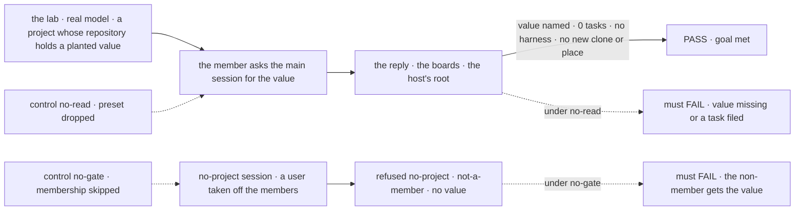
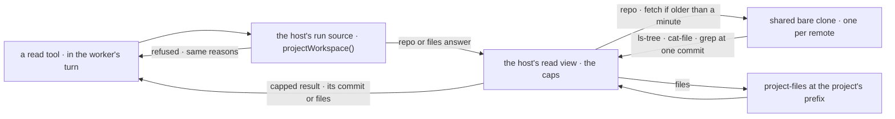

# FIX-2285 · An agent worker can read its session's project files, without a coding run

**Spec** · [Decisions](DECISIONS.md)

## Six people, before and after

| Someone who… | Today | After |
|---|---|---|
| **asks a project session "what does the code look like?"** | Is asked to paste `tree -L 2`, or, on the lab's workaround, waits for a coding task: a branch of the repository plus a whole Claude Code run, for one question | Gets an answer read from the project's files in the same turn. No task is filed |
| **asks the main session to hand a change to a coder** | Gets a task goal written blind, from the conversation alone | Gets a goal that names the files and functions the change touches, because the main session looked first |
| **is not a member of the project, or is in a session with no project** | n/a | Is refused with the reason a coding run gets: `not-a-member`, `no-project`, and the rest. Nothing is read |
| **wants to know what a coding run just committed** | Asks the run | Still asks the run. A read sees the project's default branch, never a run's own branch ([D2](DECISIONS.md#d2)) |
| **works in a project with no repository** | n/a | Reads the project's kept files, the same files a coding run there works on |
| **runs the server, with a checkout mapped for a shared project** | Coding runs work in that checkout | Reads come from the same repository, at its base commit. Its working tree is never touched |

A worker that coordinates work and can't look at anything writes poor goals and asks people
to do its reading. Jake's live run of the Claude Code-style lab hit this in the first question
(agent-mailbox PR 35, comment 6480840819).

## The goal, and how we'll know it's met

**A worker in a project session answers a question about the project's code from the files
themselves, in its own turn, with no coding run, and a session that may not see the project
gets the refusal a coding run gets.**

| Is it the right goal? | |
|---|---|
| **The real need** | "An agent worker can read the project its session works in, without a coding run: list/glob, read (line range, size cap) and grep. The project is resolved and gated the same way `projectWorkspace()` resolves it today" ([FIX-2285](https://linear.app/fixpoint-labs/issue/FIX-2285)). Under the epic: the lab needs no glue, and a gap goes to the package ([FIX-2152](../../epics/FIX-2152/SPEC.md#the-goal-and-how-well-know-its-met)) |
| **Smaller, and rejected** | "Code questions route to `desk.coder`." It works today on #4073, and it costs a branch and a whole harness run per question. "The tools exist." Hittable while no worker can pick them, or while they read a fresh clone per call |
| **Bigger, and not this issue's** | Reading a run's work in progress, from its own branch. The run's own channel owns that (`getTask`, and FIX-2290's progress note) |
| **Not done if** | The answer is right only because the model guessed it from the project's name or brief · a coding task was filed, or a harness ran without one, to get it · a read makes a clone or a worktree per call · any tool in the capability writes · a non-member reads a byte · a refusal's reason differs from the one `projectWorkspace()` gives the same session · a result has no size bound |



Leg 1 reads the reply a person sees, the boards through `listTasks`, and the server's disk,
never the tool calls. The value lives only inside a file's body, so nothing but a read can
produce it. The refusal legs read the tool result too, because a refusal the model never asked
for proves nothing.

| How we verify | |
|---|---|
| **Goal check** | `goals/claude-code-style-lab/reads-project-files/`, driven over the lab's HTTP API against `fsdev dev --config labs/claude-code-style/fsdev.config.mts` (as `session-mode-script` does) · real model · run by the implementer at completion · `VERDICT.md` with each leg's PASS or FAIL, and each control's, in the implementation PR |
| **Signal** | **Leg 1**, as the project's member, in a session set to the project with `setWorkProject`: the reply contains the planted value; `listTasks` on that conversation's board and on every delegate's board shows 0 tasks; no harness run started; `<root>/.clones/` holds one clone and no place directory appeared under `<root>`, after two questions. **Leg 2**, a session with no project asks the same: no value, and the turn holds a read call refused `no-project`. **Leg 3**, a second user who set the project as a member and was then taken off its members asks the same in that session: no value, and the read call is refused `not-a-member`. A non-member can't set the project at all (`setWorkProject` refuses them), and the package has no write that removes a member, so the check edits the stored row's `members` in the lab's SQLite file between the two steps. The gate reads that row, so the edit is what a later members write would leave. Each leg passes 3 runs of 3 |
| **Input** | A `file://` repository attached as the project's repository at create, with `LEDGER_CODE = "<value>"` in `src/billing/ledger/codes.ts`, below what a 2-level tree shows. The prompt: *"What value does this project set for its ledger code?"* It names no path. A different repository, path and value must pass too |
| **Anti-game** | Leg 1 asserts nothing on the tool call or its result. The value is in no file name, project name or brief. A leg 2 or 3 with no read call FAILs; it does not pass on the model declining |
| **Control that must fail** | `GOAL_CONTROL=no-read`: `desk.main`'s file names no `projectSource` preset. Leg 1 must FAIL on *value named* or *0 tasks*. `GOAL_CONTROL=no-gate`: the capability skips the source's membership check. Leg 3 must FAIL on *no value*. The PR shows both FAILs before the PASS |
| **Below the goal check** | Package tests carry what one question can't exercise: glob, grep, a line range, each cap and the cut it reports, a binary file, a `..` path, a mapped checkout, a files-only project, a task session of `desk.researcher` finding its project by `filingProjectId`, and that the capability exposes no tool that writes |

## What changes


Same question, two paths. Read the bottom row: the read reuses the coding path's project lookup
and its clone, and skips everything that makes a place.

**A worker picks the reads in its own file:**

```diff
  ---
  description: Does the work you ask for, and starts background tasks for the long pieces.
  delegates: [desk.researcher, desk.coder]
+ capabilities:
+   projectSource: [read]
  ---
```

**The app installs it once, with the host its coding runs already use:**

```diff
+ const workspace = localWorkspaceHost({ root: join(data, "runs"), remotes: { allow: ["file"] }, source: projectWorkspace() });
  flows = {
-   agent: defineAgentWorkerFlow({ installation, model, ...answerAgain }),
+   agent: defineAgentWorkerFlow({ installation, model, ...answerAgain, uses: [projectSourceCapability({ workspace })] }),
-   [HARNESS_THREAD_FLOW]: { flow: defineHarnessThreadFlow({ installation, root: join(data, "runs") }), roles: ["contributor"] },
+   [HARNESS_THREAD_FLOW]: { flow: defineHarnessThreadFlow({ installation, workspace }), roles: ["contributor"] },
  };
```

The worker then has three read tools: `globProjectSource`, `readProjectSource` (a line range, under
a size cap) and `grepProjectSource`.

**Docs:** update `apps/docs/docs/workforce/projects.md` → *A project's code and files* with a
*Reading a project's files from a conversation* section after *Setting the project a
conversation works in*; add the capability to `packages/workforce/README.md` and the host's read
to `packages/workspace/README.md` (*Workspace hosts and run sources*); the lab's README
inventory. No new page.

## How a read reaches the files



The tool asks the same source the coding run asks, so the gate can't drift from it. The host
owns the remote allowlist, the clone, the lock and the caps for both kinds of answer; the tool
only formats.

## What stays as it is

- **Coding runs.** `projectWorkspace()`, `harnessManager` and the place layout are unchanged.
  The read adds a door into the host, and touches no place.
- **The lookup and its refusals.** `runProjectOf` and its six reasons are reused as they are.
- **Core and engine.** Nothing here goes below `workspace` and `workforce`.
- **`readProjectFiles`**, the member's list of a project's kept files for a screen.

## What's already here, and the debt

| Already here | What this does with it |
|---|---|
| Whatever already reads a project's files. Searched `readFile`, `read`, `glob`, `grep`, `list`, `ls-tree`, `show` across `packages/`. Four hits: a coding run's checkout (`projectWorkspace()` + `localWorkspaceHost`), `readProjectFiles` (kept files, names and sizes, for a screen), core's `globResources` / `grepResourceContent` / `readResourceContentTool` (resources in the block's scope, gated by `llmReadable`), and `@flow-state-dev/tools`' bash capability (a sandbox synced to collections). **This would be the fifth way to read a project's files, and the first without a run.** The closest is the coding run's checkout | **Builds on** the first: same source, same clone. The other three can't reach a repository ([Considered and dropped](DECISIONS.md#considered-and-dropped)) |
| `projectWorkspace()` and `runProjectOf` (FIX-1762, FIX-2161) | **Builds on.** The tool calls the host's source, so the lookup, the membership check, the refusals and the `checkouts` mapping are the run's |
| `localWorkspaceHost`: the shared bare clone, `refresh`, the clone lock, the remote allowlist | **Extends** with a read view that makes no place |
| Core's resource trio: its glob, its regex with a literal fallback, its 200-character snippet | **Builds on** the shape. The project tools take the same parameters, so a model learns one vocabulary |
| The worker capability selection (`capabilities:` in `WORKER.md`, FIX-1459) | **Builds on.** A worker picks the `read` preset; the tools fence holds |
| [FIX-2152 ER-8](../../epics/FIX-2152/DECISIONS.md#who-owns-what): a lab's session works in its project's checkout | **Kept.** Coding still does; reading no longer needs it |
| #4073's lab workaround: code questions go to `desk.coder` | **Superseded** for questions. Changes still go to `desk.coder` |

| Adds | Existing piece considered | Why it doesn't fit, or how this is composed |
|---|---|---|
| A read view on the workspace host | `provision`, which hands back a checkout | Composed from the host's clone, `refresh` and lock. `provision` makes a branch and a worktree per place; a question needs neither |
| `projectSourceCapability` and its three tools | Core's resource trio; the bash capability; `readProjectFiles` | Composed from `projectWorkspace()` and the read view. The trio can't reach a repository and gates on `llmReadable`, not membership; bash writes, and mounts collections, not a repository; `readProjectFiles` lists names for a caller that names the project |

| The debt | |
|---|---|
| **Removes** | The lab's routing of code questions to `desk.coder`, and "can't see the project's code" in two of its worker files |
| **Adds** | A second door to a project's kept files for a model, beside `readProjectFiles` for a screen, over one filtered list. Permanent by design: one is a member naming a project, the other a session reading its own. A second find-files tool set beside core's trio, with the same parameters. Permanent by design: resources in scope and a project's repository are different gates |
| **Leaves** | A repository project's kept files aren't readable by these tools ([decided, not asked](DECISIONS.md#decided-not-asked)) |

**Net: up**, by one host read and one capability of three tools. Nothing in a package goes.

## Sign off

**[The goal](#the-goal-and-how-well-know-its-met), at that size:** answered from the files in
the worker's own turn, no task filed, refusals as a run's. If wrong: we ship tools no worker
uses, or keep paying a harness run per question.

**[The debt](#whats-already-here-and-the-debt), net up:** one host read and three tools, built
from the run's own lookup and clone; the lab's question routing goes. If wrong: a second read
path whose gate drifts from the run's.

1. **[D1](DECISIONS.md#d1) · Reads come from the host's shared clone, at one commit, with no
   worktree.** If wrong: the first read of a project no run has touched waits for a full clone.
2. **[D2](DECISIONS.md#d2) · A read sees the remote's default branch, fetched at most a minute
   ago, never a run's branch.** If wrong: the main session can't see a coder's work until it is
   pushed.
3. **[D3](DECISIONS.md#d3) · One capability a worker picks in its file; the project is found by
   the host's own run source.** If wrong: an app wires a host it doesn't otherwise need.

**Open: none.** D2 is the one to weigh. Reasoning and what lost: [DECISIONS.md](DECISIONS.md).

Feature · `workspace` + `workforce` + the Claude Code-style lab · medium · epic
[FIX-2152](../../epics/FIX-2152/SPEC.md)
