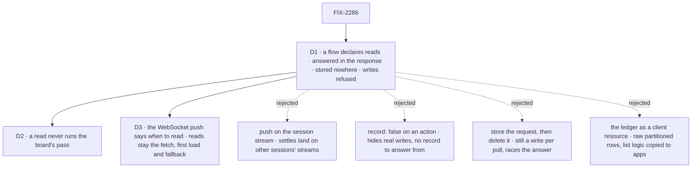

# FIX-2286 · Decisions

[Spec](SPEC.md) · **Decisions**

Two calls: how an app reads a board without storing a request, and whether that read keeps the
side effect the action has.

## The tree

Solid edges are what you're signing. Dashed edges lost, and the label says why.

## D1 · A flow declares reads: blocks answered in the response, stored nowhere, refused any write

| | |
|---|---|
| **Instead of** | A push of the board's changes; an action flagged not to be recorded; a request stored and then deleted; or the ledger exposed as a client-visible resource |
| **Because** | The list an app shows is computed by orchestration (steps beside tasks, the latest follow-up as `current`, server-only fields stripped) over a partitioned, user-scoped ledger, behind the session's membership check. Only running the package's own block on the session gives the same rows under the same fence. A read is that block with the record taken away, and with writes refused so "nothing stored" holds by construction rather than by each author's care. A push would be the better end state, but a conversation's rows are settled by task sessions on other flows, whose changes reach their own streams, and the engine's cross-session stream (`/users/:userId/stream`) is unbuilt (501). An unrecorded action would still be allowed to write and dispatch, so the log would lose real changes, and the client's way of getting an action's answer (read the request back) would have nothing to read. Storing then deleting still writes per poll and races the client's read of the answer |
| **Locks in** | `defineFlow({ reads })`, a map of name to `{ block, description? }`, names unique within the map (a read may share a name with an action). `POST /:flowKind/:sessionId/reads/:readName` with `{ input }`, answering `200 { output }`; a refusal answers as the action route would (4xx with a reason); a block that throws answers 4xx/5xx by the error's own retryability. The read's context refuses resource, collection, content and session-state writes and every dispatch with code `read_only`; its emitted items go nowhere. Client: `client.flow(kind).read(name, input, { sessionId })` resolving to the output |

**The condition it's signed off on:** `reads` is the one hook for watching a computed view. Nothing
that does the same job is added beside it, and the existing one-off watchers move onto it over time,
tracked under the FIX-2316 cleanup.

**What would change my mind:** the cross-session stream landing first. Then the board publishes its
changes there and the apps subscribe; reads would still serve the first load.

## D2 · A read never runs the board's pass

| | |
|---|---|
| **Instead of** | The read touching the board as the action does, starting rows that are startable or past due |
| **Because** | The pass writes and dispatches, which D1 refuses. Nothing depends on a poll to start a row: a row's start is its own state, and every writer that makes a row startable owes the session's wake (`conversation-board/board.ts`, FIX-2078). Since #4073 the lab doesn't poll an idle session at all, and no regression came of it |
| **Locks in** | `taskToolReads` takes a resolver of its own; workforce passes the board's reach minus `triggerPass`. The action keeps its touch |

**What would change my mind:** a stranded row that only a poll ever rescued. Then the fix is the
wake that missed it, not a write inside a read.

## D3 · The WebSocket push says when to read; a read says what changed

| | |
|---|---|
| **Instead of** | Dropping reads once client updates move to a WebSocket push of small "this changed" notices, or making the push carry the changed rows |
| **Because** | A notice carries no rows, so the client still fetches the board when one lands. That fetch is today's poll. Without a read it runs `listTasks_tasks` as an action and stores a request, so the push would cut how often the client fetches but not what each fetch costs. A push that carried rows would have to repeat the session fence and orchestration's list view on the stream. With reads, the notice decides when, and one read serves the notice, the first load, and the polling fallback |
| **Locks in** | Nothing on the push side: this spec ships reads and switches the apps' polls to them. When the push channel lands, its notice for a board names the session, and the app's handler calls the same `read`; the poll stays only as the fallback |

**What would change my mind:** a push design whose notices must carry the rows (a client that can't make
a request back). Then the stream needs its own projection and fence, and reads keep only the first load.

## Decided, not asked

- **Only `listTasks` becomes a read.** `getTask` can wait (FIX-2082) and holds a wait slot, which is a
  write, so it stays an action. Another read is one line when an app needs it.
- **The read reuses the action's list code**, so the two can't drift; the test compares them.
- **No concurrency slot.** A read doesn't queue behind a running turn, so the pane doesn't stall
  while a turn holds the session.
- **No timeout of its own.** A read is bounded by its HTTP request, as the session state route is.
- **The lab reads every 2s while the pane is open**, the gate from #4073 removed; Shift Manager keeps
  its 3s cadence and its reload when a task moves.
- **Names beyond `reads`, `read()` and `taskToolReads`** are the implementer's.

## Considered and dropped

| Alternative | Why not |
|---|---|
| `task-change` / `resource_change` push on the conversation's stream | D1: settles land on the task session's stream; needs a cross-session stream first |
| `record: false` on `listTasks_tasks` | D1: an action may write and dispatch; and no record to read the answer from |
| Store the request, delete it on completion (retention) | D1: still a write per poll; the client's answer read races the delete |
| Make the ledger client-visible and read `GET /sessions/:id/resources/tasks` | D1: raw user-scoped rows across partitions; apps would copy the list logic and the fence |
| Keep polling the action, gated harder (as #4073 did) | Still a stored request per look while a task runs; Shift Manager polls for minutes at a time |
