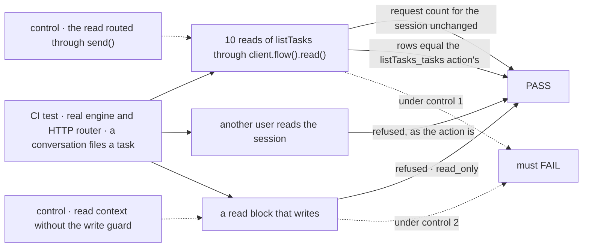
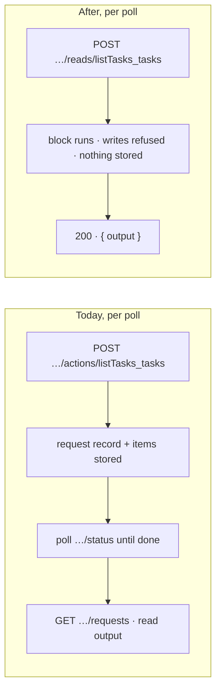

# FIX-2286 · Watching a conversation's task board stores nothing

**Spec** · [Decisions](DECISIONS.md)

## Three people, before and after

| Someone who… | Today | After |
|---|---|---|
| **leaves a Claude Code-style lab session open with a task running** | Every 2s the tasks pane runs the `listTasks_tasks` action. Each run is a stored request, with its record and items, in the session's request log. Jake's lab database held 1,877 of them against 3 `respond` turns | The pane reads the same rows through a **read**: one HTTP call, answered in its response, and nothing is stored. The session's request log holds its turns |
| **watches Shift Manager's TASKS panel while a delegate works** | The panel runs the same action every 3s while a task is open, and then polls the request until it ends and reads its output back from the request list (three or more calls per poll) | One read per poll. A task filed, moved or settled shows on the same cadence as today |
| **builds a flow with something an app needs to watch** | The only way an app runs the flow's code on a session is an action, which is recorded | The flow declares a `read`: a block that runs on a session, answers in the response, and is refused any write |

## The goal, and how we'll know it's met

**An app can watch a conversation's task board on a session without any read becoming a stored
request, and sees exactly what `listTasks` answers today, under the same rule for who may read it.**

| Is it the right goal? | |
|---|---|
| **The real need** | "A client can watch a conversation's task board without each read becoming a recorded request" (FIX-2286). PR #4073 already stopped the lab polling while nothing can move; a poll while a task runs is still a stored request, and Shift Manager's panel was never narrowed |
| **Smaller, and rejected** | Stop recording just this action (`record: false` on `listTasks_tasks`). An action may write and dispatch, so an unrecorded one would hide real changes from the log, and its caller would have no record to read the answer from ([D1](DECISIONS.md#d1)) |
| **Bigger, and rejected** | A push (`resource_change` or `task-change`) so nothing polls. The rows a conversation watches are settled by its task sessions, which run on other flows; their changes reach their own session's stream, not the conversation's, and the engine has no cross-session stream yet (`/users/:userId/stream` answers 501). That is a stream feature of its own ([D1](DECISIONS.md#d1)) |
| **Not done if** | A poll adds a row to the request store · the read's rows differ from the action's for the same board · a user who may not read the session gets its rows · a read can write a resource, session state, or start a request · the lab or Shift Manager still lists tasks through the action |



| How we verify | |
|---|---|
| **Goal check** | Model-free, so no new `goals/` script: a `packages/workforce` CI test on the real engine and HTTP router, nothing mocked, with a scripted conversation that files a task. The lab's existing goal `goals/claude-code-style-lab/session-mode-script` is rerun once against the switched lab, and its graded run counts the session's `listTasks_tasks` requests |
| **Signal** | `quiet`: the session's request count before and after 10 reads is equal. `same`: the read's `tasks` equal the action's for the same board. `fenced`: a second user's read of the session is refused with the status the action route gives them. `guarded`: a test flow's read that writes a resource, writes session state, or dispatches is refused with `read_only`, and the store is unchanged. `apps`: the lab adapter's and the TasksPanel's tests assert they call `read`, and never `send`, for the task list |
| **Input** | One installation, a conversation with one delegate, Alice and Bob |
| **Anti-game** | `quiet` counts rows in the request store, not the client's view of them. `same` compares against a live action run on the same board |
| **Control that must fail** | Routing the read through `send()` fails `quiet`. Dropping the read context's write guard fails `guarded`. Each FAIL is shown in the PR before the PASS |

## What changes



**Core and engine gain one generic hook: a flow's `reads`.** A read is a block a flow names under
`reads`, run on a session for its caller, and answered in the HTTP response. It leaves no request
record and no items, takes no concurrency slot, and its context refuses every write: resource and
session state writes, content writes, and dispatches throw `read_only`. The route checks the caller
against the session exactly as the session's action route does.

```diff
  defineFlow({
    kind: "agent",
    actions: { respond, ...board.actions },
+   reads: { ...board.reads },
  });

  // in the app
- const sent = await fsd.flow(flow).send("listTasks_tasks", {}, { sessionId });
- await sent.wait(); /* then find the request and read its output */
+ const { tasks } = await fsd.flow(flow).read("listTasks_tasks", {}, { sessionId });
```

**Orchestration adds the reads beside the actions.** `taskToolReads(collectionId, resolve)` names
`listTasks_<id>` as a read, over the same list code the action runs. Its resolver is the board's,
minus the touch: a read never runs the pass (D2).

**Workforce wires it.** The conversation board returns `reads` beside `actions`, and the session
board and the coordinator flow spread them as they spread `actions` today.

**Both apps switch.** The lab adapter's `tasksOf` and Shift Manager's `readConversationTasks` call
`read`. The lab drops the turn-watching gate PR #4073 added (it existed only to avoid recorded
requests) and reads every 2s while the pane is open. The TasksPanel keeps its cadence and its
reload-on-move.

**Docs:** `packages/core/README.md` and `packages/client/README.md` (the `reads` option and
`read()`), `packages/orchestration/README.md` (`taskToolReads`), and a *Reads* section in the
`apps/docs/docs/fundamentals/flows.md` (what a read is, when to use one instead of an action). No new page.

## What stays as it is

- **The `listTasks_tasks` action.** It stays, recorded, for anyone who calls it, and a touch through
  it still runs the pass.
- **Who may read a board.** The read reaches the session's own board through the same resolver, so
  the membership and partition rules are the action's.
- **The task model's tool.** A generator's `listTasks` tool is unchanged.
- **Starting rows.** A pending row's start is its own state, paid by the wake every writer owes
  (`conversation-board/board.ts` → *The pass*). Polls were never what started a row: since #4073
  the lab doesn't poll an idle session at all.

## What's already here, and the debt

| Already here | What this does with it |
|---|---|
| `defineFlow({ actions })` and the action route `POST /:flowKind/:sessionId/actions/:actionName` (`routes/action-routes.ts`): every call is a request with a record | **Kept**. `reads` is a sibling map, on a sibling route |
| The session route's owner check (`route-auth.ts`) for a session's actions | **Reused** as is for the read route |
| `writable: false` and its `resource_read_only` refusal (`context/resource-registry.ts`) | **Extended**: a read's registry refuses every write the same way |
| `GET /sessions/:id/resources/:ref` (`routes/resource-routes.ts`): an unrecorded read of a client-visible collection | **Not used**: the ledger is user-scoped and partitioned, and the list view (steps beside tasks, `current` follow-ups, server-only fields stripped) is orchestration's, not the raw rows |
| `task-change` component items on a writer's own session stream (`tasks/collection/change-event.ts`) | **Not used**: a task session's settle lands on its own stream, not the conversation's |
| The lab's turn-watching gate and 10s tail (`labs/claude-code-style/src/adapter.ts`, #4073) | **Removed** |
| `runAction`'s three-call answer read in Shift Manager (`lib/action.ts`) | **Kept** for actions; the task list stops using it |

| The debt | |
|---|---|
| **Adds** | One flow option (`reads`), one engine route with a write-refusing context, one client method, one orchestration factory. Permanent by design: the framework's answer to "an app watches something a flow computes" |
| **Removes** | The lab's gate and tail; one stored request per poll in both apps |
| **Leaves** | Polling. A push stays the better end state for a watched board and needs a cross-session stream; this doesn't block it |

**Net: up, by one hook in core, engine and client.** Without it, every app that watches a computed
view either records a request per look or reads raw storage and repeats the package's logic.

## Sign off

**[The goal](#the-goal-and-how-well-know-its-met):** the task list read with nothing stored, same
rows, same fence. If wrong: request logs keep growing with polls, or a read leaks another's board.

**[The debt](#whats-already-here-and-the-debt): up, by one generic hook.** If wrong: a read
surface nothing but the task list uses.

1. **[D1](DECISIONS.md#d1) · A flow declares reads: blocks answered in the response, stored nowhere,
   refused any write.** If wrong: a polling path we later replace with a push anyway.
2. **[D2](DECISIONS.md#d2) · A read never runs the board's pass.** If wrong: a row whose wake was
   lost waits for the next action on the board instead of the next poll.

3. **[D3](DECISIONS.md#d3) · The WebSocket push says when to read; a read says what changed.** If
   wrong: a push that carries rows, and reads kept only for the first load.

**Open: none.** Reasoning and what lost: [DECISIONS.md](DECISIONS.md).

Improvement · `core` + `engine` + `client` (one generic hook) + `orchestration` + `workforce` + lab and
`shift-manager` switch + docs · medium · 1 PR · epic FIX-2152
