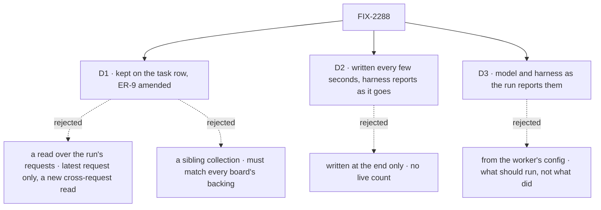

# FIX-2288 · Decisions

[Spec](SPEC.md) · **Decisions**

FIX-2145 counts what a request spends and hands it on when the request ends, by worker and day.
A task card needs the same count per task, while it runs. These three say where a task's count
is kept, how it rises mid-run, and whose word the card's model and harness are.

## The tree

Solid edges are what you're signing. Dashed edges lost, and the label says why.

## D1 · A task's spend is kept on its row, and ER-9 is amended to allow it

| | |
|---|---|
| **Instead of** | A read over the run: list the task's requests and read each one's spend from its record. Or a `task-spend/**` collection beside the board |
| **Because** | The row's `run` names only the latest request, so a read over it loses a failed attempt, a steer's turn and a notice's turn. No block can read another request's record, and adding that read means deciding who may read whose requests (BP-031). The requests that belong to a task are the ones `taskRequestAdmission` already admits and checks at their end, so that is where the count is written (tenet 5: one convergence point). A sibling collection would have to follow each board's backing (session state or a resource, any scope) and land in a second write that can fail apart from the row. The row costs a new write verb in every task store too, but one atomic with the row it describes |
| **Locks in** | `spend` on the task row: written only from inside the task's run, never by a model or a caller, visible to clients as `run` is. Kept per request, so a request's live part is replaced and its ending settles it. [ER-9](../../epics/FIX-2152/DECISIONS.md#who-owns-what)'s last clause reads "the task row gains no harness field"; the epic set takes that one-line amendment when this merges |

It comes down to the run link naming one request: a read over it drops every earlier attempt.

**What would change my mind:** a request record that names the task it ran for, readable by the
task's filer. Then a read over the run could count every request without a row field.

## D2 · The count rises while the run works

| | |
|---|---|
| **Instead of** | Writing the task's spend once, when each request ends, so a card moves only when a run finishes or stops |
| **Because** | Jake asked for a count "that ticks up during the run", and a coding run is minutes long. The ledger already holds the running total in memory; the task's run reads it every few seconds and writes it when it changed. A harness that reports usage as it works (Claude Code, per model call) is read as it goes. One that reports only at a turn's end (Codex and Cursor, per turn) shows its model and harness from the start and "not reported" until then, never 0 and never an estimate |
| **Locks in** | A row write every few seconds per running task while its count changes, publishing no `task-change`. `reportHarnessSpend` is called at a run's start, on each usage event and at its end, each call replacing that run's last; FIX-2145's worker totals still count each run once. A one-turn Codex or Cursor run shows its tokens only when it ends |

It comes down to the ask: a count written at the end can't tick up during the run.

**What would change my mind:** a store where a write every few seconds per task is too dear.
Then the interval widens; the shape stays.

## D3 · The model and harness shown are what the run reported

| | |
|---|---|
| **Instead of** | The worker's configuration: its `WORKER.md` model and its `harness` setting, which ER-9 already tags a lab's row with |
| **Because** | Config says what should run. A host override, a harness's default model, or a model chosen per call can each differ, and the card is there to say what is running. The harness names its model when it starts, so it is on the card before any token is: Claude Code's init message, Cursor's run config. Codex never names the model it ran, so its report carries the model the run was started with, and `null` when Codex picked its own default |
| **Locks in** | `HarnessRunSpend` gains `model`, a string or `null`; nothing vendor-specific. A task run by model calls only shows its model once the first call has answered, a few seconds in. A lab may keep showing the `harness` setting until a run reports |

It comes down to what the card claims: config can name a model the run never used.

**What would change my mind:** a card that should show the configured model before anything
runs. That is the lab's ER-9 tag, which stays.

## Decided, not asked

- **L1 knows a request and a run, never a task.** Core gains `readRequestSpend(ctx)`: what the
  request has spent since its last ending, the part its next ending hands on, read through the
  same symbol seam `reportHarnessSpend` uses. `undefined` outside a request. Framework-facing,
  documented as such. `ctx.request.tokenUsage` is unchanged.
- **A harness report is keyed by run.** `HarnessRunSpend` gains `runId` (the harness's own id
  for the run) and `model`. The ledger keeps one entry per run, the latest report wins, and an
  ending hands on each run's change since the last ending, counting a run once. A report with no
  tokens yet is a run with tokens `null`. `runId` is optional: a report without one is one settled run, as FIX-2145's callers make it, so those keep working; better still, the widened contract lands in #4013 before it ships. The function's doc says plainly that a later report for the same run replaces the earlier one. Each harness reports at start, on each usage event its
  SDK sends, and in its `finally`, as FIX-2145 already requires.
- **What each harness can say mid-run.** Claude Code: each assistant message's usage, summed once per message id (the SDK repeats one message's usage across the assistant messages a parallel tool call splits it into), replaced by the result's whole-query `modelUsage` at the end. Our SDK message types gain the assistant `usage` and the init `model` they lack today. Codex: each `turn.completed`.
  Cursor: each finished turn. If Claude Code's assistant messages turn out to carry no usage in
  the SDK version we pin, it joins Codex's group; nothing else changes.
- **The convergence point.** The row's `spend` is written only in `task-request.ts`: the live
  write by a tick the admission starts (every 2 s while the count changed, stopped at the
  request's end, built on the lease-renewal driver's timer, single-flight ticks and stop on the request's signal rather than a second hand-rolled timer), and the settle by the request-end hook it already registers, before the
  check, in the same write that clears the request's live part. No other writer.
- **The write is fenced by the row's identity only.** A spend is history: a terminal row and a
  lapsed claim still take it, so a failed attempt's tokens are kept. A recreated row
  (`not-my-task`) declines it.
- **One conversion.** A request's spend becomes tokens per source in one core function, which
  FIX-2145's worker writer and this read both call: input is the model's prompt tokens or what
  the harness reported as input, output likewise. The same count, so the task and Usage add up.
- **The read.** `listTasks` rows carry `spend`: `harness`, `model`, `inputTokens`,
  `outputTokens`, `unreported` and `live`. `null` when the task never ran in a request of its
  own. Tokens are `null` while no source has reported any; `unreported` is true while some
  source in the count hasn't. `live` is true while a request for it is running. The harness and
  model are the latest harness run's; with no harness run, the latest model's. The storage
  shape behind it is the implementer's.
- **A model does not read it.** The task tools' model-facing output leaves `spend` out.
- **A task's own requests only.** Pieces dispatched to other workers are their own rows, and a parent does not sum them. Pieces a board runs inside the task's own request spend in that request, so the task counts them.
- **Old rows** have no `spend` and read `null` (BP-030).

## Considered and dropped

| Option | Why it lost |
|---|---|
| Sum the run session's requests on the client | A worker's default conversation runs many tasks and messages; the session is not the task. And it is lab-side accounting |
| An `onRequestSpend` listener in core that pushes each change | A second registration beside `onRequestEnded`. A read the run already polls is smaller, and the cadence stays the task's choice |
| Write the live spend onto the request record and read it from there | The task read would still need a cross-request read from a block |
| `model` on `HarnessRunHandle` | Nothing on the card reads the handle |
| Cost on the task | Not asked. FIX-2145's rule keeps cost to billed keys, on Usage |

## Settled

- **Every request for a task passes one admission** — read in `task-request.ts`: the task's own
  entry, its resume, a notice's turn and a steer's turn are all admitted by
  `admitClaimedTask`, which registers the request-end hook. D1 rests on this.
- **A harness runs inside the task's request** — read in `harness-manager/src/manager.ts`: the
  harness is a step of the dispatched worker's sequencer, so its reports reach that request's
  ledger. FIX-2145's leg b (the coder's Claude Code tokens under its worker) shows the same path.

## Analysis

2026-10-28 · watermark 2026-10-23 (FIX-2152's last amendment) · **Right approach, with changes** (one folded).

1. **Reuse** — `reuse-review`: every Add extends a piece (the ledger and its seam, `reportHarnessSpend`, workforce's conversion moved). Folded: the identity-fenced write verb was missing from Builds on / Adds. Recorded: the live tick reuses the lease-renewal driver's machinery.
2. **Prior art** — Temporal's activity heartbeat details: running work writes throttled progress onto its own record, and clients read it. Same shape as D1 and D2. The Claude Agent SDK's cost guide dedupes usage by message id; recorded.
3. **Other shapes** — a cross-request read, a push listener, summing on the client; nothing stronger found. Riding the lease tick itself is every 40 s, too slow to tick up.
4. **New factors** — FIX-2145 is still in review, so the widened report can land in #4013. FIX-2298 filed for the debt. FIX-2207 changes nothing: the ledger doesn't read traces.
5. **Necessity** — real: no existing read is per task or rises mid-run.
6. **Ergonomics** — a repeated `reportHarnessSpend` reads as additive; its doc says it replaces by run. Recorded.
7. **Concerns** — recorded: Codex never names the model it ran (D3 now says so); Claude Code's usage repeats per message id; inline pieces count on their task. The blind goal check also folded: Cursor named, read surface only, a concurrent-tasks leg, two more controls, exact inputs.

## Notes from review

- "On a session-state or resource-backed task store, a row write every 2 s may contend with the worker's own row writes, and on a resource-backed one may emit `resource_change`. Check it, since the spec says no `task-change` is published." — analysis pass

These are inputs, not instructions. Adopt, adapt, or discard.

## How it got here

- **Draft** — framed as FIX-2145's count read per task and mid-run: the task's run reads its
  request's ledger every few seconds and settles it at each ending onto the task row, and a
  harness reports as it goes, with its model. Builds on FIX-2145's ledger and the FIX-2077
  admission every request for a task already passes.
- **Analysis and goal check** — the identity-fenced write joined the Adds; D3 now says Codex's model is the one it was started with; the goal check names Cursor, gained a concurrent-tasks leg and two controls, and says this issue is the read, the cards are the labs'.

**Open: none.**
