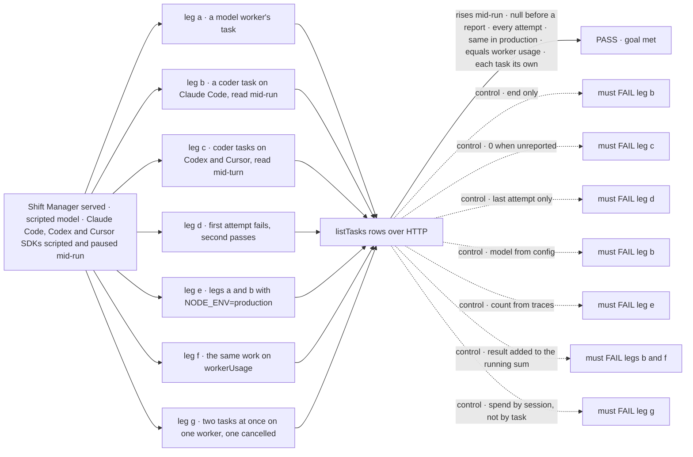
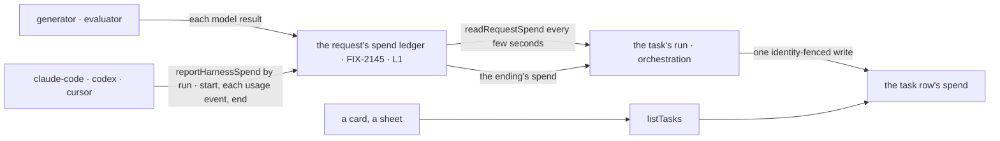

# FIX-2288 · A task's run reports its model, harness and live token count

**Spec** · [Decisions](DECISIONS.md)

## Five people, before and after

| Someone who… | Today | After |
|---|---|---|
| **watches a background task on Claude Code** | Sees the task's title and status. Nothing says which model runs it or what it has spent | Sees "Claude Code · claude-sonnet-4-5 · 12.4k tokens" on the card, and the count rises every few seconds while the run works |
| **watches a task on Codex or Cursor** | Nothing | Sees "Codex · gpt-5" from the start, and "tokens not reported yet" until the run's turn ends, then the real total. Never 0, never a guess |
| **watches a task a model-only worker runs** | Nothing | Sees the worker's model and its tokens, rising with each model call, in production as in development |
| **opens a finished task** | Nothing | Sees the final total, split into input and output, counting every attempt: a failed first try spent tokens too |
| **compares a task with Usage** | Two places can't disagree, because one doesn't exist | The task's tokens and the worker's tokens on Usage come from the same count, so they add up |

## The goal, and how we'll know it's met

**A person watching a task sees which model and which harness are running it, and how many
tokens it has spent so far, rising while it runs, with the final total and its input and output
split once it ends, and "not reported" wherever the vendor hasn't said yet.**

| Is it the right goal? | |
|---|---|
| **The real need** | *"Every task card … shows which model is running it and, when it runs on a harness, which harness. Running cards show a live token count that ticks up during the run … Done rows show the final total. The task sheet shows the same, with an input/output split"* and *"read the numbers from what the run already reports … rather than inventing lab-only accounting"* ([FIX-2287](https://linear.app/fixpoint-labs/issue/FIX-2287), part 3, Jake) |
| **Smaller, and rejected** | The final total only, written when the task ends: misses "ticks up during the run". Model and harness from the worker's config: says what should run, not what did. The latest attempt only: misses the tokens a failed attempt spent |
| **Bigger, and not this issue's** | Drawing it on the lab's cards and sheet: FIX-2153 and FIX-2157 add it once this read exists, with nothing summed in the lab. Cost per task. A budget that stops a task. A parent task summing its pieces |
| **Not done if** | A running Claude Code task's count only moves at the end · Claude Code's final result is added on top of its running sum · a Codex or Cursor task shows 0, or nothing at all, before its turn ends · a read before any report shows 0 · production counts less than development · a retried task shows only its last attempt · a task that fails or is cancelled mid-run loses its count or stays live · two tasks running at once on one worker swap or share tokens · the card's model is the configured one when the run used another · the task's total and the worker's Usage total for the same work differ |



The check reads the rows a client polls; the lab's drawing of them is FIX-2153's and FIX-2157's.
Each control must fail, or the check proves nothing.

| How we verify | |
|---|---|
| **Goal check** | `goals/shift-manager/a-task-shows-its-model-and-tokens/` · no model · run by the implementer at completion · verdict in the implementation PR |
| **Signal** | Fields as [*Decided, not asked*](DECISIONS.md#decided-not-asked) defines them. a: the researcher's task, two calls of 4 + 4 tokens, reads model `openai/gpt-6-luna`, harness `null`, exactly 8 in and 8 out. b: before the first assistant message the row reads harness `claude-code`, model `claude-sonnet-4-5` (the init message's; `WORKER.md` names `claude-opus-4-1`), tokens `null`, never 0. After the first of three assistant messages (100 + 20 each), 100 + 20 and `live: true` (**b:rising**); after the second, 200 + 40; at the end exactly 1 000 + 200, the result's whole-query count and not added to the running 300 + 60 (**b:exact**), `live: false`. c: Codex paused before `turn.completed` reads harness `codex`, model `gpt-5` (the model the run was started with), input and output `null`, `unreported: true` (**c:null**); after, 700 + 300. Cursor the same, with `cursor`, its configured model, then 500 + 100. d: attempt one spends 300 over two requests (its turn and a steer's turn) and fails its check; attempt two spends 1 200 and passes: the row reads 1 500 (**d:1500**). e: a and b give the same numbers with `NODE_ENV=production` and trace observability off (**e:same-numbers**). f: for each of legs a to d, the task's final tokens equal what `workerUsage` added for its worker over that leg (**f:equal**). g: two Claude Code tasks for one coder at once (1 000 + 200 and 400 + 80), the second cancelled mid-run after 100 + 20: each row holds only its own, the cancelled one 100 + 20 and `live: false` (**g:own-only**) |
| **Input** | FIX-2145's goal Lab (`goals/shift-manager/it-shows-worker-token-usage/lab/`: DevTeam on `openLab`, one SQLite store, the SDKs replaced at their import seams), copied, with each scripted SDK gaining a pause the run waits on and the check releases. Rows are read with the board's `listTasks_tasks` action on the filer's session, as the person who filed them |
| **Anti-game** | No assertion on a row written directly or on the ledger. Spend enters as model results and SDK messages only, through the real chain: the chief of staff files the task, the board dispatches it, the harness reports, the run writes its row |
| **Control that must fail** | `GOAL_CONTROL=end-only` (no writes mid-run) FAILS **b:rising**. `zero-unreported` FAILS **c:null**. `last-attempt-only` FAILS **d:1500**. `config-model` (model from the worker's settings) FAILS b on *model `claude-sonnet-4-5`*. `from-traces` FAILS **e:same-numbers**. `add-result` (the end report added to the running sum) FAILS **b:exact** and **f:equal**. `by-session` (a request's spend written to every task its session holds) FAILS **g:own-only** |

## What changes


The run counts its spend where FIX-2145 does, and writes it onto its own task while it works.

```diff
 // what a client reads, through the board's listTasks
 { id: "t1", title: "Fix the login form", status: "in_progress",
   run: { sessionId: "…", requestId: "…", attempt: 1 },
+  spend: { harness: "claude-code", model: "claude-sonnet-4-5",
+          inputTokens: 11_200, outputTokens: 1_240, unreported: false, live: true } }
```

```diff
 // a harness package (claude-code, codex, cursor): one report per change, not one per run
-reportHarnessSpend(ctx, { harness, inputTokens, outputTokens, costUsd, billing });   // once, in finally
+reportHarnessSpend(ctx, { runId, harness, model, inputTokens, outputTokens, costUsd, billing }); // at start, on each usage event, and in finally
```

No worker flow and no lab changes to get this: the field arrives on the rows they already read.

**Docs:** update *Orchestration → Task board* with a section on what a task's run spent (after
*One task, five tools*), *Tools → Coding agents* (a harness reports as it runs, and which do so
mid-turn), *Workforce → Worker usage* (a task's tokens and a worker's come from one count), and
the READMEs of `core`, `orchestration`, `claude-code`, `codex` and `cursor`.

## How a token gets onto the card



Core and the engine know a request and a run, never a task. Orchestration reads the request's
spend for the requests it admitted for a task, and writes the row.

## What stays as it is

- **Worker usage.** `worker-usage/**`, its hook and its query are FIX-2145's. They read the same
  ending's spend, through one conversion shared with the task.
- **The run link.** `run` still names the latest attempt's session and request.
- **ER-9's tag.** Until a run reports, a lab may still show the worker's `harness` setting.
- **Cost.** The task read carries tokens only. Dollars stay on Usage, under FIX-2145's rule.

## What's already here, and the debt

| Already here | What this does with it |
|---|---|
| Ways to read what work spent | **Five, none per task:** FIX-2145's worker totals (per worker and day, the closest), the request's `tokenUsage` (model calls, inside the request), a harness handle's `usage` (once, at the end), harness-manager's run row (last attempt, harness-manager's runs only), and DevTool's `aggregateTokenUsage` over loaded items. Searched `usage`, `spend`, `tokens`, `listTasks`, `run.` across `packages/`. This would be the first per task, and the first to rise mid-run |
| The request's spend ledger and `reportHarnessSpend` (FIX-2145, [#4013](https://github.com/fixpoint-labs/flow-state-dev/pull/4013)) | **Extends** both: the ledger gains a read of what it holds now, and a harness report may come many times per run, replaced by run. One count for the task, the worker and the budget |
| FIX-2145's *Leaves*: "per task is FIX-1652's" | **Supersedes** it for tokens, model and harness. Cost per task stays out |
| `taskRequestAdmission` and its request-end hook (FIX-2077), which every request for a task already passes | **Builds on** it: the same admission starts the live writes and the same hook settles them, so the task's requests are exactly the ones it already checks |
| The row's system-written fields: `run` (FIX-1668), `reportProgress` (FIX-2081) | **Follows** them: written from inside the run, not model-writable, client-visible, no `task-change` |
| [ER-9](../../epics/FIX-2152/DECISIONS.md#who-owns-what): "the task row gains no field" | **Amends** it ([D1](DECISIONS.md#d1)): no harness field, as ER-9 meant; one generic spend field |

| Builds on / Adds | Existing piece considered | Why it doesn't fit, or how this is composed |
|---|---|---|
| `spend` on the task row | A read over the run's request records; a sibling `task-spend/**` collection | The row names only the latest request, and no block reads another request's record. A sibling collection would have to match every board's backing and scope, in a second write ([D1](DECISIONS.md#d1)) |
| `readRequestSpend(ctx)` in core | `ctx.request.tokenUsage`; the ending's `spend` | `tokenUsage` holds model calls only; the ending comes once. Same ledger, one more read through the seam `reportHarnessSpend` already uses |
| `runId` and `model` on `HarnessRunSpend` | A second "progress" report; a `model` on the harness handle | One report, replaced by run, carries progress and the end. The card reads the request's spend, never the handle, so the handle needs no field |
| A spend write on `TaskCollectionRef`, fenced by the row's identity only | `reportProgress`, `linkRun`, `setKeptOpenBy` | Each refuses a terminal row, and a failed attempt's tokens land after its row may have settled. So every task store implements one more verb, the same cost D1 counts against a sibling collection, but in the write the row already owns ([D1](DECISIONS.md#d1)) |
| One conversion from a request's spend to tokens per source | FIX-2145's private `sourcesOf` in workforce | **Moves** it to core, where workforce and orchestration both call it. Orchestration can't import workforce |

| The debt | |
|---|---|
| **Removes** | Workforce's private conversion, now shared. The "per task belongs elsewhere" gap FIX-2145 left |
| **Adds** | One row field, system-written, and one write verb every task store implements. One framework-facing read in core. Two fields on the harness report and repeated reports. A row write every few seconds per running task. Permanent by design |
| **Leaves** | harness-manager's run row keeps its own last-attempt tokens beside the task's: filed as [FIX-2298](https://linear.app/fixpoint-labs/issue/FIX-2298). A board that runs its workers inside its own request (no dispatched run) has no per-task spend; its request carries it. A third-party harness that never reports shows no harness and no tokens. A board that runs its pieces inside the task's own request counts their tokens on the task, since they spent in its request |

**Net: up, small.** One field on an existing record, one read on the existing ledger, and the
existing harness report widened; one conversion is shared rather than copied.

## Sign off

**[The goal](#the-goal-and-how-well-know-its-met), at that size:** model, harness and tokens
per task, rising mid-run, every attempt counted, null until reported. If wrong: a card shows a
number that only moves at the end, or one that disagrees with Usage.

**[The debt](#whats-already-here-and-the-debt), net up, small:** one row field and one read on
the existing ledger, one conversion shared. If wrong: a second per-task count beside harness-manager's run row, until FIX-2298.

1. **[D1](DECISIONS.md#d1) · A task's spend is kept on its row, and ER-9 is amended to allow
   it.** The one to weigh. If wrong: the row carries a field the epic said it never would.
2. **[D2](DECISIONS.md#d2) · The count rises while the run works: written every few seconds,
   and a harness reports as it goes.** If wrong: a row write every few seconds per running task.
3. **[D3](DECISIONS.md#d3) · The model and harness shown are what the run reported, not the
   worker's config.** If wrong: a model-only task shows no model for its first few seconds.

**Open: none.**

Feature · `core` + `engine` + `claude-code` + `codex` + `cursor` + `orchestration` + `workforce` · small to medium · gap child of epic FIX-2152 · blocked by FIX-2145 ([#4013](https://github.com/fixpoint-labs/flow-state-dev/pull/4013))
