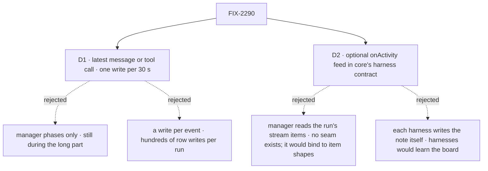

# FIX-2290 · Decisions

[Spec](SPEC.md) · **Decisions**

FIX-2081 gave a task a `statusNote` and a fenced `reportProgress` write; FIX-2160 settled that a
running coding task refuses messages. Two calls are left: what the note says, and where the manager
hears it from.

## The tree

Solid edges are what you're signing. Dashed edges lost, and the label says why.

## D1 · The note is the run's latest message or tool call, written at most once per 30 seconds

| | |
|---|---|
| **Instead of** | Manager phases only (`coding`, `judging`), or a write per event |
| **Because** | The question is asked during the coding, and what the run did last is the honest answer. A message's first line is what the agent says it's doing (`Tests pass; writing the changeset.`); a tool call says what it's touching (`Edit: src/manager.ts`, `Bash: pnpm test`). 30 seconds keeps a ten-minute run to about twenty writes, and the first activity of a step writes at once so a fresh run doesn't sit blank |
| **Locks in** | Message: its first non-empty line. Tool: `<name>: <detail>`, the detail being the first of `file_path`, `path`, `command`, `pattern`, `query`, `url` found in the call's arguments, else the name alone. Whitespace collapsed, cut to `STATUS_NOTE_LIMIT` (280). Reasoning is never shown. Unchanged text isn't rewritten. Within a window only the latest is kept and written when it closes; a step's end drops what's pending, since the run's outcome speaks then |

**What would change my mind:** a coordinator finding tool notes too terse to answer with. Then
messages win over tool calls inside a window.

## D2 · A new optional `onActivity` feed in core's harness contract

| | |
|---|---|
| **Instead of** | The manager reading the harness's emitted items, or each harness writing `statusNote` itself |
| **Because** | The feeds are already how a harness tells its manager things during a run (`onSession`, `onUsage`, `onSteerable`), so this is one more on the closest piece ([tenet 2](../../../docs/philosophy.md)). No seam lets a parent read a child's emitted items, and building one would tie the manager to item shapes. A harness writing the note would have to know the board and the claim, which the manager owns. Rendering in the manager keeps notes alike across harnesses |
| **Locks in** | `HarnessActivity = { kind: "message"; text: string } \| { kind: "tool"; name: string; arguments: string }` and `HarnessActivityHook = (activity, ctx) => void` in `@flow-state-dev/core`. Optional on `HarnessFeeds`; the manager always hands it |

**What would change my mind:** a second consumer wanting the run's activity in another shape (a
richer feed for a UI). Then the feed carries more kinds; the manager still reads these two.

## Decided, not asked

- **Fenced like `onSession`.** The write carries the run's claim ticket; a declined write (the
  attempt lost its row) stops further notes for that step. Unlike `onSession`, a decline never
  fails the run: the run's own fence finds that out on its next write.
- **No board `reportProgress`, no note.** The verb is optional on a task collection; a board without
  it gets nothing written and nothing fails.
- **Nothing is written after the step ends.** The timer is dropped with the steer watch.
- **A step a steer adds** starts its own window, so its first activity writes at once.
- **Names beyond `onActivity`, `HarnessActivity` and `PROGRESS_NOTE_MS`** are the implementer's.

## Considered and dropped

| Alternative | Why not |
|---|---|
| Manager phases only | D1: nothing moves during the coding |
| Every event written | D1: hundreds of row writes and change events per run |
| A summary model call over the transcript | Paid model work per note, for a line the run already says |
| The manager tails the session's stream | D2: no parent-reads-child-items seam, and it would bind to item shapes |
| Each harness writes the note | D2: harnesses would need the board and the claim |
| Tokens or model in the note | FIX-2288 owns those as fields |
