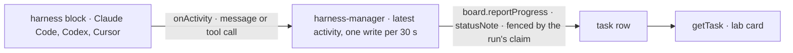

# FIX-2290 · A running coding task says how it's doing

**Spec** · [Decisions](DECISIONS.md)

## Before and after

| Someone who… | Today | After |
|---|---|---|
| **asks a coordinator "how is the coding task doing?"** | `getTask` says `in_progress`, attempt 1, and nothing else. Minute 1 and minute 9 of a Claude Code run read the same | `getTask` carries a `statusNote` such as `Bash: pnpm test` or `Tests pass; writing the changeset.`, at most 30 seconds old |
| **watches the Claude Code-style lab's tasks pane** | The card reads `Running` | The card reads `Running · "Edit: src/manager.ts"` and moves as the run does. The pane already draws the note; nothing in the lab changes |
| **messages a running coding task** | Refused, `task_running` (FIX-2160) | Still refused. Unchanged |
| **runs a harness that reports nothing** | n/a | No note, as today. Nothing else changes |

## The goal, and how we'll know it's met

**While a harness run works, its task's `statusNote` names what the run did last, and a long run
writes it a bounded number of times.**

| Is it the right goal? | |
|---|---|
| **The real need** | The issue: a coordinator asked "how is it doing?" can read only `getTask`, and harness-manager never writes the note plain workers write through `reportProgress` (FIX-2081) |
| **Smaller, and rejected** | Notes the manager writes from its own phases (`checking out`, `coding`, `judging`). They don't move during the part that takes ten minutes, which is the part the question is about |
| **Bigger, and rejected** | A live feed of the run's transcript on the task. The run's session already holds the transcript and the lab already draws it; the note is the one line a coordinator reads without opening it |
| **Not done if** | The note never changes during a real run · a burst of tool calls writes the row once per call · a replaced attempt writes onto the row its replacement holds · the `task_running` refusal changes |

| How we verify | |
|---|---|
| **Goal check** | A `packages/harness-manager` CI test on the real engine, a real board and fenced writes; only the harness is a stub (the `steer-a-run.spec.ts` pattern). A real Claude Code run in the lab, owed on a signed-in machine, for the pane |
| **Signal** | `moves`: a stub run reports a tool call, then a message; `getTask`'s note reads the first at once and the message after the throttle window. `bounded`: 50 tool calls inside one window write the row once (counted from `progress_reported` changes). `stale`: an attempt whose claim was taken writes nothing more. `quiet`: a harness that never calls the feed leaves no note |
| **Control that must fail** | The throttle removed (every activity written) fails `bounded`. The write unfenced (no claim ticket) fails `stale`. Each FAIL is shown in the PR before the PASS |

## What changes



1. **Core's harness contract gains one optional feed, `onActivity`**, beside `onUsage` and
   `onSteerable`: the harness calls it with each completed assistant message (`{ kind: "message", text }`)
   and each tool call it starts (`{ kind: "tool", name, arguments }`), the shapes its translator
   already produces. A harness that doesn't call it is unchanged.
2. **The three harness packages call it** at the point each already hands a translated event to
   its emitter. A throw from the feed is swallowed, like `onUsage`.
3. **harness-manager hands the feed** and turns activity into the note ([D1](DECISIONS.md#d1)),
   written through the board's existing `reportProgress` with the run's claim ticket
   ([D2](DECISIONS.md#d2)).

```diff
  harness: ({ cwd, resume, onSession, onUsage, onSteerable, onActivity }) =>
-   claudeCodeAgent({ cwd, resume, onSession, onUsage }),
+   claudeCodeAgent({ cwd, resume, onSession, onUsage, onActivity }),
```

A host that builds its harness inside the slot passes the new feed on. The labs and kitchen-sink
slots are updated in the same PR.

**Docs:** `packages/harness-manager/README.md` (the feeds and the note), the three harness READMEs
(one line each), and the harness-manager page under `apps/docs` if it lists the feeds.

## What stays as it is

- **The refusal.** `sendMessage` to a running coding task is still `task_running`.
- **The task row.** `statusNote` already exists (FIX-2081). No new field, nothing to migrate. As for a
  plain worker, nothing clears it: a finished task keeps its last note beside its status, and a
  retried attempt shows the last one until its own first activity, which writes at once.
- **The output.** The manager reports a note only, never a checkpoint, so a run's result is
  written as today.
- **FIX-2288.** Model, harness and token counts on a task card are that issue's fields. The note
  carries none of them, so the two don't overlap.

## What's already here, and the debt

| Already here | What this does with it |
|---|---|
| `TaskCollectionRef.reportProgress` (FIX-2081): fenced, same-status, publishes `progress_reported` | **Reused** as the only write |
| `getTask` and `listTasks` rows carry `statusNote`; the lab's `TaskCard` draws it | **Reused**, unchanged |
| `HarnessFeeds` (`onSession`, `onUsage`, `onSteerable`) and core's hook types | **Extended** by one optional feed |
| Each harness's translated `message` / `tool_call` events | **Read**, not changed |

| The debt | |
|---|---|
| **Adds** | One optional core hook type, one feed, a three-line call in each harness, one throttle in the manager |
| **Removes** | Nothing |
| **Leaves** | A harness outside this repository reports no note until it calls the feed |

## Sign off

**[The goal](#the-goal-and-how-well-know-its-met):** the run's last activity on its task, written at
most once per 30 seconds and fenced to its claim. If wrong: a coordinator still can't say how a
coding task is doing, or a long run floods the board with writes.

1. **[D1](DECISIONS.md#d1) · The note is the run's latest message or tool call, one write per 30 s.**
   If wrong: notes too noisy or too stale; the window is one constant.
2. **[D2](DECISIONS.md#d2) · A new optional `onActivity` feed in core's harness contract.** If wrong:
   a core contract line no other consumer uses.

**Open: none.** Improvement · `core` (one type) + `harness-manager` + `claude-code`, `codex`, `cursor`
(one call each) · small · 1 PR · epic FIX-2152
