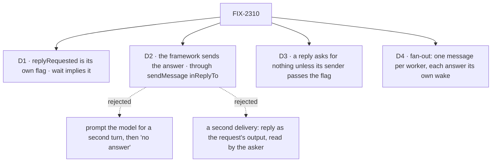

# FIX-2310 · Decisions

[Spec](SPEC.md) · **Decisions**

The issue asks for four rows: `wait` vs reply requested (D1), the turn-end check (D2), ping-pong
(D3) and fan-out (D4). D2 is the one to sign.

Solid edges are what you're signing. Dashed edges lost, and the label says why.

## D1 · `replyRequested` is a flag of its own; `wait` implies it

| | |
|---|---|
| **Instead of** | Making every new message reply-requested by default. Or folding it into `wait` |
| **Because** | An FYI ("heads-up, I pushed the branch") owes nothing; defaulting to a reply would wake the sender with "thanks" for every FYI and spend the hop budget on it. `wait` is about the asker (it blocks this turn); `replyRequested` is about the receiver (it owes an answer). A call already owes one: its reply is its turn's final text, so `wait: true` reads as reply requested and needs no second flag. A call keeps its one outcome, the tool's result: D2's turn-end send skips it, so it is never answered twice |
| **Locks in** | The tool text's one line on when to use what: **ask and go on, `replyRequested: true`, the answer wakes you later; need it in this turn, `wait: true` (one wait per step); need work tracked and owed, `createTask`.** "Only one wait per step" moves under `wait` as that rule, not a reason to ask fewer workers. The name `replyRequested` is provisional: it joins the pending rename batch with `suspendForUser` and `holdTaskForUser` |

An unanswered reply-requested message is an obligation **on the message**: its row records it,
and nothing touches a task's hold or question (FIX-2183, FIX-2303).

## D2 · At the turn end, the framework sends the answer, through the one `sendMessage({ inReplyTo })`

Jake's wording: the framework sends the answer back. Architect's constraint 1: one reply path,
the receiver's `sendMessage({ inReplyTo })`. Both hold, because the framework calls that same
send as the caller. **There is no second reply path and no second message shape.**

| | The framework sends the final text (chosen) | Prompt the model again, then "no answer" | The asker reads the request's output |
|---|---|---|---|
| Depends on the model remembering `inReplyTo` | no | yes, a second time | no |
| The answer the model already wrote | sent | thrown away unless it repeats it | read |
| Model turns per ask | one | up to two | one |
| Delivery paths | one (`sendMessage`) | one | two: a reply and an output |
| Matches the call (FIX-2239) | yes: a call's reply is its turn's final text | no | yes, but only for a waiting asker |

- **Instead of** prompting: the live run's model wrote its answer in plain text. Asking it to
  say it again costs a turn, can fail the same way, and lands "no answer" over an answer it gave.
- **Instead of** an output read: the asker isn't parked, so nothing is reading; it would be a
  second delivery shape beside the message.
- **Because:** the reply step already reads the final text for a call. Sending it with
  `inReplyTo` gives the asker a row, a wake and the received item the app already draws, attributed
  to the receiver.
- **Locks in:** the receiver's final text goes to the asker. The received prompt says so, as the
  call's does. A model that answers with the tool itself is honoured, and the turn end sends
  nothing more (the row's guarded answer write). An empty or thrown turn sends a "no answer"
  reply, the same message with a flag an app can draw. A server dying mid-turn is the one case
  the reply step can't reach; the asker's pass tells it in a line, the way an undelivered message
  is told (constraint 5), not as a message from the receiver.

**What would change my mind:** a receiver whose final text is for its own user, not the asker
(a coordinator that talks to the user and is also asked). If the labs show that, the turn end
sends a short "answered in my conversation" instead, and the prompt asks for a direct answer.

## D3 · No ping-pong: a reply asks for nothing unless its sender passes the flag

The framework's own reply and "no answer" never carry `replyRequested`. A model's reply may pass
it, to ask back; that costs the hop budget like any send, and the budget still ends a ring.

## D4 · Fan-out is N messages, and each answer is its own wake

Lead asks researcher and writer in one step: two sends, within the per-turn limit (3 by
default). Each reply lands as its own message and wakes lead on its own; lead's second wake runs
after its first turn. No gathering of answers into one: the asker reads them in order, and a
worker that needs both before it goes on files tasks or calls.

## Decided, not asked

- **E1 · The framework's send is the server's own** (FIX-2241's `exempt`): no budget, so a spent
  budget can't swallow an answer, and bounded because a reply never asks for one (D3). Its id is
  derived from the asked message, so a replay sends once.
- **E2 · The asked row records its answer** (the reply's id, or none), in one guarded write.
  Whoever writes first answers; the other sends nothing.
- **E3 · Failed or unrouted delivery ends the obligation** with the existing "wasn't delivered"
  line, told once (`toldAt`). Nothing is re-sent for the reply, nothing is told twice.
- **E4 · A receiver that runs no turn gets the call's rule** (FIX-2300,
  [#4130](https://github.com/fixpoint-labs/flow-state-dev/pull/4130)): a reply-requested send to a
  worker whose entry runs nothing is refused before the send, `no_reply`, read off the same
  `runsTurn` mark. One that still lands turnless (the mark can't be read before the send) ends the
  ask at once with the "no answer" reply. One rule for both kinds of ask: nothing waits on a
  receiver that can't answer. The build lands after #4130, or reuses its mark if it lands first.
- **E5 · Layer boundary:** all of it is Workforce. `.rescue()` on the entry's turn is core's, as
  is.
- **E6 · The lab** reads the flag: "waiting on" lists reply-requested messages with no answer, so
  an FYI never shows as waiting.

## Considered and dropped

- **Deliver a call's late reply as a message** (the deadline passed and the asker never waited
  again). Same class of loss; it needs `{ callId }` to read "answered by message" so the reply isn't
  given twice. Filed as [FIX-2311](https://linear.app/fixpoint-labs/issue/FIX-2311) rather than widened into this urgent fix.
- **A reply-requested flag on a task.** Tasks already owe a result (`createTask`); this is talk.

## Notes from review

- FSD Architect (2026-10-28, #4156): name FIX-2300's `runsTurn` and make the turnless rule one rule with the call's. Folded into E4 and the debt table.
- Cursor /simplify (2026-10-28, approved), for the implementer:
  - Drop the asker's owed entry as soon as the guarded answer write succeeds; the pass then only
    tells server death and never-landed, it isn't the detector of "answered".
  - One answer status on the asked row (e.g. `answerStatus`) may beat a nullable id plus rules
    across fields; implementer's call.
  - The model's own `inReplyTo` and the turn-end send can't both send (E2), but check they can't
    both wake the asker either.
  - D2's "what would change my mind" (a receiver whose final text is for its own user) is an
    escape hatch, not built here.
  - E4 was raised as heavy; it is now FIX-2300's up-front refusal, so it adds little.

## Notes from build

- **The server-death case moved from the asker's pass to the recipient's.** The spec had the
  asker's pass tell a line when the landing turn's server died. The asker can't read another
  session's request state (`requestStates` and `hasEnded` answer only for this session), so it
  can't tell "died" from "still thinking". The landing request now owes its own session's pass
  (`workerAsksOwed`, the same wake FIX-2240's delivery uses), and that pass sends the "no answer"
  through the same `sendMessage({ inReplyTo })` once the landing request reads ended. Still one
  reply path and one message shape (D2); the asker owes nothing, which also settles Cursor's first
  note. A recipient flow without the session board has no pass, so this backstop is the board's.
- **Answer status stays an id.** `answeredBy` on the asked row (written once, guarded) and
  `noAnswer` on the answer row; one field per fact, no status enum across rows.
- **Own `inReplyTo` and the turn-end send don't both wake the asker.** The model's own answer
  writes `answeredBy` first, so the turn's end sends nothing; the test checks the asker heard one
  message.
- **"Ask" stays out of the code and docs.** The vocabulary sweep keeps *ask* for a question to a
  person, so the build says *reply-requested message* and *owed reply* (`wantsReply`,
  `sendOwedReply`, `workerRepliesOwed`) where this spec says *ask*.
