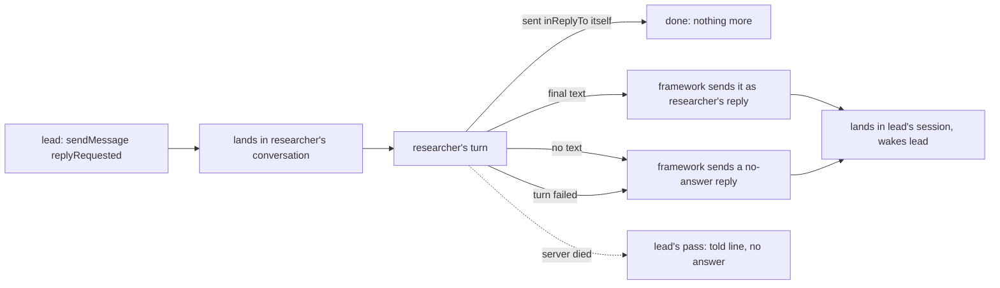

# FIX-2310 · A message that asks for a reply always gets one

**Spec** · [Decisions](DECISIONS.md)

## Who feels it, before and after

| Someone who… | Today | After |
|---|---|---|
| **builds a worker that asks another worker something and goes on** (lead asks researcher, no `wait`) | Researcher answers in plain text, or says nothing. Nothing reaches lead, no error shows, and the Teammates sidebar reads "waiting on researcher" for good | Lead sends with `replyRequested: true`. When researcher's turn ends, its final text goes back to lead as researcher's reply, wakes lead, and the sidebar clears |
| **asks two workers in one step** (researcher and writer) | The tool text says "only one wait per step", so lead skipped writer | Lead asks both with `replyRequested`, no wait. Each reply arrives as its own message |
| **is asked, and has nothing to say** (empty turn) | Silence | The asker gets a visible "no answer" reply from that worker |
| **is asked, and its turn fails, or its server dies mid-turn, or the message can't land** | Silence once it landed; the existing "wasn't delivered" line before that | A failed turn sends the same "no answer" reply. A server that died mid-turn ends in the pass's told line ("your message got no answer: …"), and a message that never landed in the existing "wasn't delivered" one. One of these, once |
| **answers with `sendMessage({ inReplyTo })` itself** | Works | Unchanged. The turn end sees the answer and sends nothing more |
| **replies** | A reply never asks for one | Unchanged: a reply asks for a reply only when its sender passes `replyRequested` |
| **sends an FYI** (no `replyRequested`) | Nothing owed | Unchanged |

## The goal, and how we'll know it's met

**Every message sent with "reply requested" ends in exactly one outcome the asker can see: the
receiver's reply, a "no answer", or a told line when it never landed or its server died. The
receiving model doesn't have to remember `inReplyTo`.**

- **Smaller, and rejected:** prompt the receiver harder to call `sendMessage({ inReplyTo })`.
  That is today's design; the live run showed the model doesn't.
- **Bigger, and not this issue's:** a call (`wait: true`) whose deadline passed and that the
  asker never waits on again keeps its reply on `sendMessage({ callId })` only. Same class of
  loss, different path; filed as a follow-up, [FIX-2311](https://linear.app/fixpoint-labs/issue/FIX-2311).
- **Not done if:** a reply-requested message ends with nothing in the asker's conversation; an
  asker gets two answers to one ask; a reply itself asks for a reply unasked.

Every edge out of researcher's turn ends the ask once. The solid ones are all one
`sendMessage({ inReplyTo })` delivery, the model or the framework calling it; the dotted one is the
asker's own pass, telling a line the way it tells an undelivered message today. There is no
second reply path and no new message shape.

**How we verify.** A Workforce test per row of the people table, on the in-memory stores with a
scripted model: plain-text answer (lands in lead's session, attributed to researcher, wakes lead);
fan-out to two (both land); empty turn ("no answer" lands); own `inReplyTo` answer (one reply,
not two); a turn that throws (one "no answer" reply); a server killed mid-turn (one line, from
the pass); a refused send (only the "wasn't delivered" line); a replay after a crash at the turn
end (one reply). Then the Teammates lab's goal leg for
acceptance 1 and 2 with the real model, 3/3, and the sidebar reads clear.

**Control that must fail:** drop the turn-end send. The plain-text, empty-turn and fan-out tests
must then leave lead with no answer, and the lab leg must see "waiting on researcher" stay.

## What changes

- **`sendMessage` takes `replyRequested`.** Optional, `true` only; the row records it. It is
  allowed on a reply (the replier asking back) and implied by `wait` (a call's reply already is
  its turn's final text). The tool text loses "Only one wait per step" and gains one line on when
  to use what ([D1](DECISIONS.md#d1)).
- **The received prompt** for a reply-requested message says the asker is waiting on an answer
  and that the turn's reply goes back to them, as a call's prompt does today.
- **The turn end** (`onMessageReceived`'s reply step, which already reads the turn's final text
  for a call) checks a reply-requested message it landed. A call is left out: its answer is its
  tool's result, as today, and is never also sent as a message. Answered already: nothing. Otherwise it
  calls the same `sendMessage({ inReplyTo })` the model would, with the framework as the caller:
  the final text, or a "no answer" reply when the text is empty or the turn threw (the entry
  rescues the turn's error for this) ([D2](DECISIONS.md#d2)). The framework's send is the
  server's own: no budget, a derived id so a replay sends once, never itself reply-requested.
- **The asked row records its answer**: the reply's id, or that it got none. A guarded write, so
  the model's own reply and the turn end can't both answer.
- **The asker's pass** keeps a reply-requested message owed past `delivered` until it is
  answered. When the request it landed in has ended unanswered (its server died, so the reply
  step never ran), the pass tells the asker in a line, the way it tells an undelivered message (FIX-2240 D1),
  once.
- **Teammates lab:** "waiting on" counts only reply-requested messages without an answer.
- **Docs:** the Workforce messages page and the package README say what `replyRequested` does and
  when to use it over `wait` and `createTask`.

## What stays as it is

`wait` and `{ callId }`, the hop budget and per-turn limit for the model's sends, FIX-2240's
delivery and resend, the "wasn't delivered" line, and every message sent without
`replyRequested`. Nothing in core or the engine changes.

## What's already here, and the debt

| Piece | What this does with it |
|---|---|
| `sendMessage` (`send-message.ts`) and its row | **Extended**: one input, two row fields. The one delivery path for every answer |
| The call's reply step (FIX-2239) | **Reused**: the same final-text read decides the answer |
| The server's own send (FIX-2241's midway question, `exempt`, derived id) | **Reused** for the framework's reply |
| The sending session's pass and its owed list (FIX-2240) | **Extended**: a reply-requested message stays owed until answered |
| The "wasn't delivered" line (FIX-2240 D1) | **Reused** as the end of an ask that never landed. The issue cites [#4059](https://github.com/fixpoint-labs/flow-state-dev/pull/4059) for this; that is a routed task's failure line, not a message's |
| FIX-2173's consult ([#4151](https://github.com/fixpoint-labs/flow-state-dev/pull/4151) D3) | **Complemented**: a consult reads; a reply-requested message asks the worker to act or answer |
| FIX-2300's `runsTurn` mark and `no_reply` refusal ([#4130](https://github.com/fixpoint-labs/flow-state-dev/pull/4130), open) | **Reused**: a reply-requested send to a worker that runs no turn is refused as a call to it is ([E4](DECISIONS.md#decided-not-asked)) |
| FIX-1989's "not answering is an answer" | **Superseded** for reply-requested messages only |

**Adds:** one tool input, two row fields, one branch in the reply step and one in the pass.
**Removes:** one sentence of tool text. **Debt:** the flag's name, `replyRequested`, joins the
pending rename batch with `suspendForUser` and `holdTaskForUser`; a late call reply is filed as a
follow-up. **Net:** small, and every answer still goes through one send.

## Sign off

**Approve by merging.** The one call is **who sends the answer at the turn end: the framework,
from the turn's final text, through `sendMessage`** ([D2](DECISIONS.md#d2)). *If wrong:* the
turn end prompts the model for a second turn instead, and the reply step's send becomes a "no
answer" only.

Bug · `workforce`, `labs/teammates` · small · 1 PR · unblocks
[FIX-2309](https://linear.app/fixpoint-labs/issue/FIX-2309)'s reply path · child of
[FIX-2152](https://linear.app/fixpoint-labs/issue/FIX-2152)
