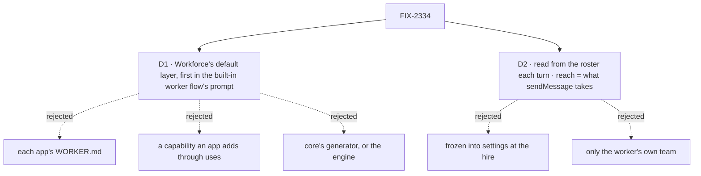

# FIX-2334 · Decisions

[Spec](SPEC.md) · **Decisions**

The issue settles the what (identity first, plus a tool-use rule) and leaves placement to the
Architect. D1 is placement and the one to sign; D2 is what the block reads.

Solid edges are what you're signing. Dashed edges lost, and the label says why.

## D1 · The identity is Workforce's default layer, first in the built-in worker flow's prompt

| | Default layer, front of the array (chosen) | Each app's `WORKER.md` | A capability in `uses` | Core or engine |
|---|---|---|---|---|
| Every app gets it | yes | only apps that write it | only apps that add it | yes |
| A worker a person hires gets it | yes | no | yes, if added | yes |
| Stays right after a rename or a fire | yes, read each turn | no | yes | yes |
| Layer boundary | Workforce (L2) | app | Workforce | **breaks it**: core has no roster or team |
| New mechanism | none: the slot C1 reserved | none | a second way in to the prompt | a hook core doesn't need |

- **Instead of** `WORKER.md`: that is the fix the issue rules out ("every app gets it").
- **Instead of** a capability: the C1 contract says the default prompt is consumed by this flow
  and "defines no second one"; a capability would be the second, and an app could leave it out.
- **Because:** the C1 contract already names the place, first, and says nothing else moves. Its
  code comment says not to grow it into a compose helper, registry or type; this is one more
  array entry.
- **Locks in:** the layer is the built-in flow's, fixed text plus roster facts, not a setting. An
  app that wants other words registers its own `agent` worker flow (C1's door) and may put the
  exported identity block first. Configuring it per app, team or org is FIX-1344's remaining part,
  not this issue's. The order promise stays "order, not precedence": a `WORKER.md` that says
  "you are Alex" contradicts the block, and the model decides.

**Ownership.** On main the default prompt has no owner: FIX-1344 (Done) carried it as its third
part and closed without it (the cycle-10 ledger calls it a false Done), and the C1 doc's pointer
is stale. fsd-architect confirmed this on agent-mailbox#46 and placed it here: **FIX-2334 owns the
default layer from now on.** Later default-prompt text joins this layer as a line, not a second
block (FIX-2073, telling the filer about asks after a task is done, is the next one).

## D2 · The block reads the roster each turn, and its reach is what `sendMessage` would take

- **Self:** `rosterWorker(workerId)`'s `name` (its id when null), `description`, `teamName`
  (omitted for an org worker). The text says the role is how the user reads it, since descriptions
  are written to the user ("runs the team's work with you").
- **Others:** the shared recipients reader, the filter `sendMessage`'s description uses today:
  roster minus self, minus workers with a `problem`. A worker whose flow hears in `task-sessions`
  only goes on a separate "takes tasks" line, with the `createTask` assignee to use. Each entry
  shows its name and the id a send or task takes. Cut at the same cap the tool uses (25).
- **Instead of** freezing it into settings at the hire: a fired or hired worker would be wrong
  until restart, and settings are the worker flow's schema, which would gain a key every
  hand-written flow refuses.
- **Instead of** the worker's own team only: the roster is who it can actually reach, across teams
  and the org's workers, and one list matches the refusals a send gives.
- **Locks in:** the identity and the `sendMessage` list come from one reader. The tool keeps its
  list, since a model reads a tool's description where it reads the tool.

## Decided, not asked

- **E1 · Off an installation** (a bare `hireWorkforce` roster, no `installation` option), or
  with no worker resolved, the layer returns `undefined`, never `""`, so the prompt slot drops it
  (the seam's existing rule).
- **E2 · Layer boundary:** all of it is Workforce. Core's prompt slot already resolves async
  entries and drops absent ones.
- **E3 · Only the built-in worker flow** gets it by default. The error reporter and app flows
  (the Teammates coder, harness flows) have their own prompts; they can compose the export.
- **E4 · The tool-use rule** is general and short, and names no tool. App-specific "act, don't
  offer" guidance (FIX-2336's Chief of Staff) stays in that worker's file.
- **E5 · Vocabulary:** the text says worker, team and teammates.
- **E6 · Once per turn:** the prompt slot resolves before every step of the tool loop; the
  roster is read once per turn, not on every step.
- **E7 · Names:** `name:` is already kept on the manifest (`declared.name`, read by
  `workerDisplayName`), so no loader change. With none, the id's worker segment stands in.

## Considered and dropped

- **Leave the roster in `sendMessage`'s description only.** The worker can't see it when the tool
  is off, and a model doesn't read a tool description as "who I am".
- **Name the worker in the first user message.** It goes out of the history window, and the
  prompt is where a model looks for who it is.

## Notes from review

- fsd-architect (2026-10-29, agent-mailbox#46 comment 6508512742): ownership confirmed and placed
  on FIX-2334; front of the existing array, not on the installation; one roster rule shared with
  `sendMessage`; carry the name; fixed text, `undefined` off an installation; read once per turn.
  Folded into D1, D2, E1, E6. Its claim that the loader drops `name:` is wrong on main
  (`read-workforce-directory.ts` validates and keeps it in `declared`); E7.
- For the implementer: FIX-2336 renames lead to Chief of Staff; check the goal leg against the
  renamed worker. Keep the existing prompt-order tests as they are.
