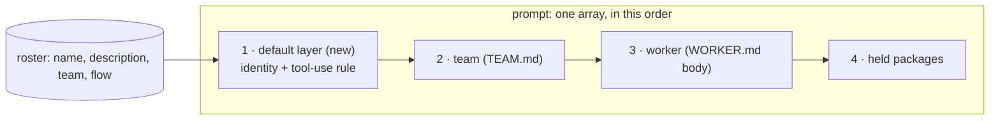

# FIX-2334 · Workers know their own name and role

**Spec** · [Decisions](DECISIONS.md)

## Who feels it, before and after

| Someone who… | Today | After |
|---|---|---|
| **asks a worker "who are you?"** (Teammates lab, lead) | "I'm ChatGPT." Nothing in the prompt says otherwise | "I'm lead, on the Teammates team: I run the team's work with you…", read off its `WORKER.md` `name:` and `description:` |
| **asks a worker who its teammates are** | It guesses, or calls a tool. The only roster it can see is in `sendMessage`'s description, and only when that tool is on | It names researcher and writer from its prompt, with no tool call, and says coder takes coding tasks |
| **asks about a worker that takes tasks only** (coder) | It is listed nowhere a model reads as "file it a task" until a send is refused | Listed apart: "takes tasks: file one with `createTask`", never as someone to message |
| **asks one of their own workers** (hired at run time, no `name:`) | Same "ChatGPT" | Its id stands in for the name; its description is its role |
| **asks a worker to do something it has a tool for** | It often offers: "I can look that up if you like" | The default layer tells it to use its tools before answering, and not to offer what it can do now |
| **writes an app on its own worker flow** | Unaffected | Unaffected. The layer is the built-in worker flow's; the recipient list it reads is exported for a custom flow |
| **runs a worker outside an installation** (a bare `hireWorkforce` roster) | No identity | Unchanged: no roster to read, so the layer is absent, not empty |

## The goal, and how we'll know it's met

**Every worker on the built-in worker flow starts its prompt knowing its own name and role and who
else it can reach, from the roster, in every app, without a tool call.**

- **Smaller, and rejected:** write "You are lead…" into each lab's `WORKER.md`. Every app would
  repeat it, it goes stale when a worker is renamed, and it never covers a worker a person hires.
- **Bigger, and not this issue's:** the rest of the shared default worker prompt (FIX-1344's third
  part), and making the default layer configurable per app or team. This issue ships the layer's
  slot and its first two pieces.
- **Not done if:** a worker on the Teammates lab says it is ChatGPT, or names itself among its own
  teammates, or offers to message coder; or the identity sits anywhere but first in the prompt.

The new layer takes the front place the C1 contract already reserved for it. Nothing behind it
moves, and the roster is the one source it reads.

**How we verify.** Workforce unit tests on the composed prompt, with an installation and a
roster of four: the prompt starts with the identity block; it names the worker and its team;
teammates exclude the worker itself; a `task-sessions` worker is listed as taking tasks, not as a
teammate; a worker with a `problem` is left out; a user's own worker shows its id; a worker fired
between turns is gone on the next turn. Then a goal leg in `goals/teammates-lab` with the real
model, 3/3: ask lead, researcher and writer "who are you?" (each answer holds its own name and not
"ChatGPT"), then ask lead "who are your teammates?" (the answer names researcher and writer, says
coder takes tasks, and that turn has no tool call).

**Control that must fail:** `GOAL_CONTROL=no-identity` drops the default layer (a scratch patch).
The unit test on the front of the prompt fails, and the goal leg must see "ChatGPT" or no name.

## What changes

- **A default layer at the front of the built-in worker flow's prompt** (`agent-worker-flow.ts`),
  owned by Workforce. It is two pieces, joined: the identity block, then the tool-use rule
  ([D1](DECISIONS.md#d1)).
- **The identity block** is built each turn from the roster: the worker's display name (its id
  when it has none) and description, its team's display name, then who else it can reach. The
  others are the same set `sendMessage` would take, split into workers to message and workers
  that take tasks only ([D2](DECISIONS.md#d2)).
- **`RosterWorker` carries `name` and `teamName`.** The client's `RosterEntry` already has both,
  read the same way (`workerDisplayName`, `manifest.teamName`); the server-side row gains them so
  the turn doesn't read files twice. With none, the name and team fall back to the id's segments
  (`parseDeclaredWorkerId`).
- **One recipient list, two formatters.** `sendMessage`'s description and the identity block
  both list the workers a send would take. The filter loop in `recipientsLine` becomes one
  function that returns `{ messageable, taskOnly }` (the `recipientRefusal` gate, the cap, the
  `messageHearingOf` split); the tool and the prompt each format it their own way. The roster is
  read once per turn and shared by both.
- **The tool-use rule**, a few sentences: use your tools to do what you're asked before you answer;
  don't offer to do something you can do now, do it. It is in this issue because the issue's
  scope names it and FIX-2336's "acts instead of offering" builds on it; it is the layer's second
  line, not a second gate.
- **Exported:** the recipient list and the display-name helper. The layer itself is exported
  when a second flow needs it.
- **Docs:** `docs/architecture/workforce-default-worker-flow.md` (C1, the order paragraph and the
  "owned and shipped elsewhere" line) and the seam comment in `agent-worker-flow.ts` say the
  default layer shipped, what it holds, and that FIX-2334 owns it; the Workforce worker-flow docs
  page and the package README say what every worker is told first.

## What stays as it is

The team, worker and package layers and their order; "order, not precedence"; `sendMessage`'s
behaviour and its refusals; every custom worker flow; core's prompt slot. Nothing in core or the
engine changes.

## What's already here, and the debt

| Piece | What this does with it |
|---|---|
| The C1 prompt seam, `[default, team, worker, packages]` (`workforce-default-worker-flow.md`) | **Fills** the reserved front slot. No new seam, no compose helper |
| FIX-1344 part 3, "default system prompt for all workers" | **Takes over** its first piece. FIX-1344 is Done in Linear with part 3 unshipped; the C1 doc still says "FIX-1344 part 2, not yet landed" (wrong part, and nobody is building it). Corrected here |
| `installation.roster` / `rosterWorker` (`workers/installation.ts`) | **Extended** with `name`, `teamName` |
| `recipientsLine` and `recipientRefusal` (`messages/`) | **Reused**: the filter loop becomes the shared recipient list |
| `messageHearingOf` (`received-mark.ts`) | **Reused** to tell a task-only worker apart |
| `workerDisplayName` (`standard-workers.ts`) | **Reused** for the name |
| FIX-2332 (coding runs are background tasks) | **Compatible**: whatever coder's row becomes, the task-only line keys off its flow's hearing, not its name |

**Adds:** one prompt layer, two roster fields, one shared reader. **Removes:** a stale doc line.
**Debt:** the default layer is fixed text, not configurable; an app that wants other words
replaces the worker flow, the door C1 already gives it. **Net:** small, and fills a slot that
was waiting for it.

## Sign off

**Approve by merging.** The one call is **placement: the identity and the tool-use rule are
Workforce's default layer, first in the built-in worker flow's prompt, built from the roster**
([D1](DECISIONS.md#d1)). *If wrong:* the same text moves behind the team layer, or into a
capability an app adds through `uses`; the roster reader and the tests stand.

Improvement · `workforce` · small · 1 PR · FIX-2336's acceptance depends on it · child of
[FIX-2152](https://linear.app/fixpoint-labs/issue/FIX-2152)
