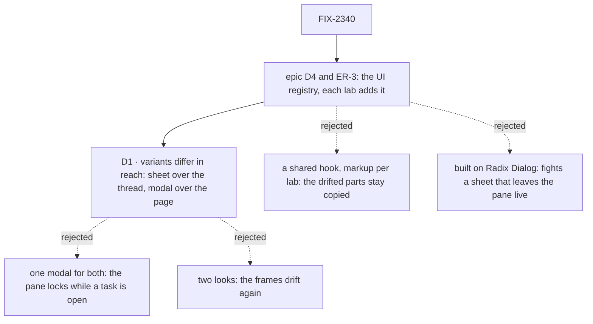

# FIX-2340 · Decisions

[Spec](SPEC.md) · **Decisions**

One decision is on the sign-off. Where the overlay lives is not asked again: the epic's
[D4](../../epics/FIX-2369/DECISIONS.md#d4) puts UI two apps need in the UI registry, and its
ER-3 has the adopting PR delete each app's copy. The rest was decided without asking and is
recorded so nobody derives it again.

## The tree

Solid edges are what you're signing. Dashed edges lost, and the label says why.

## D1 · The variants differ in reach, not in behaviour

| | |
|---|---|
| **Instead of** | One modal behaviour for both labs, which traps focus and covers the page |
| **Because** | In the Claude Code-style lab the side pane stays usable while a task is open: picking another task there shows it in the same sheet (FIX-2287, FIX-2399). A modal over the page would make the person close first. In Teammates the popup is a detour from one conversation, and holding focus in it is what keyboard users expect (FIX-2339, FIX-2401). So the variant names how much the overlay covers. Everything a person does to close it, and where focus lands after, is the same in both |
| **Locks in** | `variant: "sheet" \| "modal"` on `SessionOverlay`. A sheet needs a `SessionOverlayArea` under a `SessionOverlayProvider`; a modal needs neither |

It comes down to picking another task in the pane with one open: one shared modal makes the
person close first.

**What would change my mind:** a lab that wants the pane locked while a session is open, or a
third app whose overlay needs a reach neither variant has (a bottom drawer on a phone).

## Decided, not asked

- **A frame with slots, not a session view.** The overlay draws a header (`title`, `status`,
  `meta`), an optional `toolbar` row, the scrolling feed (`children`) with the jump-to-latest
  arrow, and an optional `footer`. What goes in them is the opener's. The issue's "read-only"
  describes what Teammates puts in it. The Claude Code-style sheet carries task actions and a
  steer box, and a session view built into the frame could not host them. Teammates' `pinned`
  becomes `footer`; the footer scrolls on its own past 60% of the height, as `pinned` does now.
- **One Esc rule, the sheet's.** A capture-phase listener; an IME's Esc is the input method's;
  a dialog focused over the overlay keeps its own Esc; the Esc that closes is spent
  (`preventDefault`). It is the newer, more tested rule (FIX-2413), and it carries that issue's
  guarantee that a closing Esc never also stops a turn. The Teammates popup gains it.
- **Focus goes back on close, in both variants.** The popup's rule today: on close, focus goes
  to what had it at open. It applies only when focus would otherwise be lost (on the body, or in
  the closing overlay), the same rule as the Claude Code-style `useFocusReturn`, so a close
  caused by picking another line does not steal focus back. New for the sheet; the issue lists
  it as behaviour to keep.
- **Tab is held only in the modal.** The sheet leaves the pane reachable, so Tab may leave it.
- **One look.** The sheet's header (icon close button, 15 px title, rounded frame), which
  FIX-2359 last polished. Each variant keeps its width today. The Claude Code-style lab's
  clamped goal line stays lab code and is passed in `meta`, so the registry gains no clamp.
- **The opener can pass its own feed.** The sheet's `feed` prop stays: the thread view scrolls
  the sheet after its own sends.
- **Registry entry.** `dependencies: ["@flow-state-dev/react", "lucide-react"]`,
  `registryDependencies: ["conversation"]`, target `components/flow-state/session-overlay.tsx`.
  Installing it also installs `conversation` in both labs, which is how the arrow is reused.
- **No changeset, no `mechanisms.yaml` row.** The registry is private and not published, and
  the mechanism list has no rows for registry components.
- **Build order.** Open PRs #4715 (FIX-2396) and #4820 (FIX-2579) edit `Popups.tsx` and
  `ThreadView.tsx`, the callers this changes. Whichever merges second rebases; the overlap is
  one opening tag per caller. Nothing blocks this.

## Considered and dropped

| Alternative | Why not |
|---|---|
| A shared close-and-focus hook, markup per lab | The header, the feed and the arrow are the parts that drifted. The copies would stay |
| Build both variants on the labs' shadcn `dialog` (Radix) | Its modal mode would serve the popup. The sheet is a non-modal layer over one area beside a live pane, so Radix's dismiss-on-outside and layer stack would need overriding at each edge. The two frames' own code is about 30 lines and already tested in both labs |
| A runtime export from `@flow-state-dev/ui` | The package exports only the generative pack. Registry items are copied in, by the epic's D4 |
| Move the labs' main-thread jump buttons too | A second job. Filed as FIX-2590 |

## Open

None.

## Settled

No POC: the question is placement and behaviour that both frames already show working, and the
spec rests on no counted facts beyond the two frames found by the search in
[SPEC.md](SPEC.md#whats-already-here-and-the-debt).

## Analysis

2026-11-06, against `origin/main` at `2189ac87`. **Run inline by the spec author**: this
session had no sub-agent to dispatch, so it is not the independent pass the skill asks for, and
review should weigh it that way. Verdict: **right approach, build as scoped.**

- **Reuse.** The arrow reuses `ConversationScrollButton` (reuse X). The frame is new only as
  the merge of two lab frames; Radix `dialog` was weighed and dropped. The Claude Code-style
  `useFocusReturn` holds the same "only when focus is lost" rule for Radix dialogs; it stays,
  since it is the Radix-side hook and this frame is not Radix.
- **Other frameworks.** shadcn and Radix both split *sheet* from *dialog* by placement and
  modality, which is D1's split.
- **Should it exist.** Yes: epic D4 and ER-3 ask for exactly this, and it removes code.
- **Concern.** Installing `conversation` adds that file to both labs. It is the registry's
  normal dependency path, so accepted.

## How it got here

- **Draft** — framed as one frame drawn twice; the registry item takes the sheet's Esc rule and
  the popup's focus return, and the variants differ only in how much they cover. Builds on the
  epic's D4 and the registry's `conversation` scroll button.
