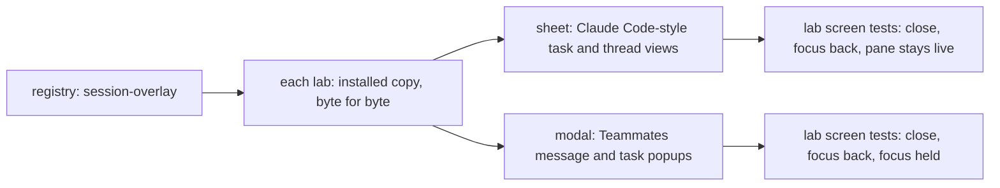
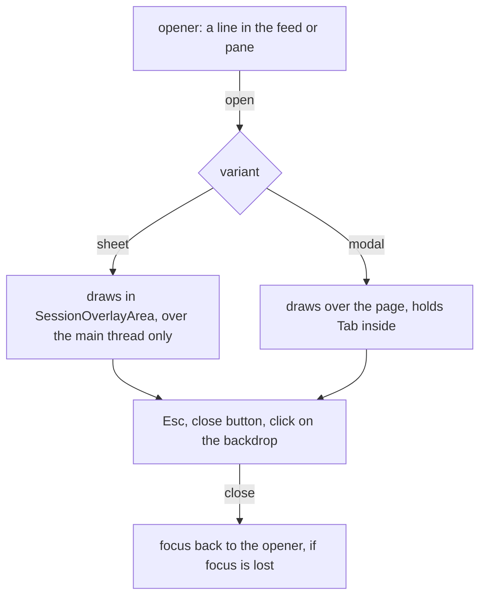

# FIX-2340 · One session overlay (sheet and modal variants) shared by the Teammates and Claude Code-style labs

**Spec** · [Decisions](DECISIONS.md)

## Who feels it, before and after

| Someone who… | Today | After |
|---|---|---|
| **opens a task from the Claude Code-style side pane**, then closes it | A sheet over the thread. Esc, close or a click on the thread closes it. Focus drops to the page | The same sheet. Focus goes back to the task line that opened it |
| **opens a worker's message or task in Teammates** | A popup over the page. Esc, × or a click outside closes it; focus goes back to the line | The same. Its header looks like the sheet's: icon close button, same title size |
| **presses Esc in the Teammates popup** while an input method composes, or under a dialog opened over it | The popup closes | The input method, or the dialog on top, keeps its Esc. The sheet's rule today |
| **has a sheet open and picks another task in the pane** | The sheet shows that task | Unchanged |
| **fixes how a session overlay closes or scrolls** | Fixes two lab files that already differ | Fixes `session-overlay` in the UI registry once and adds it again in each lab. A lab whose copy differs fails a test |

Each lab drew its own frame for one job: show a session over the thread, live, and close
without the thread losing its place. The frames already differ on focus and Esc.

### The goal, and how we'll know it's met

**Goal:** one session overlay in the UI registry, with sheet and modal variants, is the only
session overlay in either lab, and it keeps what each lab's overlay does today.

**Is it the right goal?** The issue's need is "two copies of the same idea", and the
Architect's condition adds that a third app must start from the shared piece. The smaller goal,
a shared close-and-focus hook with markup per lab, is rejected: the header, feed and arrow are
what drifted. **Not done if:** either lab keeps its own `Sheet` or `SessionPopup` frame; a lab
copy differs from the registry and no test fails; the sheet traps focus so the pane stops
working.



The registry is the one source; each lab proves its copy matches and its variant behaves.

**How we verify.** Each lab gets a copy test shaped like `task-signals-copy.test.ts`, pinning
`components/flow-state/session-overlay.tsx` to the registry. Each lab's screen test opens its
overlay from a line, closes it by Esc, close button and click outside, and asserts focus is back
on the line; the Claude Code-style test also picks a second task in the pane and asserts the
sheet shows it. No `function Sheet` or `function SessionPopup` is left under `labs/`. **The
control that must fail:** drop the focus return from the registry item and reinstall, and both
*focus back* assertions go red; edit one byte of a lab copy, and its copy test goes red. The PR
shows both red runs.

## What changes


Two lab files go; one registry item comes in twice.

`session-overlay` is a frame: header, scrolling feed with the jump-to-latest arrow, optional
rows under the header and at the foot. What it shows stays the opener's. Each lab runs
`fsdev ui add session-overlay` and deletes its own frame in the same PR (epic ER-3):

```diff
 // labs/claude-code-style: TasksPane.tsx, ThreadView.tsx, App.tsx
-import { Sheet, SheetArea, SheetProvider } from "./Sheet";
+import { SessionOverlay, SessionOverlayArea, SessionOverlayProvider } from "./flow-state/session-overlay";
-<Sheet label={label} title={title} meta={meta} toolbar={toolbar} onClose={close} footer={actions}>
+<SessionOverlay variant="sheet" label={label} title={title} meta={meta} toolbar={toolbar} onClose={close} footer={actions}>

 // labs/teammates: Popups.tsx
-import { SessionPopup, Steps } from "./SessionPopup";
+import { SessionOverlay } from "./flow-state/session-overlay";
+import { Steps } from "./Steps";
-<SessionPopup label={line} title={title} status={status} onClose={onClose} pinned={pinned}>
+<SessionOverlay variant="modal" label={line} title={title} status={status} onClose={onClose} footer={pinned}>
```



The variants close and return focus the same way; they differ in what they cover ([D1](DECISIONS.md#d1)).

**Docs:** at release, `packages/ui/README.md` gains a `session-overlay` row (update) and
`apps/docs/docs/ui/common-components.md` a short section beside `conversation` (extend; no new
page). No changeset: `@flow-state-dev/ui` is private.

## What stays as it is

- What each overlay shows: the Claude Code-style views with their toolbar, task actions and
  steer box; Teammates' read-only session steps and pinned holds.
- FIX-2413: the Esc that closes a sheet is spent, so it never also stops a turn.
- The sheet covers the thread, not the pane (FIX-2287, FIX-2399). Each overlay's width.
- The labs' main-thread jump-to-latest buttons (see the debt).

## What's already here, and the debt

The job: *show a session over the thread, live, and close without losing its place.* Searching
`labs/`, `apps/`, `packages/shift-manager` and the registry for `role="dialog"`,
`createPortal`, `DialogContent` and `SheetContent` finds two ways; this makes them one. No
`mechanisms.yaml` row covers registry components (the one UI row is `generative-ui`).

| Piece | Today | This change |
|---|---|---|
| Claude Code-style `Sheet`, `SheetArea`, `SheetProvider` (FIX-2287, 2359, 2413) | Draws into an area over the thread; capture-phase Esc; no focus handling | **Superseded** by the sheet variant; file deleted |
| Teammates `SessionPopup` (FIX-2339) | Draws over the page; holds Tab; focus back; bubbling Esc | **Superseded** by the modal variant; `Steps` moves to its own lab file |
| Registry `conversation` → `ConversationScrollButton({ feed })` | The jump-to-latest arrow | **Reused** |
| shadcn `dialog` (Radix), in both labs | Keys sheet, switcher | **Not used** ([why](DECISIONS.md#considered-and-dropped)) |
| Shift Manager `JumpTo` | A command palette | Different job |

| Builds on / Adds | Considered | How it fits |
|---|---|---|
| Registry item `session-overlay` | The two lab frames; shadcn `dialog` | Composed from the frames' tested code |
| Its arrow | `ConversationScrollButton` | `registryDependencies: ["conversation"]` |
| A copy test per lab | `task-signals-copy.test.ts` | Same shape |

**Removes:** two frames, about 150 lines. **Adds:** one registry item, about 100 lines, and two
small tests; the epic's D4 home, not debt. **Leaves:** each lab's own `JumpToLatestButton` for
its main thread, near copies of `ConversationScrollButton`
([FIX-2590](https://linear.app/fixpoint-labs/issue/FIX-2590)). **Net: down.**

## Sign off

- **Goal.** One registry overlay is the only one in both labs, and tests prove each copy matches
  and each variant closes and returns focus. *If wrong:* the labs drift again.
- **Debt: net down.** Two frames out, one registry item in; main-thread jump buttons left to
  FIX-2590. *If wrong:* one more copy to fold later.
- **[D1](DECISIONS.md#d1) · The variants differ in reach: the sheet covers the thread and leaves
  the pane live; the modal covers the page and holds focus.** *If wrong:* one lab's overlay
  feels different than today; a prop to flip.

**Open: none.** Slots, the Esc rule, the look, focus return and the registry entry are in
[Decided, not asked](DECISIONS.md#decided-not-asked).

Improvement · Claude Code-style and Teammates labs, `packages/ui` registry · small · 1 PR ·
child of epic [FIX-2369](../../epics/FIX-2369/SPEC.md), under its [D4](../../epics/FIX-2369/DECISIONS.md#d4) and ER-3
