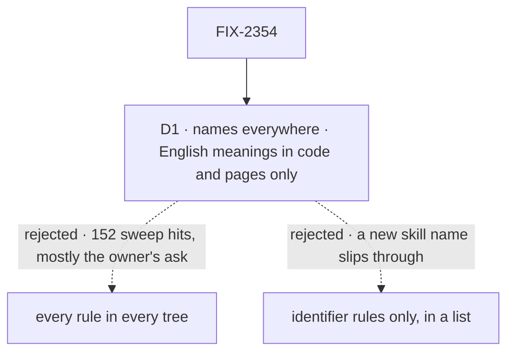

# FIX-2354 · Decisions

[Spec](SPEC.md) · **Decisions**

One decision: what a check refuses once it reads the trees agents read most. The rest follows
from the epic's ER-3 and FIX-2601's glossary.

## The tree

Solid edges are what you're signing. Dashed edges lost, and the label says why.

## D1 · Contributor trees are read for retired names; English meanings are refused in code and published pages only

| | |
|---|---|
| **Instead of** | Every rule in every tree, the prose rules (*an ask*, *hand it off*, *the room*) included |
| **Because** | Measured on `main` (`c55c48a81`): every sweep rule applied to the contributor trees finds 152 hits in 36 files, most of them *ask* meaning the owner's question, which is the meaning FIX-1876 keeps. Name rules alone find 66 in 14 files: `AskUserQuestion`, `openQuestions`, a few comments, and the real leftovers. A skill author who writes plain English shouldn't fight CI |
| **Locks in** | Each glossary entry is a *name* or a *meaning* (FIX-2601's field), and a new retirement is a name unless it says otherwise. A skill that says "hand it off" for new work is not caught |

It comes down to what a skill author hits: 152 hits, most of them correct English, against 66.

**What would change my mind:** a skill whose English misuse is shown to mislead an agent. That
meaning's entry then reaches contributor trees, one entry at a time.

## Decided, not asked

- **The guard's words are classified the same way.** *Seat*, *mailbox*, *hired roster* and
  *talk session* are names and read everywhere; *room* is a meaning. *Member*, *thread*,
  *person*, *kind* keep their Workforce ground. The 142 *mailbox* hits in `.agents/` are the
  agent-mailbox board, a different thing with that name: one exemption, with that reason. The 28
  *seat* hits are sorted one by one: a Workforce seat in `architecture-reference.md` is renamed;
  a worked example that means a reviewer's slot, or the figure called "how it reaches the seat",
  is renamed where cheap and otherwise kept with its reason.
- **The sweep's totality check covers every tracked file**, as the guard's already does. A file
  is read or excluded by a named rule; the tree map stops being a list of roots.
- **History is named, not assumed:** `specs/`, `spec/`, `docs/internal/`, `CHANGELOG.md`, verdict
  logs, and an example a skill keeps for its shape and says so in its header. Tooling the checks
  can't read as prose (`scripts/`, `.github/`, `.husky/`) is excluded as tooling, by name.
- **Pending changesets are read by both checks** (ER-3). The guard's `history` area lets them go.
- **The three published lines go in a separate `docs-fix` PR.** A normal PR can't edit them.
- **`issue-multi-pr.js` is a workflow script:** `node .agents/workflows/verify.mjs` runs after
  the edit.
- **`external-dispatcher` stays.** It is a public refusal value, and renaming one is breaking.
  Its README line keeps it by an exemption that says so. The prose around it is renamed.

## Considered and dropped

| Alternative | Why not |
|---|---|
| Fold this issue into FIX-2601 | The epic's collapse trigger: it applies only if FIX-2601 reads every tree by construction. FIX-2601 moves the map without widening it, so this issue's widening, its 66 hits and its renames stay here |
| Identifier rules only, picked by hand | A list of which rules read skills is a second rule home. The name-or-meaning field puts it on the entry |
| Add contributor trees to `ROOTS` alone | Fails the sweep's totality check: about 99 files match no rule's `files` (the issue's ledger note) |

## Analysis

2026-11-07 · watermark 2026-11-07 · **Right approach, with two changes.**

1. **Reuse** — no *Adds*: the glossary's tree map is widened, nothing is new.
2. **Prior art** — Vale scopes rules by file type and markup scope, not by tree. D1 is the
   same move: a name is matched everywhere, a style rule only where it applies.
3. **Other shapes** — every rule everywhere; identifier rules by hand. Both above.
4. **New factors** — `labs/` and `examples/` (411 files) are read by the guard but not the sweep,
   and hold about 66 retired names. **Folded** into scope, and into the epic's ER-3.
5. **Necessity** — earns its place: the leftovers passed CI because of this gap.
6. **Ergonomics** — a skill author sees a failure only for a retired name.
7. **Concerns** — the root `CLAUDE.md`, `AGENTS.md` and `CONTRIBUTING.md` are not in the epic's
   ER-3 list. **Folded** as an epic amendment.

## How it got here

- **Drafted in the spec set (2026-11-07)** — names, not meanings, after measuring both on `main`.
  The set review added `labs/`, `examples/` and the root contributor files, and kept the issue
  out of FIX-2601.

**Open: none.**
