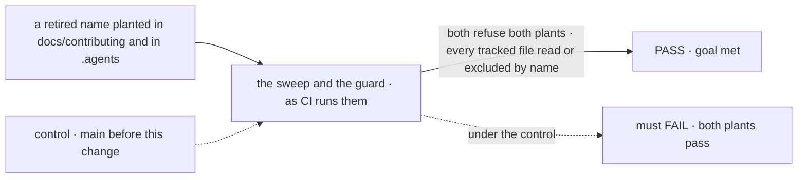

# FIX-2354 · The vocabulary checks read contributor docs and skills, and the six "dispatcher" leftovers go

**Spec** · [Decisions](DECISIONS.md)

## Six people, before and after

| Someone who… | Today | After |
|---|---|---|
| **reads the contracts page** (`architecture-reference.md`) | Is taught `isInProcessDispatcher`, a name FIX-2245 retired | Is taught the flow runner's name |
| **adds a retired name to a skill or a contributor doc** | CI passes: neither text check reads `.agents/` or `docs/contributing/` | CI fails, naming the file, the line and the glossary entry |
| **writes "the ask" or "hand it off" in a skill, in plain English** | Passes | Still passes. Contributor trees are read for retired *names*, not English meanings ([D1](DECISIONS.md#d1)) |
| **retires a new word in the glossary** (the owner) | It reaches package source and published pages | It reaches every contributor tree too |
| **builds a lab or an example** | The sweep never reads `labs/` or `examples/`, which hold about 66 retired names today (`answerHold`, `waitingOn`) | Read like `packages/` |
| **reads the background-work page or the BullMQ guide** | The flow runner is called "a dispatcher" | The current name, through a `docs-fix` PR |

The epic's PASS reads wider than it is. `goals/vocabulary/one-word-per-thing` says "one word per
thing, everywhere a reader meets it", and agents read skills and the contracts page more than
anything else.

## The goal, and how we'll know it's met

**A retired name fails CI wherever a contributor or an agent reads it, contributor docs and
skills included, and the six leftovers use today's names.**

| Is it the right goal? | |
|---|---|
| **The real need** | [FIX-2600](../../epics/FIX-2600/DECISIONS.md#who-owns-what) ER-3: every vocabulary check reads every contributor tree |
| **Smaller, and rejected** | "Fix the six lines." The next retired name lands in a skill the same way, and the sweep still says PASS |
| **Bigger, and not this issue's** | Refusing English meanings in contributor prose ([D1](DECISIONS.md#d1)). Renaming the public `external-dispatcher` refusal code (see the debt) |
| **Not done if** | Either text check skips `docs/contributing/`, `.agents/`, `labs/`, `examples/`, the root `CLAUDE.md`, `AGENTS.md` or `CONTRIBUTING.md`, or a pending changeset · a tracked file is neither read nor excluded by a named rule · a hit was silenced by narrowing a pattern instead of an exemption with a reason |



The plants go through each check's own `--control`, the path a real file takes. On `main`
before this change neither check reads either tree, so both plants pass and the run fails.

| How we verify | |
|---|---|
| **Goal check** | `goals/vocabulary/one-word-per-thing/`, FIX-1876's own check, with its **Input** widened to the whole repository and two plants added to the sweep's `--control`. The guard's `--control` gets the same two. Run by the implementer at completion; verdict in the implementation PR and in `goal.md`'s verdict log |
| **Signal** | Both `--control` runs report both new plants by their own rule. Both checks PASS at OPEN 0 with zero files unruled, across every tracked file |
| **Input** | A retired name (`isInProcessDispatcher`) planted in a skill and in a contributor doc. Any other retired name, in any other file under those trees, must fail too |
| **Anti-game** | No pattern is narrowed to go green; a hit is renamed, or kept by an exemption with a reason. The run prints how many exemptions this change added, by tree |
| **Control that must fail** | `main` before this change: both plants pass, so *the plant is refused* FAILs. Red first: with the widening and before the renames, the sweep FAILs on exactly the two `dispatcher-names` leftovers |

## What changes


Read the two highlighted rows: the trees agents read most are read by nothing today. Every
row on the right is filled except history, which stays out by name.

**The six leftovers:**

```diff
- docs/contributing/architecture-reference.md   the effective dispatcher (`isInProcessDispatcher`)
+                                              the effective flow runner (its in-process check)
- .agents/workflows/issue-multi-pr.js           (`topologicalDispatcher`, …)
+                                              (the `topological` claim order, …)
- packages/bullmq/test/scaffold.test.ts         it("exports dispatcher factory")
+                                              it("exports the flow runner factory")
  packages/core/README.md · background-work.md · background-jobs-bullmq.md
                                              the runner called "a dispatcher" → its name, in a docs-fix PR
```

**Docs:** the three published lines go in their own `docs-fix` PR, since those pages change only
at release otherwise ([`release-docs.md`](../../../docs/contributing/release-docs.md)). The
contracts page and the skill change in the main PR. No new page.

## What stays as it is

- **History**: `specs/`, `docs/internal/`, `CHANGELOG.md`, verdict logs, and retained examples
  such as `concept-doc/example/CONCEPT.md`, which says it is kept for its shape. Out by a named rule.
- **English meanings in contributor prose.** *The ask*, *hand it off*, *room* ([D1](DECISIONS.md#d1)).
- **The side-chain check.** It already reads every tracked TypeScript file, wherever it sits.
  Prose is its stated gap.
- **The glossary's format.** FIX-2601's; this issue edits its tree map and adds exemptions.

## What's already here, and the debt

| Already here | What this does with it |
|---|---|
| The glossary's tree map (FIX-2601: the sweep's `ROOTS` and `EXCLUDE`, the guard's `AREAS`) | **Extends.** One widening, which both checks follow |
| The guard's `process` and `history` areas | **Amended.** `docs/contributing/`, `.agents/` and the root contributor files leave `process`; pending changesets leave `history` |
| The sweep's totality check, over its roots only | **Extends** to every tracked file, as the guard's already is |
| FIX-2245's rename (the flow runner, the claim order) | **Builds on.** Its six leftovers |
| The glossary's name-or-meaning field (FIX-2601) | **Builds on.** This issue sets the contributor trees' reach on it |
| Anything else that reads skills for vocabulary | **None.** Searched `.agents`, `docs/contributing` across `scripts/`, `goals/`, `.github/` |

**Builds on / Adds: none.** No new check, file or field: one map widened, exemptions added.

| The debt | |
|---|---|
| **Removes** | Six retired-name leftovers; two tree maps that disagree about four trees |
| **Adds** | Exemptions for live names that collide with retired ones in skills: `AskUserQuestion` (a Claude tool), `openQuestions` (a workflow field), the agent-mailbox board. Permanent by design |
| **Leaves** | The public `external-dispatcher` refusal code: renaming a public value is a breaking change no issue has asked for; kept by an exemption with that reason. Whether the epic keeps or renames retired words on the wire is one rule, open for the owner at the gate ([FIX-2479 Open](../FIX-2479/DECISIONS.md#open)); if renamed, FIX-2479 does it. English misuse in skills ([D1](DECISIONS.md#d1)) |

**Net: down.** Six leftovers go, the two maps agree, and nothing is added but exemptions.

## Sign off

**[The goal](#the-goal-and-how-well-know-its-met), at that size:** a retired name fails CI in
every tree a contributor reads. If wrong: the next leftover lands in a skill, as these two did.

**[The debt](#whats-already-here-and-the-debt), net down:** six leftovers go; some exemptions
come in. If wrong: a skill author fighting the check over a name that collides by accident.

1. **[D1](DECISIONS.md#d1) · Contributor trees are read for retired names; English meanings are
   refused in code and published pages only.** If wrong: a skill teaches "hand it off" for new
   work and nothing catches it.

**Open: none.**

Improvement · tooling, `docs/contributing`, `.agents`, one test · small · epic FIX-2600
