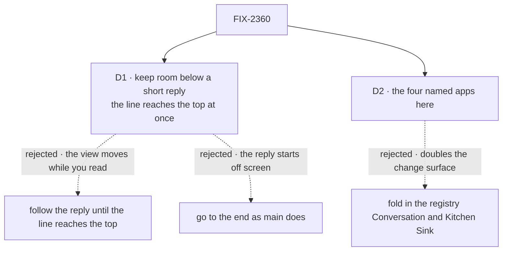

# FIX-2360 · Decisions

[Spec](SPEC.md) · **Decisions**

Settled before this spec, by the owner on the issue (2026-11-02): the five rules, that sending
moves the view to a near-top position (not the end), and one shared implementation for DevTool,
Shift Manager and both labs. These decisions cover the rest.

## The tree

Solid edges are what you're signing. Dashed edges lost, and the label says why.

## D1 · Keep room below a short reply, so the sent line reaches the top at once

| | |
|---|---|
| **Instead of** | Following the reply, moving the view down as it grows, until the sent line reaches the top, and then stopping. That needs no blank space. Also instead of today's go-to-the-end, which leaves the reply off screen. |
| **Because** | Rule 2 says the view doesn't follow a reply you can see. Following until the line reaches the top moves the view for as long as the reply is shorter than a screen, while the person is reading its first lines. The kept room moves the view once, at the send, and never during the reply. This is what ChatGPT and Claude do, and what open chat scrollers copy (shadcn's message scroller pins the user turn with an anchor; tale-project#830 sizes the reply area with a computed min-height). |
| **Locks in** | A short reply has blank space under it until the next send, open or switch. People see it in every app after a one-line answer. Removing it later moves the view (the browser clamps the scroll), so it can only go at one of those three moments. |

It comes down to movement during the reply: kept room moves once, following moves on every line.

- **What would change my mind:** the browser check side by side with ChatGPT shows the blank
  space reads as broken, or ChatGPT turns out to follow. Then follow-until-top, with rule 2 read
  as "after the line reaches the top".
- **What being wrong costs:** one function in the hook changes; no app code moves.

## D2 · This issue moves the four named apps; the registry and Kitchen Sink stay FIX-2456's

| | |
|---|---|
| **Instead of** | Folding FIX-2456's first two bullets in here: rebuild the ui registry's `Conversation` on the hook, drop `ScrollOnNewRequest`, move Kitchen Sink's two pages over, and ship a shared jump button. |
| **Because** | The owner named four apps in *Done when*, and all four already use the hook, so this issue is one hook and four one-line marks. The registry is code adopters copy into their own apps with `fsdev ui add`; changing it rewrites a documented component and its docs page, and Kitchen Sink's harness modes ride on it. FIX-2456 already owns that move and its review. |
| **Locks in** | Until FIX-2456 ships, Kitchen Sink and any app built from the registry still go to the bottom on each new request. FIX-2456 is re-pointed at this rule, so it inherits D1 and the line marker. |

It comes down to the change surface: one hook and four marks, against a copied component too.

- **What would change my mind:** you count Kitchen Sink among "all apps" for this issue. Then
  FIX-2456's first two bullets fold in here and the PR roughly doubles.

## Decided, not asked

- **E1 · The convergence point is `useJumpToLatest`.** Every conversation that sends goes
  through its `sent()`: Shift Manager's `Conversation` (handler) and `TaskSession` (effect, #4277),
  DevTool's stream view (effect on `sends`), the Claude Code lab's `Thread` and `ThreadView`
  (say and request-changes), and the Teammates lab's `Conversation`. The views that never send
  (the lab's task panel `Sheet`, FIX-2359's, and the Teammates `SessionPopup`) still use the
  hook, so rules 2–5 hold there too. No app scrolls a conversation itself.
- **E2 · The app marks its line; the hook never guesses.** The Teammates lab adds
  *"… is answering"* before the line, and Shift Manager draws the line only after a re-read, so
  "the first element added after `sent()`" picks the wrong one. A `sent()` called after the line
  is already drawn (the two effect callers) must still bring that line up.
- **E3 · "Near the top"** is a small gap below the feed's top edge, under any sticky header
  inside the feed. The goal check's threshold is 48px. The exact gap is the implementer's.
- **E4 · Rule 1's "scrolls it into place"** is the same move: the line rises when it lands,
  wherever the reader had scrolled to when they sent. A scroll by the person after the send and
  before the line lands cancels it (rule 3).
- **E5 · "Your scroll" is detected by input** (wheel, touch, keys, pointer on the scrollbar),
  not by scroll direction, so a downward scroll counts and the hook's own smooth move doesn't.
- **E6 · The kept room is not "more below".** `atEnd` and the arrow look at content only, and
  `jump()` goes to the content's end.
- **E7 · `sent()` keeps its name.** Its meaning changes; a `minor` changeset for
  `@flow-state-dev/react` says so. The labs, Shift Manager and DevTool are in this repo and move
  in the same PR.
- **E8 · Reproduce first.** The unit tests in SPEC → *How we verify* are written red against
  `main` before the hook changes, as the issue asks.

## Considered and dropped

| Option | Why it lost |
|---|---|
| Follow the reply until the line reaches the top (no blank space) | D1: moves the view while the person reads |
| Keep #4275's go-to-the-end and widen "your scroll" | Rule 1 fails: the reply starts off screen. The simpler approach, and it doesn't meet the goal |
| Each app pads its own feed's end | Four copies of one measurement; the hook already observes the feed |
| CSS `scroll-snap` or `overflow-anchor` on the line | Neither holds the line while content grows below it in all browsers, and neither knows about the send |
| An adopter library (`use-stick-to-bottom`) | It implements stick-to-bottom, the rule this issue retires |

## Analysis

**2026-11-04 · watermark: origin/main 6ebd7909 · verdict: right approach.** Run in this session;
no separate sub-agent was available to this worker, so a fresh-eyes pass is owed at review.

- **Reuse:** extends the one hook every named app already uses; no new entry
  ([Builds on / Adds](SPEC.md#whats-already-here-and-the-debt)). The registry duplicate is
  FIX-2456's (recorded).
- **Other frameworks:** ChatGPT and Claude (anchor the user turn, keep room); shadcn's message
  scroller and tale-project#830 copy it. Folded as D1.
- **Other shapes:** follow-until-top, per-app padding, CSS snapping. Dropped above.
- **New since the last analysis:** the owner's 2026-11-02 rewrite of the rule; FIX-2456 filed.
- **Should it exist:** yes; the owner asked, and #4275 meets only part of it.
- **Major concern:** happy-dom has no layout, so only the browser goal check proves rule 1
  (recorded in *Not done if*).

## How it got here

- **Draft** — framed as one change to `useJumpToLatest`'s `sent()` on top of #4275/#4277: the
  sent line rises near the top over room the hook keeps below it, the app marks its line, and
  any scroll by the person stops the move; the registry stays with FIX-2456.
