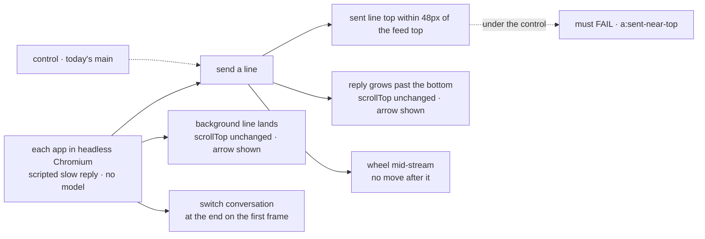
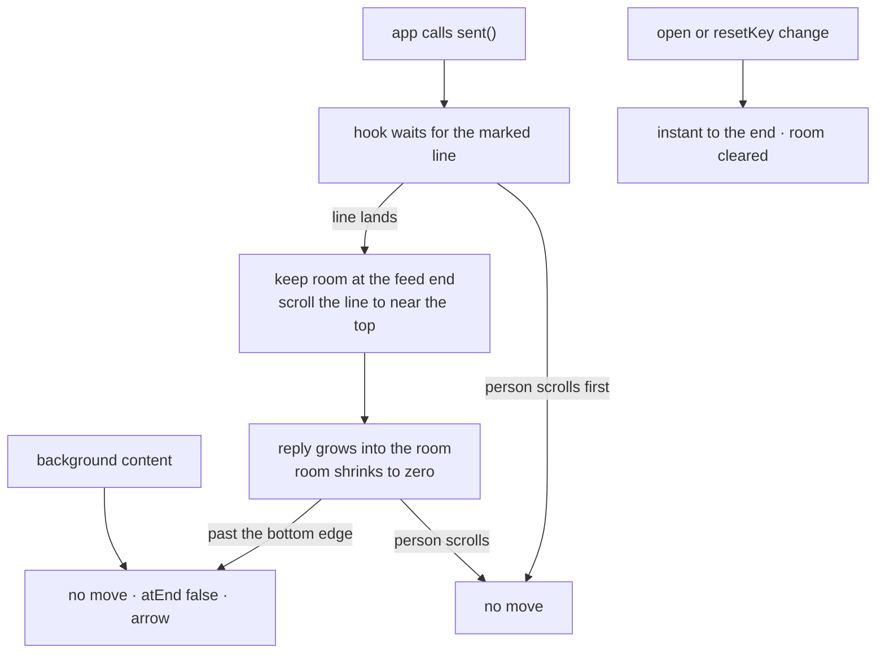

# FIX-2360 · All apps: scroll like ChatGPT/Claude: your sent message moves near the top, the reply streams below it, and the view never follows past that

**Spec** · [Decisions](DECISIONS.md)

## Who feels it, before and after

| Someone who… | Today (main, after #4275 and #4277) | After |
|---|---|---|
| **sends a message** in DevTool, Shift Manager, or either lab (the Claude Code lab's task threads too) | The view goes to the end. Their line sits at the bottom edge, and the reply grows below the fold, out of sight, behind the arrow | Their line rises to near the top of the view. The reply streams into the space below it, in view |
| **reads a long reply as it streams** | Doesn't see it start, because it starts off screen | Sees it start under their line. Once it grows past the bottom edge, the view stays put and the jump-to-latest arrow shows |
| **scrolls while a reply streams** (wheel, touch, keys, scrollbar, up or down) | Only scrolling *up* counts as theirs | Any scroll they make stops all automatic movement for that response |
| **sends while scrolled far up** | Taken to the end; their line is at the bottom edge | Taken to their line, which sits near the top |
| **gets background content** (a task result, another worker's line, a notice) | The view stays; the arrow shows | Unchanged |
| **opens or switches a conversation** | Lands at the bottom on the first frame, no animation | Unchanged |

## The goal, and how we'll know it's met

**In each of the four apps, a line you send rises to near the top of the view and its reply
streams in below it where you can read it; after that, nothing you didn't do moves the view.**

| | |
|---|---|
| **The real need** | Jake, 2026-11-02: *"If I type a message and the server responds, and that message isn't even on the page, then it should scroll into place. But if I can see a message because I'm still reading it, I don't want it to continue to scroll. We should follow what ChatGPT and or Claude does."* |
| **Smaller, and rejected** | Keep today's `sent()` (go to the end) and only widen "your scroll" to any direction. Rule 3 would hold, and rule 1 would not: the reply still starts off screen. This is what #4275 shipped. |
| **Bigger, and not this issue's** | The ui registry's `Conversation`, Kitchen Sink's two pages on it, and one shared jump button: FIX-2456 ([D2](DECISIONS.md#d2)). |
| **Not done if** | The line rises only when the reply is long (no room below a short one); the line that rises is a status row such as *"… is answering"*, not the person's line; the unit tests pass in happy-dom but nobody measured a real browser; the Claude Code lab's task thread or Shift Manager's task session still goes to the end. |



The check measures where the sent line's box is in a real layout, not what the hook meant to do.

**How we verify.**

- **Goal check (new): `goals/conversation-scroll/sent-line-rises-reply-stays/`**. Model-free: each
  app runs with a scripted reply that streams slowly enough to measure. Headless Chromium, one
  leg per surface: DevTool's stream view, Shift Manager's conversation and task session, the
  Claude Code lab's thread, task thread and task panel (FIX-2359's sheet, which doesn't send: legs b, d and e only), and the Teammates lab's conversation and popup. The
  implementing agent runs it at completion and puts the verdict on the implementation PR. If a
  surface can't be served headless, hand that leg to `fsd-qa` over the mailbox.
- **Signals, per leg.**
  - `a:sent-near-top`: after a send, the sent line's top is 0–48px below the feed's top, with a
    short reply and with a long one.
  - `b:reply-stays`: as the reply grows past the bottom edge, `scrollTop` doesn't change by more
    than 1px, and the arrow is visible.
  - `c:scroll-stops`: a wheel scroll mid-stream, then no programmatic move for the rest of the
    response.
  - `d:background-stays`: a line that isn't the person's lands with nothing sent; `scrollTop`
    doesn't change, and the arrow shows if the line is below the fold.
  - `e:opens-at-end`: a switch to another conversation is at its end on the first frame, with no
    smooth scroll.
- **Input.** Two lengths of reply: two lines, and three screens. A send from the end and a send
  from far up. Any reply length must pass `a`.
- **Anti-game.** Don't assert on the hook's return values or on `scrollTo` calls. Assert on
  rendered boxes and `scrollTop`. Don't identify the sent line by "the last element"; find it by
  its text.
- **Controls that must fail.** Today's `main` fails `a:sent-near-top` on every leg (the line
  sits at the bottom edge). `GOAL_CONTROL=no-reserve` (no space kept below the reply) fails
  `a:sent-near-top` on the short reply only.
- **Unit tests** (happy-dom, laid out by hand as `useJumpToLatest.test.ts` does today), written
  red against main first, per the issue: the sent line is brought near the top; growth past the
  bottom doesn't move; a downward user scroll mid-stream stops the move; background content
  doesn't move; opening and switching land at the end instantly.

## What changes


Same send, two outcomes: the top row is main today; the bottom is what this issue builds.

`useJumpToLatest` in `@flow-state-dev/react` stays the one implementation, and its `sent()`
changes meaning:

- **The sent line rises.** After `sent()`, the hook brings the person's line to near the top
  of the feed, once, smoothly, wherever the reader was.
- **Room below it** ([D1](DECISIONS.md#d1)). The hook keeps space at the feed's end so that
  line can reach the top even when the reply is short. The space shrinks as the reply grows,
  and is gone once the reply fills the view. It stays until the next send, open or switch.
- **The app names its line.** The hook doesn't guess from "whatever lands next". The app marks
  the element that is the person's line.
- **Any scroll by the person** stops the pending move, in any direction. A move the hook makes
  itself doesn't count as theirs.
- **The arrow is about content.** `atEnd` is `false` only when content, not the kept room, is
  below the view, and `jump()` goes to the content's end.

What an app writes, against today:

```diff
 const feed = useJumpToLatest({ resetKey: sessionId });

 {lines.map((line) => (
-  <div key={line.id} className="user-line">{line.text}</div>
+  <div key={line.id} className="user-line" {...feed.mine(line)}>{line.text}</div>
 ))}

 <Composer onSend={(text) => {
   feed.sent();
   return adapter.send(sessionId, text);
 }} />
```

The marker's name and shape are the implementer's; the diff shows where it goes. Callers
that learn of a send after the line is drawn (Shift Manager's task session, DevTool's
`sends` counter) keep calling `sent()` from an effect, and the same line must rise.

**Docs:** update `packages/react/README.md` → `useJumpToLatest` (what `sent()` does now, marking
the line, the kept room). Add a `useJumpToLatest` entry to `apps/docs/docs/api/react.md` →
*Hooks*, after `useSubscription`: the hook is public and the site doesn't list it. A changeset
for `@flow-state-dev/react` (minor: `sent()` behaves differently).



## What stays as it is

- Opening and switching (FIX-2346): `resetKey`, `startAtEnd`, and the first-frame landing.
- Background content never moves the view, and the arrow shows instead.
- `jump()` and the four jump buttons as they look today.
- `useJumpToLatest`'s name, its `ref`, `atEnd`, `jump` and `sent`, and its options.
- The ui registry's `Conversation` and Kitchen Sink ([D2](DECISIONS.md#d2), FIX-2456).

## What's already here, and the debt

**The job:** move a conversation's view in response to new content. Searched `packages/`,
`labs/`, `apps/` for `scrollTo`, `scrollIntoView`, `scrollTop`, `useJumpToLatest`,
`ScrollOnNewRequest`, `stick`. No row in `docs/mechanisms/mechanisms.yaml` does this job (it
lists framework mechanisms; this is a React hook). Two entries do it today, so this is not a
new way. It changes the closest one.

| Already here | What this does with it |
|---|---|
| `useJumpToLatest` (#4275, `packages/react/src/hooks/useJumpToLatest.ts`), used by DevTool's stream view, Shift Manager's conversation and task session, the Claude Code lab's thread, task view and sheet, and the Teammates lab's conversation and popup | **Extends**: `sent()` brings the line near the top and keeps room below. Replaces its "next added element" guess and its "only scrolling up is yours" rule |
| #4277's effect in Shift Manager's `TaskSession` that calls `sent()` when a line is added | **Builds on**: kept. The marked line is what rises, so calling after the line is drawn works |
| DevTool's `sends` counter effect | **Builds on**: kept, the same way |
| The ui registry `Conversation` (50px stick-to-bottom, `ScrollOnNewRequest`) and Kitchen Sink's copies | **Leaves alone**: FIX-2456 moves them onto the hook, so they get this rule there ([D2](DECISIONS.md#d2)) |
| Four hand-copied jump buttons (Shift Manager `ui.tsx`, both labs' `JumpToLatest.tsx`, DevTool inline) | **Leaves alone**: FIX-2456 ships the shared one |
| Prior design: FIX-2346 (opening lands at the bottom, instantly; PR #4211 era) | **Kept** in full |
| Prior design: FIX-2338 / FIX-2346 stick-to-bottom while at the end (`useFollowLatest`) | **Already superseded** by #4275, which deleted it. Nothing to remove |
| Prior design: #4275 / #4277 "new content never scrolls; sending goes to the end" (no retained spec; PR and changeset `008c63e` only) | **Superseded in part**: sending now goes to the line, near the top. The rest of it holds |

**Builds on / Adds.**

| Adds | Considered first | Why it doesn't fit, or how it's composed |
|---|---|---|
| Room kept at the feed's end | The feed's own bottom padding in each app; the ui registry's `RequestGroupRenderer`, which already gives the last request group a `min-height` (`70dvh`) for the same reason | Each app would compute it, four times. The hook already measures the feed. The registry's tail `min-height` is the same technique in a copied component the four apps don't render, so it is the precedent, not a piece to import |
| A way for the app to mark its line | The hook's `bringNext` guess (first element added after `sent()`) | The Teammates lab adds *"… is answering"* first, and Shift Manager draws the line only on a re-read, so the guess picks the wrong element |
| User-scroll detection by input (wheel, touch, keys, pointer) | The current scroll-direction test | A downward scroll by the person reads as the hook's own move |

**Adds:** the kept room, the line marker, input-based scroll detection, a goal check.
**Removes:** the next-element guess and the scroll-direction rule. **Debt:** the registry
`Conversation` and Kitchen Sink stay on the old rule until FIX-2456. Each app marks its own line
element, one line per app. **Net:** flat, in one hook, with four one-line app changes.

## Sign off

**The goal, at that size:** the line rises and the reply is in view in all four apps,
measured in a real browser. *If wrong:* we ship a hook that passes happy-dom and still starts
replies off screen.

**The debt: flat.** Adds the kept room and a line marker. Removes the next-element guess and
the direction rule. *If wrong:* a second scroll rule lives on in the registry longer than
FIX-2456 takes.

- [D1](DECISIONS.md#d1) · Keep room below a short reply, so the line reaches the top, instead
  of following the reply until the line gets there. *If wrong:* the view moves while people
  read, which is what the owner asked to stop. **The one to weigh.**
- [D2](DECISIONS.md#d2) · The four named apps here; the registry `Conversation` and Kitchen Sink
  stay FIX-2456's. *If wrong:* Kitchen Sink scrolls differently from the other apps until
  FIX-2456 ships.

**Open: none.**

Improvement · `react`, `devtool`, `shift-manager`, `labs/claude-code-style`, `labs/teammates` ·
small–medium · one PR · no epic · related FIX-2346, FIX-2338, FIX-2359, FIX-2456 · rebase over
#4653 (Teammates lab panel), which edits the lab's `Conversation.tsx`
