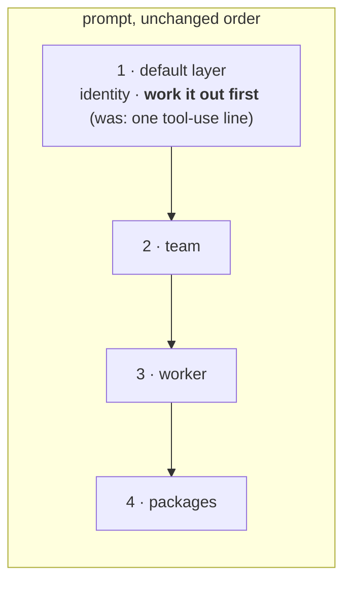

# FIX-2364 · Workers work things out for themselves first

**Spec** · [Decisions](DECISIONS.md)

## Who feels it, before and after

| Someone who… | Today | After |
|---|---|---|
| **asks a worker with no instructions of its own to review a PR it can't see** (no file or git tools) | It asks the user to "share the diff or paste the copy here", or holds off until someone does | It asks a teammate, uses what they find, and says what it couldn't see instead of asking for a paste |
| **asks a review task about work a coding task made** (the Claude Code-style lab, #4272) | It asked which region mattered, then for the PR description, diff or screenshots | **Not fixed by this issue alone.** That lab's `thread` worker says "the user is the one you ask" and "ask which region matters", and its text and the default rule both reach the model; it also can't see the work. It changes when FIX-2363 and FIX-2361 land (below) |
| **asks something vague a sensible assumption covers** | It asks a clarifying question and stops | It makes the assumption, says it, and does the work |
| **asks for something a worker could just do** | "If you want, I can…" | It does what it was asked this turn and says what it did |
| **asks for something that needs their say-so** (sending or posting for them, merging, spending, deleting, an app's own confirmations such as Shift Manager's Inbox approvals) | Waits | Still waits, and asks once, saying why |
| **needs a real decision from the user** (a preference, a call that is theirs) | Asks | Still asks, once, saying what it already found |
| **writes their own worker** (a hire with only a description, or an app's `WORKER.md`) | Gets one line: "use your tools before you answer; don't offer" | Gets the full rule, with no text of their own |
| **runs a worker on a harness or their own flow** (Claude Code, Codex, Cursor, a custom `agent` flow) | Unaffected | Unaffected |

## The goal, and how we'll know it's met

**Every worker on the built-in worker flow, and every main or lead session on it, finds what it
can with its tools before it asks the user anything, and asks only what depends on the user.**

- **Smaller, and rejected:** copy the Chief of Staff's "act, don't offer" paragraph (FIX-2336)
  into each lab's files. Every app repeats it, and a worker someone hires gets none of it. That is
  why this issue exists.
- **Bigger, and not this issue's:** giving a task access to an earlier task's branch, diff or PR
  (FIX-2361, Architect design first; it also drops the Claude Code-style `thread` worker's "can't
  see or change the project's code" line when it grants that worker read access), and fixing
  app prompts that contradict the rule. FIX-2363 owns the `thread` worker's "ask which region
  matters"; its "the user is the one you ask" and "never message another worker" lines had no
  owner until FIX-2366, filed for them.
- **Not done if:** a worker with nothing but a description, asked to review a PR it can't see,
  asks the user to paste it; or the FIX-2334 and FIX-2336 checks stop passing.

The rule replaces the one-line tool-use rule FIX-2334 put at the end of the default layer. Nothing
else in the prompt moves.

**How we verify.**

- **Goal leg (new), `goals/teammates-lab/works-it-out-first`**, real model, 3 of 3 runs. The
  Teammates lab on a fresh store, over a working folder whose last commit changed
  `docs/pricing.md` and wrote a wrong saving (40%). The user hires their own worker with only a
  description: **no instructions and no file tools**, so the default layer is the only text that
  says how to behave, and, like the review task in the incident, it can't see the work itself. It
  is asked to review "PR #42, the pricing change the coding task opened". Graded on every reply
  the conversation holds once it goes quiet: it must call a tool (here, asking a teammate counts
  as looking), must not ask the user to paste, share or send the diff, link or copy, and must
  name the 40% claim, which it can only learn by getting a teammate to read the file.
- **Control that must fail:** `GOAL_CONTROL=old-rule` patches the layer's rule back to the
  one-line FIX-2334 wording as the server loads it. Prototyped: it failed 3 of 3 runs (one asked
  "if you can share the PR link or patch here"; two asked Chief of Staff for the diff and waited,
  never reviewing). The final wording, with the review's last bullet, passed 3 of 3 and its
  control failed 2 of 3 ("Please share the PR link or paste the diff"). A first scenario, a worker *with* file tools,
  passed on the old wording too, so it proved nothing about the rule and was dropped.
- **Regression (re-runs, no new code):** FIX-2152's closure goals that #4262 fixed,
  `claude-code-style-lab/session-mode-script` and `teammates-lab/a-worker-knows-who-it-is`.
  FIX-2336's check becomes leg 2 of the new goal: Chief of Staff is asked what researcher and
  writer are working on, something only they know (never their names, which
  `a-worker-knows-who-it-is` leg 2 requires it to answer from its prompt with no tool call). It
  must message them or read their conversations, and offer nothing it could have done. Both
  goals share one Teammates boot (`goals/teammates-lab/lab.mts`), lifted from
  `a-worker-knows-who-it-is/run.mts`. The
  control isn't asked to fail it, since Chief of Staff's own file says the same.
- **Unit:** the existing default-layer tests in `packages/workforce/test/worker-identity.test.ts`
  keep asserting the rule sits in the layer, ahead of the team and worker text.
- **Deferred to FIX-2361:** the issue's scripted PR-review run (a coding task makes a PR, a review
  task finds it and asks nothing). It needs a task to reach another task's work first.

## What changes

- **The default layer's rule** (`packages/workforce/src/messages/worker-identity.ts`) becomes
  five lines, naming no tool ([D1](DECISIONS.md#d1)):

  > Work things out yourself first.
  > - Look before you ask anyone anything. Use your tools, and ask a teammate who can read what
  >   you can't: files, branches, diffs, pull requests, tasks and their results.
  > - Never ask the user to paste, share or send something the system holds or a teammate can
  >   find: a diff, a branch, a pull request, a file, a link, a task's result, an id. If you still
  >   can't reach it, say what you looked at and what you couldn't see, then do the job as far as
  >   what you found allows.
  > - Ask the user only what truly depends on them: a preference, a decision that is theirs, or a
  >   fact nobody on the team can reach. When a sensible assumption will do, make it, say it, and
  >   go on.
  > - Act, don't offer. Do what you were asked this turn, then say what you did. Don't end with
  >   "if you want, I can…" for something you could have done. Anything that needs the user's
  >   say-so still waits for it: sending or posting for them, merging, spending, deleting, or
  >   what your instructions say to confirm. Ask for that once, and say why.

  A first draft ("look it up… don't ask the user to paste it") failed the goal leg 2 of 3: the
  worker still asked the user to "share the PR link or diff". This wording names the paste
  directly and sends the worker to a teammate who can read what it can't. Keep the first three
  bullets word for word unless the goal leg and its control are re-run: they are what passes.
  The last bullet names what still waits (FIX-2364 review), scoped to "what you were asked" so
  FIX-2073's later line, which sends new work in a finished task's session to its filer, doesn't
  pull against it.

- **Who gets it:** everything that runs the built-in agent turn on an installation: `agent`
  workers, their task sessions, and the coordinator flow's judgment turn (it shares the turn). So
  Shift Manager, both labs, and any app on the package inherit it.
- **Docs:** the package README and the Workforce docs page that say what every worker is told
  first; the default worker flow architecture doc's C1 line names the rule.

## What stays as it is

The layer's place and order; the identity block; "order, not precedence" (an app's text that
says "ask which region matters" still contradicts the rule, and the model decides, which is why
FIX-2363 fixes that text at its source); harness flows and custom worker flows; core and the
engine.

## What's already here, and the debt

| Piece | What this does with it |
|---|---|
| FIX-2334's default layer and its one-line `TOOL_USE_RULE` | **Replaces** the line's text, in the same place. D1 of FIX-2334 said later default text joins this layer as a line |
| FIX-2336's Chief of Staff "how you use your tools" paragraph | **Kept.** It is app guidance on top; the package rule now says the general part for every worker. Its "act, don't offer" and "ask only what no tool can find" lines now repeat the layer; trimming them is optional and not in this change |
| FIX-2073, the next default-layer line (tell the filer about asks after a task is done) | **Compatible:** "do what you were asked this turn" is scoped to the asked work, so new work in a finished task's session still goes to the filer |
| App confirmations (Shift Manager's Inbox approvals, devforce's wait-for-a-person) | **Kept:** the rule's last bullet names "what your instructions say to confirm" as still waiting |
| `goals/teammates-lab/a-worker-knows-who-it-is` and its `run.mts` helpers | **Reused**: the new leg drives the same lab the same way |
| `goals/lib` module patches | **Reused** for the control |

**Adds:** prompt text and one goal leg. **Removes:** nothing. **Debt:** the rule is fixed text.
An app that wants other words still registers its own worker flow (C1's door). **Net:** small.

## Sign off

**Approve by merging.** The one call is **the words** ([D1](DECISIONS.md#d1)): one rule in the
default layer, strong on "look first, never ask for what the system has", and still letting a
worker ask what only the user can answer. *If wrong:* the text changes in one constant and the
goal leg tells us whether the new words still hold.

Improvement · `workforce` · small · 1 PR · builds on FIX-2334, FIX-2336 · check's PR-review leg
waits on FIX-2361
