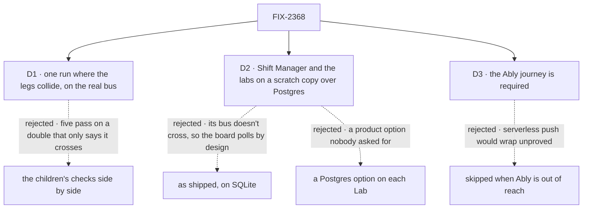

# FIX-2368 · Decisions

[Spec](SPEC.md) · **Decisions**

The plan's four rows are the [closure rule's](../../../docs/contributing/orchestration.md#the-closure-issue-every-epic-ends-in-qa)
and its legs are the [epic's](../../epics/FIX-2367/SPEC.md#the-goal-and-how-well-know-its-met).
Three calls are this spec's: how the legs are put together, where Shift Manager and the labs are
graded, and whether the Ably journey can be skipped.

## The tree

Solid edges are what you're signing. Dashed edges lost, and the label says why.

## D1 · One run where the legs collide, on the real Postgres bus, not the children's checks side by side

| | |
|---|---|
| **Instead of** | Re-running each child's goal and calling the set proved when each is green |
| **Because** | FIX-2428's, FIX-1506's and FIX-2429's legs a pass on `goals/lib/crossing-bus.mts`, an in-memory bus that reports it crosses, on one process; FIX-2426's on two registries in one process. Only FIX-2427's crosses a real process, and it reads a session, not org state, a board or a browser. What none sees: a notice that must ride the Postgres bus from process 1 to a socket on process 2, the session stream and a board view sharing one session topic while a reply streams and a task settles (the epic's *a board is no second way to watch a session* seam), and the product's own defaults turning the timers off |
| **Locks in** | One goal with two processes, a Postgres it starts, three browsers and Shift Manager, minutes per attempt, repeated in full per finding. Every assertion is tagged `<leg>:<assertion>`, so a red leg doesn't hide the others |

It comes down to the real bus: a double that says it crosses passes whatever the Postgres bus does.

**What would change my mind:** a child's check already run on the real Postgres bus across two
processes for its own leg. Then that leg drops out of the collision and is graded in row 3.

## D2 · Shift Manager and the labs are graded on a scratch copy with the store swapped to Postgres

| | |
|---|---|
| **Instead of** | Grading them as we run them, on SQLite · adding a Postgres store option to each Lab so the closure can configure it |
| **Because** | DevTeam's and the Teammates lab's configs build `sqliteStores` themselves. SQLite's bus doesn't cross, so under [FIX-2429's call](../FIX-2429/DECISIONS.md#decided-not-asked) Shift Manager's board keeps its 3 s timer while a task is open, and leg b's "no read between notices" can never pass there. The epic's *not done if* already reads "still polls … with the Postgres bus configured". Grading a scratch copy with only the store line changed tests Shift Manager's and the labs' own views on the bus that crosses. `buildShiftManagerCopy` already patches copies in scratch, so it needs no product change. A Lab option would be product surface no person has asked for |
| **Locks in** | The run proves the views on Postgres. As shipped, the labs still read every 3 s while a task is open, and the report says so in one line |

It comes down to the bus: on SQLite the board polls by an approved design, so leg b can't pass.

**What would change my mind:** an intent to run the labs on Postgres day to day. Then the labs
need a store option, filed under FIX-2466, and the closure configures it instead of patching.

## D3 · The Vercel-with-Ably journey is required: Ably out of reach holds the run, never skips it

| | |
|---|---|
| **Instead of** | Skipping journey j4's Ably half, with a note, when the run's machine has no `ABLY_API_KEY` and can't reach Ably's sandbox |
| **Because** | The epic's Vercel row promises push with Ably, and [epic D5](../../epics/FIX-2367/DECISIONS.md#d5) names Ably as the test that the two seams are the right two. FIX-380's own check proves its adapter beside a fetch handler; only the closure follows the realtime guide's Ably row on `createNextHandler` with the rest of the set merged. A skipped half is the epic wrapping with its serverless promise unproved |
| **Locks in** | A run without Ably access is a setup failure: the worker reports it as a blocker naming the key, and the run waits. The polling half of j4 needs no Ably and always runs |

It comes down to the Vercel promise: skipped, push with Ably is never seen working with the set.

**What would change my mind:** FIX-380 cut from the epic. Then j4 is its polling half alone.

## The plan in full

| # | What runs | PASS means |
|---|---|---|
| 1 | Legs a to d ([the signal](SPEC.md#the-signal)) | Each green; each control red where named |
| 2 | One journey per team whose *after* row 1 doesn't walk. *Builds a screen two people watch* is leg a. **j2** *runs the labs or Shift Manager*: Shift Manager and the Teammates and claude-code-style labs, each on D2's copy, a conversation open with a task open and its message, request, project and activity views mounted; over 10 s from the first `crosses: true` frame, with nothing written, 0 reads (`j2:no-poll`); a message sent from another session shows within 1 s (`j2:message`). **j3** *runs more than one process*, on row 1's two processes plus one: process 1 on BullMQ `dispatch-only`, a `worker-only` process runs A's action, B on process 2 shows the reply within 1 s (`j3:worker-reply`); then over 10 s idle, with nothing written, 0 session-stream statements from process 2 (`j3:no-timed-read`), as in FIX-2427's signal, so the read the reply's notice wakes is not counted; `no-request-publish` must FAIL `j3:worker-reply`. **j4** *deploys to Vercel or Next*, on FIX-380's goal's Next and Ably wiring: the fixture behind `createNextHandler` with no Ably, `GET /capabilities` reports no push and B updates within the hook's poll interval plus 1 s (`j4:polls`); then with Ably set up as the realtime guide's Ably row says ([D3](#d3)), within 1 s and 0 reads between changes over 10 s (`j4:ably`); FIX-380's `memory-bus` must FAIL `j4:ably` | Each green |
| 3 | Every child's goal check with its controls, read from Linear at run time and printed: FIX-2426, FIX-2427, FIX-2428, FIX-1506, FIX-2429, FIX-380, FIX-2466, and any child that joins later. **None is skipped:** row 1 walks no child's signal as that child wrote it | Each PASS beside its documented FAIL |
| 4 | The gap sweep: each [coordination seam](../../epics/FIX-2367/DECISIONS.md#coordination-seams) from both sides; the realtime guide, FIX-380's Ably row and the client, react, node, store-postgres and Ably READMEs followed as written; each epic *not done if* state absent, including an app with no push configured (`push: false`) still updating by polling, and the Vercel pages saying "polls" | Every seam two-sided |

**Must be green first:** every other child merged with its goal's PASS and its controls' FAIL.
At drafting none has: FIX-2426, FIX-2427, FIX-2428, FIX-1506 and FIX-2429 are spec approved,
FIX-380 is in spec review (#4486), and FIX-2466 has no spec. j4 also waits on
[epic D5](../../epics/FIX-2367/DECISIONS.md#d5) being settled and #4486 merged: its Ably half
follows the guide's Ably row, whose config shape is D5's open push-seam call.

## Decided, not asked

- **The epic's memory-bus control fails on the 1 s signal, not on "B never updates".** Since
  [FIX-2428 D3](../FIX-2428/DECISIONS.md#d3) and the Nov 2 ER-5 amendment, a hook keeps its
  timer where the bus can't cross, so under the in-memory bus B may update at the poll pace. The
  control grades `a:org-state` and `a:org-row` on the 1 s. The epic's control line says the same,
  amended in this PR.
- **"Polls off" is the product's default, not a switch the run sets.** On a bus that crosses,
  FIX-2426 turns the session stream's timed read off and the hooks keep no timer. The run counts
  reads instead, so a default left on is a FAIL, where a switch would hide it.
- **Each "within 1 s" is 5 samples, all within 1 s, none retried.** Model `n/a` makes every
  miss structural, and a structural miss on any attempt is a finding
  ([FIX-2087 D1](../FIX-2087/DECISIONS.md#d1)). Each sample runs from A's action returning to the
  change showing on B's page, and every latency is printed, so a miss reads as a slow tail or a
  missing notice. The product claim stays 1 s; the count and where a sample starts are the
  implementer's to tune.
- **Reads are counted in the browser and in Postgres.** Read requests and socket frames from
  Playwright's request and WebSocket events; statements from `log_statement = all`, by each
  process's `application_name`. No counter inside the framework. A zero-read assertion counts
  over an idle window with nothing written, or counts only reads no notice or connect preceded:
  the read a notice wakes is the product's path (FIX-2426 keeps it), and only a timed read fails.
- **Leg c names A's session, not A's org.** User and org topics name no id on the wire, so C
  can't ask for org 1. C's own org topic is graded silent instead (`c:other-org-silent`).
- **Model `n/a` throughout.** Handler actions write the reply and settle the task. The epic's
  goal names no model, and a model's latency would sit inside the 1 s.
- **Leg b's Lab:** the closure's own Lab config on `postgresStores`, with a handler worker, if
  Shift Manager opens a board on it; otherwise DevTeam's config copied to scratch with its store
  line swapped. The implementer's call within D2.
- **Today's `main` is the parent of FIX-2426's implementation merge** (`9fd46b6` at drafting), so
  the fixture app runs on hooks that exist there.

## Considered and dropped

| Alternative | Why not |
|---|---|
| Re-run the children's checks and stop there | Most pass on the crossing double, on one process (D1); row 3 re-runs them anyway |
| Kitchen Sink as the real app | It runs on Next, which polls until Ably ([epic D3](../../epics/FIX-2367/DECISIONS.md#d3)); a fixture host under `goals/` is the home for this |
| The crossing double for speed | It is what the closure exists to go past |
| BullMQ inside leg b's Shift Manager | Shift Manager's command runs one host; j3 grades the worker on the fixture instead |

## Analysis

Nov 2, at `9fd46b6`. **Right approach, one fold.** Run in this dispatch by the author, since the
worker can't start a fresh sub-agent; the coordinator can dispatch a fresh `analysis` pass if it
wants an independent one.

- **Reuse:** every *Adds* item is the goal itself, apart from FIX-2427's Postgres bootstrap,
  extended into `goals/lib`; browsers, Shift Manager copies and controls reuse `goals/lib`. **Reuse X** on the crossing double was considered and refused (D1).
- **Others' shapes:** a closure is a release QA; the shape is FIX-2242's.
- **Should it exist:** required by the closure rule.
- **Major concern, folded:** leg b can't pass on the Labs as shipped, because FIX-2429 keeps their
  timer on SQLite. Became D2.

## How it got here

- **Draft** — the epic's four legs on one real two-process Postgres host, at the product's
  defaults, colliding on one conversation; FIX-2242's closure shape kept. Found: leg b needs a Lab
  on Postgres (D2), and the epic's memory-bus control reads "never updates", which FIX-2428 D3 no
  longer makes true.
- **Review (Nov 2)** — the epic's memory-bus control line amended to fail on the 1 s. j4 waits on
  epic D5 and #4486. `a:same-source` moved to anti-game; it grades no team. FIX-2427's
  bootstrap extended into `goals/lib`; the kept goal's scenes, runner and 1 s sampling named.

## Notes from review

- "consider narrowing **j2** to labs-only (or one lab + message path)" — cursor ([thread](https://github.com/fixpoint-labs/flow-state-dev/pull/4512#discussion_r4438121672))
- "Optional amend: name one invariant in DECISIONS and attach fewer redundant scenes, keeping Postgres logging only where the browser cannot observe the read path." — cursor ([thread](https://github.com/fixpoint-labs/flow-state-dev/pull/4512#discussion_r4438121675))
- "Prefer a **warm `FSD_DB_URL`** in the closure worker over `initdb` every attempt; narrow `log_statement` to what `d`/`j3` need (with `application_name`), if you can keep anti-game strength." — cursor ([review](https://github.com/fixpoint-labs/flow-state-dev/pull/4512#pullrequestreview-5731142473))

**Open: none of its own.**
