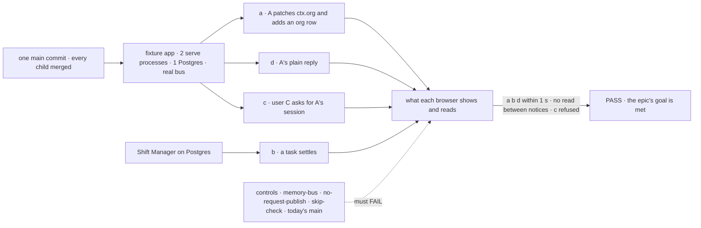
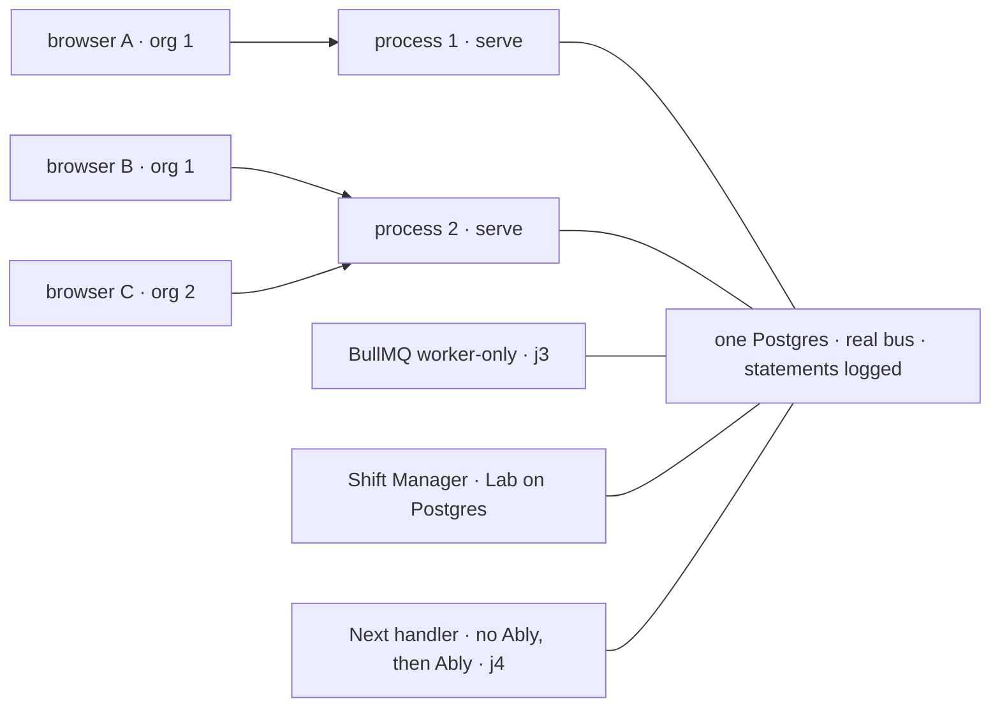

# FIX-2368 · Closure: a change reaches every screen watching it

**Spec** · [Decisions](DECISIONS.md)

## Five teams, before and after

| A team that… | Today | After this closes |
|---|---|---|
| **decides whether the epic is done** | Each child green on its own commit, most of them on a test-only bus that only says it crosses | One report on one `main` commit, on the real Postgres bus across two processes, every check beside its control's FAIL |
| **builds a screen two people watch** | B's tab never shows A's org patch or org row until it reads again | Shown within a second on another process, by an app whose source is the same file on today's `main` |
| **runs the labs or Shift Manager** | The board reads every 3 s while a task is open; the other views read every 1.5 to 5 s | On the Postgres bus, the board shows a settled task within a second, and no view reads between notices |
| **runs more than one process** (Postgres, or BullMQ workers) | A reply crosses by a store read each second per open view; org changes don't cross | A reply run on a BullMQ worker reaches a viewer on a third process within a second, with no timed read |
| **deploys to Vercel or Next** | Polls, and nothing says so | Polls without Ably, as the guide says; with Ably, hears a change within a second |

## The goal, and how we'll know it's met

**On one `main` commit with every other child merged, a fixture app on the Node host, run as two
processes over one Postgres on the real Postgres bus, shows viewer B on process 2 viewer A's
`ctx.org` patch, org-resource row and plain reply within a second; Shift Manager's board shows a
settled task within a second with no read between notices; a user who may not read a scope is
refused and hears nothing; and each team's journey, each child's own check and the gap sweep pass
beside controls that fail.**

| Is it the right goal? | |
|---|---|
| **The real need** | [The epic's goal](../../epics/FIX-2367/SPEC.md#the-goal-and-how-well-know-its-met) on the assembled set: the gaps *between* children ([closure rule](../../../docs/contributing/orchestration.md#the-closure-issue-every-epic-ends-in-qa)) |
| **Smaller, and rejected** | "Re-run every child's check." Five of them pass on `goals/lib/crossing-bus.mts`, a double that only *says* it crosses, and on one process. A Postgres bus that loses its listener, or a raw-registry entry that forgets to publish, passes all five ([D1](DECISIONS.md#d1)) |
| **Not done if** | [The epic's list](../../epics/FIX-2367/SPEC.md#the-goal-and-how-well-know-its-met), plus: a check ran on another commit · a check passed on the crossing double · a timer or timed read was switched off by the run instead of by the product's default · the fixture app's source differs from today's `main` · a control was skipped or passed · a finding is open |



Legs a, c and d run at once on one conversation while leg b's task settles; each control breaks one
named assertion.

| How we verify | |
|---|---|
| **Goal check** | `goals/realtime/a-change-reaches-every-screen/`, new · model `n/a` (handler actions write and settle) · run by the closure worker on one `main` commit · the report is the closure PR's body |
| **Signal** | Every `<leg>:<assertion>` in [the signal table](#the-signal) passes |
| **Input** | Two `serve()` processes (`child_process.fork`) over one Postgres the script starts (`initdb`, `pg_ctl`) or `FSD_DB_URL`, with `log_statement = all` and each process's `application_name` set; Chromium through `goals/lib/playwright.mts`, one browser context per user; users A and B in org 1, C in org 2 |
| **Anti-game** | Assert on what each page shows and on the read requests and WebSocket frames the page itself makes, never on `publish` calls. Two processes, not two registries. The real Postgres bus, never the crossing double. The run sets no poll, timer or timed-read switch: what is off is off by default. The fixture app's source hashes the same on today's `main` and on the pinned commit, printed |
| **Control that must fail** | `memory-bus` (both processes on the in-memory bus): **`a:org-state`**, **`a:org-row`**, which miss the 1 s; B may still update at the hook's poll pace ([below](DECISIONS.md#decided-not-asked)) · `no-request-publish` (the bus child's write wrapper publishes nothing, FIX-2426's `no-publish` patch): **`d:plain-reply`**, while a passes · `skip-check` (FIX-2428's: the mint grants every topic): **`c:refused`** · today's `main` (the parent of FIX-2426's implementation merge; `9fd46b6` at drafting): every `a:` assertion and **`b:no-read-between`** |

### The signal

| Assertion | Passes when |
|---|---|
| `a:org-state` | A, on process 1, patches `ctx.org` (a plain state field, no resource); B's page on process 2 shows the new value within 1 s |
| `a:org-row` | A adds a row to an org-scoped collection; B's board shows it within 1 s |
| `a:no-timer` | Over 10 s from B's first `crosses: true` frame, with nothing written, B's page sends 0 read requests; while A writes, every read B sends follows a notice frame or a connect |
| `d:plain-reply` | A's action writes only a reply and its status (no resource, state or task); B's session view on process 2 shows it within 1 s |
| `d:no-timed-read` | Over the same 10 s, Postgres logs 0 statements from process 2's session stream |
| `c:refused` | C asks to subscribe to A's session; the mint refuses it and C's page shows nothing of it |
| `c:other-org-silent` | C, on its own org's topic, sends 0 reads and shows no change when A patches org 1 |
| `c:reconnect-refused` | Process 2 is restarted; C's socket reconnects, the re-mint refuses A's session again, and C hears nothing |
| `b:settles` | Shift Manager, on a Lab over Postgres ([D2](DECISIONS.md#d2)), open on a conversation's board; a worker's task settles from its own session; the board shows it `completed` within 1 s |
| `b:no-read-between` | Over 10 s from the board's first `crosses: true` frame, with the task open and a reply streaming, the board sends 0 reads between notices |

**The rest of the plan** is [in DECISIONS](DECISIONS.md#the-plan-in-full): a journey per team,
the children's checks, and the gap sweep. A failure becomes a child of FIX-2367 blocking this
issue, and the plan runs again as the closure rule says.

## What changes



Before, each child proved its piece on one process or a test-only bus; the closure runs the pieces
together, on the real wire, across processes.

The fixture app is ordinary app code. It is the same file on today's `main` and on the pinned
commit, which is how the run proves an app needs no push code:

```diff
+// goals/realtime/a-change-reaches-every-screen/app/Board.tsx
+const { org } = useClientData(session, { org: ["plan"] });       // a:org-state
+const seats = useResourceCollectionList(session, "seats");       // a:org-row
+const { items } = useSession(sessionId, { live: true });         // d:plain-reply
+// host: serve(createFlowState({ flows, stores: { default: { primary: postgresStores(...) } } }))
+// no bus line, no push option, no poll interval: the defaults are what is graded
```

**Docs:** no documentation impact: no page is written or changed. Row 4 follows the realtime
guide FIX-2428 publishes (`apps/docs/guides/realtime.md`), FIX-380's Ably row and each child's
README as written; a page that doesn't hold when followed is a finding against its child.

**Stays as it is:** all product code; every child's check as it is on `main`; the Labs' shipped
SQLite setup, which FIX-2429 decided keeps its timer while a task is open.

## What's already here, and the debt

| Already here | What this does with it |
|---|---|
| The epic's legs a to d and its controls | **Builds on.** Walked together on one host; the memory-bus control's FAIL is graded on the 1 s signal ([below](DECISIONS.md#decided-not-asked)) |
| The children's goals: `session-stream/wakes-on-a-change`, `session-stream/wakes-across-processes`, `realtime/websocket-delivery`, `realtime/scope-changes-reach-other-sessions`, `task-board/a-settled-task-reaches-the-board`, `realtime/ably`, and FIX-2466's | **Composed.** Re-run in row 3; three controls reused (`no-publish`, `skip-check`, `memory-bus`) |
| `goals/lib/playwright.mts`, `goals/lib/shift-manager.mts` (`buildShiftManagerCopy`, `startShiftManager`), `goals/lib/module-patch.mjs`, `goals/lib/server.mts`, `goals/lib/verdict.mts`, `goals/lib/client-actions.mts` | **Reused** for the browsers, Shift Manager in scratch, the controls' patches, the forked `serve` processes, the tagged report and the handler writes. Row 3 runs each child's own `run.mts` with its controls, as FIX-2242's did |
| `goals/lib/crossing-bus.mts` (FIX-2426) | **Not used.** It is what the closure exists to go past |
| [FIX-2242](../FIX-2242/SPEC.md), the last closure | **Kept** its shape: tagged assertions, one run where the legs collide, the plan's four rows |
| Anything else grading the set | **None.** Searched `goals/` for `useSubscription`, `client.subscribe`, `crosses`, `postgresStores` with `serve(` |

| The debt | |
|---|---|
| **Removes** | Nothing |
| **Adds** | One goal with its fixture app and a scratch Lab config. Permanent by design: it keeps running after the wrap |
| **Leaves** | The Labs as shipped run on SQLite and keep their fallback timer while a task is open (FIX-2429's call, [D2](DECISIONS.md#d2)) |

**Net: up, a little.** One goal, for a promise that crosses five packages.

## Sign off

**[The goal](#the-goal-and-how-well-know-its-met), at that size:** the four legs on one real
two-process Postgres host, at the product's defaults, on one commit. If wrong: the epic wraps on
children that each passed on a double.

**[The debt](#whats-already-here-and-the-debt), net up a little:** one goal and its fixture. If
wrong: a slow goal nobody re-runs.

1. **[D2](DECISIONS.md#d2) · Shift Manager and the labs are graded on a scratch copy with the
   store swapped to Postgres,** not as shipped on SQLite and not through a new Lab option. If
   wrong: the apps we run day to day still poll, and the run says they don't.
2. **[D3](DECISIONS.md#d3) · The Vercel-with-Ably journey is required: Ably out of reach holds
   the run, never skips it.** If wrong: the wrap waits on an Ably key.
3. **[D1](DECISIONS.md#d1) · One run where the legs collide, on the real bus, not the children's
   checks side by side.** If wrong: a longer run whose failures are harder to split.

**Open: none of its own.** D2 is the one to weigh. Before the run: FIX-380 and FIX-2466 have no
approved spec yet, and no child's implementation has merged ([Must be green first](DECISIONS.md#the-plan-in-full)).
j4 can't be written until [epic D5](../../epics/FIX-2367/DECISIONS.md#d5) is settled and FIX-380's
spec (#4486, not yet approved) merges, since its Ably half follows the guide's Ably row.

Improvement · closure (QA) · `goals/` only · large, repeats per finding · epic
[FIX-2367](../../epics/FIX-2367/SPEC.md), closure · required · runs after every other child merges
(FIX-2426, FIX-2427, FIX-2428, FIX-1506, FIX-2429 spec approved; FIX-380 in spec review; FIX-2466
spec to come) · Linear [FIX-2368](https://linear.app/fixpoint-labs/issue/FIX-2368)
