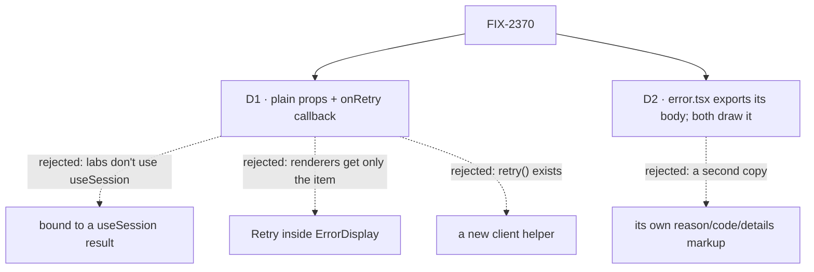

# FIX-2370 · Decisions

[Spec](SPEC.md) · **Decisions**

The issue settles the what (a failed turn shows inline with its reason and Retry) and the epic
settles where (one registry component, ER-4). D1 is the component's shape and the one to sign;
D2 is how it avoids a second copy of the error text.

Solid edges are what you're signing. Dashed edges lost, and the label says why.

## D1 · `request-recovery` takes plain props and an `onRetry` callback

| | Plain props + `onRetry` (chosen) | Takes a `useSession` result | Retry added to `ErrorDisplay` |
|---|---|---|---|
| Teammates and Claude Code-style can use it | yes: their adapters already hold the reason | no: they map client events to entries, not `useSession` items | only if the renderer can reach a callback |
| Kitchen Sink can use it | yes, `onRetry={() => session.resumeLatestRequest()}` | yes | yes, through a wrapped renderer |
| Latest-only Retry | the caller passes `onRetry` or not | the component reads `latestRequest` | the item doesn't know it is latest |
| FIX-2377 adds Continue / Discard | another optional callback | another session method | an interrupted request has no ErrorItem |

- **Instead of** a session-bound component: two of the three apps don't run `useSession` for
  their feed, so they couldn't use it; a session wrapper can be added on top if a fourth app wants it.
- **Instead of** Retry inside `ErrorDisplay`: an item renderer receives only the item, so the
  Retry wiring would ride on context, and FIX-2377's interrupted case has no item to render.
- **Because:** tenet 2, few primitives that compose; the retry already exists in the client
  (`RequestHandle.retry()`), and the component is presentation over it.
- **Locks in:** the app decides whether Retry shows, by passing `onRetry`. The server's rule
  (only a latest `failed` or `interrupted` request is retried) is documented on the component.

## D2 · `error.tsx` exports its body, and both components draw it

- The reason, the code line and the *Details* block move from `ErrorDisplay` into one exported
  piece in `error.tsx`. `ErrorDisplay` renders the same output as today; `RequestRecovery` wraps
  the same piece with the `who` label and its button. `request-recovery` lists `error` in its
  `registryDependencies`, so one `fsdev ui add` installs both.
- **Instead of** its own markup: ER-3, one implementation per need. A failure reads the same in
  an item stream and on a recovery line.
- **Locks in:** a change to how an error reads is one edit, in `error.tsx`.

## Decided, not asked

- **E1 · Delivery splits along the epic's build order.** The wave-1 package PR ships the
  component, the shared body, the render tests, the Kitchen Sink installed copy the drift test
  requires, and the docs. Each app's adoption (adapter branch, entry, startup key warning, KS's
  inline box) lands in that app's stack, per the build order.
- **E2 · Layer boundary:** all of it is the ui registry and the apps. No worker, task or
  harness noun enters the component: `who` is a free label the app fills.
- **E3 · Busy and refused states** are the component's: *Retrying…* while the promise runs, the
  rejection's message inline after, the button back. This matches FIX-2372's rule for mutation
  buttons without depending on it.
- **E4 · Wording:** the line uses *worker* only through the app's `who`; no copy names a role.
- **E5 · Colours** use the `destructive` token, as `ErrorDisplay` does; the palette census and
  token tests cover it.

## How it got here

- Initial draft, 2026-10-31, from the issue, the epic's ER-3 and ER-4, and a read of
  `error.tsx`, `stuck-request-banner.tsx`, Kitchen Sink's `ConversationBody` and `ResumePrompt`,
  `RequestHandle.retry()` and `useSession.resumeLatestRequest`.

## Notes from review

None yet.
