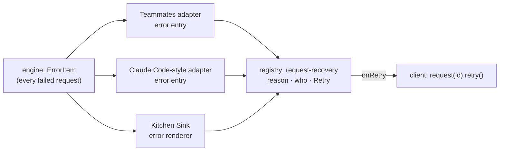

# FIX-2370 · Show a failed turn inline with its reason and Retry

**Spec** · [Decisions](DECISIONS.md)

Child of epic [FIX-2369](../../epics/FIX-2369/SPEC.md) (*Trust the feed*). This spec covers the
whole issue; the epic's [build order](../../epics/FIX-2369/DECISIONS.md#coordination-seams)
splits its delivery into a wave-1 package slice and three app adoptions, which land later in
their apps' stacks.

## Who feels it, before and after

| Someone who… | Today | After |
|---|---|---|
| **sends a turn that fails** (no API key, a provider 4xx/5xx, a tool throws, max steps) in Teammates or Claude Code-style | The working indicator goes away and nothing else shows. A crash looks like a short answer | A red line in the thread names the worker and the reason, with **Retry** |
| **sends a turn that fails** in Kitchen Sink's Flow State assistant | A bare red box with `session.error.message`, no Retry | The same line, from the same component, with Retry |
| **presses Retry** | — | The button says *Retrying…* and is disabled; the new request streams into the thread. If the retry call itself is refused, the line says so and Retry comes back |
| **reads an older failed turn** further up the thread | — | The reason stays; Retry shows only on the latest request, where the server will take it |
| **watches a turn fail half-way through a reply** | The half-written reply reads as a finished one | The reply is marked incomplete, and the failure line sits under it |
| **builds their own app** on the registry | Writes their own failed-turn line, or none | `fsdev ui add request-recovery`, and passes the reason and an `onRetry` |

## The goal, and how we'll know it's met

**A failed turn reads as a failure, with its reason and a working Retry, in all three apps, from
one registry component.**

- **The real need**, from the app review (R-01): "A crash looks the same as a short answer." Three
  apps need the same affordance, and Kitchen Sink already holds a third copy inline.
- **Smaller, and rejected:** add an error branch to each lab's adapter and draw the line in each
  app's own markup. That fixes the symptom and makes three copies, which the epic's ER-3 rules out.
- **Not done if:** any of the three apps still shows nothing (or a bare string) for a failed turn;
  Retry is drawn but doesn't start a new request; or an app keeps its own copy of the line.



One component, three callers, and the retry goes through the client call that already exists.

**How we verify.**

- *Package slice:* render tests in `packages/ui/test/render/` built from an ErrorItem shaped the
  way the engine writes one (`runAction.ts`, `type: "error"`, `message`, `code`). The line shows
  the reason and the worker; Retry calls `onRetry` once, shows *Retrying…* and is disabled while
  it runs; a rejected retry shows its message and re-enables; no `onRetry` means no button. Kitchen
  Sink's registry drift test covers the installed copy.
- *App slices:* each adapter gets a unit case built from a real ErrorItem: it maps to an error
  entry, and a message entry of the same request that never completed is marked incomplete.
  Then one `fsdev run` per lab with the provider key unset: the turn fails, the entry shows the
  reason, and Retry with the key set produces a new request whose reply streams in.

**Control that must fail:** in the render test, a component whose button doesn't call `onRetry`
(the Retry case fails), and one that draws a fixed "Something went wrong" instead of the reason
(the reason case fails).
In each adapter unit case, dropping the `"error"` branch fails it. Each PR shows its red run.

## What changes

- **A new registry component, `request-recovery`** (`RequestRecovery`), beside `error` and
  `stuck-request-banner`. It takes plain props, not a session: the reason (and the optional code
  and details an ErrorItem carries), an optional `who` label, and an optional `onRetry` returning
  a promise ([D1](DECISIONS.md#d1)). It owns the busy and refused states of its button. FIX-2377
  extends this same component with *Continue* and *Discard* for an interrupted turn.
- **`error.tsx` shares its body.** The reason, code and *Details* block move into one exported
  piece that `ErrorDisplay` and `RequestRecovery` both draw, so the failure text looks the same
  everywhere ([D2](DECISIONS.md#d2)). `ErrorDisplay`'s output is unchanged.
- **Who retries what is the app's call.** The app passes `onRetry` only for the latest request
  (the server retries only a latest `failed` or `interrupted` request), and wires it to
  `client.flow(f).request(id).retry()` or `useSession().resumeLatestRequest()`.
- **App slices** (later, in their stacks): both lab adapters map `type: "error"` items to an error
  entry and mark an unfinished message of that request incomplete; each lab's entry renders
  `RequestRecovery`; Kitchen Sink replaces its inline error box with it. Each lab's host logs one
  startup warning when neither `AI_GATEWAY_API_KEY` nor `ANTHROPIC_API_KEY` is set.
- **Docs:** `packages/ui/README.md` gains a `request-recovery` row; `apps/docs/docs/ui/flow-aware-components.md`
  gains a *RequestRecovery* section (what it shows, the `onRetry` contract, latest-only).

```diff
+ import { RequestRecovery } from "@/components/flow-state/request-recovery";
  …
- {error && <div className="… text-destructive"><span>{error.message}</span></div>}
+ {failed && (
+   <RequestRecovery
+     reason={failed.message}
+     code={failed.code}
+     who="Assistant"
+     onRetry={isLatest ? () => session.resumeLatestRequest() : undefined}
+   />
+ )}
```

## What stays as it is

The engine's ErrorItem and the request record; the client's `retry()` and `useSession`'s
`resumeLatestRequest`; `ErrorDisplay`'s look and its place in `chatAssistantRenderers`;
`StuckRequestBanner`. Nothing in core, engine, client or react changes.

## What's already here, and the debt

| Piece | What this does with it |
|---|---|
| `ErrorItem` (`contracts/items/types.ts`), written for every failed request (`runAction.ts`) | **Read as is.** No new item or field |
| `RequestHandle.retry()` (`client.ts`) and `useSession.resumeLatestRequest` | **Reused** as the Retry action. The component takes a callback, so it needs neither |
| `ErrorDisplay` (`registry/components/error.tsx`) | **Shares its body** with the new component ([D2](DECISIONS.md#d2)) |
| `StuckRequestBanner` | **Left alone.** It is the *connection lost* case, with Dismiss; a failed turn is a different state with a reason |
| Kitchen Sink's `ResumePrompt` (interrupted, Resume) | **Not touched here.** FIX-2377 moves it into this component |
| Prior designs | None in `specs/`: searched `specs/issues` and `specs/epics` for *retry*, *failed turn*, *ErrorItem*. FIX-646 is engine-side (failed items in history), compatible |

**Builds on / Adds.** Adds one registry component; it is composed from `error`'s body and the
existing `button` primitive, and its action is the client's existing `retry()`. The job,
*recover a request that didn't finish*, has two entries today (`StuckRequestBanner` for a silent
one, Kitchen Sink's inline `ResumePrompt` for an interrupted one); this is the place they
converge, since FIX-2377 folds `ResumePrompt` in.

**Removes:** Kitchen Sink's inline error box (in its app slice). **Debt:** none new; latest-only
Retry is a rule each caller applies, documented, not enforced. **Net:** small, and stops a third copy.

## Sign off

**Approve by merging.** The goal: a failed turn reads as a failure with a working Retry in three
apps, from one component. *If wrong:* the apps' adoption slices still stand; only the component's
props move.

- [D1](DECISIONS.md#d1) · `request-recovery` takes plain props and an `onRetry` callback, not a
  session or a client. *If wrong:* a session-bound wrapper is added beside it; the props stay.
- [D2](DECISIONS.md#d2) · `error.tsx` exports its body and both components draw it. *If wrong:*
  the new component draws its own; one more copy of ~15 lines.

Feature · `ui` registry, then Teammates, Claude Code-style, Kitchen Sink · small · 1 package PR +
3 app slices · FIX-2377 builds on it · child of [FIX-2369](https://linear.app/fixpoint-labs/issue/FIX-2369)
