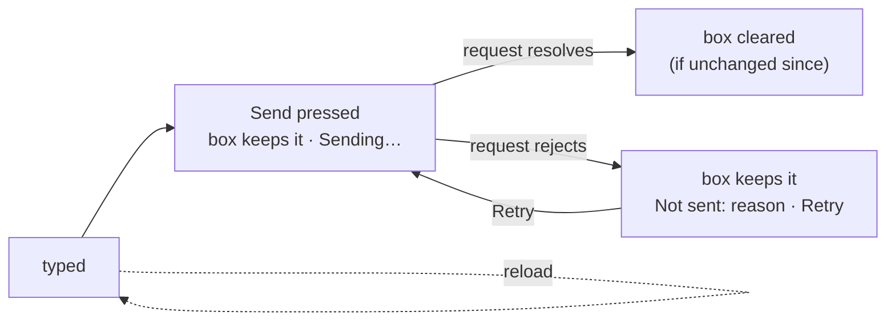

# FIX-2371 · A typed line is never lost to a failed send

**Spec** · [Decisions](DECISIONS.md)

## Who feels it, before and after

| Someone who… | Today | After |
|---|---|---|
| **sends a line in the Claude Code-style lab or Teammates, and the send fails** (a 401, a refusal, the server gone) | The box empties the moment they press Send. The send runs as `void adapter.send(...)`, so a rejection goes nowhere: the text is gone and nothing says why | The line stays in the box, marked *Sending…*, until the request lands. If it fails, the box still holds it and says **Not sent: \<reason\> · Retry**. Retry sends it again; editing it is just typing |
| **sends a line that lands** | The box empties at once and the line arrives from the server | The box empties when the send resolves, and only if they haven't typed something else since. The line arrives from the server, as today |
| **has a half-written line in Shift Manager when the page reloads** (`--dev` reloads on every save; an *Unreachable* swap remounts) | The draft is React state, so it is gone | The draft is back in the same box: a conversation's, a task's, or an Inbox reply's |
| **sent a line in Shift Manager that may have arrived, then reloads** (the *unconfirmed* state: no Retry, so it isn't sent twice) | The warning is gone with the reload, and the restored-empty box invites a second send | The draft and its warning both come back, so the reload doesn't turn into a double send |
| **reloads either lab mid-draft** (Vite reloads on save too) | Gone | Back, per session, the same way |
| **uses Kitchen Sink** | Drafts already survive a reload (`useSessionDraft`) | Unchanged to them. Its copy of the hook moves into `@flow-state-dev/react` and Kitchen Sink imports it; stored drafts keep their keys |

## The goal, and how we'll know it's met

**In every workforce app, text a person typed leaves the box only when the server has it: a
failed send keeps it with the reason and a Retry, and a reload brings an unsent draft back.**

- **Smaller, and rejected:** only stop clearing the box early in the two labs. That fixes the
  failure case and leaves Shift Manager's reload loss, which is the same lost text by another
  road, and the finding the review filed for it (SM-ROB-8).
- **Bigger, and not this issue's:** an optimistic *sending* line drawn in the conversation
  ([D2](DECISIONS.md#d2)). A line shown in the feed before the server stores it is FIX-2376's
  *queued* state and FIX-2374's session feed. A turn that was accepted and then failed is
  FIX-2370's inline failure. Lines sent from a task that vanish on reload are FIX-2422.
- **Not done if:** any of the four apps can lose typed text to a failed send or a reload, or
  Kitchen Sink keeps its own copy of the draft hook beside the lifted one.

The text is in the box until the server has it; a reload at any point before that brings it back.

**How we verify.**

- **Screen tests, both labs** (`labs/claude-code-style/test/screen.test.tsx`,
  `labs/teammates/test/screen.test.tsx`), on the fake adapter made to reject one send with a
  reason: the box still holds the line, the reason shows as *Not sent: …*, Retry sends it and the
  line lands once, and a send that succeeds clears the box unless the text changed meanwhile. A
  remount (the reload) restores an unsent draft for that session and only that session.
- **Shift Manager** (`packages/shift-manager/test/composer.test.tsx`): a remounted composer
  restores its draft per target, and an *unconfirmed* line comes back with its warning and no
  Retry.
- **The lifted hook** moves with Kitchen Sink's existing tests (`use-session-draft.test.tsx`) into
  `packages/react/test`, unchanged in what they assert, plus one that a draft stored under the
  old Kitchen Sink key is still read.
- **Control that must fail:** the same lab tests against today's composers, which clear before
  the send resolves. Run on the red state and recorded in the implementation PR, not argued.
- **Real host:** each lab against its real server, the server stopped mid-session, a line sent:
  the box keeps it and shows the reason; the server restarted, Retry lands it. Recorded with
  screenshots in the PR.

## What changes

- **`@flow-state-dev/react` gets the draft hook** Kitchen Sink already has, as `useDraft(namespace,
  id)` and `clearDraft(namespace, id)`: text kept in `localStorage` under the caller's
  namespace and id, read when the box opens ([D1](DECISIONS.md#d1)). No workforce noun; a draft
  is a box's text.
- **The two lab composers** keep the line until `onSend` resolves, show *Sending…* while it runs,
  and on a rejection keep it with *Not sent: \<reason\> · Retry*. Their callers pass the promise
  instead of `void`ing it. Teammates routes its composer through its own `useSubmit`, as the
  issue asks. Both store drafts per session through `useDraft`.
- **Shift Manager's `TurnComposer`** keeps its send states as they are, which already keep the
  draft until the session holds the line. It stores the draft through `useDraft`, keyed by the
  target each caller passes (a conversation's worker, a task, an ask), and stores an
  *unconfirmed* warning beside it until the next send.
- **Kitchen Sink** deletes `lib/use-session-draft.ts` and imports the hook (ER-3).
- **Docs:** `packages/react/README.md` documents `useDraft`; the Shift Manager README's `--dev`
  line notes that drafts survive the reload.

## What stays as it is

What a send does and where it goes; Shift Manager's send states and its *Retry only for a line
that never got there* rule; Kitchen Sink's composers and their request tracking; each lab's
adapter. The conversation feed draws only stored items.

## What's already here, and the debt

| Piece | What this does with it |
|---|---|
| Kitchen Sink's `useSessionDraft` (`apps/kitchen-sink/lib/use-session-draft.ts`) | **Lifted** into `@flow-state-dev/react` as `useDraft`, same behaviour, namespace now the caller's. Kitchen Sink's copy is deleted |
| Shift Manager's `useTurnSend` and `TurnSendStatus` | **Kept.** The labs' simpler states (*Sending…*, *Not sent · Retry*) match its wording; they don't import it, since it is Shift Manager's own send model |
| Teammates' `useSubmit` | **Reused** for its composer, as it already is for its forms |
| FIX-2370 (inline failed turn, ui registry), FIX-2376 (*queued* line), FIX-2374 (session feed) | **Left to them.** This change draws nothing in the feed |
| FIX-2372 (busy and failed states on mutation buttons, Claude Code-style lab) | **Beside it.** That issue covers the lab's buttons; this one its composer. If 2372 lands a shared helper first, the composer uses it |

**Adds:** one hook in `react` (moved, not new). **Removes:** Kitchen Sink's copy. **Debt:** a
Retry after a network error can send a line twice if the first did arrive; the labs show the
reason and the conversation, so the person can see it landed. The engine re-runs a reused
request id, so an idempotent Retry needs an engine change, not filed. **Net:** small.

## Sign off

**Approve by merging.** The one call is **where the draft hook lives** ([D1](DECISIONS.md#d1)):
in `@flow-state-dev/react`, shared by all four apps, rather than a copy in each. *If wrong:* it
is one small hook, and moving it back is an import change in four apps.

Improvement · labs, `shift-manager`, `react`, Kitchen Sink import · small · 1 PR · wave 0 of
FIX-2369, merges after FIX-2413 and before FIX-2390
