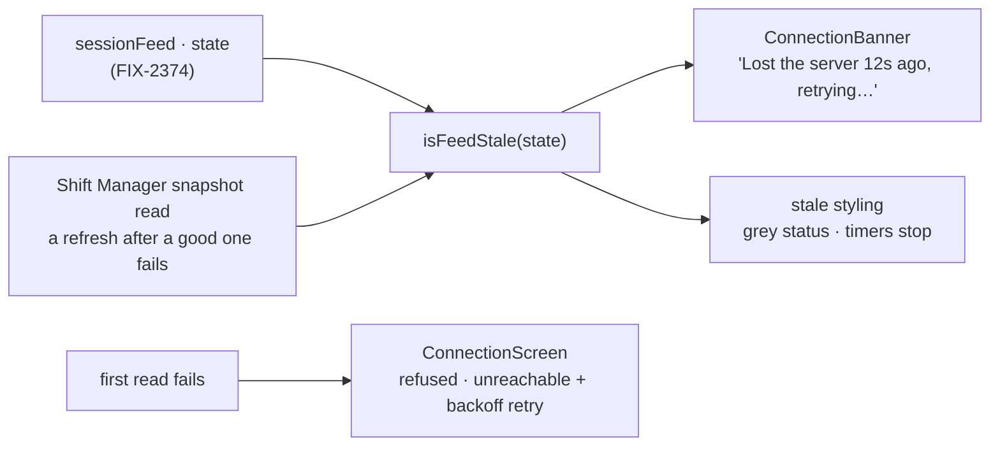

# FIX-2373 · Say when the server is gone, and stop drawing stale work as live

**Spec** · [Decisions](DECISIONS.md)

## Who feels it, before and after

| Someone who… | Today | After |
|---|---|---|
| **watches a turn in the Claude Code-style or Teammates lab when the server stops** | Running dots keep pulsing and "working · 3m" keeps counting. The only sign is a line in the browser console | A thin bar says "Lost the server 12s ago, retrying…". Status lines grey out and timers stop where the data stopped |
| **opens Teammates while its server is down** | A blank grid: the boot read has no catch | "Can't reach the lab", what the server answered, a Retry button, and a retry on its own with backoff |
| **works in Shift Manager when one refresh fails** | The whole shell swaps for the full-screen *couldn't reach* page. The route, the open task and any draft are gone | The shell stays with the last good snapshot. The bar says the server is gone. The full-screen page is for the first read only |
| **builds the next workforce app** | Copies Shift Manager's `Refusal` and `Unreachable` and writes a poll-failure counter | Installs `connection-banner` and `connection-screen` from the ui registry and passes the feed's `state` |

## The goal, and how we'll know it's met

**In all three apps, a developer can tell from the screen, without the console, that the server
is gone and that what they see is the last thing it said. The bar reads the session feed's own
`state` (FIX-2374), and one registry component draws it everywhere.**

- **Smaller, and rejected:** the registry components alone. Every app would still blank, freeze
  or pulse, which is the bug the person sees.
- **Bigger, and not this issue's:** moving any app onto `sessionFeed` (FIX-2374's wave-2 stacks),
  refreshing Shift Manager's snapshot on events, focus and age (FIX-2409), and push (FIX-2367).
- **Not done if:** a bar shows on a first load or on the server's ordinary 15-minute close; or a
  timer keeps counting while the bar is up; or any app keeps its own poll-failure counter as the
  health signal.

The bar and the stale styling read one boolean from one function. The full-screen page is only
for a first read, before there is anything to keep on screen.

**How we verify.**

- **Registry tests (new), `packages/ui/test/connection-banner.test.tsx`.** For each of the five
  feed states: nothing draws on `connecting`, `live` or `reconnecting`; the bar draws on `lapsed`
  and `stopped`; the age counts from when the feed left `live`, not from when the bar mounted.
  `connection-screen`: a refusal has no retry; an unreachable screen retries on its own at
  2, 4, 8… seconds, capped at 30, and on the button.
- **Shift Manager (new), in its test suite.** After a good read, a failed refresh keeps the
  shell, the route and a typed draft, and shows the bar; the next good read clears it.
- **Browser check, each app, against a real host.** Open a conversation with a running turn, stop
  the server: within a few seconds the bar shows and the timer stops. Start the server again: the
  bar goes and the timer moves. Teammates opened with the server down shows its screen, then the
  grid once the server starts.
- **Controls that must fail,** produced in the build PR: `isFeedStale` that counts `reconnecting`
  fails the "ordinary close draws nothing" case; Shift Manager's old swap to `Unreachable` on a
  later refresh fails the keep-the-draft case.

## What's already here, and the debt

| Already here | What this does with it |
|---|---|
| Shift Manager `App.tsx` `Refusal` and `Unreachable` | **Lifted** to the registry as `connection-screen`, the copy given by props. Shift Manager installs it and deletes its own two |
| Registry `stuck-request-banner.tsx` (a request that went silent) | **Left as it is.** It is about one request and offers Dismiss; the new bar is about the connection. They can show together |
| FIX-2374's `sessionFeed` `state`: `connecting · live · reconnecting · lapsed · stopped` | **Consumed** (epic ER-4). No second health signal |
| The labs' `useNow(active)`, Shift Manager's `Tasks.tsx` and `TaskFrame.tsx` clocks | **Built on:** each is gated on not stale, so it stops |
| The labs' `poll`/`every` helpers that log and keep the last value | **Left** for FIX-2367's task-board child, which turns them into the fallback. Session watching leaves them in FIX-2374's stacks |
| Shift Manager `lab-data.tsx` `refreshing`, exposed and unused | **Left.** The bar reads a failed refresh, not a running one |

**Net:** two registry components and one function added (`connection-banner`,
`connection-screen`, `isFeedStale`), Shift Manager's two screens removed in favour of one shared
copy, no change to any package's runtime code, and no new server route. It adds nothing an app
must keep in step by hand: the drift tests hold every installed copy to the registry.

**Builds in three PRs, in the epic's build order.** The registry slice goes from `main`: it
needs only the feed's state names. Shift Manager's part and each lab's part stack on FIX-2374's
adoption PR in that app, since the bar reads the feed the app adopts there (after FIX-2408 in
Shift Manager). See [D3](DECISIONS.md#d3).

---

Linear [FIX-2373](https://linear.app/fixpoint-labs/issue/FIX-2373) · epic
[FIX-2369](../../epics/FIX-2369/SPEC.md) · depends on
[FIX-2374](https://linear.app/fixpoint-labs/issue/FIX-2374) · drafted 2026-10-31 on `main` at
`675f614`.
