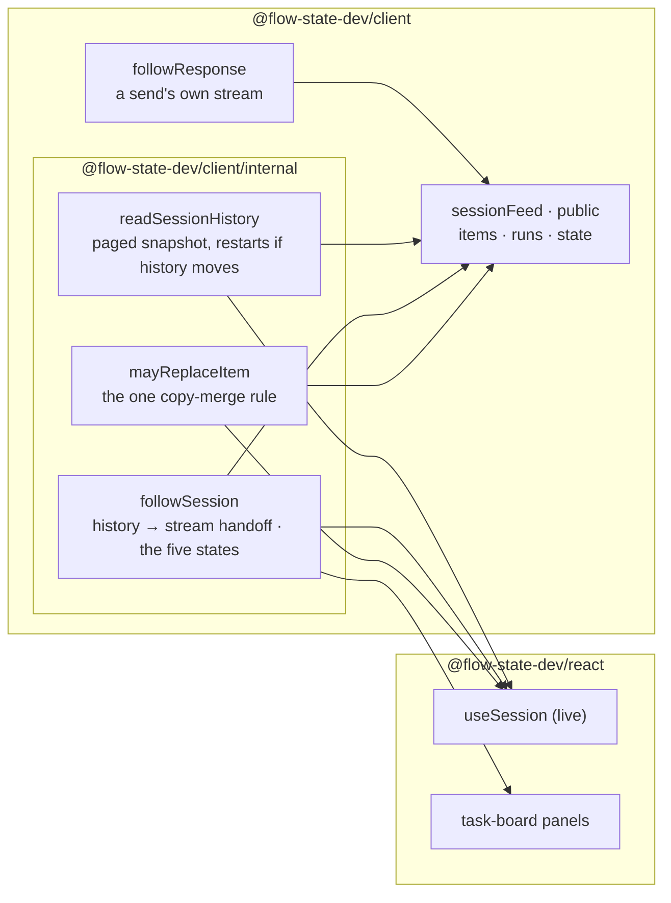

# FIX-2374 · A session feed any app can follow, without React

**Spec** · [Decisions](DECISIONS.md)

## Who feels it, before and after

| Someone who… | Today | After |
|---|---|---|
| **builds a workforce app that isn't a `useSession` chat** (the Teammates and Claude Code-style labs, Shift Manager) | Writes their own feed. Teammates has a 169-line `session-feed.ts` that hears items only; Claude Code-style re-reads every item every 1.5–3s; Shift Manager polls every 2–5s | Calls `sessionFeed(client, sessionId)` and gets items, the session's live runs, and whether the feed is live, from one connection |
| **watches a session whose server restarts or drops** | Teammates' feed goes quiet with no signal; Shift Manager's task tab blanks | The feed says `reconnecting`, then `lapsed` once a retry fails, and goes back to `live` by itself when a connection names the runs again. `stopped` means it will not come back. These five states are the client's one connection vocabulary ([D2](DECISIONS.md#d2)) |
| **sends a turn and wants its answer as it is written** | Each app hand-rolls the send-response merge | `feed.followResponse(response)` keeps the answer growing in place until the session stream carries the finished copy |
| **uses `useSession({ live: true })` or the task-board panels** | Unchanged | Unchanged, `childSessionsStale` included. They follow the session through the same client code the feed uses, imported from an internal subpath |
| **builds on a later slice** (FIX-2410, FIX-2373, the labs' wave-2 stacks) | Nothing to build on | One exported feed and one state vocabulary to read |

## The goal, and how we'll know it's met

**Any app can follow a session's items, its live runs and the health of that connection from
`@flow-state-dev/client`, with no React, and `useSession` follows sessions through the same code.**

- **Smaller, and rejected:** export `followSession` as it is. Apps would still each write the
  snapshot paging, the copy-merge rule and the send-response follow, which is most of
  Teammates' file.
- **Bigger, and not this issue's:** moving the labs and Shift Manager onto the feed (wave 2,
  stacked after this merges: `2374 → 2375 → 2376` in each lab, and Shift Manager's stack), the
  connection banner (FIX-2373), and change notices for lists, which come through FIX-2367's
  `client.subscribe` (epic D2). This slice touches no app file (the epic's wave-1 rule).
- **Not done if:** a feed can sit on a dead connection and still say `live`; or a partial copy
  from a send's response can replace a finished one; or `useSession`'s live tests need to change
  to pass; or an app has a second public way to follow a session beside `sessionFeed` (epic ER-4).

The three pieces `useSession` already has move down into the client, behind an internal subpath
that `@flow-state-dev/react` imports, and the feed is built from them. `sessionFeed` is the only
public way to follow a session. `useSession` keeps its own join because it carries rules a feed
doesn't need (optimistic user messages, stop records, state and resource merges), and it keeps
reading the stream as one flag, `childSessionsStale`, derived from the same five states; see
[D1](DECISIONS.md#d1).

**How we verify.**

- **Real host (new), `packages/node/test/session-feed.test.ts`.** A `serve()` host with a small
  flow. A feed opened by one client reads the history, reads `live` once the stream names the
  session's runs, hears a turn a second client sends, keeps its own send through
  `followResponse`, and reads `reconnecting` and then `lapsed` when the host closes. Starting the
  host again on the same port brings it back to `live`. (A run here is background work under the
  session; the stream names an empty list for a session with none.)
- **Client unit tests (new), `packages/client/test/session-feed.test.ts`**, against a scripted
  fetch: an answer growing in place through `followResponse` and a late partial copy never
  replacing the finished one, `stopped` on a 404, a failed history read retried, `close()`. The
  paged read keeps `useSession`'s existing tests for history that moves.
- **Control that must fail:** each check's red state is produced in the build PR, not argued:
  the feed with its lapse mapping removed fails the restart case; the feed with `mayReplaceItem`
  replaced by "last copy wins" fails the partial-copy case.
- **Parity:** `useSession-live.test.ts`, `board-list.test.ts` and the rest of the react suite
  pass unchanged, and they reach the moved code (they import nothing from the old internal file).

## What's already here, and the debt

| Already here | What this does with it |
|---|---|
| `followSession` in `@flow-state-dev/react` `src/internal/followSession.ts` | **Moves** to the client's internal subpath. The stream, backoff and stop behaviour are unchanged; it now computes the five states (`onConnection`), and `onLapsed` is read off them. It takes the history read's `at` and `sessionCreatedAt` as one `after` value, so the history→stream handoff lives in one place. Its `coalescedReads` neighbour stays in react, the panels' only user, under its own file name |
| `useSession`'s paged snapshot read (`readPages`, the overlap check, 5 attempts, 100 a page) | **Moves** to the client's internal subpath as `readSessionHistory`, with the same restarts and page size; `useSession` calls it. A read that moved 5 times, or failed, throws: what to do next is the caller's ([E4](DECISIONS.md#decided-not-asked)) |
| `useSession`'s `mayReplace` | **Moves** to the client's internal subpath as `mayReplaceItem`; `useSession` and the feed both use it |
| `sessions.stream()`: backoff, `since` on reconnect, `onStop` on 401/403/404/409/501 | **Builds on**, unchanged |
| `createRequestStreamStore` + `bindStoreToCallbacks` + `createSSEClientFromResponse` | **Builds on** for `followResponse`, as Teammates does today |
| Teammates `session-feed.ts` (its own paging, merge rule and a raw `sessions.stream` with no connection health), Claude Code-style `watchThread`/`watchTaskWork`, Shift Manager's session re-reads | **Left for wave 2.** This thread ships one adoption PR per app after this merges, and each deletes the app's copy (ER-3). The task-board polls stay FIX-2367's task-board child's |
| FIX-2367's delivery child, which also names a `followSession` lift | **This issue owns the lift.** That child is not filed yet, so it builds on this `followSession` and its five states, and adds no states of its own |

**Net:** one public export added to the client (`sessionFeed`, with its snapshot and state
types), an internal subpath holding three pieces moved down from react rather than copied, no
new server route, and no app change. The debt this creates until wave 2 lands is the three app feeds still standing
beside the shared one.
