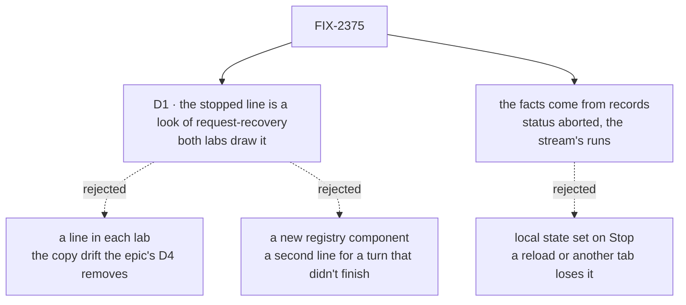

# FIX-2375 · Decisions

[Spec](SPEC.md) · **Decisions**

One decision shapes the outcome, and the epic already made it as an engineering rule. The rest
was decided without asking and is recorded so nobody re-derives it.

## The tree

Solid edges are what you're signing. Dashed edges lost, and the label says why.

## D1 · The stopped line is a look of the registry's `request-recovery` · engineering, decided

| | |
|---|---|
| **Instead of** | Each lab drawing its own line (the Claude Code-style lab already has one in `Entry.tsx`), or a new registry component beside `request-recovery` |
| **Because** | Two labs need the same line, and the epic's [D4](../../epics/FIX-2369/DECISIONS.md#d4) sends UI two apps need to the registry. Its reason is this exact case: the review found the failed-turn line in one app and nothing in two others. [ER-4](../../epics/FIX-2369/DECISIONS.md#who-owns-what) names `request-recovery` as the one artifact for a turn that didn't finish, and FIX-2377 already extended it once. A second component would be a second line for the same job |
| **Locks in** | `request-recovery` takes `stopped`, with optional `stillRunning` (a count) and `onView`. The look is quiet: `role="status"`, no button, muted. A later app drawing a stopped turn uses this look |

**What would change my mind:** a stopped turn needing an action of its own, say *run it again*.
The server retries only a failed or cut-off request, so there is none today. If one arrives it is a
button on this same look.

## Decided, not asked

- **The copy.** *Stopping…*, then *Interrupted by you*, then *N background task(s) still
  running · View*. *Interrupted* is the issue's word, and the one Shift Manager and FIX-2413 already
  use for an aborted run. A turn a restart cut off reads *cut off* (FIX-2377), so the two don't
  blur. *By you* holds because only the request's own user can abort it (the abort route answers
  404 to anyone else). A cut-off turn you Discard (FIX-2377) also ends `aborted`, and reads the same:
  you ended it.
- **Where the line sits.** After the last entry of the aborted request. A request with no entry in
  the loaded window gets no line; there is nowhere true to put it.
- **The count shows on the newest stopped line only, and only while no later turn has started.** An
  old line saying *2 still running* about work started since would be false. The count is the
  session's unfinished runs, whichever turn started them. `runs` is `null` until the stream has
  named them, and then no clause shows: unknown is not zero.
- **Where each fact comes from.** The turn's state comes from the session's request records,
  through the one request read each adapter already makes on request notices. The Claude Code-style
  adapter's read widens from running turns to recent turns of its `TURN_ACTIONS`, so `aborted` is
  in it. Teammates' read already lists every status. The count comes from `sessionFeed`'s `runs`.
  Those are child sessions, never the session's own turns, as the Claude Code-style adapter's own
  comment says (`adapter.ts`, `watchThread`). Task runs are child sessions of the session that
  dispatched them (`engine/src/context/dispatch-run.ts`, `parentSessionId`); the browser pass
  confirms that each lab's tasks show up in the count.
- **Seam with FIX-2376.** It stacks on this one in both adapters and marks a line *queued*. It reads
  the same request read this spec widens. It does not add a second one, and it does not take turn
  state from the feed's `runs`, which carry background work only. If FIX-2376's spec says
  otherwise, that spec moves, not this one.
- **Seam with FIX-2370 and FIX-2377's lab slices.** They come later in each lab's stack 2 and add
  their lines to the same entry mapping and the same request read, with `request-recovery` already
  installed by this slice.
- **What Stop aborts.** In Teammates, each answering request in the conversation that is in
  progress: everything but `dispatch` (its `QUIET_ACTIONS`), which is what its *working* line
  already counts. Stop stops exactly what *working* shows. A turn parked on an approval is not
  running and has no Stop; its card's Reject answers it.
- **Stopping and its end.** The adapter holds `stopping` from the `interrupt` call until the
  request read shows the turn ended. A 409 from abort means the turn already ended, and counts as
  done. Any other refusal clears `stopping` and is shown beside the button. The Stop button is
  disabled while stopping.
- **Teammates' keys.** `useInterruptKeys` on the document, enabled while the worker answers, as the
  other lab's `Thread.tsx` has it. The session popup's own Esc listener prevents the default, so
  closing it never arms a stop.
- **Order.** The registry slice first (epic D3), then each lab's slice on its adapter stack 1, after
  FIX-2374 (done). The adapter tests use FIX-2406's in-process host harness from the start (its D1),
  so FIX-2406 folds them into its matrix as the *stop* scenario instead of replacing a second harness.
- **The test fakes follow.** Each lab's `test/fake-lab.ts` draws what the real adapter now draws.
  The goal check never reads them.

## Considered and dropped

| Alternative | Why not |
|---|---|
| Set the stopped line locally when Stop is pressed, as `useSession` does | A reload or a second tab loses it. And it would claim a stop the server may have refused |
| Show *Stopping…* until the background runs finish too | Before FIX-2202 they don't stop, so it would never clear. *Stopping* ends with the turn; the runs get their own clause |
| A *Stop everything* button that also cancels the turn's tasks | Cancels work a person may want. Each task already has Cancel on its row, and making Stop own delegated work is FIX-2202's |
| Bind a single Esc to Stop in Teammates, as the issue asked | FIX-2413, done since the issue was written, rules a bare Esc out for every stop |
| A client helper that lists a session's stopped turns | Two labs filtering a list by one status is a line each. Nothing for a package to own |

## Analysis

Skipped here, as a spec-set member: the epic agent runs `analysis` and `reuse-review` over the set.

## How it got here

- **Draft (2026-11-04)** — written against `main` after FIX-2374, FIX-2377 and FIX-2413 merged.
  The issue's lab-only scope gained a registry look by the epic's D4, its single Esc gave way to
  FIX-2413's gesture, and the fixed *keep running* text became a live count so FIX-2202 can land on
  either side.

**Open: none.**
